# HỌC VIỆN CHÍNH TRỊ QUỐC GIA HỒ CHÍ MINH

## HỌC VIỆN HÀNH CHÍNH VÀ QUẢN TRỊ CÔNG

*(Hoặc cơ quan đào tạo: BỘ GIÁO DỤC VÀ ĐÀO TẠO - TRƯỜNG ĐẠI HỌC CÔNG NGHỆ)*


---


# BÀI TẬP LỚN / BÀI TIỂU LUẬN KẾT THÚC HỌC PHẦN


### TÊN ĐỀ TÀI:

# XÂY DỰNG HỆ THỐNG THƯƠNG MẠI ĐIỆN TỬ VÀ BÁN LẺ MỸ PHẨM ĐA KÊNH OMNICHANNEL BEAUTY DỰA TRÊN NỀN TẢNG .NET 8 VÀ CLEAN ARCHITECTURE


**Học phần:** Phát triển Ứng dụng Web Đa nền tảng / Hệ thống Thông tin Doanh nghiệp  


| Mã phách: ........................................ (Để trống) |

| :--- |


### Hà Nội – 2026


---


## PHIẾU LÀM PHÁCH HÌNH THỨC THI BÀI TẬP LỚN / TIỂU LUẬN

*(Phiếu này bằng 1/2 tờ giấy A4 in rời, kẹp giữa Bìa 1 và trang đầu tiên của bài thi hoặc giữa giấy bóng kính với Bìa 1)*


| MÃ PHÁCH: ........................................ (Do Ban làm phách ghi) |

| :--- |


**Họ và tên:** ........................................................................ **Ngày sinh:** ......./......./...........  

**Mã SV:** ............................................................................ **Lớp:** .................................  

**Ngành đào tạo:** Hệ thống Thông tin / Kỹ thuật Phần mềm  

**Tên Tiểu luận / Bài tập lớn:** XÂY DỰNG HỆ THỐNG THƯƠNG MẠI ĐIỆN TỬ VÀ BÁN LẺ MỸ PHẨM ĐA KÊNH OMNICHANNEL BEAUTY DỰA TRÊN NỀN TẢNG .NET 8 VÀ CLEAN ARCHITECTURE  

**Học phần:** Phát triển Ứng dụng Web Đa nền tảng / Hệ thống Thông tin Doanh nghiệp  

**Giảng viên phụ trách:** .............................................................................................  


*Hà Nội, ngày ..... tháng ..... năm 2026*  

**Sinh viên ký và ghi rõ họ tên**  

*(Ký và ghi rõ họ tên vào phiếu này)*


---


## LỜI CAM ĐOAN


Người thực hiện bài tập lớn/tiểu luận xin cam đoan đề tài **"Xây dựng hệ thống thương mại điện tử và bán lẻ mỹ phẩm đa kênh Omnichannel Beauty dựa trên nền tảng .NET 8 và Clean Architecture"** là công trình nghiên cứu khoa học và phát triển phần mềm độc lập, được triển khai dưới sự định hướng chuyên môn của Giảng viên phụ trách học phần.


Toàn bộ các số liệu khảo sát nghiệp vụ, sơ đồ thiết kế kiến trúc, cấu trúc cơ sở dữ liệu quan hệ và mã nguồn chương trình được trình bày trong bài tập lớn này là hoàn toàn trung thực, phản ánh chính xác kết quả xây dựng hệ thống thực tế tại giải pháp `OmnichannelBeautySolution`. Các tài liệu tham khảo, nghiên cứu lý thuyết kế thừa từ các tác giả và tổ chức chuyên môn đều được trích dẫn nguồn gốc rõ ràng và đầy đủ theo quy định học thuật.


Người thực hiện xin chịu hoàn toàn trách nhiệm trước Phòng Khảo thí và Bảo đảm chất lượng cùng Hội đồng chấm thi về tính trung thực của lời cam đoan này.


*Hà Nội, năm 2026*  

**Người cam đoan**  

*(Không ký tên và không ghi thông tin cá nhân để đảm bảo tính bảo mật bài thi theo Phụ lục 05)*


---


## LỜI CẢM ƠN


Để hoàn thành bài tập lớn kết thúc học phần này, lời đầu tiên người thực hiện xin bày tỏ lòng biết ơn sâu sắc và chân thành nhất tới quý Thầy, Cô giáo trong bộ môn, những người đã tận tâm truyền đạt những tri thức quý báu về phân tích thiết kế hệ thống thông tin, cơ sở dữ liệu nâng cao và kiến trúc phần mềm hiện đại trong suốt quá trình học tập.


Đặc biệt, người thực hiện xin gửi lời cảm ơn sâu sắc nhất tới Giảng viên phụ trách học phần. Thầy/Cô đã dành nhiều thời gian quý báu để định hướng đề tài, tận tình chỉ bảo, đóng góp những ý kiến chuyên môn sâu sắc về cả mặt nghiệp vụ bán lẻ thực tế lẫn kiến trúc kỹ thuật Clean Architecture để hệ thống được hoàn thiện một cách trọn vẹn nhất.


Mặc dù đã dành nhiều tâm huyết và nỗ lực tối đa để hoàn thiện đề tài, song do giới hạn về mặt thời gian và kinh nghiệm thực tế, bài tập lớn khó tránh khỏi những thiếu sót nhất định. Người thực hiện rất mong nhận được những lời nhận xét, chỉ bảo và đóng góp quý báu từ quý Thầy, Cô cán bộ chấm thi để hệ thống được tiếp tục phát triển và hoàn thiện hơn nữa trong tương lai.


*Người thực hiện*  

*(Không ghi họ tên để đảm bảo tính bảo mật bài thi)*


---


## DANH MỤC THUẬT NGỮ VÀ TỪ VIẾT TẮT


| STT | Từ Viết Tắt | Thuật Ngữ Tiếng Anh & Giải Nghĩa Tiếng Việt |

| :---: | :--- | :--- |

| 1 | **3NF** | **Third Normal Form**: Dạng chuẩn thứ ba trong chuẩn hóa cơ sở dữ liệu quan hệ, triệt tiêu phụ thuộc hàm bắc cầu. |

| 2 | **ACID** | **Atomicity, Consistency, Isolation, Durability**: Bốn thuộc tính bảo đảm tính toàn vẹn và tin cậy của giao dịch dữ liệu. |

| 3 | **API** | **Application Programming Interface**: Giao diện lập trình ứng dụng, phương thức kết nối và trao đổi dữ liệu giữa các hệ thống phần mềm. |

| 4 | **BCE** | **Boundary - Control - Entity**: Mô hình phân tích kiến trúc hướng đối tượng, phân định giữa lớp Biên, Điều khiển và Thực thể. |

| 5 | **BOPIS** | **Buy Online, Pick Up In Store**: Mô hình mua sắm đa kênh cho phép khách hàng đặt hàng trên mạng và trực tiếp tới cửa hàng nhận hàng. |

| 6 | **CFD** | **Customer Facing Display**: Màn hình hiển thị phụ đặt tại quầy thu ngân hướng về phía khách hàng để xem giỏ hàng và quét mã thanh toán. |

| 7 | **COD** | **Cash on Delivery**: Hình thức giao hàng và thu tiền hộ bằng tiền mặt trực tiếp tại địa chỉ của khách hàng. |

| 8 | **COGS** | **Cost of Goods Sold**: Giá vốn hàng bán, tổng giá trị chi phí trực tiếp phát sinh để tạo ra hoặc nhập khẩu sản phẩm đã bán. |

| 9 | **CQRS** | **Command Query Responsibility Segregation**: Mẫu kiến trúc tách biệt rõ ràng giữa thao tác ghi (Command) và thao tác đọc (Query). |

| 10 | **DIP** | **Dependency Inversion Principle**: Nguyên lý đảo ngược phụ thuộc, quy định các module cấp cao không được phụ thuộc trực tiếp vào module cấp thấp. |

| 11 | **DTO** | **Data Transfer Object**: Đối tượng truyền tải dữ liệu, cấu trúc lớp đóng gói dữ liệu trung gian giữa các tầng phần mềm. |

| 12 | **EAN-13** | **European Article Number 13**: Chuẩn mã vạch thương mại quốc tế gồm 13 chữ số in trên bao bì sản phẩm bán lẻ. |

| 13 | **EF Core** | **Entity Framework Core**: Bộ công cụ ánh xạ đối tượng quan hệ (ORM) hiệu năng cao chính thức của Microsoft cho nền tảng .NET. |

| 14 | **FEFO** | **First-Expired, First-Out**: Nguyên tắc quản lý kho ưu tiên xuất trước đối với các lô hàng có hạn sử dụng gần nhất. |

| 15 | **FIFO** | **First-In, First-Out**: Nguyên tắc quản lý kho nhập trước xuất trước truyền thống theo thời gian tiếp nhận hàng vào kho. |

| 16 | **ORM** | **Object-Relational Mapping**: Kỹ thuật ánh xạ giữa các bảng dữ liệu trong CSDL quan hệ với các lớp đối tượng trong mã nguồn lập trình. |

| 17 | **P&L** | **Profit and Loss Statement**: Báo cáo kết quả hoạt động kinh doanh lãi và lỗ, phản ánh doanh thu, chi phí và lợi nhuận ròng. |

| 18 | **PAO** | **Period After Opening**: Thời hạn sử dụng an toàn của mỹ phẩm sau khi mở nắp niêm phong lần đầu tiên (ký hiệu 6M, 12M, 24M). |

| 19 | **PBAC** | **Permission-Based Access Control**: Mô hình kiểm soát truy cập dựa trên quyền hạn hạt nhân, phân quyền chi tiết tới từng hành vi nghiệp vụ. |

| 20 | **POS** | **Point of Sale**: Điểm bán lẻ trực tiếp, hệ thống phần cứng và phần mềm phục vụ tính tiền, in hóa đơn tại quầy thu ngân. |

| 21 | **SEO** | **Search Engine Optimization**: Tối ưu hóa công cụ tìm kiếm, tập hợp các phương pháp nâng cao thứ hạng hiển thị của website. |

| 22 | **SKU** | **Stock Keeping Unit**: Đơn vị lưu kho, mã định danh phân loại duy nhất cho từng mặt hàng và từng biến thể sản phẩm. |

| 23 | **SLA** | **Service Level Agreement**: Cam kết chất lượng dịch vụ, quy định ngưỡng thời gian tối đa để xử lý đơn hàng và phản hồi kỹ thuật. |

| 24 | **UI/UX** | **User Interface / User Experience**: Giao diện người dùng và Trải nghiệm người dùng trong thiết kế tương tác phần mềm. |

| 25 | **WASM** | **WebAssembly**: Chuẩn định dạng mã nhị phân cho phép thực thi mã hiệu năng cao gần như mã máy trực tiếp trong trình duyệt web. |


---


## MỤC LỤC TỔNG THỂ


- **LỜI CAM ĐOAN**

- **LỜI CẢM ƠN**

- **DANH MỤC THUẬT NGỮ VÀ TỪ VIẾT TẮT**

- **LỜI MỞ ĐẦU**

  - 1. Tính cấp thiết của đề tài nghiên cứu

  - 2. Các khó khăn và bài toán nghiệp vụ đặc thù của ngành kinh doanh mỹ phẩm

  - 3. Mục tiêu và đối tượng nghiên cứu của đề tài

  - 4. Phạm vi nghiên cứu và phương pháp tiếp cận

  - 5. Bố cục tổng thể của bài tập lớn

- **CHƯƠNG I: TỔNG QUAN BÀI TOÁN BÁN LẺ MỸ PHẨM ĐA KÊNH VÀ CƠ SỞ LÝ THUYẾT**

  - 1.1. Thực trạng quản lý kinh doanh mỹ phẩm và xu hướng bán lẻ hợp kênh

    - 1.1.1. Phân biệt bản chất giữa mô hình bán lẻ đa kênh phân mảnh và bán lẻ hợp kênh

    - 1.1.2. Xu hướng tiêu dùng mỹ phẩm hiện đại tại thị trường Việt Nam

  - 1.2. Các bài toán nghiệp vụ đặc thù cần giải quyết

    - 1.2.1. Quản trị kho theo lô sản xuất và giải thuật xuất kho ưu tiên theo hạn sử dụng (Hết hạn trước - Xuất trước)

    - 1.2.2. Kiểm soát dòng tiền, ca kíp bán hàng và chống gian lận két tiền thu ngân tại quầy bán lẻ trực tiếp

    - 1.2.3. Cá nhân hóa trải nghiệm khách hàng dựa trên khoa học da liễu và kiểm tra tương kỵ hoạt chất

  - 1.3. Tổng quan công nghệ nền tảng được lựa chọn

    - 1.3.1. Nền tảng .NET 8 (ngôn ngữ C# 12) và kiến trúc Clean Architecture bốn tầng

    - 1.3.2. Cơ sở dữ liệu Microsoft SQL Server và công cụ ánh xạ đối tượng Entity Framework Core 8

    - 1.3.3. Công nghệ truyền thông thời gian thực SignalR Core và định tuyến động tối ưu hóa công cụ tìm kiếm

    - 1.3.4. Mô hình tương tác hiện đại không phình to mã nguồn với thư viện HTMX và Alpine.js

  - 1.4. Đánh giá, so sánh và luận chứng giải pháp công nghệ đã chọn

- **CHƯƠNG II: PHÂN TÍCH YÊU CẦU NGHIỆP VỤ VÀ MÔ HÌNH HÓA HỆ THỐNG**

  - 2.1. Khảo sát hiện trạng và quy trình nghiệp vụ tổng thể

    - 2.1.1. Mô hình vận hành thực tế của chuỗi bán lẻ Canmake Beauty

    - 2.1.2. Luồng vận hành hàng hóa và dữ liệu từ đầu vào đến đầu ra

  - 2.2. Phân tích yêu cầu chức năng (Mười bảy phân hệ nghiệp vụ)

    - 1. Phân hệ Quản lý Điểm bán lẻ trực tiếp và Ca làm việc (Point of Sale)

    - 2. Phân hệ Quản trị Kho Dược mỹ phẩm và Giám sát Hạn dùng theo nguyên tắc Hết hạn trước - Xuất trước

    - 3. Phân hệ Quản lý Đặt hàng Đa kênh và Cấp phát Kho hai giai đoạn

    - 4. Phân hệ Điều chuyển Kho Liên Chi nhánh

    - 5. Phân hệ Quản trị Quan hệ Khách hàng và Hồ sơ Da liễu Chuyên sâu

    - 6. Phân hệ Chương trình Thành viên và Ví điểm Thưởng

    - 7. Phân hệ Động cơ Khuyến mãi Chiến dịch và Mã Giảm giá

    - 8. Phân hệ Kế toán Sổ cái và Quản lý Tài chính Chi nhánh

    - 9. Phân hệ Bảo mật Động và Phân quyền Hạt nhân dựa trên Quyền hạn chi tiết

    - 10. Phân hệ Trợ lý Trí tuệ Nhân tạo và Kiểm tra Tương kỵ Hoạt chất Mỹ phẩm

    - 11. Phân hệ Quản trị Danh mục và Sản phẩm Cốt lõi

    - 12. Phân hệ Quản trị Cây Menu Đa hình và Điều hướng Tối ưu Công cụ Tìm kiếm

    - 13. Phân hệ Quản trị Nội dung và Cẩm nang Làm đẹp

    - 14. Phân hệ Banner và Chiến dịch Truyền thông

    - 15. Phân hệ Kiểm duyệt Đánh giá và Mẫu thử Thực tế

    - 16. Phân hệ Giám sát Tự động và Cảnh báo Vận hành Thông minh

    - 17. Phân hệ Thông báo Đẩy và Hộp thư Điều hành Nội bộ Thời gian thực

  - 2.3. Phân tích yêu cầu phi chức năng

  - 2.4. Mô hình hóa Ca sử dụng (Use Case)

    - 2.4.1. Bảng phân vai tác nhân hệ thống

    - 2.4.2. Đặc tả chi tiết các Ca sử dụng trọng yếu

- **CHƯƠNG III: PHÂN TÍCH THIẾT KẾ HƯỚNG ĐỐI TƯỢNG VÀ CƠ SỞ DỮ LIỆU**

  - 3.1. Thiết kế Kiến trúc Phần mềm tổng thể

    - 3.1.1. Kiến trúc Clean Architecture bốn tầng và nguyên lý Đảo ngược Phụ thuộc

    - 3.1.2. Thiết kế theo mô hình Phân tích Boundary - Control - Entity

    - 3.1.3. Chuỗi Xử lý Đường ống HTTP Request Pipeline trong Program.cs

  - 3.2. Thiết kế Cơ sở Dữ liệu Quan hệ chuẩn hóa Dạng chuẩn 3

    - 3.2.1. Phân tích và Chứng minh Chuẩn hóa Dữ liệu Dạng chuẩn 3

    - 3.2.2. Bảng Từ điển Dữ liệu Chi tiết cho Tám Bảng Cốt lõi của Hệ thống

  - 3.3. Thiết kế Tương tác Hành vi (Biểu đồ Tuần tự)

    - 3.3.1. Sơ đồ tuần tự 01: Luồng phân giải quyền động ba tầng khi gửi yêu cầu HTTP

    - 3.3.2. Sơ đồ tuần tự 02: Luồng đặt hàng trực tuyến và trừ kho hai giai đoạn theo hạn dùng

    - 3.3.3. Sơ đồ tuần tự 03: Luồng vòng đời ca làm việc thu ngân và kiểm toán két tiền

    - 3.3.4. Sơ đồ tuần tự 04: Luồng điều chuyển kho liên chi nhánh ba bước bảo toàn tồn kho

- **CHƯƠNG IV: HIỆN THỰC HÓA VÀ CÀI ĐẶT HỆ THỐNG**

  - 4.1. Môi trường triển khai và cấu trúc mã nguồn giải pháp

  - 4.2. Hiện thực hóa các Giao diện chức năng tiêu biểu

  - 4.3. Hiện thực hóa các Thuật toán và Module Kỹ thuật cốt lõi

- **CHƯƠNG V: KIỂM THỬ VÀ ĐÁNH GIÁ HỆ THỐNG**

  - 5.1. Chiến lược Kiểm thử phần mềm

  - 5.2. Danh mục và Kết quả thực thi Hai mươi mốt Bộ Kiểm thử Tự động

  - 5.3. Kiểm thử hiệu năng và khả năng chịu tải đồng thời bằng công cụ k6

  - 5.4. Đánh giá Mức độ Hoàn thiện và An toàn Hệ thống

- **KẾT LUẬN VÀ HƯỚNG PHÁT TRIỂN**

  - 1. Kết luận

  - 2. Định hướng phát triển hệ thống

- **DANH MỤC TÀI LIỆU THAM KHẢO**

- **PHIẾU CHẤM ĐIỂM HÌNH THỨC THI BÀI TẬP LỚN / TIỂU LUẬN**


---


# LỜI MỞ ĐẦU


### 1. Tính cấp thiết của đề tài nghiên cứu

Trong những năm gần đây, thị trường hóa mỹ phẩm và chăm sóc cá nhân tại Việt Nam chứng kiến tốc độ tăng trưởng vượt bậc nhờ vào sự nâng cao trong nhận thức làm đẹp cùng mức thu nhập khả dụng của người tiêu dùng. Cùng với sự chuyển dịch này, hành vi mua sắm của khách hàng không còn giới hạn ở các cửa hàng vật lý truyền thống mà đã phân tán trên nhiều kênh khác nhau, từ các sàn thương mại điện tử, mạng xã hội cho đến các ứng dụng mua sắm trên thiết bị di động. Khách hàng ngày càng có xu hướng tìm hiểu kỹ lưỡng thông tin, bảng thành phần hoạt chất trên website trước khi đến trải nghiệm trực tiếp tại showroom, hoặc ngược lại, thử mẫu sản phẩm tại quầy bán lẻ nhưng lại đặt giao hàng tận nhà. 


Tuy nhiên, phần lớn các doanh nghiệp bán lẻ mỹ phẩm hiện nay vẫn đang vận hành theo mô hình bán lẻ đa kênh phân mảnh (Multi-channel Retail). Ở mô hình này, kênh trực tuyến và các cửa hàng vật lý hoạt động như những thực thể độc lập, sử dụng các phần mềm quản lý riêng biệt dẫn đến sự chia cắt về dữ liệu. Tình trạng này khiến khách hàng không có được trải nghiệm nhất quán khi quyền lợi thành viên, điểm thưởng tích lũy hay các chương trình khuyến mãi không thể sử dụng xuyên suốt giữa các điểm chạm. Xuất phát từ nhu cầu thực tiễn đó, việc chuyển đổi sang mô hình bán lẻ hợp kênh liền mạch (Omnichannel Retail), nơi toàn bộ dữ liệu về sản phẩm, tồn kho, đơn hàng và khách hàng được đồng bộ trên một nền tảng quản trị tập trung duy nhất, đã trở thành yêu cầu sống còn cho các doanh nghiệp bán lẻ mỹ phẩm.


### 2. Các khó khăn và bài toán nghiệp vụ đặc thù của ngành kinh doanh mỹ phẩm

Khác với các ngành hàng tiêu dùng thông thường hay thời trang, ngành bán lẻ mỹ phẩm mang những đặc thù quản trị vô cùng phức tạp và tiềm ẩn nhiều rủi ro vận hành:


Thứ nhất là bài toán quản trị hạn sử dụng và lô sản xuất. Mỹ phẩm là sản phẩm tiếp xúc trực tiếp lên da và cơ thể người nên có yêu cầu pháp lý và kỹ thuật khắt khe về thời hạn sử dụng. Một sản phẩm thông thường có thời hạn bảo quản từ hai đến ba năm, nhưng thời hạn sử dụng an toàn sau khi mở nắp niêm phong lần đầu tiên (Period After Opening - PAO) chỉ kéo dài từ sáu đến mười hai tháng. Nếu chỉ áp dụng nguyên tắc nhập trước xuất trước thông thường, doanh nghiệp rất dễ rơi vào tình trạng các lô hàng nhập sau nhưng có hạn dùng ngắn hơn bị lưu kho quá lâu, dẫn đến việc phải xuất hủy khi hết hạn. Trong ngành mỹ phẩm, việc tiêu hủy một lô hàng cận hạn sử dụng đồng nghĩa với việc mất toàn bộ giá vốn cùng chi phí xử lý chất thải theo quy định môi trường.


Thứ hai là bài toán đồng bộ tồn kho và chống bán khống vượt tồn. Khi cùng một sản phẩm được mở bán đồng thời trên website và tại nhiều quầy thu ngân của chuỗi showroom, việc thiếu cơ chế đồng bộ theo thời gian thực sẽ dẫn đến hiện tượng bán vượt quá lượng tồn kho khả dụng. Tình trạng hai khách hàng cùng thanh toán cho một sản phẩm cuối cùng tại cùng một thời điểm không chỉ gây thất thoát uy tín thương hiệu mà còn làm phát sinh chi phí bồi thường và khiếu nại.


Thứ ba là bài toán thất thoát dòng tiền tại điểm bán lẻ trực tiếp (Point of Sale - POS). Tại các showroom, giao dịch tiền mặt vẫn chiếm tỷ trọng đáng kể. Nếu phần mềm thu ngân không có cơ chế quản lý chặt chẽ vòng đời ca làm việc, đối soát số dư tiền mặt đầu ca, các giao dịch nộp rút giữa ca và chốt sổ thực đếm cuối ca, doanh nghiệp sẽ phải đối mặt với nguy cơ thâm hụt tài chính khó quy trách nhiệm.


Cuối cùng là bài toán an toàn da liễu và trải nghiệm khách hàng. Sự phát triển của xu hướng làm đẹp khoa học đòi hỏi người bán phải hiểu rõ nồng độ hoạt chất, độ cân bằng độ ẩm và đặc biệt là khả năng tương kỵ giữa các thành phần. Việc khách hàng tự ý kết hợp các sản phẩm chứa hoạt chất xung đột có thể gây kích ứng nghiêm trọng, dẫn đến khiếu nại chất lượng sản phẩm mặc dù lỗi xuất phát từ phác đồ sử dụng.


### 3. Mục tiêu và đối tượng nghiên cứu của đề tài

Mục tiêu tổng quát của bài tập lớn là nghiên cứu, phân tích và xây dựng hoàn chỉnh giải pháp phần mềm cấp doanh nghiệp mang tên Canmake Beauty Solution. Hệ thống hướng tới việc hợp nhất toàn diện chuỗi cung ứng, quản trị bán lẻ tại quầy, thương mại điện tử, chăm sóc khách hàng và kiểm soát tài chính kế toán trên một nền tảng kiến trúc hiện đại, có tính mở rộng cao và vận hành ổn định.


Đối tượng nghiên cứu của đề tài bao gồm:

- Quy trình nghiệp vụ bán lẻ mỹ phẩm đa kênh, bao gồm chuỗi cung ứng theo hạn dùng, bán lẻ tại quầy trực tiếp (Point of Sale - POS), phân quyền bảo mật chi tiết (Permission-Based Access Control - PBAC) và quản lý tài chính kế toán chi nhánh.

- Nền tảng công nghệ Microsoft .NET 8, ngôn ngữ lập trình C# 12, bộ công cụ ánh xạ dữ liệu Entity Framework Core 8 và hệ quản trị cơ sở dữ liệu quan hệ Microsoft SQL Server.

- Các mẫu kiến trúc phần mềm doanh nghiệp như Clean Architecture bốn tầng, mô hình phân quyền dựa trên quyền hạn hạt nhân, công nghệ truyền thông thời gian thực SignalR và các chuẩn giao diện tối ưu hiệu năng.


### 4. Phạm vi nghiên cứu và phương pháp tiếp cận

Về phạm vi nghiệp vụ, đề tài tập trung giải quyết trọn vẹn chu trình vận hành của một chuỗi bán lẻ mỹ phẩm thực tế gồm một tổng kho phân phối trung tâm và hai chi nhánh showroom bán lẻ tại Thành phố Hồ Chí Minh và Hà Nội. Hệ thống bao quát từ phân hệ bán lẻ tiền tuyến, giỏ hàng, đặt hàng trực tuyến, thanh toán chuyển khoản động, cho đến các phân hệ quản trị hậu cần như điều chuyển kho liên chi nhánh, quản trị ca thu ngân, chăm sóc khách hàng và sổ cái kế toán.


Về phương pháp nghiên cứu, đề tài kết hợp phương pháp nghiên cứu lý thuyết về kiến trúc phần mềm và phương pháp thực nghiệm phát triển hệ thống. Quá trình triển khai tuân thủ quy trình phân tích và thiết kế hướng đối tượng, chuẩn hóa dữ liệu quan hệ, kết hợp kiểm thử tự động đa tầng từ kiểm thử đơn vị, kiểm thử tích hợp đến kiểm thử chịu tải đồng thời để đánh giá tính đúng đắn và độ bền vững của hệ thống.


### 5. Bố cục tổng thể của bài tập lớn

Nội dung bài tập lớn được trình bày trong năm chương chính như sau:

- **Lời mở đầu**: Giới thiệu bối cảnh, tính cấp thiết, mục tiêu, đối tượng, phạm vi nghiên cứu và phương pháp tiếp cận của đề tài.

- **Chương I: Tổng quan bài toán bán lẻ mỹ phẩm đa kênh và cơ sở lý thuyết**: Phân tích thực trạng ngành, làm rõ sự khác biệt giữa các mô hình bán lẻ, phân tích các bài toán nghiệp vụ đặc thù và luận chứng cơ sở lý thuyết của các công nghệ được lựa chọn.

- **Chương II: Phân tích yêu cầu nghiệp vụ và mô hình hóa hệ thống**: Khảo sát hiện trạng, phân tích chi tiết mười bảy phân hệ chức năng, các yêu cầu phi chức năng và xây dựng sơ đồ, đặc tả Use Case trọng yếu.

- **Chương III: Phân tích thiết kế hướng đối tượng và cơ sở dữ liệu**: Trình bày kiến trúc phần mềm Clean Architecture, thiết kế các tầng lớp theo mô hình Boundary - Control - Entity, từ điển cơ sở dữ liệu chuẩn hóa và các biểu đồ tuần tự mô tả luồng tương tác của hệ thống.

- **Chương IV: Hiện thực hóa và cài đặt hệ thống**: Thuyết minh cấu trúc mã nguồn, môi trường triển khai, giao diện người dùng thực tế và các thuật toán kỹ thuật cốt lõi.

- **Chương V: Kiểm thử và đánh giá hệ thống**: Trình bày chiến lược kiểm thử kim tự tháp, kết quả thực thi các bộ kiểm thử tự động, bài kiểm thử chịu tải chống âm kho và đánh giá mức độ hoàn thiện của hệ thống.

- **Kết luận và định hướng phát triển**: Tổng kết các kết quả đạt được, chỉ ra những hạn chế còn tồn đọng và vạch ra lộ trình nâng cấp công nghệ trong tương lai.


---


# Chương I

## TỔNG QUAN BÀI TOÁN BÁN LẺ MỸ PHẨM ĐA KÊNH VÀ CƠ SỞ LÝ THUYẾT


## 1.1. Thực trạng quản lý kinh doanh mỹ phẩm và xu hướng bán lẻ hợp kênh


### 1.1.1. Phân biệt bản chất giữa mô hình bán lẻ đa kênh phân mảnh và bán lẻ hợp kênh

Trong quá trình phát triển của ngành thương mại điện tử, các doanh nghiệp thường bắt đầu bằng mô hình bán lẻ đa kênh truyền thống (Multi-channel Retail). Ở mô hình này, doanh nghiệp mở rộng diện bao phủ bằng cách đưa sản phẩm lên nhiều kênh bán hàng khác nhau như cửa hàng bán lẻ, trang web riêng, trang mạng xã hội và các sàn thương mại điện tử. 


Tuy nhiên, điểm hạn chế cốt tử của Multi-channel nằm ở chỗ mỗi kênh vận hành như một thực thể độc lập với hệ thống cơ sở dữ liệu, kho hàng và đội ngũ nhân sự riêng biệt. Sự tách rời này dẫn đến hiện tượng dữ liệu bị phân mảnh, khiến doanh nghiệp không thể có được cái nhìn toàn diện về hành vi khách hàng. Khách hàng khi chuyển đổi giữa các kênh bán hàng sẽ gặp phải trải nghiệm đứt gãy: họ không thể sử dụng mã giảm giá phát hành trên website để mua hàng tại showroom, hoặc số điểm thưởng tích lũy khi mua tại quầy không thể dùng để thanh toán trên ứng dụng trực tuyến.


Ngược lại, mô hình bán lẻ hợp kênh (Omnichannel Retail) đặt trải nghiệm của người tiêu dùng làm trung tâm và hợp nhất toàn bộ các điểm chạm kinh doanh vào một hệ thống quản trị dữ liệu cốt lõi duy nhất. Thay vì phân chia tồn kho cho từng kênh, hệ thống Omnichannel duy trì một nguồn chân lý dữ liệu tập trung (Single Source of Truth). Bất kỳ biến động nào về số lượng hàng hóa tại kho, giao dịch bán lẻ tại quầy bán lẻ trực tiếp hay đơn đặt hàng trên website đều được cập nhật theo thời gian thực trên toàn chuỗi. 


Hơn thế nữa, Omnichannel tạo điều kiện để triển khai các mô hình kinh doanh kết hợp trực tuyến và trực tiếp (Online-to-Offline) hiện đại, tiêu biểu là nghiệp vụ mua hàng trực tuyến và nhận hàng tại cửa hàng (Buy Online, Pick Up In Store) hoặc đặt hàng đổi trả liên kênh. Nhờ đó, doanh nghiệp không chỉ tối ưu hóa chi phí vận hành kho vận mà còn tạo ra sự gắn kết bền chặt với khách hàng thông qua chính sách tích điểm, hạng thành viên và chăm sóc khách hàng đồng bộ.


### 1.1.2. Xu hướng tiêu dùng mỹ phẩm hiện đại tại thị trường Việt Nam

Thị trường bán lẻ mỹ phẩm tại Việt Nam đang có những bước chuyển mình mạnh mẽ về hành vi mua sắm. Khách hàng hiện đại không còn mua sắm theo cảm tính mà chuyển dịch rõ nét sang xu hướng tìm hiểu thông tin khoa học trước khi ra quyết định. Họ dành nhiều thời gian nghiên cứu về thành phần hóa mỹ phẩm, nồng độ hoạt chất, cơ chế phục hồi và các phản hồi thực tế trên các diễn đàn làm đẹp. 


Từ sự thay đổi này, hành vi nghiên cứu trực tuyến rồi mua hàng trực tiếp (Research Online, Purchase Offline) trở nên phổ biến hơn bao giờ hết. Khách hàng tra cứu kỹ thông tin sản phẩm và tình trạng tồn kho trên website, sau đó mới tìm đến showroom gần nhất để trực tiếp thử kết cấu kem, thử màu son trên da và nhận sự tư vấn từ chuyên viên bán hàng. 


Đồng thời, nhu cầu nhận hàng nhanh chóng trong ngày đang ngày càng gia tăng. Việc phải chờ đợi từ hai đến ba ngày cho một đơn hàng giao qua đơn vị vận chuyển truyền thống dần được thay thế bằng hình thức giao hàng tốc hành trong hai giờ từ showroom gần nhất hoặc hình thức đặt giữ chỗ trước để ghé cửa hàng lấy ngay. Điều này đòi hỏi hệ thống công nghệ thông tin của chuỗi bán lẻ phải có khả năng định tuyến kho hàng thông minh dựa trên vị trí địa lý của người mua và tình trạng sẵn sàng của hàng hóa tại từng chi nhánh.


---


## 1.2. Các bài toán nghiệp vụ đặc thù cần giải quyết


### 1.2.1. Quản trị kho theo lô sản xuất và giải thuật xuất kho ưu tiên theo hạn sử dụng (Hết hạn trước - Xuất trước)

Trong quản trị kho bãi truyền thống, giải thuật nhập trước xuất trước (First-In, First-Out - FIFO) là chuẩn mực được áp dụng rộng rãi nhất. Theo nguyên lý này, kiện hàng nào được nhập vào kho trước sẽ được ưu tiên xuất kho bán trước. 


Tuy nhiên, đối với ngành kinh doanh dược mỹ phẩm nhập khẩu, nguyên lý FIFO bộc lộ một nhược điểm chí mạng. Do phụ thuộc vào chu kỳ sản xuất của các hãng mỹ phẩm quốc tế và quá trình vận chuyển đường biển kéo dài, không phải lúc nào lô hàng nhập vào kho sau cũng là lô có ngày sản xuất mới hơn. Có những trường hợp lô hàng nhập kho vào tháng Sáu lại mang ngày hết hạn sớm hơn lô hàng đã nhập từ tháng Tư. Nếu hệ thống máy móc tuân thủ theo FIFO, lô hàng có hạn sử dụng ngắn hơn sẽ bị giữ lại trong kho, dẫn đến nguy cơ cận hạn dùng hoặc hết hạn sử dụng trước khi được đưa đến tay khách hàng.


Để giải quyết triệt để rủi ro trên, hệ thống bắt buộc phải áp dụng nguyên lý xuất kho ưu tiên hàng cận hạn trước (First-Expired, First-Out - FEFO). Theo đó, tiêu chí hàng đầu để hệ thống chỉ định xuất hàng không phải là thời điểm nhập kho mà là thời điểm hết hạn sử dụng in trên bao bì của từng lô hàng. Lô hàng nào có hạn sử dụng gần nhất, miễn là vẫn nằm trong ngưỡng an toàn cho phép xuất bán, sẽ được thuật toán tự động chọn để phân bổ vào đơn hàng. 


Bên cạnh đó, việc quản trị theo hạn dùng FEFO đòi hỏi hệ thống phải duy trì cơ chế phân loại cảnh báo trực quan đa cấp gồm:

- Lô hàng ở trạng thái an toàn: Thời hạn sử dụng còn trên 90 ngày, được mở bán bình thường trên mọi kênh.

- Lô hàng cận hạn: Thời hạn sử dụng còn từ 30 đến 90 ngày, hệ thống tự động kích hoạt cảnh báo tới bộ phận kinh doanh để đẩy lên trang xả hàng cận date với các mức chiết khấu hấp dẫn nhằm nhanh chóng thu hồi vốn gốc.

- Lô hàng nguy hiểm: Thời hạn sử dụng dưới 30 ngày, hệ thống lập tức khóa quyền xuất bán lẻ trên toàn hệ thống để bảo vệ an toàn cho người tiêu dùng, đồng thời thông báo cho thủ kho tạo phiếu xuất trả nhà cung cấp hoặc làm thủ tục tiêu hủy.


### 1.2.2. Kiểm soát dòng tiền, ca kíp bán hàng và chống gian lận két tiền thu ngân tại quầy bán lẻ trực tiếp

Điểm bán lẻ tại quầy là nơi diễn ra các giao dịch trực tiếp với tần suất cao và xử lý lượng tiền mặt lớn. Nếu hệ thống bán hàng chỉ đơn thuần ghi nhận việc bán sản phẩm và trừ tồn kho mà thiếu đi nghiệp vụ quản lý ca làm việc, doanh nghiệp sẽ không thể kiểm soát được dòng tiền thực tế luân chuyển trong ca. 


Một quy trình quản lý két tiền tiêu chuẩn đòi hỏi sự chặt chẽ từ đầu ca đến cuối ca:

- Khi bắt đầu ca, thu ngân bắt buộc phải khai báo số tiền mặt có sẵn trong két để làm tiền thối cho khách hàng. Hệ thống ghi nhận đây là số dư đầu ca và khóa cứng để làm mốc tính toán.

- Trong suốt thời gian ca làm việc diễn ra, mọi giao dịch bán hàng thu bằng tiền mặt sẽ được tự động cộng dồn vào doanh số tiền mặt. Nếu phát sinh nhu cầu tiếp thêm tiền lẻ hoặc rút bớt tiền mặt doanh thu chuyển vào két sắt trung tâm để đảm bảo an toàn, thu ngân phải thực hiện các giao dịch nộp rút két tiền kèm theo lý do rõ ràng.

- Đến cuối ca làm việc, hệ thống sẽ tự động tính toán số tiền mặt lý thuyết phải có trong két dựa trên công thức cân đối dòng tiền. Thu ngân phải tự kiểm đếm toàn bộ số tiền mặt thực tế đang cầm trên tay và nhập vào hệ thống mà không được nhìn thấy trước con số lý thuyết do máy tính đưa ra.


Việc đối chiếu giữa số tiền thực tế kiểm đếm và số tiền lý thuyết giúp hệ thống phát hiện ngay lập tức tình trạng lệch két, dù là thừa tiền hay thiếu tiền. Mọi chênh lệch đều phải có văn bản giải trình từ thu ngân và yêu cầu xác nhận từ quản lý cửa hàng trước khi ca làm việc được chính thức đóng lại. Toàn bộ lịch sử này được ghi nhận bất biến vào sổ cái kế toán để phục vụ công tác thanh tra tài chính định kỳ.


### 1.2.3. Cá nhân hóa trải nghiệm khách hàng dựa trên khoa học da liễu và kiểm tra tương kỵ hoạt chất

Khác với việc mua một bộ trang phục chỉ phụ thuộc vào kích cỡ và sở thích màu sắc, việc chọn lựa mỹ phẩm dưỡng da đòi hỏi tính tương thích sinh học cao với cơ địa của từng người. Mỗi khách hàng sở hữu một loại da riêng biệt như da dầu, da khô, da hỗn hợp hay da nhạy cảm, đồng thời đi kèm các vấn đề bệnh lý về da cần điều trị như mụn viêm, thâm nám, lão hóa hay suy yếu hàng rào bảo vệ da.


Nếu một hệ thống bán hàng chỉ dừng lại ở việc tìm kiếm sản phẩm theo tên thương hiệu hoặc mức giá, người dùng rất dễ mua phải sản phẩm không phù hợp, thậm chí gây bùng phát mụn và kích ứng. Hệ thống Omnichannel Beauty Solution giải quyết vấn đề này bằng việc thiết lập phân hệ Hồ sơ sắc đẹp và bộ lọc chẩn đoán da thông minh. Dữ liệu sản phẩm không chỉ lưu trữ giá bán và tồn kho mà còn được chuẩn hóa chi tiết về danh mục hoạt chất khoa học, nồng độ phần trăm, độ pH hoạt động và chỉ định loại da tương thích.


Đặc biệt, hệ thống tích hợp động cơ phân tích tương tác hoạt chất da liễu. Trong ngành mỹ phẩm có những cặp hoạt chất khi kết hợp trong cùng một buổi dưỡng da sẽ gây ra phản ứng tiêu cực:

- Cặp hoạt chất Retinol và BHA nồng độ cao: Đều có tính bạt sừng và tái tạo mạnh, nếu dùng chung cùng lúc sẽ làm mỏng biểu bì, gây quá tải cho màng ẩm và dẫn đến hiện tượng đỏ rát, viêm da tiếp xúc.

- Cặp hoạt chất Retinol và Benzoyl Peroxide: Tính oxy hóa mạnh của Benzoyl Peroxide sẽ làm mất hoạt tính của phân tử Retinol, khiến cả hai sản phẩm đều trở nên vô hiệu.

- Cặp hoạt chất Vitamin C dạng nguyên chất L-Ascorbic Acid và Peptides đồng: Các ion kim loại trong peptide sẽ xúc tác làm oxy hóa Vitamin C cực nhanh, làm biến tính sản phẩm và mất khả năng chống lão hóa.


Bằng việc tự động phát hiện các cặp thành phần xung đột này ngay khi sản phẩm được đưa vào giỏ hàng hoặc chu trình dưỡng da của khách hàng, hệ thống đưa ra các khuyến cáo kịp thời, đồng thời tự động phân bổ lịch trình sử dụng khoa học theo buổi sáng, buổi tối hoặc dùng cách ngày. Đây chính là giá trị gia tăng vượt bậc giúp biến một phần mềm bán hàng đơn thuần thành một trợ lý chuyên môn đáng tin cậy cho người tiêu dùng.


---


## 1.3. Tổng quan công nghệ nền tảng được lựa chọn


### 1.3.1. Nền tảng .NET 8 (ngôn ngữ C# 12) và kiến trúc Clean Architecture bốn tầng

Để đáp ứng khối lượng giao dịch lớn của chuỗi bán lẻ và đảm bảo tính toàn vẹn của dữ liệu trong các đợt cao điểm khuyến mãi, hệ thống được xây dựng trên nền tảng .NET 8 kết hợp ngôn ngữ lập trình C# 12. Nền tảng này sở hữu máy ảo CLR được tối ưu hóa sâu về quản lý bộ nhớ, cơ chế biên dịch JIT hiện đại và khả năng xử lý bất đồng bộ mạnh mẽ thông qua mô hình Task-based Asynchronous Pattern, giúp máy chủ tiếp nhận và xử lý hàng chục nghìn kết nối đồng thời với mức tiêu hao tài nguyên thấp.


Về mặt kiến trúc phần mềm, hệ thống tuân thủ nghiêm ngặt mô hình Clean Architecture gồm bốn tầng riêng biệt:

- Tầng thực thể nghiệp vụ cốt lõi (Domain Layer): Nằm ở trung tâm của kiến trúc, chứa các lớp thực thể nghiệp vụ, các quy tắc tính toán nội tại và các kiểu dữ liệu cơ bản. Tầng này được thiết kế thuần túy bằng ngôn ngữ C# độc lập, tuyệt đối không phụ thuộc vào bất kỳ thư viện ngoài, hệ cơ sở dữ liệu hay công nghệ giao diện nào.

- Tầng ứng dụng (Application Layer): Đóng vai trò điều phối luồng nghiệp vụ của hệ thống. Tầng này định nghĩa các giao diện dịch vụ, các đối tượng truyền tải dữ liệu và các mẫu điều phối xử lý. Việc tách rời giao diện giúp hệ thống dễ dàng thay thế việc triển khai bên dưới mà không làm ảnh hưởng đến các tầng khác.

- Tầng hạ tầng và lưu trữ dữ liệu (Infrastructure Layer): Triển khai thực tế các giao diện được định nghĩa ở tầng ứng dụng. Đây là nơi chứa DbContext của Entity Framework Core, các dịch vụ truy vấn SQL Server, thuật toán trừ kho theo hạn dùng, cơ chế ghi nhận nhật ký kiểm toán và các dịch vụ tích hợp với cổng thanh toán điện tử VNPay, MoMo hay đơn vị vận chuyển Giao Hàng Nhanh.

- Tầng giao diện và kết xuất (Presentation Layer): Là điểm tiếp xúc đầu tiên với người dùng, bao gồm các bộ điều khiển Controller, các trang giao diện Razor Pages, các thành phần ViewComponent và các kênh WebSocket của SignalR.


Kiến trúc này thực thi triệt để nguyên lý Đảo ngược Phụ thuộc thuộc bộ nguyên lý SOLID. Toàn bộ mã nguồn nghiệp vụ của doanh nghiệp được bảo vệ an toàn ở các tầng bên trong, trong khi các chi tiết kỹ thuật như cơ sở dữ liệu hay giao diện người dùng chỉ đóng vai trò là các plugin bên ngoài có thể thay thế hoặc nâng cấp độc lập.


### 1.3.2. Cơ sở dữ liệu Microsoft SQL Server và công cụ ánh xạ đối tượng Entity Framework Core 8

Cơ sở dữ liệu của hệ thống được xây dựng trên hệ quản trị cơ sở dữ liệu quan hệ Microsoft SQL Server, chuẩn hóa toàn diện theo Dạng chuẩn 3 (3NF) với 65 bảng thực thể. Việc chuẩn hóa này đảm bảo tính nguyên tử của dữ liệu, triệt tiêu hoàn toàn sự dư thừa và loại bỏ các dị thường khi thêm, sửa hoặc xóa dữ liệu nghiệp vụ. Toàn bộ khóa chính của các bảng đều sử dụng kiểu dữ liệu số nguyên tự tăng để tối ưu hóa hiệu năng đánh chỉ mục Clustered Index và giảm thiểu dung lượng lưu trữ trên các trang dữ liệu của SQL Server.


Để giao tiếp giữa mã nguồn C# và SQL Server, hệ thống sử dụng Entity Framework Core 8. Đây là công cụ ánh xạ quan hệ đối tượng (ORM) mạnh mẽ nhất trong hệ sinh thái .NET với nhiều tính năng nâng cao:

- Cơ chế theo dõi thay đổi thông minh (Change Tracker): Cho phép tự động phát hiện các thuộc tính bị sửa đổi trên thực thể và sinh ra các câu lệnh SQL UPDATE chỉ nhắm vào đúng các cột đó. Đối với các truy vấn chỉ đọc như xem danh mục sản phẩm hay xem báo cáo, việc sử dụng phương thức AsNoTracking giúp ngắt hoàn toàn bộ theo dõi, giải phóng tài nguyên bộ nhớ và tăng tốc độ truy vấn lên gấp nhiều lần.

- Tính năng Compiled Query (Truy vấn biên dịch sẵn): Đối với các truy vấn có tần suất gọi cực cao như kiểm tra số lượng tồn kho khả dụng tại một chi nhánh, EF Core biên dịch sẵn cây biểu thức LINQ thành mã thực thi SQL trong lần đầu tiên, loại bỏ hoàn toàn chi phí phân tích cú pháp ở các lần gọi tiếp theo.

- Khả năng xử lý giao dịch ACID và chiến lược chống đứt gãy kết nối: Thông qua tính năng EnableRetryOnFailure, hệ thống tự động thử lại tối đa 5 lần khi gặp các lỗi mạng thoáng qua với SQL Server. Đồng thời, toàn bộ các thao tác nghiệp vụ phức tạp như trừ tồn kho theo lô và tạo đơn hàng đều được bọc trong các giao dịch cơ sở dữ liệu với mức độ cô lập an toàn, đảm bảo tính nguyên tử tuyệt đối.


### 1.3.3. Công nghệ truyền thông thời gian thực SignalR Core và định tuyến động tối ưu hóa công cụ tìm kiếm

Trong một hệ thống bán lẻ hợp kênh, việc cập nhật thông tin tức thời đóng vai trò then chốt đối với sự thành bại của vận hành. Hệ thống ứng dụng thư viện SignalR Core của ASP.NET Core để thiết lập kênh giao tiếp hai chiều thời gian thực thông qua giao thức WebSocket giữa máy chủ và các máy trạm của người dùng.


SignalR được triển khai qua hai Hub trung tâm:

- NotificationHub: Chịu trách nhiệm đẩy các thông báo cá nhân hóa theo từng người dùng, từng vai trò hoặc từng chi nhánh cửa hàng. Khi một khách hàng đặt hàng thành công trên website, chuông thông báo trên màn hình làm việc của thu ngân tại showroom phụ trách sẽ lập tức reo lên và hiển thị thông tin đơn hàng mới mà không cần nhân viên phải tải lại trang.

- SystemHub: Kênh chuyên trách của ban quản trị và đội ngũ kỹ thuật, phục vụ việc giám sát hoạt động của toàn bộ chuỗi bán lẻ, phát sóng các cảnh báo khẩn cấp khi phát hiện lô hàng cận hạn dùng hoặc phát hiện chênh lệch két tiền đáng ngờ tại các điểm bán.


Bên cạnh khả năng truyền thông thời gian thực, hệ thống đặc biệt chú trọng đến tối ưu hóa công cụ tìm kiếm (Search Engine Optimization) thông qua cơ chế định tuyến động đa hình. Thay vì sử dụng các đường dẫn cố định chứa tham số truy vấn khó hiểu, hệ thống triển khai bộ điều phối URL linh hoạt. Người quản trị có thể tùy chỉnh đường dẫn thân thiện cho từng danh mục, sản phẩm hay bài viết. 


Khi một đường dẫn cũ bị thay đổi, hệ thống chuyển hướng tự động sẽ chặn bắt yêu cầu gửi tới địa chỉ cũ, tra cứu bảng lịch sử chuyển hướng và trả về mã phản hồi chuẩn HTTP 301 Moved Permanently để điều hướng trình duyệt sang địa chỉ mới. Cơ chế này giúp bảo toàn thứ hạng từ khóa trên công cụ tìm kiếm Google và ngăn ngừa hoàn toàn tình trạng gãy liên kết đối với các chiến dịch tiếp thị số.


### 1.3.4. Mô hình tương tác hiện đại không phình to mã nguồn với thư viện HTMX và Alpine.js

Trong xu hướng phát triển giao diện web hiện nay, các khung ứng dụng trang đơn như React hay Vue thường đòi hỏi việc đóng gói các tệp tin JavaScript rất lớn về phía trình duyệt của người dùng. Điều này không chỉ làm chậm tốc độ tải trang ban đầu mà còn tiêu tốn đáng kể tài nguyên phần cứng, đặc biệt là trên các thiết bị di động tầm trung hoặc các máy tính tiền cảm ứng đời cũ tại quầy bán lẻ.


Để khắc phục nhược điểm trên, hệ thống lựa chọn giải pháp kết hợp giữa kỹ thuật kết xuất phía máy chủ thông qua Razor Views của ASP.NET Core với hai thư viện siêu nhẹ là HTMX và Alpine.js:

- Thư viện HTMX: Cho phép thực hiện các thao tác AJAX phức tạp, cập nhật từng phần của trang web và lắng nghe các sự kiện trực tiếp từ các thuộc tính HTML tùy biến. Khi người dùng lọc sản phẩm theo loại da hoặc chuyển tab bán chạy, chỉ phần lưới sản phẩm được máy chủ kết xuất và gửi về để thay thế, giúp giao diện phản hồi mượt mà như một ứng dụng gốc mà kích thước mã nguồn tải về chỉ dưới 14 KB.

- Thư viện Alpine.js: Đóng vai trò xử lý các trạng thái cục bộ của giao diện người dùng như đóng mở các hộp thoại modal, kéo mở ngăn kéo giỏ hàng hay chuyển đổi trạng thái vòng tròn mẫu thử màu son. Alpine.js hoạt động hoàn toàn dựa trên cơ chế khai báo thuộc tính trong mã HTML mà không cần viết các đoạn mã JavaScript phức tạp, giúp mã nguồn giao diện gọn gàng và dễ bảo trì.


Sự kết hợp này mang lại cho hệ thống thời gian tương tác đầu tiên cực nhanh, đảm bảo các chỉ số đo lường hiệu năng của Google luôn ở mức tối ưu và mang lại trải nghiệm mượt mà cho cả khách sắm trực tuyến lẫn nhân viên thu ngân tại quầy.


---


## 1.4. Đánh giá, so sánh và luận chứng giải pháp công nghệ đã chọn


Để minh chứng cho tính khoa học và sự đúng đắn của việc lựa chọn kiến trúc phần mềm, hệ thống được đặt lên bàn cân so sánh với hai mô hình kiến trúc phổ biến khác trong ngành kỹ thuật phần mềm: mô hình MVC nguyên khối truyền thống và mô hình kiến trúc vi dịch vụ (Microservices Architecture).


**Bảng 1.1. So sánh đối chiếu các mô hình kiến trúc phần mềm cho bài toán bán lẻ**


| Tiêu chí So sánh | Kiến trúc MVC Nguyên khối Truyền thống | Kiến trúc Vi dịch vụ (Microservices) | Kiến trúc Clean Architecture (.NET 8) Được Chọn |

| :--- | :--- | :--- | :--- |

| **Phân tách trách nhiệm** | Thấp; mã nguồn xử lý nghiệp vụ thường bị trộn lẫn trong Controllers hoặc các lớp DbContext nặng nề. | Rất cao; mỗi nghiệp vụ là một dịch vụ độc lập có cơ sở dữ liệu riêng. | Rất cao; phân tách rõ ràng 4 tầng độc lập, bảo vệ tuyệt đối mã nguồn nghiệp vụ ở tầng lõi Domain. |

| **Tính độc lập với công nghệ và CSDL** | Kém; mã nguồn phụ thuộc chặt chẽ vào một công nghệ giao diện hoặc một hệ cơ sở dữ liệu cụ thể. | Rất cao; mỗi dịch vụ có thể sử dụng một ngôn ngữ lập trình và hệ quản trị dữ liệu khác nhau. | Cao; tầng nghiệp vụ hoàn toàn không phụ thuộc vào cơ sở dữ liệu hay thư viện bên ngoài nhờ nguyên lý DIP. |

| **Khả năng kiểm thử tự động** | Khó khăn; khó viết Unit Test do sự phụ thuộc đan xen giữa các lớp điều khiển và cơ sở dữ liệu. | Rất cao cho từng dịch vụ riêng biệt, nhưng cực kỳ phức tạp khi kiểm thử tích hợp toàn hệ thống. | Tối ưu; dễ dàng viết Unit Test cho toàn bộ tầng Domain và Application bằng cách giả lập (Mocking) các giao diện. |

| **Tính toàn vẹn giao dịch (ACID)** | Đảm bảo tuyệt đối nhờ sử dụng chung một cơ sở dữ liệu quan hệ cục bộ. | Phức tạp; phải sử dụng các cơ chế phân tán như Saga Pattern hoặc Two-Phase Commit dễ dẫn đến bất đồng bộ. | Đảm bảo tuyệt đối; toàn bộ các thao tác nghiệp vụ phức tạp đều được kiểm soát trong giao dịch ACID của SQL Server. |

| **Chi phí vận hành và hạ tầng máy chủ** | Rất thấp; triển khai trên một máy chủ đơn giản hoặc gói lưu trữ thông thường. | Rất cao; đòi hỏi hạ tầng Kubernetes, API Gateway, Service Mesh, hệ thống giám sát phân tán phức tạp. | Vừa phải; có thể triển khai gọn gàng trên một máy chủ hoặc cụm container tối thiểu mà vẫn đạt hiệu năng cực cao. |

| **Độ phức tạp trong bảo trì và phát triển** | Cao dần theo thời gian khi dự án phình to, dễ dẫn đến hiện tượng mã nguồn rối rắm (Spaghetti Code). | Rất cao; đòi hỏi đội ngũ kỹ sư DevOps chuyên trách và chi phí bảo trì mạng phân tán lớn. | Vừa phải; cấu trúc dự án rõ ràng, có tính kỷ luật cao, giúp các thành viên mới dễ dàng tiếp cận và mở rộng chức năng. |


*(Nguồn: Tác giả nghiên cứu và đối chiếu các chuẩn kiến trúc phần mềm)*


Qua bảng phân tích so sánh trên, có thể khẳng định rằng việc lựa chọn kiến trúc Clean Architecture trên nền tảng .NET 8 là giải pháp phù hợp nhất với bài toán bán lẻ đa kênh của hệ thống Canmake Beauty Solution:


Thứ nhất, so với mô hình MVC truyền thống, Clean Architecture triệt tiêu hoàn toàn sự phụ thuộc lẫn nhau giữa các thành phần. Nhờ việc tuân thủ nguyên lý Đảo ngược Phụ thuộc, logic cốt lõi của doanh nghiệp như giải thuật phân bổ hạn dùng FEFO, công thức tính điểm thưởng hay quy tắc kiểm toán chênh lệch két tiền không bị ảnh hưởng khi có sự thay đổi về giao diện hay khi nâng cấp thư viện truy cập dữ liệu. Điều này đảm bảo dự án có tuổi thọ cao và không bị biến thành một mớ mã nguồn hỗn tạp khi quy mô nghiệp vụ mở rộng.


Thứ hai, so với kiến trúc vi dịch vụ (Microservices), mặc dù Microservices có ưu thế lớn về khả năng mở rộng độc lập cho từng thành phần tại các tập đoàn công nghệ khổng lồ, nhưng nó lại kéo theo chi phí đầu tư hạ tầng cực kỳ đắt đỏ và độ phức tạp rất lớn trong việc quản lý giao dịch phân tán. Đối với một chuỗi bán lẻ mỹ phẩm quy mô vừa và lớn, yêu cầu quan trọng hàng đầu là tính toàn vẹn tuyệt đối của dữ liệu tồn kho và tiền tệ: không thể chấp nhận việc trừ kho thành công ở dịch vụ kho nhưng dịch vụ thanh toán lại thất bại do nghẽn mạng nội bộ. Việc sử dụng Clean Architecture dưới dạng một khối thống nhất được module hóa cao độ mang lại sự cân bằng hoàn hảo: vừa đảm bảo cấu trúc phần mềm mạch lạc, vừa tận dụng được sức mạnh của các giao dịch ACID nguyên tử trên SQL Server mà không làm phát sinh chi phí vận hành hạ tầng phức tạp.


Tóm lại, sự kết hợp giữa nền tảng hiện đại .NET 8, hệ quản trị cơ sở dữ liệu quan hệ SQL Server chuẩn hóa 3NF và kiến trúc Clean Architecture chính là điểm tựa vững chắc để xây dựng thành công một giải pháp công nghệ thông tin toàn diện, đáp ứng hoàn hảo các thách thức nghiệp vụ khắt khe của ngành bán lẻ mỹ phẩm đa kênh tại Việt Nam.


---


# Chương II

## PHÂN TÍCH YÊU CẦU NGHIỆP VỤ VÀ MÔ HÌNH HÓA HỆ THỐNG


## 2.1. Khảo sát hiện trạng và quy trình nghiệp vụ tổng thể


### 2.1.1. Mô hình vận hành thực tế của chuỗi bán lẻ Canmake Beauty

Qua quá trình khảo sát thực tế tại chuỗi bán lẻ mỹ phẩm Canmake Beauty, mô hình kinh doanh của doanh nghiệp được tổ chức theo mạng lưới phân phối đa điểm nhằm phục vụ cả hai thị trường trọng điểm phía Nam và phía Bắc. Cơ cấu tổ chức vật lý của chuỗi bao gồm ba đơn vị nòng cốt:


Thứ nhất là Tổng kho phân phối trung tâm Miền Nam (ký hiệu mã kho WH-MN). Đây là kho đầu mối tiếp nhận toàn bộ các lô hàng mỹ phẩm nhập khẩu chính ngạch từ các tập đoàn dược mỹ phẩm quốc tế. Tổng kho đảm nhiệm chức năng lưu trữ dài hạn, kiểm định tem nhãn phụ, số công bố mỹ phẩm của Bộ Y tế, phân loại hạn sử dụng và điều phối hàng hóa cho toàn bộ các điểm bán lẻ trên toàn quốc.


Thứ hai là Showroom bán lẻ trung tâm Flagship Quận 1 tại Thành phố Hồ Chí Minh (ký hiệu mã cửa hàng SH-Q1). Nằm tại khu vực có mật độ mua sắm sầm uất, showroom này sở hữu lượng khách hàng vãng lai lớn, đồng thời là trung tâm xử lý các đơn hàng giao nhanh hỏa tốc trong hai giờ cho khu vực nội thành. Cửa hàng được trang bị hai quầy thu ngân bán lẻ trực tiếp, khu vực máy soi da chuyên sâu và bàn trải nghiệm mẫu thử sản phẩm thực tế.


Thứ ba là Showroom bán lẻ chi nhánh Ba Đình tại Thủ đô Hà Nội (ký hiệu mã cửa hàng SH-BD). Chi nhánh này đóng vai trò phục vụ thị trường tiêu dùng phía Bắc, kết hợp giữa hoạt động bán hàng trực tiếp tại quầy và làm điểm lấy hàng cho các đơn hàng trực tuyến của khách hàng khu vực Hà Nội.


Trước khi ứng dụng giải pháp công nghệ mới, chuỗi Canmake Beauty gặp phải nhiều trở ngại lớn trong khâu phối hợp giữa các đơn vị này. Các cửa hàng sử dụng phần mềm kế toán bán hàng độc lập, dữ liệu tồn kho cuối ngày mới được kết xuất và gửi về trụ sở chính qua các bảng tính Excel. Sự trễ pha về dữ liệu khiến ban điều hành không nắm bắt được chính xác lượng hàng tồn thực tế tại từng chi nhánh, dẫn đến tình trạng chi nhánh Quận 1 hết sạch mặt hàng serum phục hồi da trong khi kho Ba Đình lại tồn đọng nhiều lô hàng cận hạn dùng.


### 2.1.2. Luồng vận hành hàng hóa và dữ liệu từ đầu vào đến đầu ra

Quy trình luân chuyển hàng hóa và dữ liệu xuyên suốt chuỗi bán lẻ Canmake Beauty được chuẩn hóa thành một chu trình khép kín, bảo đảm tính minh bạch và khả năng truy xuất nguồn gốc trên từng sản phẩm:


Giai đoạn đầu vào bắt đầu khi phòng mua hàng phát hành đơn đặt hàng nhập kho gửi tới nhà cung cấp. Khi xe hàng vận chuyển tới Tổng kho WH-MN, nhân viên thủ kho thực hiện kiểm đếm số lượng thực nhận so với phiếu giao hàng, kiểm tra tính nguyên vẹn của tem niêm phong và đối chiếu số lô sản xuất cùng ngày sản xuất, ngày hết hạn in trên bao bì. Mỗi lô mỹ phẩm nhập kho đều được hệ thống cấp phát một bản ghi quản lý riêng biệt, gắn kèm các thông số kỹ thuật như số tiếp nhận phiếu công bố mỹ phẩm do Cục Quản lý Dược cấp và hạn dùng sau khi mở nắp (PAO).


Giai đoạn lưu kho và điều phối được kiểm soát nghiêm ngặt theo nguyên tắc hạn dùng. Khi các chi nhánh bán lẻ có nhu cầu bổ sung hàng hóa, quản lý cửa hàng sẽ lập phiếu yêu cầu điều chuyển kho trực tiếp trên phần mềm. Lệnh điều chuyển sau khi được phê duyệt sẽ kích hoạt thủ kho xuất hàng theo đúng lô cận hạn nhất hiện có tại kho nguồn. Hàng hóa trong quá trình vận chuyển liên tỉnh được theo dõi ở trạng thái đang chuyển và chỉ chính thức được ghi tăng vào tồn kho khả dụng của chi nhánh đích khi nhân viên tại đây đã kiểm đếm thực tế và ký nhận điện tử trên hệ thống.


Giai đoạn bán hàng và phục vụ người tiêu dùng diễn ra đồng thời trên hai mặt trận: tại quầy bán lẻ trực tiếp và trên website thương mại điện tử. Tại quầy thu ngân, nhân viên sử dụng máy quét mã vạch để nhận diện sản phẩm; hệ thống tự động nhận diện lô hàng xuất bán, áp dụng các chính sách chiết khấu của ca làm việc, tích lũy điểm thưởng thành viên và in hóa đơn bán lẻ. Đối với kênh trực tuyến, khi khách hàng đặt hàng thành công, hệ thống thực hiện nghiệp vụ khóa giữ chỗ tồn kho mềm trên lô hàng có hạn sử dụng gần nhất của chi nhánh phụ trách nhằm tránh tình trạng bị quầy bán lẻ bán mất sản phẩm trong thời gian khách tiến hành thanh toán. Sau khi cổng thanh toán trực tuyến xác nhận giao dịch thành công, số lượng giữ chỗ này mới chính thức được chuyển thành việc trừ tồn kho cứng và kích hoạt quy trình đóng gói vận chuyển.


Giai đoạn sau bán hàng bao gồm các nghiệp vụ tiếp nhận khiếu nại, đổi trả hàng do lỗi bao bì hoặc kích ứng da, và kiểm toán chốt sổ cuối ngày. Mọi biến động hàng hóa bị hoàn trả đều được ghi nhận vào nhật ký kho để phân loại xem sản phẩm có thể tái nhập kho bán tiếp hay phải chuyển vào khu vực chờ tiêu hủy do đã mở nắp.


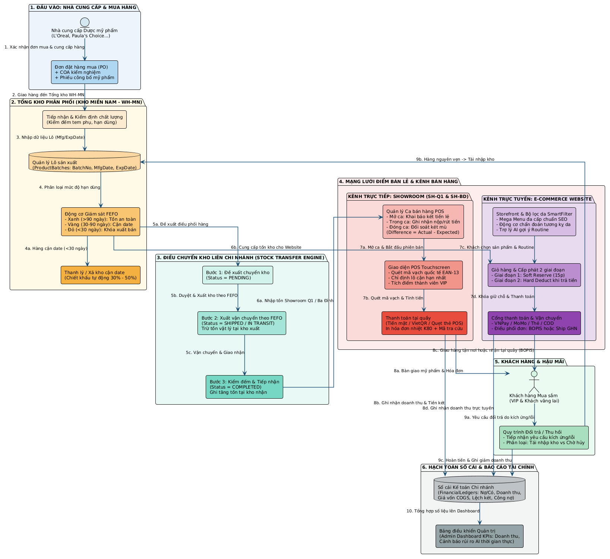

**Hình 2.1. Sơ đồ luồng vận hành hàng hóa và dữ liệu từ đầu vào đến đầu ra**  

*(Nguồn: Khảo sát thực tế chuỗi bán lẻ Canmake Beauty)*


---


## 2.2. Phân tích yêu cầu chức năng (Mười bảy phân hệ nghiệp vụ)


Hệ thống Omnichannel Beauty Solution được phân rã thành mười bảy phân hệ nghiệp vụ hoàn chỉnh, đáp ứng toàn diện mọi khía cạnh quản trị và vận hành của một chuỗi bán lẻ mỹ phẩm quy mô doanh nghiệp:


### 1. Phân hệ Quản lý Điểm bán lẻ trực tiếp và Ca làm việc (Point of Sale)

Phân hệ phục vụ trực tiếp cho nhân viên thu ngân tại các showroom với giao diện chuyên biệt được tối ưu hóa cho màn hình cảm ứng và chế độ toàn màn hình. Phân hệ hỗ trợ tìm kiếm sản phẩm siêu tốc bằng súng quét mã vạch chuẩn quốc tế, tìm kiếm theo tên hoặc mã phân loại. Hệ thống tích hợp toàn diện quy trình kiểm toán két tiền: bắt buộc thu ngân phải thực hiện thủ tục mở ca với số tiền lẻ đầu ca được xác nhận, ghi nhận mọi biến động nộp thêm tiền lẻ hoặc rút bớt tiền mặt an toàn trong ca thông qua các chứng từ giao dịch két. Khi kết thúc ngày làm việc, thu ngân thực hiện đóng ca bằng cách nhập số tiền mặt thực tế đếm được; hệ thống tự động đối chiếu với số tiền lý thuyết sinh ra từ các giao dịch mua hàng để tính toán số tiền chênh lệch, hỗ trợ in biên bản kết ca và chuyển dữ liệu doanh thu sang sổ cái tài chính.


### 2. Phân hệ Quản trị Kho Dược mỹ phẩm và Giám sát Hạn dùng theo nguyên tắc Hết hạn trước - Xuất trước

Phân hệ đóng vai trò là hạt nhân điều phối hàng hóa theo hạn sử dụng. Mỗi mặt hàng mỹ phẩm được quản lý chi tiết đến từng lô sản xuất kèm ngày sản xuất và ngày hết hạn. Bảng điều khiển kho hàng sử dụng thuật toán phân loại tự động để tô màu cảnh báo theo ba cấp độ: màu xanh cho lô an toàn dài hạn, màu vàng cho lô cận date (dưới 90 ngày) và màu đỏ cho lô nguy hiểm cận hạn xuất bán (dưới 30 ngày). Phân hệ cung cấp các nghiệp vụ nhập kho từ nhà cung cấp, kiểm kê cân bằng kho định kỳ, xuất hủy hàng hóa hư hỏng hoặc hết hạn, đồng thời tự động kích hoạt tính năng đẩy sản phẩm cận date lên danh mục xả hàng khuyến mãi trên website để giải phóng vốn lưu động.


### 3. Phân hệ Quản lý Đặt hàng Đa kênh và Cấp phát Kho hai giai đoạn

Phân hệ đảm nhiệm việc tiếp nhận và xử lý đơn hàng phát sinh từ mọi điểm chạm bán hàng. Để triệt tiêu hoàn toàn rủi ro bán vượt tồn kho, hệ thống ứng dụng giải thuật cấp phát kho hai giai đoạn: ngay khi khách hàng gửi đơn đặt hàng trên website, hệ thống thực hiện Giai đoạn 1 (khóa giữ chỗ mềm) bằng cách tăng số lượng giữ chỗ tạm tính trên lô hàng có hạn sử dụng gần nhất của chi nhánh phụ trách. Khi khách hàng hoàn tất thanh toán qua cổng điện tử hoặc chuyển khoản ngân hàng, hệ thống thực hiện Giai đoạn 2 (trừ tồn kho cứng) bằng cách trừ cứng số lượng tồn kho vật lý và giải phóng số lượng giữ chỗ tương ứng. Phân hệ cung cấp quy trình theo dõi trạng thái đơn hàng xuyên suốt từ Chờ xử lý, Đang đóng gói, Đang giao hàng cho đến khi Hoàn tất hoặc Hủy đơn có hoàn trả tồn kho tự động.


### 4. Phân hệ Điều chuyển Kho Liên Chi nhánh

Phân hệ hỗ trợ luân chuyển hàng hóa linh hoạt giữa Tổng kho trung tâm và các showroom bán lẻ hoặc giữa các showroom với nhau nhằm cân đối tồn kho. Quy trình điều chuyển được kiểm soát chặt chẽ qua ba bước nghiệp vụ: bước một, quản lý chi nhánh nhận lập phiếu yêu cầu điều chuyển ở trạng thái Chờ duyệt; bước hai, người có thẩm quyền tại kho nguồn phê duyệt lệnh xuất kho, tiến hành đóng gói và chuyển trạng thái sang Đang vận chuyển, lúc này tồn kho vật lý tại kho nguồn lập tức bị trừ theo đúng giải thuật cận hạn; bước ba, khi xe chở hàng đến nơi, thủ kho chi nhánh nhận kiểm đếm thực tế, ghi nhận số lượng nguyên vẹn và xác nhận Hoàn tất, giúp tồn kho tại chi nhánh đích chính thức được ghi tăng vào hệ thống.


### 5. Phân hệ Quản trị Quan hệ Khách hàng và Hồ sơ Da liễu Chuyên sâu

Phân hệ nâng tầm việc quản lý khách hàng từ thông tin liên lạc cơ bản lên thành một hồ sơ bệnh lý sắc đẹp cá nhân hóa. Hệ thống lưu trữ loại da chủ đạo, tông màu da phục vụ chọn phấn hoặc son, các vấn đề về da cần điều trị như mụn hay lão hóa, cùng tiền sử dị ứng thành phần hóa mỹ phẩm của khách hàng. Mỗi buổi soi da định kỳ tại showroom đều được chuyên viên ghi nhận vào nhật ký theo dõi da với các chỉ số định lượng về độ ẩm, lượng dầu tiết trên bề mặt và độ đàn hồi của biểu bì. Đặc biệt, phân hệ tích hợp thuật toán dự báo chu kỳ sử dụng sản phẩm: căn cứ vào dung tích chai mỹ phẩm đã mua và định mức liều dùng mỗi ngày, hệ thống tự động tính ra ngày khách hàng sẽ dùng hết sản phẩm để tự động gửi thông báo nhắc nhở tái mua hàng trước bảy ngày.


### 6. Phân hệ Chương trình Thành viên và Ví điểm Thưởng

Phân hệ quản trị chính sách giữ chân khách hàng thông qua mô hình tích điểm và phân hạng thành viên tự động. Khách hàng được xếp hạng theo ba cấp bậc gồm Hạng Bạc, Hạng Vàng và Hạng Kim Cương căn cứ vào tổng chi tiêu tích lũy trong vòng mười hai tháng gần nhất. Mỗi hạng thành viên có hệ số nhân điểm thưởng riêng biệt khi mua sắm. Điểm tích lũy trong ví điểm của khách hàng có thể được quy đổi trực tiếp thành tiền mặt để giảm trừ ngay trên hóa đơn thanh toán tại quầy bán lẻ hoặc trên trang thanh toán trực tuyến. Toàn bộ lịch sử cộng điểm từ đơn hàng, trừ điểm thanh toán hay thưởng điểm ngày sinh nhật đều được lưu trữ minh bạch trong sổ nhật ký giao dịch điểm.


### 7. Phân hệ Động cơ Khuyến mãi Chiến dịch và Mã Giảm giá

Phân hệ cho phép bộ phận tiếp thị thiết lập linh hoạt các chương trình khuyến mại phong phú phục vụ các chiến dịch bán hàng đa kênh. Động cơ tính giá hỗ trợ nhiều hình thức chiết khấu như: giảm giá theo phần trăm hóa đơn, giảm một số tiền cố định, đồng giá sản phẩm, quà tặng kèm theo sản phẩm chính hoặc chương trình xả hàng cận date theo hạn dùng. Hệ thống hỗ trợ phát hành mã giảm giá nhập tay với các điều kiện ràng buộc chặt chẽ: quy định giá trị đơn hàng tối thiểu, mức giảm tối đa, thời gian hiệu lực, tổng số lượt sử dụng toàn sàn và giới hạn số lần sử dụng cho mỗi tài khoản khách hàng nhằm ngăn chặn hành vi đầu cơ trục lợi mã khuyến mãi.


### 8. Phân hệ Kế toán Sổ cái và Quản lý Tài chính Chi nhánh

Phân hệ cung cấp bức tranh tài chính đa chiều cho ban giám đốc và kế toán trưởng. Mọi hoạt động phát sinh dòng tiền như doanh thu bán hàng, giá vốn hàng bán, chi phí mặt bằng chi nhánh hay tiền thanh toán nhập hàng cho nhà cung cấp đều được hệ thống tự động hạch toán thành các bút toán ghi Nợ và ghi Có vào bảng sổ cái tài chính tổng hợp. Phân hệ theo dõi công nợ phải trả theo từng đơn nhập hàng của từng nhà phân phối, đưa ra cảnh báo nợ quá hạn và cung cấp tính năng đối soát dòng tiền thu hộ tiền mặt định kỳ với đơn vị vận chuyển, giúp phát hiện ngay các khoản lệch tiền giữa thực nhận và lý thuyết.


### 9. Phân hệ Bảo mật Động và Phân quyền Hạt nhân dựa trên Quyền hạn chi tiết

Phân hệ thiết lập lá chắn an ninh toàn diện cho giải pháp bằng việc áp dụng mô hình phân quyền dựa trên quyền hạn động. Hệ thống phân rã quyền truy cập thành năm mươi mốt quyền nguyên tử độc lập thuộc mười bảy phân hệ chức năng. Quản trị viên tối cao có thể dễ dàng thiết lập ma trận phân quyền bằng giao diện trực quan cho sáu vai trò người dùng trong tổ chức. Điểm đặc sắc của phân hệ là hỗ trợ cơ chế can thiệp quyền cá nhân, cho phép cấp thêm quyền đặc cách hoặc thu hồi đích danh một quyền cụ thể đối với một nhân sự mà không cần phải thay đổi cấu trúc vai trò chung.


### 10. Phân hệ Trợ lý Trí tuệ Nhân tạo và Kiểm tra Tương kỵ Hoạt chất Mỹ phẩm

Phân hệ kết hợp giữa trí tuệ nhân tạo và tri thức khoa học da liễu để hỗ trợ khách hàng tìm kiếm sản phẩm an toàn nhất. Động cơ phân tích hoạt chất tự động rà soát toàn bộ các sản phẩm có trong giỏ hàng để phát hiện các cặp thành phần đối kháng hóa học, ví dụ như sự kết hợp giữa Retinol và BHA nồng độ cao hoặc Vitamin C nguyên chất và Peptides đồng. Khi phát hiện tương kỵ, hệ thống lập tức hiển thị cảnh báo đỏ và tự động phân bổ lại lịch trình sử dụng theo buổi sáng, buổi tối hoặc dùng cách ngày. Bên cạnh đó, trợ lý ảo tích hợp trên website có khả năng hiểu ngữ cảnh câu hỏi của khách hàng, tra cứu trực tiếp tình trạng tồn kho thực tế và đưa ra các đề xuất sản phẩm tương thích với hồ sơ da của người đang trò chuyện.


### 11. Phân hệ Quản trị Danh mục và Sản phẩm Cốt lõi

Phân hệ quản lý toàn bộ vòng đời sản phẩm từ khâu khai báo mã sản phẩm, mã vạch thương mại, thương hiệu, nhà cung cấp cho đến phân loại danh mục cha con đa cấp. Hệ thống hỗ trợ quản lý các sản phẩm có biến thể phức tạp theo các nhóm thuộc tính màu sắc và dung tích. Đối với dòng sản phẩm trang điểm như son môi hay phấn nền, hệ thống cho phép cấu hình bảng mẫu thử màu sắc với mã màu chuẩn xác và hình ảnh chất son thử thực tế trên da, giúp khách hàng hình dung rõ nét trước khi mua.


### 12. Phân hệ Quản trị Cây Menu Đa hình và Điều hướng Tối ưu Công cụ Tìm kiếm

Phân hệ cho phép quản trị viên biên tập thanh điều hướng chính và menu chân trang thông qua giao diện cây phân cấp trực quan kéo thả. Nút menu hỗ trợ cơ chế liên kết đa hình, có thể trỏ tới một danh mục sản phẩm, một sản phẩm cụ thể, một bài viết cẩm nang hoặc một liên kết ngoài tùy biến. Đi kèm với phân hệ là cơ chế tự động bắt vết thay đổi đường dẫn: mỗi khi người quản trị chỉnh sửa đường dẫn của một sản phẩm hay danh mục, hệ thống tự động lưu vết và kích hoạt chuyển hướng chuẩn 301, ngăn ngừa tuyệt đối lỗi gãy liên kết khi khách hàng truy cập từ các công cụ tìm kiếm.


### 13. Phân hệ Quản trị Nội dung và Cẩm nang Làm đẹp

Phân hệ cung cấp môi trường xuất bản nội dung số chuyên nghiệp phục vụ chiến lược tiếp thị nội dung. Đội ngũ biên tập viên có thể tạo lập các bài viết chia sẻ bí quyết chăm sóc da, xu hướng trang điểm và kiến thức phân tích thành phần mỹ phẩm với trình soạn thảo văn bản phong phú. Hệ thống hỗ trợ tối ưu hóa các thẻ tiêu đề, mô tả chuẩn tìm kiếm, quản lý chuyên mục bài viết và đo lường số lượt xem để đánh giá mức độ quan tâm của độc giả.


### 14. Phân hệ Banner và Chiến dịch Truyền thông

Phân hệ hỗ trợ quản lý tập trung toàn bộ hình ảnh quảng cáo, băng rôn sự kiện trên trang chủ và các trang ngành hàng. Mỗi banner được phân loại hiển thị riêng biệt theo kích thước màn hình máy tính và màn hình điện thoại nhằm tối ưu tốc độ tải trang. Hệ thống cho phép cài đặt khung giờ bắt đầu và kết thúc hiệu lực của chiến dịch quảng cáo, tự động ẩn banner khi hết hạn và theo dõi số lượt nhấp chuột để đo lường hiệu quả chuyển đổi truyền thông.


### 15. Phân hệ Kiểm duyệt Đánh giá và Mẫu thử Thực tế

Phân hệ xây dựng cộng đồng đánh giá mỹ phẩm khách quan và văn minh. Khách hàng đã mua hàng có thể gửi bài đánh giá xếp hạng từ 1 đến 5 sao kèm hình ảnh thực tế chất kem hoặc màu son thử trên cổ tay. Hệ thống gắn huy hiệu đã mua hàng chính hãng để tăng độ tin cậy cho bài viết. Toàn bộ các đánh giá phải trải qua quy trình kiểm duyệt nội dung của quản trị viên trước khi xuất bản ra ngoài website nhằm ngăn chặn các bình luận rác hoặc từ ngữ vi phạm tiêu chuẩn cộng đồng, đồng thời cung cấp tính năng để chuyên viên chăm sóc khách hàng phản hồi chính thức các thắc mắc của người dùng.


### 16. Phân hệ Giám sát Tự động và Cảnh báo Vận hành Thông minh

Phân hệ đóng vai trò như một hệ thống radar vận hành ngầm của doanh nghiệp. Sử dụng tiến trình chạy nền thức dậy định kỳ mỗi mười lăm phút, hệ thống tự động quét toàn bộ cơ sở dữ liệu để phát hiện sớm các rủi ro vận hành: phát hiện sản phẩm có tổng tồn kho chạm ngưỡng tồn an toàn hoặc bằng không, phát hiện các lô mỹ phẩm còn dưới chín mươi ngày hạn sử dụng cần xả hàng, và phát hiện các khoản công nợ nhà cung cấp đã quá hạn thanh toán. Các cảnh báo này được gửi tức thì lên bảng điều khiển của ban quản lý kèm mức độ nghiêm trọng bằng các dải màu trực quan.


### 17. Phân hệ Thông báo Đẩy và Hộp thư Điều hành Nội bộ Thời gian thực

Phân hệ đảm bảo sự kết nối thông suốt giữa các phòng ban trong chuỗi bán lẻ. Ứng dụng công nghệ truyền thông thời gian thực, thông báo về đơn hàng mới, sự cố kho bãi hay phê duyệt chuyển kho được đẩy tức thời tới đúng nhóm người dùng mục tiêu mà không cần người dùng tải lại trang. Bên cạnh đó, hệ thống tích hợp hộp thư trao đổi công văn nội bộ giữa ban giám đốc, quản lý showroom và thủ kho, hỗ trợ soạn thảo công văn công việc, đính kèm chỉ đạo điều hành và xác nhận đã đọc văn bản theo thời gian thực. Toàn bộ các thao tác thêm, sửa, xóa dữ liệu nhạy cảm trên toàn hệ sinh thái đều được đánh chặn tự động và ghi sổ nhật ký kiểm toán chứa địa chỉ mạng máy tính, dấu vết thay đổi giá trị cũ và mới để phục vụ điều tra an ninh thông tin.


---


## 2.3. Phân tích yêu cầu phi chức năng


Bên cạnh việc đáp ứng trọn vẹn các yêu cầu nghiệp vụ, hệ thống Canmake Beauty Solution đặt ra các tiêu chuẩn kỹ thuật khắt khe về mặt kiến trúc nhằm đảm bảo tính ổn định và an toàn khi vận hành trong môi trường thực tế:


### 2.3.1. Yêu cầu về Hiệu năng và Thời gian Phản hồi

Đối với phân hệ bán lẻ tại quầy, thời gian phản hồi của các thao tác quét mã vạch sản phẩm, tính tiền và in hóa đơn bắt buộc phải hoàn tất trong thời gian dưới 500 mili-giây để đảm bảo tốc độ phục vụ khách hàng tại quầy trong giờ cao điểm. Đối với kênh mua sắm trực tuyến, thời gian kết xuất trang chi tiết sản phẩm và danh mục ngành hàng phải đạt dưới 1.5 giây trên kết nối mạng thông thường. 


Để đạt được mục tiêu này, hệ thống ứng dụng kỹ thuật biên dịch trước truy vấn cho các thao tác tra cứu tồn kho lặp lại với tần suất cao, kết hợp nén luồng dữ liệu truyền tải và áp dụng cơ chế bộ nhớ đệm đa tầng giúp giảm tải tới 80% áp lực truy vấn trực tiếp xuống cơ sở dữ liệu SQL Server.


### 2.3.2. Yêu cầu về Tính Toàn vẹn và Kiểm soát Đồng thời

Một trong những thách thức lớn nhất của hệ thống thương mại điện tử đa kênh là ngăn chặn triệt để hiện tượng bán khống và tranh chấp dữ liệu khi diễn ra các sự kiện xả hàng cận date. Hệ thống giải quyết bài toán này thông qua việc áp dụng cơ chế kiểm soát đồng thời lạc quan dựa trên thuộc tính phiên bản dữ liệu RowVersion (kiểu dữ liệu 8-byte Timestamp tự tăng của SQL Server) trên các bảng giao dịch trọng yếu. 


Khi hai tiến trình cùng đọc một bản ghi tồn kho và cùng cố gắng cập nhật số lượng, tiến trình nào gửi yêu cầu đến sau sẽ bị từ chối do giá trị phiên bản đã thay đổi, hệ thống sẽ tự động kích hoạt vòng lặp nạp lại dữ liệu mới nhất và thử lại tối đa ba lần trước khi thông báo hết hàng cho người dùng. Toàn bộ các biến động trừ kho và sinh mã vận đơn đều được thực thi trong phạm vi giao dịch ACID với mức độ cô lập an toàn, bảo đảm dữ liệu luôn nhất quán tuyệt đối.


### 2.3.3. Yêu cầu về Bảo mật và Kiến trúc Không Tin cậy

Hệ thống thiết lập chính sách an ninh nhiều lớp tuân thủ các tiêu chuẩn bảo mật hiện đại:

- Cô lập phạm vi dữ liệu đa chi nhánh: Hệ thống ứng dụng cơ chế lọc truy vấn toàn cục của Entity Framework Core. Bất kỳ truy vấn dữ liệu nào phát sinh từ tài khoản của nhân viên chi nhánh nào sẽ tự động bị chèn thêm điều kiện lọc theo đúng mã chi nhánh đó, ngăn chặn triệt để lỗ hổng tham chiếu trực tiếp đối tượng không an toàn. Nhân viên tại Showroom Ba Đình tuyệt đối không thể xem lén doanh thu hay tồn kho của Showroom Quận 1 dù cố tình thay đổi tham số nhận diện trên thanh địa chỉ trình duyệt.

- An toàn định danh và mật khẩu: Mật khẩu người dùng được băm một chiều bằng thuật toán mã hóa hiện đại với 100.000 vòng lặp có kèm muối ngẫu nhiên, vô hiệu hóa hoàn toàn các hình thức tấn công dò mật khẩu bằng bảng băm tính sẵn. Phiên làm việc được kiểm soát thông qua mã xác thực bảo mật; mỗi khi người dùng bị khóa tài khoản hoặc thay đổi quyền hạn, phiên làm việc lập tức bị hủy bỏ trong vòng chưa đầy một giây.

- Phòng chống tấn công từ chối dịch vụ và cào quét dữ liệu: Tích hợp hệ thống giới hạn tần suất truy cập với bốn chính sách phân vùng chuyên biệt, tự động chặn đứng các hành vi tấn công dò mật khẩu tại trang đăng nhập và hành vi sử dụng bot tự động gom hàng khuyến mãi.


### 2.3.4. Yêu cầu về Tính Sẵn sàng và Khả năng Mở rộng

Kiến trúc phần mềm được thiết kế theo hướng module hóa lỏng lẻo, phân định rõ ràng giữa tầng logic nghiệp vụ và tầng giao diện. Việc áp dụng mô hình sự kiện nội miền cho phép các tác vụ phụ phát sinh sau khi thanh toán thành công (như cộng điểm thưởng thành viên, ghi sổ cái tài chính, gửi thông báo đẩy thời gian thực) được phân tách thành các bộ xử lý độc lập, giúp rút ngắn thời gian giữ khóa cơ sở dữ liệu và gia tăng năng lực chịu tải của hệ thống. 


Cơ sở dữ liệu được tổ chức theo chuẩn Dạng chuẩn 3 với hệ thống chỉ mục bao phủ được tối ưu hóa riêng cho các câu lệnh tìm kiếm, sẵn sàng cho việc mở rộng quy mô lên hàng trăm điểm bán lẻ và nâng cấp lên cụm máy chủ phân tán trong tương lai mà không đòi hỏi phải tái cấu trúc lại mô hình dữ liệu cốt lõi.


---


## 2.4. Mô hình hóa Ca sử dụng (Use Case)


### 2.4.1. Bảng phân vai tác nhân hệ thống

Hệ thống Omnichannel Beauty Solution phân quyền chặt chẽ cho sáu nhóm tác nhân chính tham gia tương tác, mỗi tác nhân mang các quyền hạn và trách nhiệm nghiệp vụ chuyên biệt:


**Bảng 2.1. Bảng phân vai tác nhân và phạm vi trách nhiệm trong hệ thống**


| Tác nhân (Actor) | Bản chất Tác nhân | Phạm vi Trách nhiệm và Chức năng Chính trong Hệ thống |

| :--- | :--- | :--- |

| **SuperAdmin** | Quản trị viên tối cao | Toàn quyền kiểm soát hệ thống; cấu hình tham số toàn cục; quản lý danh mục vai trò; thiết lập ma trận phân quyền động; phê duyệt lệnh điều chuyển kho; xem báo cáo tài chính hợp nhất toàn chuỗi. |

| **StoreManager** | Quản lý chi nhánh | Điều hành hoạt động bán lẻ tại showroom được phân công; giám sát doanh thu ca làm việc của thu ngân; lập phiếu yêu cầu chuyển kho; điều chỉnh số liệu kiểm kê kho; duyệt chi tiền mặt két phụ. |

| **Cashier** | Thu ngân điểm bán lẻ | Thực hiện mở ca và đóng ca tại quầy bán lẻ; quét mã vạch bán hàng; tra cứu thông tin tích điểm khách hàng; áp dụng voucher; nhận tiền mặt và xác nhận thanh toán chuyển khoản ngân hàng; in hóa đơn nhiệt. |

| **WarehouseStaff** | Nhân viên thủ kho | Thực hiện nhập kho các lô hàng mới; in tem mã vạch; kiểm tra hạn dùng theo nguyên tắc FEFO; xuất kho vận chuyển điều chuyển chi nhánh; tiếp nhận và kiểm đếm hàng chuyển đến; xuất hủy hàng cận date. |

| **ContentEditor** | Biên tập viên CMS | Quản lý cây Menu điều hướng website; biên tập bài viết cẩm nang làm đẹp; xuất bản banner sự kiện; kiểm duyệt đánh giá và hình ảnh swatch thực tế của khách hàng; quản lý trang chính sách tĩnh. |

| **Customer** | Khách hàng mua sắm | Tìm kiếm và xem thông tin sản phẩm; thực hiện bài trắc nghiệm phân tích da; tương tác với trợ lý tư vấn hoạt chất; đặt hàng trực tuyến; chọn nhận hàng tại quầy; theo dõi ví điểm. |


*(Nguồn: Phân tích yêu cầu hệ thống Canmake Beauty)*


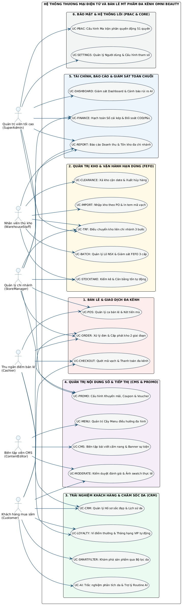

**Hình 2.2. Sơ đồ Ca sử dụng tổng quát hệ thống Canmake Beauty**  

*(Nguồn: Thiết kế phân tích yêu cầu hệ thống)*


---


### 2.4.2. Đặc tả chi tiết các Ca sử dụng trọng yếu


#### 1. Ca sử dụng UC-01: Cấu hình ma trận phân quyền động dựa trên quyền hạn chi tiết


**Bảng 2.2. Đặc tả Ca sử dụng UC-01: Cấu hình ma trận phân quyền động**


| Thuộc tính Use Case | Nội dung Đặc tả Nghiệp vụ Chi tiết |

| :--- | :--- |

| **Mã Use Case** | **UC-01** |

| **Tên Use Case** | Cấu hình ma trận phân quyền động dựa trên quyền hạn chi tiết |

| **Tác nhân chính** | Quản trị viên tối cao (SuperAdmin) |

| **Tiền điều kiện** | Tài khoản Quản trị viên tối cao đã đăng nhập thành công và truy cập vào giao diện quản lý phân quyền. |

| **Hậu điều kiện** | Bản ghi ma trận phân quyền được lưu vào CSDL; toàn bộ bộ nhớ đệm phân quyền của người dùng liên quan bị xóa lập tức; chính sách mới có hiệu lực ngay trong yêu cầu kế tiếp. |

| **Luồng sự kiện chính** | 1. Tác nhân truy cập màn hình Quản lý ma trận phân quyền.<br>2. Hệ thống tải danh mục sáu vai trò và năm mươi mốt quyền hạn nguyên tử được gom nhóm theo mười bảy phân hệ dưới dạng lưới ma trận.<br>3. Tác nhân chọn chế độ phân quyền theo Vai trò hoặc Can thiệp Người dùng cá nhân.<br>4. Tác nhân thực hiện đánh dấu chọn hoặc bỏ chọn các ô quyền tương ứng trên lưới phân quyền.<br>5. Tác nhân nhấn nút "Lưu thay đổi ma trận phân quyền".<br>6. Hệ thống mở giao dịch cơ sở dữ liệu: xóa bỏ các quyền cũ, chèn danh sách quyền mới được cấp vào bảng phân quyền vai trò hoặc phân quyền người dùng.<br>7. Hệ thống kích hoạt dịch vụ xóa bộ nhớ đệm quyền hạn đối với tất cả người dùng thuộc vai trò bị tác động.<br>8. Hệ thống hiển thị thông báo cập nhật thành công và ghi nhận nhật ký kiểm toán. |

| **Luồng ngoại lệ** | - **4a. Can thiệp tước bỏ quyền cá nhân**: Nếu tác nhân chọn chế độ can thiệp người dùng và đánh dấu tước bỏ một quyền mà vai trò của người đó đang sở hữu, hệ thống ưu tiên luật tước bỏ quyền, khiến người dùng đó bị cấm thao tác ngay lập tức.<br>- **6a. Lỗi kết nối CSDL**: Nếu quá trình ghi dữ liệu gặp sự cố, hệ thống thực hiện hoàn tác giao dịch, giữ nguyên trạng thái bộ nhớ đệm cũ và thông báo lỗi tới quản trị viên. |


*(Nguồn: Thiết kế chi tiết Use Case hệ thống)*


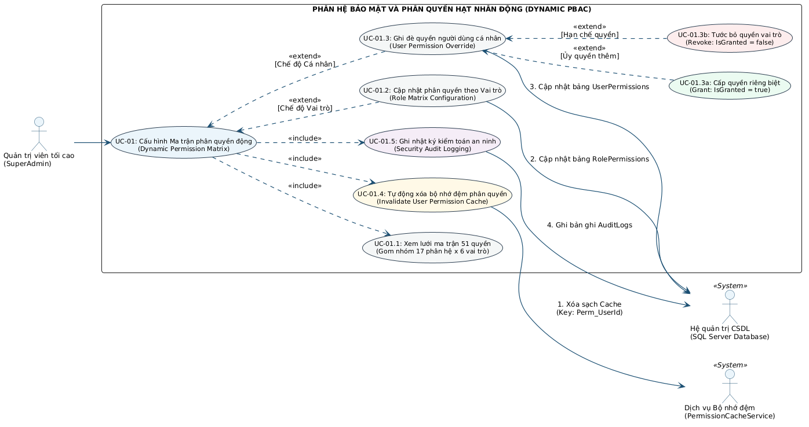

**Hình 2.3. Sơ đồ Ca sử dụng chi tiết UC-01: Phân quyền động dựa trên quyền hạn chi tiết**  

*(Nguồn: Thiết kế chi tiết Use Case hệ thống)*


---


#### 2. Ca sử dụng UC-02: Đặt hàng trực tuyến và trừ kho hai giai đoạn theo hạn dùng


**Bảng 2.3. Đặc tả Ca sử dụng UC-02: Đặt hàng trực tuyến và trừ kho hai giai đoạn theo hạn dùng**


| Thuộc tính Use Case | Nội dung Đặc tả Nghiệp vụ Chi tiết |

| :--- | :--- |

| **Mã Use Case** | **UC-02** |

| **Tên Use Case** | Đặt hàng trực tuyến và trừ kho an toàn theo giải thuật hết hạn trước xuất trước |

| **Tác nhân chính** | Khách hàng (Customer) |

| **Tiền điều kiện** | Khách hàng đã thêm sản phẩm vào giỏ hàng; sản phẩm đang ở trạng thái mở bán và tồn kho khả dụng lớn hơn số lượng yêu cầu mua. |

| **Hậu điều kiện** | Đơn hàng được tạo thành công ở trạng thái chờ thanh toán; tồn kho lô hạn dùng gần nhất được giữ chỗ an toàn; sau khi thanh toán thành công tồn kho vật lý bị trừ cứng và tích điểm thưởng cho khách. |

| **Luồng sự kiện chính** | 1. Khách hàng truy cập trang thanh toán, nhập thông tin giao nhận và chọn phương thức thanh toán chuyển khoản ngân hàng hoặc cổng điện tử.<br>2. Khách hàng bấm nút "Xác nhận đặt hàng".<br>3. Hệ thống kích hoạt Giai đoạn 1 (Khóa giữ chỗ mềm): truy vấn tồn kho của sản phẩm tại chi nhánh xuất hàng, sắp xếp các lô theo hạn dùng tăng dần để chọn lô có hạn sử dụng gần nhất còn hiệu lực.<br>4. Hệ thống kiểm tra điều kiện an toàn: nếu tồn kho khả dụng đủ đáp ứng, hệ thống tăng thuộc tính số lượng giữ chỗ trên lô hàng đó.<br>5. Hệ thống khởi tạo đơn hàng với trạng thái Chờ xử lý, các dòng chi tiết đơn hàng được gán chính xác mã lô đã chọn, đồng thời sinh mã thanh toán phản hồi động.<br>6. Khách hàng thực hiện quét mã chuyển khoản chính xác số tiền trên ứng dụng ngân hàng.<br>7. Cổng thanh toán gửi bản tin xác nhận Webhook về máy chủ hệ thống.<br>8. Hệ thống kích hoạt Giai đoạn 2 (Trừ kho cứng): kiểm tra tính hợp lệ của chữ ký Webhook, mở giao dịch trừ cứng tồn kho vật lý, đồng thời giải phóng lượng giữ chỗ tương ứng.<br>9. Hệ thống chuyển trạng thái đơn hàng sang Đang xử lý, ghi nhật ký kho, tự động tích điểm vào ví điểm thưởng và gửi thông báo thời gian thực tới ban quản trị. |

| **Luồng ngoại lệ** | - **4a. Hết tồn kho khả dụng do tranh mua**: Nếu trong tích tắc trước đó có khách hàng khác đã giữ chỗ hết sản phẩm, hệ thống ném ra ngoại lệ không đủ tồn kho, từ chối tạo đơn và thông báo cho khách hàng sản phẩm vừa hết hàng.<br>- **6a. Quá hạn thanh toán mười lăm phút**: Nếu khách hàng không thực hiện thanh toán trong vòng mười lăm phút, tiến trình nền tự động hủy đơn và hoàn trả lại số lượng giữ chỗ về trạng thái khả dụng. |


*(Nguồn: Thiết kế chi tiết Use Case hệ thống)*


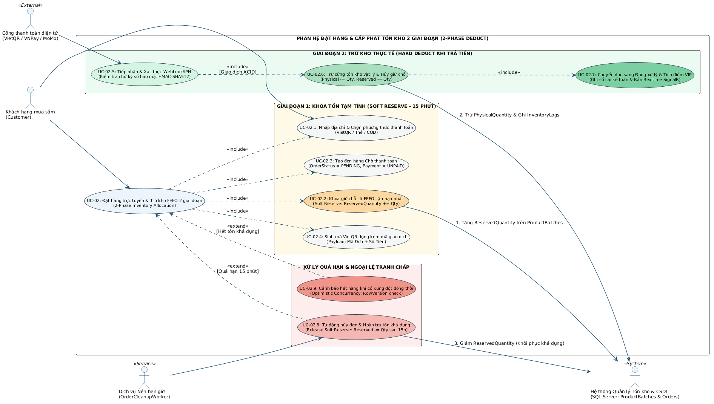

**Hình 2.4. Sơ đồ Ca sử dụng chi tiết UC-02: Đặt hàng và trừ kho hai giai đoạn theo hạn dùng**  

*(Nguồn: Thiết kế chi tiết Use Case hệ thống)*


---


#### 3. Ca sử dụng UC-03: Mở ca, bán hàng tại quầy và đóng ca đối soát két tiền mặt


**Bảng 2.4. Đặc tả Ca sử dụng UC-03: Mở ca, bán hàng tại quầy và đóng ca đối soát két tiền mặt**


| Thuộc tính Use Case | Nội dung Đặc tả Nghiệp vụ Chi tiết |

| :--- | :--- |

| **Mã Use Case** | **UC-03** |

| **Tên Use Case** | Quản lý ca bán hàng và đối soát két tiền mặt tại điểm bán lẻ trực tiếp |

| **Tác nhân chính** | Thu ngân điểm bán lẻ (Cashier) |

| **Tiền điều kiện** | Thu ngân đã đăng nhập vào hệ thống tại đúng chi nhánh cửa hàng được phân công; thu ngân sở hữu quyền truy cập quầy bán lẻ và mở ca. |

| **Hậu điều kiện** | Ca làm việc được mở và chốt thành công; các chỉ số doanh số tiền mặt, doanh số chuyển khoản được tổng hợp; số tiền chênh lệch thừa thiếu két được ghi nhận bất biến vào CSDL. |

| **Luồng sự kiện chính** | 1. Đầu ca làm việc, thu ngân truy cập màn hình bán lẻ. Hệ thống kiểm tra thấy chưa có ca mở và hiển thị hộp thoại "Mở ca bán hàng mới".<br>2. Thu ngân đếm số tiền mặt lẻ có sẵn trong két, nhập vào ô số dư đầu ca và bấm "Xác nhận mở ca".<br>3. Hệ thống tạo bản ghi ca làm việc mới với mã ca tự sinh theo ngày, trạng thái Mở.<br>4. Trong suốt ca làm việc, thu ngân thực hiện quét mã vạch bán hàng, áp dụng voucher và thanh toán đơn hàng bằng tiền mặt hoặc mã ngân hàng động.<br>5. Cuối ca làm việc, thu ngân bấm phím tắt hoặc chọn chức năng "Đóng ca & Kết sổ két".<br>6. Thu ngân kiểm đếm toàn bộ số tiền mặt hiện có trong két và nhập giá trị thực tế đếm được.<br>7. Hệ thống tự động tính toán số tiền mặt lý thuyết phải có: `Tiền lý thuyết = Số dư đầu ca + Tiền mặt bán hàng + Tiền nộp thêm - Tiền rút bớt`.<br>8. Hệ thống tính toán chênh lệch: `Chênh lệch = Tiền thực tế - Tiền lý thuyết`.<br>9. Thu ngân nhập lý do giải trình (nếu có chênh lệch) và nhấn "Hoàn tất chốt ca". Hệ thống chuyển trạng thái ca sang Đã đóng, tự động sinh bút toán doanh thu vào sổ cái tài chính và in biên bản bàn giao Z-Report. |

| **Luồng ngoại lệ** | - **2a. Đang có ca mở chưa đóng**: Nếu chi nhánh đang tồn tại một ca làm việc ở trạng thái Mở của ca trước chưa kết sổ, hệ thống ngăn chặn việc mở ca mới và yêu cầu thu ngân hoàn tất ca cũ trước.<br>- **4a. Rút bớt tiền về két sắt trung tâm**: Khi tiền mặt trong ca vượt ngưỡng an toàn, thu ngân thực hiện giao dịch rút tiền két, hệ thống ghi nhận phiếu vào bảng giao dịch két và tự động trừ vào số tiền mặt lý thuyết khi kết ca. |


*(Nguồn: Thiết kế chi tiết Use Case hệ thống)*


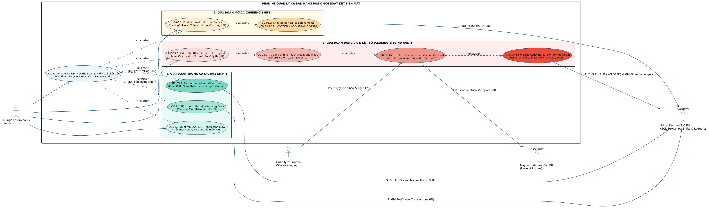

**Hình 2.5. Sơ đồ Ca sử dụng chi tiết UC-03: Vòng đời ca làm việc thu ngân và kiểm toán két tiền**  

*(Nguồn: Thiết kế chi tiết Use Case hệ thống)*


---


#### 4. Ca sử dụng UC-04: Điều chuyển hàng hóa liên chi nhánh qua ba bước


**Bảng 2.5. Đặc tả Ca sử dụng UC-04: Điều chuyển kho liên chi nhánh ba bước**


| Thuộc tính Use Case | Nội dung Đặc tả Nghiệp vụ Chi tiết |

| :--- | :--- |

| **Mã Use Case** | **UC-04** |

| **Tên Use Case** | Điều chuyển hàng hóa liên chi nhánh qua ba bước bảo toàn tồn kho |

| **Tác nhân chính** | Quản lý chi nhánh (StoreManager) và Nhân viên thủ kho (WarehouseStaff) |

| **Tiền điều kiện** | Người dùng có tài khoản hợp lệ với các quyền tạo phiếu chuyển, phê duyệt lệnh xuất và xác nhận nhập kho. |

| **Hậu điều kiện** | Hàng hóa được chuyển trạng thái an toàn từ kho nguồn sang kho đích; tồn kho vật lý tại kho nguồn bị trừ và kho đích được ghi tăng theo đúng lô hàng thực nhận. |

| **Luồng sự kiện chính** | 1. Quản lý chi nhánh nhận truy cập màn hình tạo phiếu chuyển kho, chọn kho xuất, chọn sản phẩm và nhập số lượng yêu cầu cần chuyển.<br>2. Hệ thống khởi tạo phiếu chuyển trong bảng điều chuyển kho với trạng thái ban đầu là Chờ duyệt.<br>3. Người có thẩm quyền tại kho nguồn nhận được thông báo, kiểm tra số lượng tồn và bấm nút "Phê duyệt lệnh xuất kho". Trạng thái chuyển sang Đã duyệt.<br>4. Thủ kho kho nguồn đóng gói hàng hóa lên xe tải, hệ thống tự động chọn các lô hàng có hạn sử dụng gần nhất theo nguyên tắc FEFO để xuất kho, cập nhật số lượng thực xuất, chuyển trạng thái sang Đang vận chuyển, đồng thời trừ tồn kho vật lý tại kho nguồn.<br>5. Xe hàng di chuyển đến chi nhánh nhận. Thủ kho chi nhánh nhận tiến hành dỡ hàng, kiểm đếm thực tế từng hộp sản phẩm và nhập số lượng thực nhận vào hệ thống.<br>6. Thủ kho chi nhánh nhận bấm nút "Xác nhận nhập kho hoàn tất".<br>7. Hệ thống chuyển trạng thái phiếu sang Hoàn tất, tự động ghi tăng tồn kho vật lý tại chi nhánh nhận theo đúng các lô hàng đã nhận và ghi nhật ký kiểm toán kho. |

| **Luồng ngoại lệ** | - **3a. Từ chối yêu cầu chuyển kho**: Nếu kho nguồn không đủ hàng hoặc nhu cầu không hợp lý, quản lý kho nguồn bấm nút "Từ chối" kèm lý do, phiếu chuyển chuyển sang trạng thái Bị từ chối và chấm dứt quy trình.<br>- **5a. Hàng hóa bị thiếu hoặc hư hỏng trong quá trình vận chuyển**: Nếu số lượng thực nhận nhỏ hơn số lượng gửi đi, hệ thống yêu cầu lập biên bản ghi chú sự cố, chỉ ghi tăng tồn kho đích theo số lượng thực nhận và chuyển phần chênh lệch hao hụt vào tài khoản tổn thất của sổ cái kế toán. |


*(Nguồn: Thiết kế chi tiết Use Case hệ thống)*


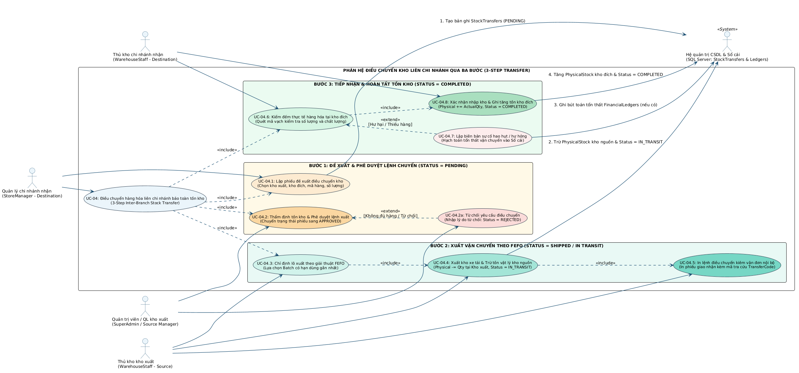

**Hình 2.6. Sơ đồ Ca sử dụng chi tiết UC-04: Điều chuyển tồn kho liên chi nhánh qua ba bước**  

*(Nguồn: Thiết kế chi tiết Use Case hệ thống)*


---


#### 5. Ca sử dụng UC-05: Tư vấn phác đồ chăm sóc da và kiểm tra xung đột hoạt chất da liễu


**Bảng 2.6. Đặc tả Ca sử dụng UC-05: Tư vấn phác đồ da và kiểm tra tương kỵ hoạt chất**


| Thuộc tính Use Case | Nội dung Đặc tả Nghiệp vụ Chi tiết |

| :--- | :--- |

| **Mã Use Case** | **UC-05** |

| **Tên Use Case** | Tư vấn phác đồ chăm sóc da và kiểm tra xung đột hoạt chất da liễu |

| **Tác nhân chính** | Khách hàng (Customer) hoặc Chuyên viên tư vấn sắc đẹp |

| **Tiền điều kiện** | Khách hàng truy cập website hoặc chuyên viên mở màn hình tư vấn tại showroom; dữ liệu thành phần hoạt chất của sản phẩm đã được chuẩn hóa trong CSDL. |

| **Hậu điều kiện** | Hệ thống đưa ra phác đồ chăm sóc da tối ưu; các cặp hoạt chất xung đột được cảnh báo kèm giải pháp phân chia lịch trình sáng/tối hoặc cách ngày an toàn. |

| **Luồng sự kiện chính** | 1. Tác nhân mở tiện ích chẩn đoán da hoặc tương tác với trợ lý ảo trên hệ thống.<br>2. Tác nhân cung cấp các thông số đặc trưng của làn da gồm: loại da (da dầu, da khô, da hỗn hợp), mối bận tâm điều trị (mụn, nám, lão hóa) và tiền sử dị ứng thành phần.<br>3. Hệ thống truy vấn cơ sở dữ liệu hoạt chất và bảng nối thành phần sản phẩm, tính toán điểm tương thích sinh học và hiển thị danh mục các sản phẩm tối ưu nhất.<br>4. Tác nhân chọn thêm các sản phẩm mong muốn vào giỏ hàng hoặc chu trình dưỡng da cá nhân.<br>5. Động cơ phân tích hoạt chất tự động rà soát toàn bộ các sản phẩm đã chọn theo ma trận quy tắc da liễu.<br>6. Hệ thống đối chiếu phát hiện: nếu có hai hoạt chất tương kỵ cao cùng xuất hiện (ví dụ Retinol và BHA nồng độ cao), hệ thống lập tức xuất hiện khối cảnh báo trực quan.<br>7. Hệ thống tự động phân tách và gợi ý chu trình sử dụng khoa học: chỉ định sản phẩm dùng vào Buổi Sáng, sản phẩm dùng vào Buổi Tối và sản phẩm dùng Cách Ngày theo phương pháp khoa học.<br>8. Tác nhân xác nhận đồng ý với phác đồ đã phân tách, hệ thống lưu lịch trình này vào hồ sơ sắc đẹp của khách hàng và chuyển sang bước mua hàng. |

| **Luồng ngoại lệ** | - **2a. Phát hiện thành phần trùng với tiền sử dị ứng của khách hàng**: Nếu sản phẩm khách hàng chọn có chứa hoạt chất nằm trong danh sách dị ứng của hồ sơ cá nhân, hệ thống kích hoạt cảnh báo nguy hiểm cấp độ đỏ và đề xuất một sản phẩm thay thế có công dụng tương đương nhưng lành tính hơn. |


*(Nguồn: Thiết kế chi tiết Use Case hệ thống)*


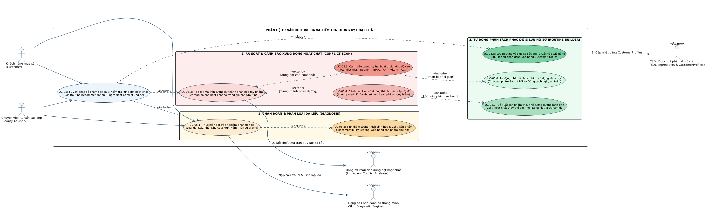

**Hình 2.7. Sơ đồ Ca sử dụng chi tiết UC-05: Tư vấn phác đồ da và kiểm tra tương kỵ hoạt chất**  

*(Nguồn: Thiết kế chi tiết Use Case hệ thống)*


---


# Chương III

# PHÂN TÍCH THIẾT KẾ HƯỚNG ĐỐI TƯỢNG VÀ CƠ SỞ DỮ LIỆU


## 3.1. Thiết kế Kiến trúc Phần mềm tổng thể


### 3.1.1. Kiến trúc Clean Architecture bốn tầng và nguyên lý Đảo ngược Phụ thuộc

Để xây dựng một hệ thống bán lẻ có quy mô nghiệp vụ phức tạp và đòi hỏi khả năng mở rộng lâu dài như Canmake Beauty Solution, việc lựa chọn một kiến trúc phần mềm có tính kỷ luật cao là yếu tố quyết định. Hệ thống được tổ chức tuân thủ nghiêm ngặt mô hình kiến trúc Clean Architecture gồm bốn tầng độc lập, tương ứng với bốn dự án riêng biệt trong không gian giải pháp:


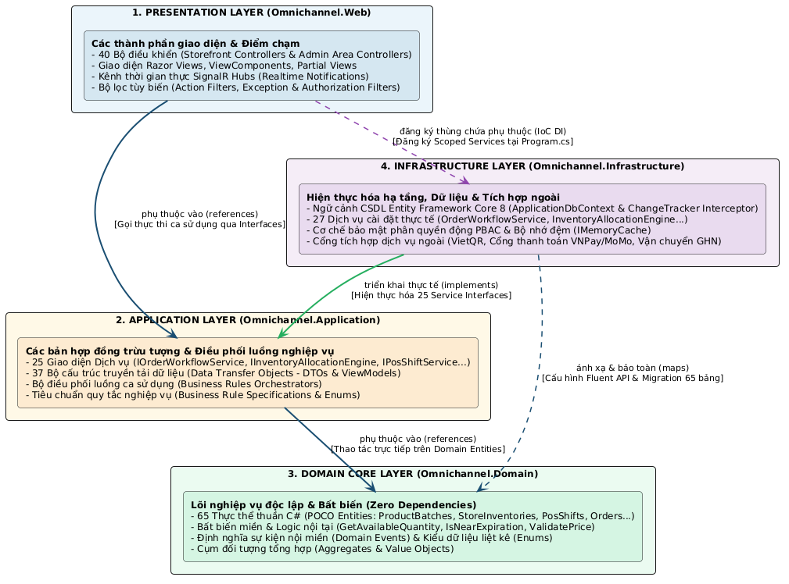

**Hình 3.0. Kiến trúc Clean Architecture bốn tầng và nguyên lý Đảo ngược Phụ thuộc của hệ thống Canmake Beauty**  

*(Nguồn: Thiết kế kiến trúc giải pháp hệ thống Canmake Beauty)*


```

+-------------------------------------------------------------------------+

|                  1. PRESENTATION LAYER (Omnichannel.Web)                |

|      Controllers, Razor Layouts, ViewComponents, SignalR Hubs, Filters  |

+------------------------------------+------------------------------------+

                                     | phụ thuộc vào (references)

                                     v

+------------------------------------+------------------------------------+

|                2. APPLICATION LAYER (Omnichannel.Application)           |

|         Interfaces, DTOs, ViewModels, Business Rules Orchestrators      |

+------------------------------------+------------------------------------+

                                     | phụ thuộc vào (references)

                                     v

+------------------------------------+------------------------------------+

|                   3. DOMAIN CORE LAYER (Omnichannel.Domain)             |

|          POCO Entities, Domain Logic, Invariants, Enums, Aggregate      |

+------------------------------------+------------------------------------+

                                     ^

                                     | triển khai thực tế (implements)

+------------------------------------+------------------------------------+

|             4. INFRASTRUCTURE LAYER (Omnichannel.Infrastructure)        |

|     DbContext (EF Core 8), Repositories, 27 Services, Security PBAC     |

+-------------------------------------------------------------------------+

```


Tầng trung tâm là Domain Core (`Omnichannel.Domain`), nơi định nghĩa 65 thực thể nghiệp vụ dưới dạng các lớp đối tượng thuần C# (Plain Old CLR Objects - POCO). Tầng này hoàn toàn cô lập, không chứa bất kỳ chỉ thị hay thư viện phụ thuộc nào từ bên ngoài, kể cả Entity Framework hay ASP.NET Core. Mọi quy tắc nghiệp vụ nội tại như công thức tính tồn kho khả dụng `GetAvailableQuantity() = PhysicalQuantity - ReservedQuantity`, kiểm tra trạng thái cận hạn dùng `IsNearExpiration()`, hay tính thành tiền chi tiết dòng hàng đều được đóng gói trực tiếp bên trong các thực thể này.


Bao bọc bên ngoài tầng Domain là tầng Ứng dụng (`Omnichannel.Application`). Tầng này định nghĩa các bản hợp đồng giao tiếp kỹ thuật bao gồm 25 giao diện dịch vụ (Interfaces như `IOrderWorkflowService`, `IInventoryAllocationEngine`, `IPosShiftService`) cùng 37 bộ cấu trúc truyền tải dữ liệu (DTOs và ViewModels). Tầng ứng dụng chịu trách nhiệm điều phối các ca sử dụng nghiệp vụ nhưng hoàn toàn không biết dữ liệu sẽ được lưu trữ vào SQL Server, PostgreSQL hay bộ nhớ đệm nào.


Tầng Hạ tầng (`Omnichannel.Infrastructure`) chứa toàn bộ các cài đặt hiện thực hóa cụ thể cho các giao diện đã được định nghĩa ở tầng ứng dụng. Đây là nơi chứa `ApplicationDbContext` của Entity Framework Core 8, các câu lệnh truy vấn cơ sở dữ liệu, bộ chặn bắt kiểm toán `ChangeTracker Interceptor`, các dịch vụ xử lý thuật toán phân bổ kho FEFO và các cổng tích hợp bên thứ ba như VNPay, MoMo hay Giao Hàng Nhanh. 


Tầng ngoài cùng là Giao diện và Điểm chạm (`Omnichannel.Web`), bao gồm 40 bộ điều khiển Controllers phục vụ cả khu vực Storefront mua sắm và khu vực quản trị Admin, kết hợp cùng 2 kênh WebSocket SignalR Hubs để phát sóng dữ liệu thời gian thực.


Mối liên kết giữa các tầng tuân thủ triệt để nguyên tắc Phụ thuộc Hướng tâm (The Dependency Rule): mã nguồn ở tầng bên ngoài chỉ được phép phụ thuộc vào mã nguồn ở tầng bên trong, tuyệt đối không có chiều ngược lại. Để hiện thực hóa điều này, hệ thống ứng dụng nguyên lý Đảo ngược Phụ thuộc (Dependency Inversion Principle - DIP). Tại tệp tin cấu hình khởi động `Program.cs`, toàn bộ các dịch vụ hạ tầng được đăng ký vào thùng chứa điều khiển phụ thuộc (IoC Container) thông qua các giao diện trừu tượng với vòng đời Scoped. Nhờ cơ chế này, khi tầng Web Controller cần thực hiện nghiệp vụ thanh toán đơn hàng, nó chỉ cần yêu cầu giao diện `IOrderWorkflowService` thông qua hàm khởi tạo mà không cần biết đến lớp cài đặt `OrderWorkflowService` bên dưới tầng Hạ tầng.


---


### 3.1.2. Thiết kế theo mô hình Boundary - Control - Entity


**Bảng 3.1. Phân định trách nhiệm các thành phần theo mô hình Boundary - Control - Entity**


| Thành phần BCE | Lớp Đối tượng Tiêu biểu trong Hệ thống | Vị trí Tầng (Layer) | Trách nhiệm Nghiệp vụ và Kỹ thuật Chi tiết |

| :--- | :--- | :--- | :--- |

| **Boundary (Lớp Biên)** | `PosController`, `CheckoutController`, `StockTransferController`, `NotificationHub`, các Razor Layouts (`_AdminLayout`, `_PosLayout`). | `Omnichannel.Web` | Tiếp nhận các tương tác từ người dùng và hệ thống ngoài qua giao thức HTTP/WebSocket; thực hiện kiểm tra tính hợp lệ của dữ liệu đầu vào (Model Validation); giải mã Cookie xác thực; truyền tham số xuống tầng Control và định dạng dữ liệu kết xuất giao diện HTML hoặc JSON. |

| **Control (Lớp Điều khiển)** | `InventoryAllocationEngine`, `OrderWorkflowService`, `PosShiftService`, `PermissionAuthorizationHandler`, `PromotionEngine`. | `Omnichannel.Application` & `Omnichannel.Infrastructure` | Chứa toàn bộ logic điều phối luồng nghiệp vụ; thực thi giải thuật cấp phát lô cận hạn FEFO; quản lý giao dịch CSDL bảo đảm tính nguyên tử ACID; kiểm tra quyền truy cập động PBAC; kích hoạt các sự kiện miền bất đồng bộ và phối hợp giữa nhiều thực thể khác nhau. |

| **Entity (Lớp Thực thể)** | `Product`, `ProductBatch`, `StoreInventory`, `PosShift`, `Order`, `OrderDetail`, `FinancialLedger`, `CustomerProfile`. | `Omnichannel.Domain` | Đại diện cho các khái niệm và dữ liệu nghiệp vụ cốt lõi tồn tại lâu dài của doanh nghiệp; chứa các thuộc tính dữ liệu ánh xạ trực tiếp với bảng CSDL và các phương thức nghiệp vụ nội tại bảo vệ tính toàn vẹn của đối tượng. |


*(Nguồn: Thiết kế kiến trúc giải pháp Canmake Beauty)*


---


### 3.1.3. Chuỗi Xử lý Đường ống HTTP Request Pipeline trong `Program.cs`

Quy trình xử lý thực tế diễn ra qua tám bước nghiêm ngặt:

1. `GlobalExceptionMiddleware`: Bắt giữ mọi ngoại lệ chưa được xử lý trên toàn hệ thống, tự động trả về phản hồi chuẩn lỗi RFC 7807 ProblemDetails dưới dạng JSON cho AJAX/API hoặc chuyển hướng sang trang lỗi thân thiện.

2. `UseResponseCompression`: Nén luồng dữ liệu trả về bằng Brotli và Gzip, giảm tới 70% băng thông truyền tải.

3. `UseHttpsRedirection` và `UseStaticFiles`: Ép buộc kết nối HTTPS và phục vụ tài nguyên tĩnh (CSS, JS, WebP) tốc độ cao.

4. `SlugRedirectMiddleware`: Kiểm tra lịch sử đổi URL trong bảng `SlugRedirects`, tự động chuyển hướng HTTP 301 Moved Permanently chuẩn SEO.

5. `UseSession`: Duy trì giỏ hàng cho khách chưa đăng nhập với thời gian sống 8 giờ, cờ `HttpOnly` và `SameSite = Strict`.

6. `UseAuthentication`: Giải mã cookie `OmnichannelBeauty.AuthCookie`, tái lập đối tượng `ClaimsPrincipal`.

7. `UseAuthorization`: `DynamicPermissionPolicyProvider` và `PermissionAuthorizationHandler` đối soát quyền ba tầng PBAC thời gian thực.

8. `Endpoint Mapping`: Định tuyến tới Controller tương ứng và mở hai kênh WebSocket `/systemHub`, `/notificationHub`.


---


## 3.2. Thiết kế Cơ sở Dữ liệu Quan hệ chuẩn hóa Dạng chuẩn 3


### 3.2.1. Phân tích và Chứng minh Chuẩn hóa Dữ liệu Dạng chuẩn 3

Cơ sở dữ liệu của giải pháp Canmake Beauty Solution gồm 65 bảng thực thể được xây dựng trên Microsoft SQL Server. Cấu trúc của toàn bộ lược đồ dữ liệu được chứng minh tuân thủ nghiêm ngặt Dạng chuẩn 3 (3NF):

- Dạng chuẩn 1 (1NF): Mọi cột thuộc tính đều mang giá trị nguyên tố đơn lẻ. Không tồn tại cột lặp hay danh sách phức hợp. Các cấu trúc động (mảng ảnh Swatch, bộ lọc) được tách thành bảng quan hệ riêng hoặc trường JSON có cấu trúc kiểm soát. Mỗi bảng đều có Khóa chính đơn kiểu `INT IDENTITY(1,1)`.

- Dạng chuẩn 2 (2NF): Đã đạt 1NF và không tồn tại bất kỳ sự phụ thuộc hàm từng phần nào vào khóa chính phức hợp. Toàn bộ các thuộc tính không khóa đều phụ thuộc đầy đủ vào toàn bộ khóa chính.

- Dạng chuẩn 3 (3NF): Đã đạt 2NF và triệt tiêu hoàn toàn sự phụ thuộc bắc cầu (X → Y, Y → Z). Mọi thuộc tính không khóa đều phụ thuộc trực tiếp vào Khóa chính. Ví dụ: thông tin Nhà cung cấp hay Thương hiệu được tách riêng ra bảng `Suppliers`, `Brands` thay vì lưu trực tiếp tên và địa chỉ vào bảng `Products`.


---


### 3.2.2. Bảng Từ điển Dữ liệu Chi tiết cho Tám Bảng Cốt lõi của Hệ thống


**Bảng 3.2. Từ điển dữ liệu thực thể Sản phẩm (Products)**


- **Khóa chính (PK):** `Id` (INT IDENTITY(1,1))

- **Khóa duy nhất (Unique):** `IX_Products_Sku` (`Sku`), `IX_Products_Barcode` (`Barcode`), `IX_Products_Slug` (`Slug`)

- **Khóa ngoại (FK):** `CategoryId` -> `Categories(Id)`, `BrandId` -> `Brands(Id)`, `SupplierId` -> `Suppliers(Id)`


| Tên Cột | Kiểu Dữ liệu SQL | Nullable | Ràng buộc / Mặc định | Ý nghĩa Nghiệp vụ Thực tế |

| :--- | :--- | :---: | :--- | :--- |

| `Id` | `INT IDENTITY(1,1)` | **NO** | PK, Clustered | Mã định danh sản phẩm Master tự tăng |

| `CategoryId` | `INT` | **NO** | FK -> Categories | Khóa ngoại ngành hàng mỹ phẩm |

| `BrandId` | `INT` | YES | FK -> Brands | Khóa ngoại thương hiệu xuất xứ |

| `SupplierId` | `INT` | YES | FK -> Suppliers | Khóa ngoại nhà cung cấp nhập khẩu |

| `Sku` | `VARCHAR(50)` | **NO** | UNIQUE | Mã SKU Master duy nhất toàn chuỗi |

| `Barcode` | `VARCHAR(50)` | **NO** | UNIQUE | Mã vạch chuẩn quốc tế EAN-13 quét tại quầy |

| `Name` | `NVARCHAR(200)` | **NO** |  | Tên thương mại đầy đủ của mỹ phẩm |

| `Slug` | `VARCHAR(250)` | **NO** | UNIQUE | Đường dẫn thân thiện phục vụ SEO website |

| `CostPrice` | `DECIMAL(18,2)` | **NO** | CHECK >= 0 | Giá vốn bình quân phục vụ tính lợi nhuận |

| `SellingPrice` | `DECIMAL(18,2)` | **NO** | CHECK >= 0 | Giá niêm yết bán lẻ hiện hành |

| `DiscountPrice` | `DECIMAL(18,2)` | YES | NULL | Giá bán khuyến mãi (nếu có) |

| `Unit` | `NVARCHAR(50)` | **NO** | DEFAULT N'Chai' | Đơn vị tính (Chai, Lọ, Tuýp, Thỏi, Hộp) |

| `CosmeticNotificationNumber`| `VARCHAR(100)` | YES | NULL | Số tiếp nhận phiếu công bố của Cục Quản lý Dược |

| `IsActive` | `BIT` | **NO** | DEFAULT 1 | Cờ trạng thái: 1 = Đang mở bán, 0 = Ngừng bán |

| `CreatedAt` | `DATETIME2(7)` | **NO** | DEFAULT UTC | Dấu thời gian khởi tạo bản ghi |


*(Nguồn: Thiết kế cơ sở dữ liệu giải pháp Canmake Beauty)*


---


**Bảng 3.3. Từ điển dữ liệu Lô sản xuất và Hạn dùng (ProductBatches)**


- **Khóa chính (PK):** `Id` (INT IDENTITY(1,1))

- **Khóa ngoại (FK):** `ProductId` -> `Products(Id)`, `ProductVariantId` -> `ProductVariants(Id)`

- **Chỉ mục tìm kiếm (Index):** `IX_ProductBatches_FEFO` (`ProductId`, `ExpDate`, `Status`)


| Tên Cột | Kiểu Dữ liệu SQL | Nullable | Ràng buộc / Mặc định | Ý nghĩa Nghiệp vụ Thực tế |

| :--- | :--- | :---: | :--- | :--- |

| `Id` | `INT IDENTITY(1,1)` | **NO** | PK, Clustered | Mã định danh lô hàng tự tăng |

| `ProductId` | `INT` | **NO** | FK -> Products | Sản phẩm Master tương ứng |

| `ProductVariantId`| `INT` | YES | FK -> Variants | Biến thể con tương ứng (nếu có) |

| `BatchNumber` | `VARCHAR(50)` | **NO** |  | Số lô in dập nổi trên vỏ hộp mỹ phẩm |

| `ManufacturingDate`| `DATETIME2(7)` | **NO** |  | Ngày sản xuất thực tế của lô |

| `ExpDate` | `DATETIME2(7)` | **NO** | CHECK > MfgDate | **Hạn sử dụng của lô (Tiêu chí sắp xếp xuất kho FEFO)** |

| `ImportCost` | `DECIMAL(18,2)` | **NO** | CHECK >= 0 | Giá vốn nhập khẩu thực tế của riêng lô này |

| `InitialQuantity`| `INT` | **NO** | CHECK > 0 | Số lượng hàng nhập kho ban đầu của lô |

| `CurrentQuantity`| `INT` | **NO** | CHECK >= 0 | Số lượng hàng tồn kho vật lý hiện tại của lô |

| `Status` | `VARCHAR(30)` | **NO** | DEFAULT 'ACTIVE' | Trạng thái lô: `ACTIVE`, `NEAR_EXPIRATION`, `EXPIRED` |

| `AlertDaysThreshold`| `INT` | **NO** | DEFAULT 90 | Ngưỡng số ngày kích hoạt cảnh báo cận date FEFO |

| `ClearanceDiscountPercent`| `DECIMAL(5,2)` | YES | NULL | Tỷ lệ chiết khấu tự động khi xả hàng cận date |


*(Nguồn: Thiết kế cơ sở dữ liệu giải pháp Canmake Beauty)*


---


**Bảng 3.4. Từ điển dữ liệu Tồn kho chi nhánh theo lô (StoreInventories)**


- **Khóa chính (PK):** `Id` (INT IDENTITY(1,1))

- **Khóa duy nhất (Unique Index):** `IX_StoreInventories_Store_Batch` (`StoreId`, `ProductBatchId`)

- **Khóa ngoại (FK):** `StoreId` -> `Stores(Id)`, `ProductBatchId` -> `ProductBatches(Id)`


| Tên Cột | Kiểu Dữ liệu SQL | Nullable | Ràng buộc / Mặc định | Ý nghĩa Nghiệp vụ Thực tế |

| :--- | :--- | :---: | :--- | :--- |

| `Id` | `INT IDENTITY(1,1)` | **NO** | PK, Clustered | Mã phân bổ tồn kho tự tăng |

| `StoreId` | `INT` | **NO** | FK -> Stores | Chi nhánh cửa hàng hoặc kho lưu trữ |

| `ProductBatchId` | `INT` | **NO** | FK -> Batches | Khóa ngoại trỏ đến Lô hàng có hạn dùng xác định |

| `PhysicalQuantity` | `INT` | **NO** | CHECK >= 0 | Số lượng hàng thực tế đếm được trong kho |

| `ReservedQuantity` | `INT` | **NO** | CHECK >= 0 | **Số lượng đang bị tạm giữ bởi các đơn hàng chờ thanh toán** |

| `RowVersion` | `ROWVERSION` | **NO** | Timestamp | **Khóa phiên bản phục vụ kiểm soát đồng thời lạc quan** |

| `LastUpdated` | `DATETIME2(7)` | **NO** | DEFAULT UTC | Dấu thời gian biến động tồn kho gần nhất |


*(Nguồn: Thiết kế cơ sở dữ liệu giải pháp Canmake Beauty)*


---


**Bảng 3.5. Từ điển dữ liệu Ca làm việc và Két tiền thu ngân (PosShifts)**


- **Khóa chính (PK):** `Id` (INT IDENTITY(1,1))

- **Khóa duy nhất (Unique):** `IX_PosShifts_ShiftCode` (`ShiftCode`)

- **Khóa ngoại (FK):** `StoreId` -> `Stores(Id)`, `CashierId` -> `Users(Id)`


| Tên Cột | Kiểu Dữ liệu SQL | Nullable | Ràng buộc / Mặc định | Ý nghĩa Nghiệp vụ Thực tế |

| :--- | :--- | :---: | :--- | :--- |

| `Id` | `INT IDENTITY(1,1)` | **NO** | PK, Clustered | Mã định danh ca làm việc tự tăng |

| `ShiftCode` | `VARCHAR(50)` | **NO** | UNIQUE | Mã ca nghiệp vụ (VD: `SHIFT-20261028-101`) |

| `StoreId` | `INT` | **NO** | FK -> Stores | Chi nhánh cửa hàng diễn ra ca bán hàng |

| `CashierId` | `INT` | **NO** | FK -> Users | Thu ngân chịu trách nhiệm quản lý ca và két tiền |

| `OpenedAt` | `DATETIME2(7)` | **NO** |  | Thời điểm bắt đầu mở ca bán hàng |

| `ClosedAt` | `DATETIME2(7)` | YES | NULL | Thời điểm chính thức đóng ca và bàn giao két |

| `OpeningBalance` | `DECIMAL(18,2)` | **NO** | CHECK >= 0 | Tiền mặt lẻ có sẵn trong két đầu ca |

| `ExpectedCash` | `DECIMAL(18,2)` | **NO** | DEFAULT 0 | Tiền mặt lý thuyết hệ thống tự động tính toán |

| `ActualCash` | `DECIMAL(18,2)` | **NO** | DEFAULT 0 | Tiền mặt thực tế thu ngân đếm được khi kết ca |

| `Difference` | `DECIMAL(18,2)` | **NO** | DEFAULT 0 | **Chênh lệch thừa (+) hoặc thiếu (-) tiền mặt trong két** |

| `CashSalesTotal` | `DECIMAL(18,2)` | **NO** | DEFAULT 0 | Tổng doanh thu thu bằng tiền mặt trong ca |

| `CardSalesTotal` | `DECIMAL(18,2)` | **NO** | DEFAULT 0 | Tổng doanh thu thu qua chuyển khoản VietQR và thẻ |

| `Status` | `VARCHAR(20)` | **NO** | DEFAULT 'OPEN' | Trạng thái ca làm việc: `OPEN`, `CLOSED` |

| `Note` | `NVARCHAR(500)` | YES | NULL | Giải trình của thu ngân khi phát sinh lệch tiền két |


*(Nguồn: Thiết kế cơ sở dữ liệu giải pháp Canmake Beauty)*


---


**Bảng 3.6. Từ điển dữ liệu Đơn hàng đa kênh và Chi tiết đơn hàng (Orders & OrderDetails)**


| Tên Bảng | Tên Cột | Kiểu Dữ liệu SQL | Nullable | Ý nghĩa Nghiệp vụ Thực tế |

| :--- | :--- | :--- | :---: | :--- |

| `Orders` | `Id` | `INT IDENTITY(1,1)` | **NO** | Mã định danh đơn hàng tự tăng (PK) |

| `Orders` | `OrderCode` | `VARCHAR(50)` | **NO** | Mã đơn hàng định danh (VD: `ORD-20261028-001`, UNIQUE) |

| `Orders` | `StoreId` | `INT` | **NO** | Chi nhánh trực tiếp xuất hàng và ghi nhận doanh số |

| `Orders` | `OrderSource` | `VARCHAR(30)` | **NO** | Kênh bán phát sinh đơn: `POS`, `WEBSITE`, `BOPIS` |

| `Orders` | `OrderStatus` | `VARCHAR(30)` | **NO** | Trạng thái: `PENDING`, `PROCESSING`, `COMPLETED`, `CANCELLED` |

| `Orders` | `PaymentStatus`| `VARCHAR(30)` | **NO** | Trạng thái thanh toán: `UNPAID`, `PAID`, `REFUNDED` |

| `Orders` | `PaymentMethod`| `VARCHAR(50)` | **NO** | Phương thức thanh toán: `CASH`, `VIETQR`, `VNPAY`, `COD` |

| `Orders` | `TotalAmount` | `DECIMAL(18,2)` | **NO** | Tổng số tiền thực thu cuối cùng sau giảm giá |

| `OrderDetails`| `Id` | `INT IDENTITY(1,1)` | **NO** | Mã chi tiết dòng đơn hàng (PK) |

| `OrderDetails`| `OrderId` | `INT` | **NO** | Khóa ngoại tham chiếu đơn hàng cha (FK) |

| `OrderDetails`| `ProductId` | `INT` | **NO** | Khóa ngoại tham chiếu sản phẩm đặt mua (FK) |

| `OrderDetails`| `ProductBatchId`| `INT` | YES | **Lô hàng cụ thể được hệ thống chỉ định xuất theo FEFO (FK)** |

| `OrderDetails`| `Quantity` | `INT` | **NO** | Số lượng mua (CHECK > 0) |

| `OrderDetails`| `UnitPrice` | `DECIMAL(18,2)` | **NO** | Đơn giá niêm yết tại thời điểm xuất bán |

| `OrderDetails`| `LineTotal` | `DECIMAL(18,2)` | **NO** | Thành tiền sau chiết khấu của riêng dòng hàng |


*(Nguồn: Thiết kế cơ sở dữ liệu giải pháp Canmake Beauty)*


---


**Bảng 3.7. Từ điển dữ liệu Cụm phân quyền động dựa trên chính sách (Roles, Permissions, UserPermissions)**


| Tên Bảng | Tên Cột | Kiểu Dữ liệu SQL | Nullable | Ràng buộc & Ý nghĩa Nghiệp vụ |

| :--- | :--- | :--- | :---: | :--- |

| `Roles` | `Id` | `INT IDENTITY(1,1)` | **NO** | Khóa chính vai trò (SuperAdmin, StoreManager, Cashier...) |

| `Roles` | `Name` | `VARCHAR(50)` | **NO** | Tên định danh vai trò chuẩn hóa (UNIQUE) |

| `Permissions`| `Id` | `INT IDENTITY(1,1)` | **NO** | Khóa chính danh mục quyền hạt nhân |

| `Permissions`| `Code` | `VARCHAR(100)` | **NO** | Mã quyền chuẩn hóa (VD: `POS_CHECKOUT`, `INVENTORY_IMPORT`, UNIQUE) |

| `Permissions`| `Module` | `VARCHAR(50)` | **NO** | Nhóm phân hệ nghiệp vụ quản lý |

| `RolePermissions`| `RoleId, PermissionId`| `INT, INT` | **NO** | Khóa chính phức hợp gán ma trận quyền cho Vai trò |

| `UserPermissions`| `UserId, PermissionId`| `INT, INT` | **NO** | Khóa chính phức hợp can thiệp quyền cá nhân người dùng |

| `UserPermissions`| `IsGranted` | `BIT` | **NO** | **1 = Đặc cách cấp thêm (Grant), 0 = Tước quyền tuyệt đối (Revoke)** |


*(Nguồn: Thiết kế cơ sở dữ liệu giải pháp Canmake Beauty)*


---


**Bảng 3.8. Từ điển dữ liệu Sổ cái kế toán chi nhánh (FinancialLedgers)**


- **Khóa chính (PK):** `Id` (INT IDENTITY(1,1))

- **Khóa duy nhất (Unique):** `IX_FinancialLedgers_LedgerCode` (`LedgerCode`)

- **Khóa ngoại (FK):** `StoreId` -> `Stores(Id)`, `OrderId` -> `Orders(Id)`, `SupplierId` -> `Suppliers(Id)`


| Tên Cột | Kiểu Dữ liệu SQL | Nullable | Ràng buộc / Mặc định | Ý nghĩa Nghiệp vụ Kế toán |

| :--- | :--- | :---: | :--- | :--- |

| `Id` | `INT IDENTITY(1,1)` | **NO** | PK, Clustered | Mã định danh bút toán sổ cái tự tăng |

| `LedgerCode` | `VARCHAR(50)` | **NO** | UNIQUE | Số hiệu chứng từ kế toán (VD: `LED-20261028-001`) |

| `EntryDate` | `DATETIME2(7)` | **NO** | DEFAULT UTC | Ngày ghi sổ kế toán tài chính |

| `EntryType` | `VARCHAR(50)` | **NO** |  | Loại nghiệp vụ: `REVENUE`, `COGS`, `EXPENSE`, `SUPPLIER_PAYMENT` |

| `StoreId` | `INT` | **NO** | FK -> Stores | Chi nhánh hạch toán doanh thu và chi phí |

| `OrderId` | `INT` | YES | FK -> Orders | Liên kết đơn hàng bán lẻ phát sinh thu tiền |

| `SupplierId` | `INT` | YES | FK -> Suppliers | Liên kết nhà phân phối phát sinh chi trả tiền hàng |

| `DebitAmount` | `DECIMAL(18,2)` | **NO** | DEFAULT 0 | Số tiền ghi Nợ (Debit) |

| `CreditAmount`| `DECIMAL(18,2)` | **NO** | DEFAULT 0 | Số tiền ghi Có (Credit) |

| `Description` | `NVARCHAR(500)` | YES | NULL | Diễn giải nội dung chứng từ kế toán theo quy định |


*(Nguồn: Thiết kế cơ sở dữ liệu giải pháp Canmake Beauty)*


---


**Bảng 3.9. Từ điển dữ liệu Hồ sơ da liễu khách hàng (CustomerProfiles & SkinHistories)**


| Tên Bảng | Tên Cột | Kiểu Dữ liệu SQL | Nullable | Ý nghĩa Nghiệp vụ Da liễu & Chăm sóc Khách hàng |

| :--- | :--- | :--- | :---: | :--- |

| `CustomerProfiles`| `Id` | `INT IDENTITY(1,1)` | **NO** | Mã hồ sơ sắc đẹp khách hàng (PK) |

| `CustomerProfiles`| `UserId` | `INT` | **NO** | Khóa ngoại trỏ về tài khoản thành viên (FK, UNIQUE 1-1) |

| `CustomerProfiles`| `SkinType` | `NVARCHAR(50)` | YES | Phân loại da chủ đạo (Da dầu, Da khô, Da hỗn hợp...) |

| `CustomerProfiles`| `PrimaryConcern` | `NVARCHAR(100)` | YES | Mối bận tâm lớn nhất về da (Mụn viêm, Lão hóa, Thâm nám) |

| `CustomerProfiles`| `BeautyNotes` | `NVARCHAR(MAX)` | YES | **Ghi chú tiền sử dị ứng thành phần (VD: Dị ứng cồn khô, hương liệu)** |

| `SkinHistories` | `Id` | `INT IDENTITY(1,1)` | **NO** | Mã bản ghi lịch sử kiểm tra da định kỳ (PK) |

| `SkinHistories` | `CustomerProfileId`| `INT` | **NO** | Khóa ngoại tham chiếu hồ sơ sắc đẹp (FK) |

| `SkinHistories` | `MoistureLevel` | `INT` | **NO** | Chỉ số độ ẩm đo được từ máy soi da tại quầy (0 - 100%) |

| `SkinHistories` | `OilLevel` | `INT` | **NO** | Chỉ số lượng dầu tiết trên bề mặt da đo được (0 - 100%) |

| `SkinHistories` | `ElasticityScore` | `INT` | **NO** | Điểm số độ đàn hồi của da (0 - 100) |

| `SkinHistories` | `RecordedAt` | `DATETIME2(7)` | **NO** | Thời điểm chuyên viên thực hiện đo và lưu hồ sơ |


*(Nguồn: Thiết kế cơ sở dữ liệu giải pháp Canmake Beauty)*


---


## 3.3. Thiết kế Tương tác Hành vi (Biểu đồ Tuần tự)


### 3.3.1. Sơ đồ tuần tự 01: Luồng phân giải quyền động ba tầng khi gửi yêu cầu HTTP


```plantuml

@startuml SD01_Dynamic_PBAC_Resolution

skinparam backgroundColor #FFFFFF

skinparam defaultFontName "Times New Roman"

skinparam defaultFontSize 12

skinparam roundCorner 6

skinparam shadowing false

skinparam ArrowColor #1B4F72

skinparam ArrowThickness 1.2

skinparam SequenceLifeLineBorderColor #1B4F72

skinparam SequenceLifeLineBackgroundColor #EBF5FB

skinparam SequenceGroupBorderColor #2C3E50

skinparam SequenceGroupBackgroundColor #F8F9F9

skinparam SequenceGroupHeaderFontColor #1B4F72

skinparam SequenceGroupFontSize 11

autonumber


actor "Nhân sự / Quản lý" as User #E8F8F5

participant "Browser / Client" as Client #EBF5FB


box "Presentation Layer (Omnichannel.Web)" #EAF2F8

    participant "CookieAuthMiddleware" as CookieAuth #D4E6F1

    participant "DynamicPermission\nPolicyProvider" as PolicyProvider #D4E6F1

    participant "PermissionAuthorization\nHandler" as AuthHandler #D4E6F1

end box


box "Infrastructure Layer (Omnichannel.Infrastructure)" #E8F8F5

    participant "PermissionService" as PermService #D1F2EB

    participant "IMemoryCache\n(L1 Cache)" as Cache #D1F2EB

    database "SQL Server\nDatabase" as DB #D1F2EB

end box


User -> Client: Bấm chọn menu "Quản lý Chuyển kho"

activate Client


Client -> CookieAuth: HTTP GET /Admin/StockTransfer (Kèm Auth Cookie)

activate CookieAuth


CookieAuth -> CookieAuth: 1. Giải mã Cookie bảo mật\n2. Tái tạo ClaimsPrincipal (UserId=4, Role='WarehouseStaff')

CookieAuth -> PolicyProvider: GetPolicyAsync("PERM:TRANSFER:VIEW")

activate PolicyProvider


PolicyProvider -> PolicyProvider: Khởi tạo Policy động với\nPermissionRequirement("TRANSFER_VIEW")

PolicyProvider --> AuthHandler: Chuyển giao context kiểm tra quyền

deactivate PolicyProvider


activate AuthHandler

AuthHandler -> PermService: GetEffectivePermissionsAsync(userId=4)

activate PermService


PermService -> Cache: TryGetValue("UserPerms:4", out cachedPerms)

activate Cache


alt #EDF7ED Trường hợp 1: Cache HIT (Đã lưu tập quyền trong RAM)

    Cache --> PermService: Trả về HashSet<string> quyền hữu hiệu (< 1ms)

else #FFF9E6 Trường hợp 2: Cache MISS (Chưa nạp hoặc bị xóa do đổi quyền)

    Cache --> PermService: Trả về null

    deactivate Cache

    

    PermService -> DB: 1. Truy vấn quyền từ vai trò (UserRoles -> RolePermissions)

    activate DB

    DB --> PermService: Danh sách quyền cơ sở từ vai trò

    deactivate DB

    

    PermService -> DB: 2. Truy vấn can thiệp quyền cá nhân (UserPermissions Overrides)

    activate DB

    DB --> PermService: Danh sách can thiệp (IsGranted: 1=Cấp, 0=Tước)

    deactivate DB

    

    PermService -> PermService: Hòa trộn tập quyền\n(Áp dụng luật Deny tước quyền ưu tiên tuyệt đối)

    PermService -> Cache: Set("UserPerms:4", effectivePerms, TTL=30 phút)

    activate Cache

    deactivate Cache

end


PermService --> AuthHandler: Trả về tập quyền hữu hiệu của User #4

deactivate PermService


alt #EDF7ED Kiểm tra thấy mã quyền "TRANSFER_VIEW" tồn tại

    AuthHandler -> AuthHandler: context.Succeed(requirement)

    AuthHandler --> CookieAuth: Cấp phép truy cập thành công (Success)

    CookieAuth --> Client: HTTP 200 OK (Kèm HTML màn hình Quản lý điều chuyển kho)

    Client --> User: Hiển thị giao diện màn hình Điều chuyển kho

else #FDEDEC Không sở hữu quyền hạn "TRANSFER_VIEW"

    AuthHandler -> AuthHandler: context.Fail()

    AuthHandler --> CookieAuth: Từ chối truy cập (Access Denied)

    CookieAuth --> Client: HTTP 403 Forbidden (Redirect /Account/AccessDenied)

    Client --> User: Hiển thị thông báo "Bạn không có quyền truy cập tính năng này"

end


deactivate AuthHandler

deactivate CookieAuth

deactivate Client

@enduml

```


#### Diễn giải luồng kỹ thuật:

Quy trình phân giải quyền hạn PBAC diễn ra qua ba tầng sàng lọc độc lập:

- Tầng 1: Đánh chặn ngoại lệ tối cao (God Mode Bypass). Nếu người dùng sở hữu vai trò `SuperAdmin`, `PermissionAuthorizationHandler` lập tức kích hoạt hàm `context.Succeed` cho phép truy cập ngay.

- Tầng 2: Kiểm tra bộ nhớ đệm hiệu năng cao. `PermissionService` tìm kiếm khóa `UserPerms:{UserId}` trong `IMemoryCache`. Nếu trúng cache (Cache Hit), danh sách quyền dạng `HashSet<string>` được trả về tức thì dưới 1ms.

- Tầng 3: Truy vấn và hòa trộn ghi đè cá nhân. Trong trường hợp trượt cache (Cache Miss), hệ thống lấy toàn bộ quyền từ các vai trò của người dùng, sau đó áp dụng danh sách can thiệp trong `UserPermissions`. Nếu một quyền bị đánh dấu `IsGranted = false`, quyền đó sẽ bị loại bỏ khỏi danh sách quyền hữu hiệu ngay cả khi vai trò có quyền đó (nguyên lý Deny-Takes-Precedence).


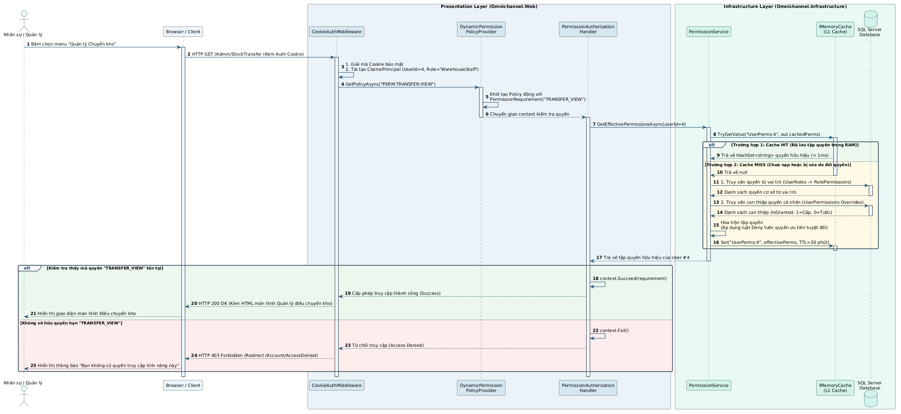

**Hình 3.1. Sơ đồ tuần tự luồng phân giải quyền động 3 tầng khi gửi yêu cầu HTTP**  

*(Nguồn: Thiết kế hệ thống giải pháp Canmake Beauty)*


---


### 3.3.2. Sơ đồ tuần tự 02: Luồng đặt hàng trực tuyến và trừ tồn kho hai giai đoạn


```plantuml

@startuml SD02_FEFO_Two_Phase_Reservation

skinparam backgroundColor #FFFFFF

skinparam defaultFontName "Times New Roman"

skinparam defaultFontSize 12

skinparam roundCorner 6

skinparam shadowing false

skinparam ArrowColor #1B4F72

skinparam ArrowThickness 1.2

skinparam SequenceLifeLineBorderColor #1B4F72

skinparam SequenceLifeLineBackgroundColor #EBF5FB

skinparam SequenceGroupBorderColor #2C3E50

skinparam SequenceGroupBackgroundColor #F8F9F9

skinparam SequenceGroupHeaderFontColor #1B4F72

skinparam SequenceGroupFontSize 11

skinparam DividerFontColor #1B4F72

skinparam DividerFontSize 12

skinparam DividerFontStyle bold

autonumber


actor "Khách hàng\n(Customer)" as Customer #E8F8F5

participant "CheckoutController\n(Web Presentation)" as CheckoutCtrl #D4E6F1


box "Application & Infrastructure Core" #EAF2F8

    participant "OrderWorkflowService" as OrderSvc #D4E6F1

    participant "InventoryAllocation\nEngine" as AllocEngine #D4E6F1

    participant "PaymentService\n(VNPay Gateway)" as PaymentSvc #D4E6F1

end box


database "SQL Server Database\n(ApplicationDbContext)" as DB #D1F2EB

actor "Cổng Thanh toán\nVNPay Sandbox" as VNPayGate #FDEDEC


== GIAI ĐOẠN 1: KHÓA GIỮ CHỖ TỒN KHO TẠM TÍNH (SOFT RESERVE THEO THUẬT TOÁN FEFO) ==


Customer -> CheckoutCtrl: Bấm "Xác nhận Thanh toán Đặt hàng"\n(POST /Checkout/ProcessOrder)

activate CheckoutCtrl


CheckoutCtrl -> OrderSvc: CreateOrderAsync(checkoutDto)

activate OrderSvc


OrderSvc -> AllocEngine: ReserveInventoryAsync(storeId=1, items)

activate AllocEngine


AllocEngine -> DB: Truy vấn StoreInventories & ProductBatches\n(Sắp xếp hạn dùng ExpDate ASC - Ưu tiên lô cận date nhất)

activate DB

DB --> AllocEngine: Dữ liệu Lô #LOT-26A (Hạn 15/12/2026, Tồn khả dụng = 5)

deactivate DB


AllocEngine -> AllocEngine: Kiểm tra AvailableQuantity >= Yêu cầu\n(5 >= 2 -> Đủ điều kiện cấp phát)


AllocEngine -> DB: Cập nhật StoreInventories:\nTăng ReservedQuantity += 2 (PhysicalQuantity giữ nguyên)

activate DB

DB --> AllocEngine: Xác nhận ghi nhận Soft Reserve thành công

deactivate DB


AllocEngine --> OrderSvc: Cấp phát thành công: Chỉ định Lô #LOT-26A (Số lượng: 2)

deactivate AllocEngine


OrderSvc -> DB: INSERT Orders (Trạng thái Status='PENDING', PaymentStatus='UNPAID')

activate DB

DB --> OrderSvc: Khởi tạo OrderId = 2048

deactivate DB


OrderSvc -> DB: INSERT OrderDetails (OrderId=2048, ProductBatchId=LOT-26A, Quantity=2)


OrderSvc -> PaymentSvc: CreatePaymentUrl(orderId=2048, amount=850.000 đ)

activate PaymentSvc

PaymentSvc --> OrderSvc: Trả về Payment URL kèm chữ ký số bảo mật SecureHash

deactivate PaymentSvc


OrderSvc --> CheckoutCtrl: Kết quả khởi tạo đơn hàng thành công kèm VNPay Payment URL

deactivate OrderSvc


CheckoutCtrl --> Customer: Điều hướng trình duyệt chuyển sang Cổng thanh toán VNPay

deactivate CheckoutCtrl


== GIAI ĐOẠN 2: CHỐT TRỪ KHO VẬT LÝ KHI THANH TOÁN THÀNH CÔNG (HARD DEDUCT) ==


Customer -> VNPayGate: Nhập OTP xác thực & hoàn tất giao dịch thanh toán

activate VNPayGate


VNPayGate -> CheckoutCtrl: Gửi bản tin Webhook IPN Server-to-Server\n(GET /Checkout/VnpayIpn?vnp_ResponseCode=00&vnp_SecureHash=...)

deactivate VNPayGate

activate CheckoutCtrl


CheckoutCtrl -> PaymentSvc: ProcessVnpayCallbackAsync(queryParams)

activate PaymentSvc


PaymentSvc -> PaymentSvc: Xác thực chữ ký điện tử HMAC-SHA512\n(So khớp vnp_SecureHash với Secret Key)

PaymentSvc --> CheckoutCtrl: Chữ ký hợp lệ, giao dịch thành công (ResponseCode = '00')

deactivate PaymentSvc


CheckoutCtrl -> OrderSvc: ConfirmPaymentAndAllocateInventoryAsync(orderId=2048)

activate OrderSvc


OrderSvc -> DB: 1. Mở giao dịch CSDL (BeginTransactionAsync)

activate DB


OrderSvc -> DB: 2. UPDATE StoreInventories:\nGiảm PhysicalQuantity -= 2 và Giảm ReservedQuantity -= 2

OrderSvc -> DB: 3. UPDATE ProductBatches:\nGiảm số lượng tồn thực tế của Lô #LOT-26A -= 2

OrderSvc -> DB: 4. INSERT InventoryLogs:\nLoại 'SALE_ONLINE', Tham chiếu 'ORD-2048', Lô #LOT-26A

OrderSvc -> DB: 5. UPDATE Orders:\nChuyển Status='PROCESSING', PaymentStatus='PAID'


OrderSvc -> DB: 6. Xác nhận giao dịch nguyên tử (CommitTransactionAsync)

DB --> OrderSvc: Cam kết dữ liệu thành công (ACID Transaction)

deactivate DB


OrderSvc --> CheckoutCtrl: Hoàn tất chốt kho vật lý và gạch nợ đơn hàng

deactivate OrderSvc


CheckoutCtrl --> VNPayGate: Phản hồi HTTP 200 OK\n({"RspCode":"00", "Message":"Confirm Success"})

deactivate CheckoutCtrl


CheckoutCtrl --> Customer: Điều hướng trang cảm ơn (Hiển thị đơn hàng ORD-2048 thành công)

@enduml

```


#### Diễn giải luồng kỹ thuật:

- Giai đoạn 1 (Soft Reserve): Hệ thống tăng trường `ReservedQuantity` trên lô hàng có hạn sử dụng gần nhất (`ExpDate ASC`). Khách hàng có 15 phút an toàn để thanh toán mà không sợ bị người khác mua mất, trong khi quầy POS vẫn biết chính xác số lượng tồn khả dụng còn lại.

- Giai đoạn 2 (Hard Deduct): Khi nhận tín hiệu thanh toán qua Webhook, hệ thống đồng thời trừ cả tồn kho vật lý và tồn kho giữ chỗ trong một Database Transaction duy nhất. Lô hàng đã xuất được gắn cứng vào `OrderDetails`, bảo đảm tính minh bạch tuyệt đối về hạn sử dụng.


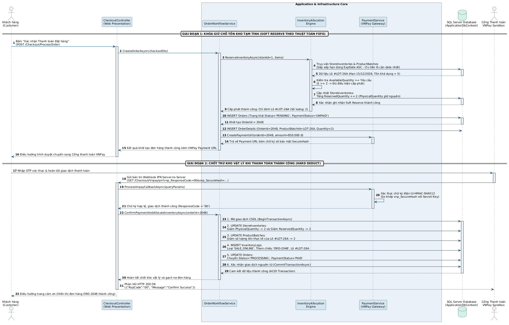

**Hình 3.2. Sơ đồ tuần tự luồng đặt hàng trực tuyến và trừ tồn kho 2 giai đoạn**  

*(Nguồn: Thiết kế hệ thống giải pháp Canmake Beauty)*


---


### 3.3.3. Sơ đồ tuần tự 03: Luồng quản lý vòng đời ca làm việc và kiểm toán két tiền thu ngân


```plantuml

@startuml SD03_POS_Shift_Lifecycle

skinparam backgroundColor #FFFFFF

skinparam defaultFontName "Times New Roman"

skinparam defaultFontSize 12

skinparam roundCorner 6

skinparam shadowing false

skinparam ArrowColor #1B4F72

skinparam ArrowThickness 1.2

skinparam SequenceLifeLineBorderColor #1B4F72

skinparam SequenceLifeLineBackgroundColor #EBF5FB

skinparam SequenceGroupBorderColor #2C3E50

skinparam SequenceGroupBackgroundColor #F8F9F9

skinparam SequenceGroupHeaderFontColor #1B4F72

skinparam SequenceGroupFontSize 11

skinparam DividerFontColor #1B4F72

skinparam DividerFontSize 12

skinparam DividerFontStyle bold

autonumber


actor "Thu ngân POS\n(Cashier)" as Cashier #E8F8F5

participant "PosShiftController\n(Web Presentation)" as ShiftCtrl #D4E6F1


box "Application & Infrastructure Core" #EAF2F8

    participant "PosShiftService\n(Quản lý ca)" as ShiftSvc #D4E6F1

    participant "FinanceService\n(Sổ cái tài chính)" as FinanceSvc #D4E6F1

end box


database "SQL Server Database\n(ApplicationDbContext)" as DB #D1F2EB


== BƯỚC 1: MỞ CA LÀM VIỆC ĐẦU NGÀY (OPEN SHIFT & KHAI BÁO TIỀN ĐẦU CA) ==


Cashier -> ShiftCtrl: Khai báo số tiền mặt lẻ đầu ca: 1.000.000 đ\n(POST /Admin/PosShift/Open)

activate ShiftCtrl


ShiftCtrl -> ShiftSvc: OpenShiftAsync(userId=5, storeId=2, initialCash=1000000)

activate ShiftSvc


ShiftSvc -> DB: Kiểm tra xem chi nhánh có ca nào đang mở (Status='OPEN') hay không

activate DB

DB --> ShiftSvc: Hợp lệ (Không có ca mở dở dang tại chi nhánh)

deactivate DB


ShiftSvc -> DB: INSERT PosShifts (ShiftCode='SHIFT-01', OpeningBalance=1000000, Status='OPEN')

activate DB

DB --> ShiftSvc: Sinh khóa chính ShiftId = 88

deactivate DB


ShiftSvc -> DB: INSERT PosDrawerTransactions\n(ShiftId=88, Type='INITIAL_FLOAT', Amount=1000000, Reason='Tiền mặt lẻ đầu ca')


ShiftSvc --> ShiftCtrl: Xác nhận mở ca thành công (ShiftId = 88)

deactivate ShiftSvc


ShiftCtrl --> Cashier: Kích hoạt giao diện màn hình bán hàng POS

deactivate ShiftCtrl


== BƯỚC 2: PHÁT SINH GIAO DỊCH BÁN HÀNG VÀ RÚT TIỀN KÉT GIỮA CA ==


Cashier -> ShiftCtrl: Thanh toán đơn hàng tại quầy (Đơn 500.000 đ: Thu tiền mặt 300.000 đ)

activate ShiftCtrl


ShiftCtrl -> ShiftSvc: RecordOrderPaymentAsync(shiftId=88, cashAmount=300000)

activate ShiftSvc


ShiftSvc -> DB: Cập nhật PosShifts: Tích lũy CashSalesTotal += 300000

activate DB

DB --> ShiftSvc: Ghi nhận thành công

deactivate DB


ShiftSvc --> ShiftCtrl: Xác nhận cộng doanh thu tiền mặt vào ca

deactivate ShiftSvc


ShiftCtrl --> Cashier: In hóa đơn bán hàng cho khách

deactivate ShiftCtrl


Cashier -> ShiftCtrl: Thao tác rút bớt tiền nộp két sắt trung tâm: 500.000 đ\n(POST /Admin/PosShift/AddDrawerTransaction)

activate ShiftCtrl


ShiftCtrl -> ShiftSvc: AddDrawerTransactionAsync(shiftId=88, Type='PAY_OUT', Amount=500000)

activate ShiftSvc


ShiftSvc -> DB: INSERT PosDrawerTransactions\n(ShiftId=88, Type='PAY_OUT', Amount=500000, Reason='Nộp két an toàn trung tâm')

activate DB

DB --> ShiftSvc: Ghi nhận giao dịch rút két thành công

deactivate DB


ShiftSvc --> ShiftCtrl: Xác nhận rút tiền thành công

deactivate ShiftSvc


ShiftCtrl --> Cashier: In phiếu chi rút két (Pay-Out Voucher)

deactivate ShiftCtrl


== BƯỚC 3: ĐỐI SOÁT CHÊNH LỆCH MÙ VÀ ĐÓNG CA CUỐI NGÀY (BLIND RECONCILIATION & Z-REPORT) ==


Cashier -> ShiftCtrl: Kiểm đếm thực tế có 780.000 đ trong két -> Yêu cầu chốt ca\n(POST /Admin/PosShift/Close)

activate ShiftCtrl


ShiftCtrl -> ShiftSvc: CloseShiftAsync(shiftId=88, actualCashCounted=780000)

activate ShiftSvc


ShiftSvc -> DB: Tải toàn bộ dữ liệu giao dịch của Ca #88\n(InitialFloat, CashSalesTotal, PayIns, PayOuts)

activate DB

DB --> ShiftSvc: Dữ liệu giao dịch ca bán hàng

deactivate DB


ShiftSvc -> ShiftSvc: 1. Tính tiền lý thuyết hệ thống:\nExpectedCash = Initial (1.000.000) + Sales (300.000) - PayOut (500.000) = 800.000 đ

ShiftSvc -> ShiftSvc: 2. Tính chênh lệch đối soát két mù:\nDifference = Actual (780.000) - Expected (800.000) = -20.000 đ (Thiếu hụt 20k)


ShiftSvc -> DB: UPDATE PosShifts:\nStatus='CLOSED', ActualCash=780000, ExpectedCash=800000, Difference=-20000, ClosedAt=GETDATE()

activate DB

DB --> ShiftSvc: Xác nhận cập nhật đóng ca

deactivate DB


ShiftSvc -> FinanceSvc: RecordShiftClosingFinancialLedgerAsync(shiftSummary)

activate FinanceSvc


FinanceSvc -> DB: INSERT FinancialLedgers\n(Ghi nhận bút toán doanh thu thuần và hạch toán tổn thất tiền mặt két)

activate DB

DB --> FinanceSvc: Ghi nhận sổ cái thành công

deactivate DB

deactivate FinanceSvc


ShiftSvc --> ShiftCtrl: Trả về báo cáo kết ca (Z-Report DTO)

deactivate ShiftSvc


ShiftCtrl --> Cashier: Xuất biên bản kết ca Z-Report, hiển thị cảnh báo hao hụt tiền két -20.000 đ

deactivate ShiftCtrl

@enduml

```


#### Diễn giải luồng kỹ thuật:

- Ràng buộc độc quyền ca: Mỗi chi nhánh cửa hàng tại một thời điểm chỉ cho phép duy nhất một ca làm việc ở trạng thái `OPEN`.

- Đối soát mù (Blind Reconciliation): Thu ngân không được xem trước con số tiền mặt lý thuyết do máy tính tính toán. Thu ngân bắt buộc phải tự đếm tiền vật lý thực tế trong két và nhập vào hệ thống. Việc tính toán độ lệch `Difference` hoàn toàn do máy chủ thực thi ngầm.


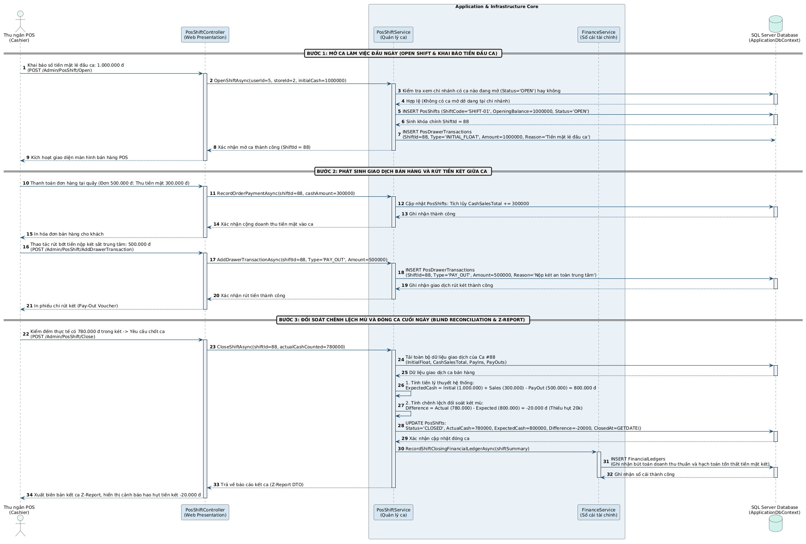

**Hình 3.3. Sơ đồ tuần tự luồng quản lý vòng đời ca làm việc và kiểm toán két tiền thu ngân**  

*(Nguồn: Thiết kế hệ thống giải pháp Canmake Beauty)*


---


### 3.3.4. Sơ đồ tuần tự 04: Luồng điều chuyển tồn kho liên chi nhánh ba bước


```plantuml

@startuml SD04_InterBranch_Stock_Transfer

skinparam backgroundColor #FFFFFF

skinparam defaultFontName "Times New Roman"

skinparam defaultFontSize 12

skinparam roundCorner 6

skinparam shadowing false

skinparam ArrowColor #1B4F72

skinparam ArrowThickness 1.2

skinparam SequenceLifeLineBorderColor #1B4F72

skinparam SequenceLifeLineBackgroundColor #EBF5FB

skinparam SequenceGroupBorderColor #2C3E50

skinparam SequenceGroupBackgroundColor #F8F9F9

skinparam SequenceGroupHeaderFontColor #1B4F72

skinparam SequenceGroupFontSize 11

skinparam DividerFontColor #1B4F72

skinparam DividerFontSize 12

skinparam DividerFontStyle bold

autonumber


actor "Quản lý Chi nhánh Nhận\n(Showroom Ba Đình)" as Receiver #E8F8F5

actor "Thủ kho / Quản lý Xuất\n(Tổng kho Miền Nam)" as Dispatcher #FEF9E7

participant "StockTransferController\n(Web Presentation)" as TransferCtrl #D4E6F1


box "Application & Infrastructure Core" #EAF2F8

    participant "StockTransferService\n(Điều chuyển kho)" as TransferSvc #D4E6F1

    participant "InventoryAllocation\nEngine" as AllocEngine #D4E6F1

end box


database "SQL Server Database\n(ApplicationDbContext)" as DB #D1F2EB


== BƯỚC 1: LẬP ĐỀ XUẤT YÊU CẦU ĐIỀU CHUYỂN (STATUS = PENDING) ==


Receiver -> TransferCtrl: Lập phiếu đề xuất chuyển 50 hộp kem B5\n(POST /Admin/StockTransfer/Create)

activate TransferCtrl


TransferCtrl -> TransferSvc: CreateTransferRequestAsync(dto)

activate TransferSvc


TransferSvc -> DB: INSERT StockTransfers\n(FromStore='WH-MN', ToStore='SH-BD', Status='PENDING')

activate DB

DB --> TransferSvc: Khởi tạo TransferId = 12, Mã phiếu 'TRF-2026-0012'

deactivate DB


TransferSvc -> DB: INSERT StockTransferDetails\n(TransferId=12, ProductId=10, RequestedQty=50)


TransferSvc --> TransferCtrl: Phiếu chuyển tạo thành công: Mã 'TRF-2026-0012'

deactivate TransferSvc


TransferCtrl --> Receiver: Hiển thị phiếu đề xuất ở trạng thái CHỜ DUYỆT (PENDING)

deactivate TransferCtrl


== BƯỚC 2: PHÊ DUYỆT VÀ XUẤT KHO VẬN CHUYỂN THEO FEFO (STATUS = SHIPPED) ==


Dispatcher -> TransferCtrl: Duyệt yêu cầu & bấm "Xuất kho vận chuyển"\n(POST /Admin/StockTransfer/Dispatch)

activate TransferCtrl


TransferCtrl -> TransferSvc: DispatchTransferAsync(transferId=12)

activate TransferSvc


TransferSvc -> AllocEngine: AllocateBatchesFEFOAsync(storeId='WH-MN', productId=10, qty=50)

activate AllocEngine


AllocEngine -> DB: Truy vấn tồn kho lô theo FEFO (ExpDate ASC) tại Tổng kho WH-MN

activate DB

DB --> AllocEngine: Cấp phát 2 lô cận hạn: Lô #LOT-01 (30 sp) & Lô #LOT-02 (20 sp)

deactivate DB


AllocEngine --> TransferSvc: Cấp phát thành công danh sách lô xuất kho

deactivate AllocEngine


TransferSvc -> DB: 1. Mở giao dịch CSDL (BeginTransactionAsync)

activate DB


TransferSvc -> DB: 2. UPDATE StoreInventories: Giảm PhysicalQuantity tại Kho Miền Nam (-50)

TransferSvc -> DB: 3. UPDATE ProductBatches: Trừ số lượng tồn từng Lô (#LOT-01: -30, #LOT-02: -20)

TransferSvc -> DB: 4. INSERT InventoryLogs: Loại 'TRANSFER_OUT', Kho WH-MN, Mã 'TRF-2026-0012'

TransferSvc -> DB: 5. UPDATE StockTransfers: Set Status='SHIPPED', TotalSentQty=50, ShippedAt=UTC


TransferSvc -> DB: 6. Xác nhận giao dịch nguyên tử (CommitTransactionAsync)

DB --> TransferSvc: Dữ liệu xuất kho cam kết thành công

deactivate DB


TransferSvc --> TransferCtrl: Xuất kho thành công, hàng bắt đầu lưu thông trên đường

deactivate TransferSvc


TransferCtrl --> Dispatcher: In phiếu xuất kho vận chuyển kiêm lệnh điều động (IN TRANSIT)

deactivate TransferCtrl


== BƯỚC 3: TIẾP NHẬN, ĐỐI SOÁT VÀ XÁC NHẬN NHẬP KHO ĐÍCH (STATUS = COMPLETED) ==


Receiver -> TransferCtrl: Kiểm đếm thực nhận đủ 50 hộp nguyên vẹn -> Bấm "Xác nhận nhập kho"\n(POST /Admin/StockTransfer/Receive)

activate TransferCtrl


TransferCtrl -> TransferSvc: ReceiveTransferAsync(transferId=12, receivedQty=50)

activate TransferSvc


TransferSvc -> DB: 1. Mở giao dịch CSDL (BeginTransactionAsync)

activate DB


TransferSvc -> DB: 2. UPDATE StoreInventories: Tăng PhysicalQuantity tại Showroom Ba Đình (+50)

TransferSvc -> DB: 3. Tăng tồn hoặc ghi nhận lô hàng chuyển giao tại chi nhánh đích (#LOT-01: +30, #LOT-02: +20)

TransferSvc -> DB: 4. INSERT InventoryLogs: Loại 'TRANSFER_IN', Kho SH-BD, Mã 'TRF-2026-0012'

TransferSvc -> DB: 5. UPDATE StockTransfers: Set Status='COMPLETED', TotalReceivedQty=50, ReceivedAt=UTC


TransferSvc -> DB: 6. Xác nhận giao dịch nguyên tử (CommitTransactionAsync)

DB --> TransferSvc: Cam kết nhập kho thành công

deactivate DB


TransferSvc --> TransferCtrl: Hoàn tất toàn bộ quy trình điều chuyển liên chi nhánh

deactivate TransferSvc


TransferCtrl --> Receiver: Thông báo nhập kho thành công, tồn kho tại Ba Đình đã sẵn sàng mở bán

deactivate TransferCtrl

@enduml

```


#### Diễn giải luồng kỹ thuật:

- Trừ kho theo giải thuật FEFO tại nguồn: Hệ thống chỉ định đích danh từng lô hàng cụ thể có hạn sử dụng gần nhất tại kho nguồn để đưa lên xe vận chuyển.

- Trạng thái hàng trên đường (In Transit): Trạng thái `SHIPPED` giúp kế toán kiểm soát chính xác lượng hàng đang lưu thông trên đường, không bị ghi nhận trùng lặp vào tồn kho có thể bán của bất kỳ chi nhánh nào.

- Kiểm đếm thực nhận và ghi tăng: Tồn kho tại chi nhánh nhận chỉ thực sự tăng lên khi thủ kho tại đích đối chiếu tem niêm phong và ký xác nhận trên phần mềm.


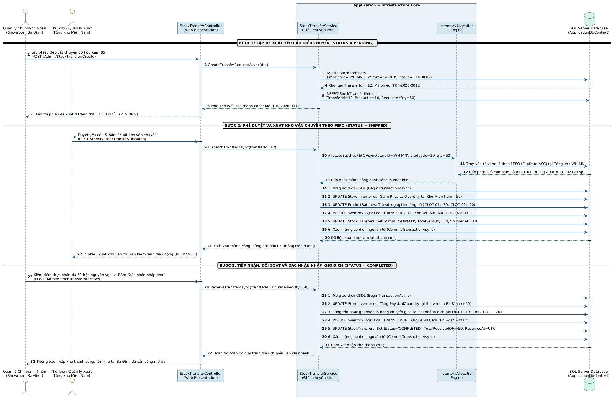

**Hình 3.4. Sơ đồ tuần tự luồng điều chuyển tồn kho liên chi nhánh 3 bước**  

*(Nguồn: Thiết kế hệ thống giải pháp Canmake Beauty)*


---


# Chương IV

# HIỆN THỰC HÓA VÀ CÀI ĐẶT HỆ THỐNG


## 4.1. Môi trường triển khai và cấu trúc mã nguồn giải pháp


### 4.1.1. Môi trường phần mềm và công cụ phát triển

- Nền tảng thực thi: Microsoft .NET SDK phiên bản 8.0 (LTS), ngôn ngữ C# 12 với Primary Constructors, Collection Expressions và Pattern Matching.

- Môi trường phát triển: Visual Studio 2022 Enterprise (17.8+) kết hợp JetBrains Rider 2023.3 và ReSharper.

- Hệ quản trị cơ sở dữ liệu: Microsoft SQL Server 2022 Developer Edition, cấu hình Compatibility Level 160.

- Công cụ tài nguyên giao diện: Node.js 20 LTS, npm, Webpack, HTMX 1.9 và Alpine.js 3.13.


### 4.1.2. Cấu trúc tổ chức mã nguồn trong giải pháp OmnichannelBeautySolution

Toàn bộ mã nguồn giải pháp được phân bổ theo Clean Architecture gồm 5 dự án:

- `Omnichannel.Domain`: Chứa 19 tệp thực thể định nghĩa 65 bảng dữ liệu quan hệ POCO và các quy tắc kiểm tra bất biến nội tại.

- `Omnichannel.Application`: Định nghĩa 25 giao diện dịch vụ xử lý luồng nghiệp vụ và 37 tệp DTO truyền tải dữ liệu.

- `Omnichannel.Infrastructure`: Cài đặt `ApplicationDbContext` (EF Core 8), 27 dịch vụ hạ tầng, thuật toán trừ kho FEFO, bộ chặn bắt `AuditLogInterceptor` và tích hợp cổng ngoài.

- `Omnichannel.Web`: Dự án khởi động chứa 40 Controllers, 2 SignalR Hubs, Middlewares và 4 Razor Layouts chuyên biệt.

- `Omnichannel.Tests`: Dự án kiểm thử độc lập gồm 21 tệp test Unit, Integration và k6 script.


---


## 4.2. Hiện thực hóa các Giao diện chức năng tiêu biểu


### 4.2.1. Phân vùng Giao diện Mua sắm Trực tuyến (Storefront Area)


**Hình 4.1. Giao diện Trang chủ Hệ thống Thương mại Điện tử Canmake Beauty**  

*(Nguồn: Chụp trực tiếp từ giao diện thực tế hệ thống)*


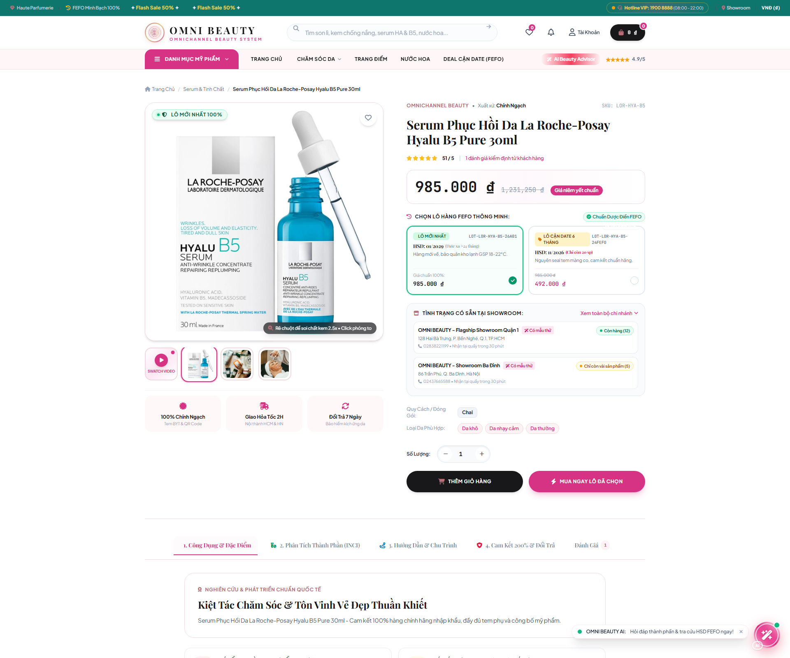

**Hình 4.2. Giao diện Chi tiết Sản phẩm với Bảng thành phần Hoạt chất mỹ phẩm**  

*(Nguồn: Chụp trực tiếp từ giao diện thực tế hệ thống)*


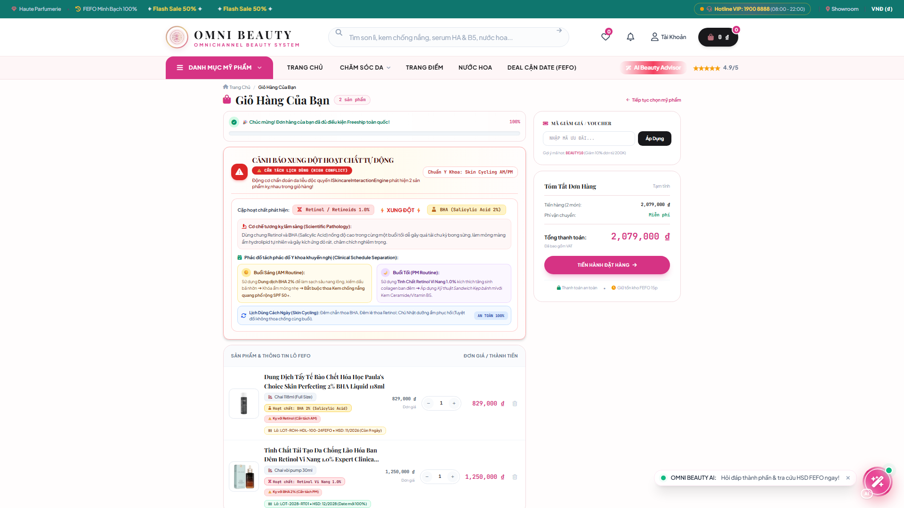

**Hình 4.3. Giao diện Giỏ hàng và Cơ chế Cảnh báo Xung đột Hoạt chất tự động**  

*(Nguồn: Chụp trực tiếp từ giao diện thực tế hệ thống)*


---


### 4.2.2. Phân vùng Bốn Khung Giao diện Quản trị Chuyên biệt (Back-office Area)


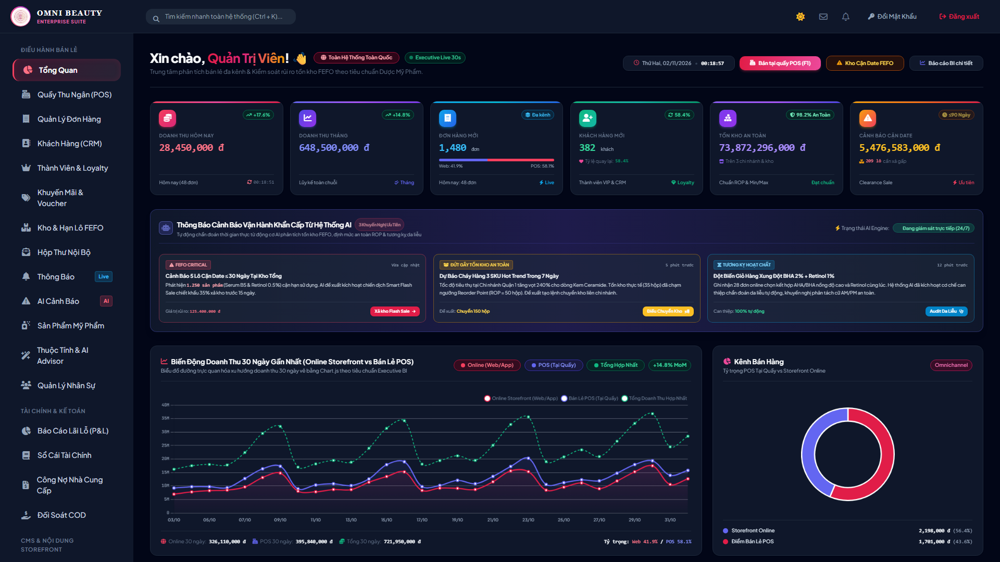

**Hình 4.4. Giao diện Bảng điều khiển Quản trị Trung tâm (Admin Dashboard)**  

*(Nguồn: Chụp trực tiếp từ giao diện thực tế hệ thống)*


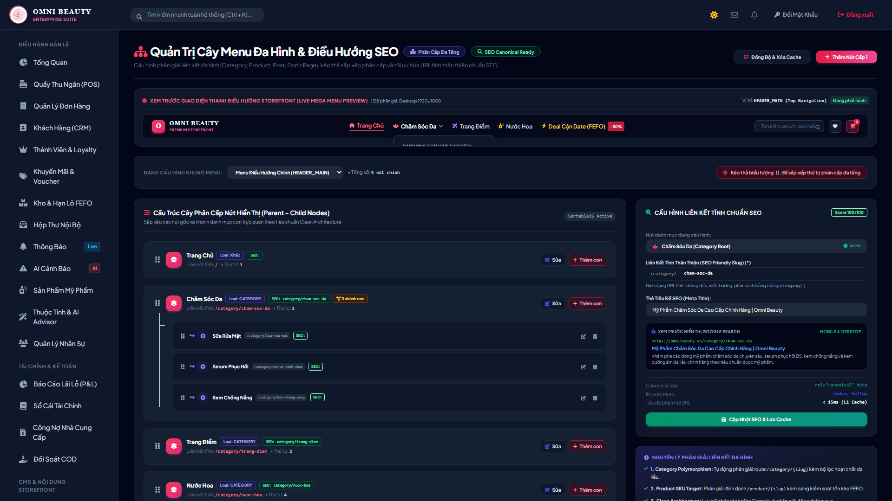

**Hình 4.5. Giao diện Quản trị Cây Menu Đa hình và Điều hướng SEO**  

*(Nguồn: Chụp trực tiếp từ giao diện thực tế hệ thống)*


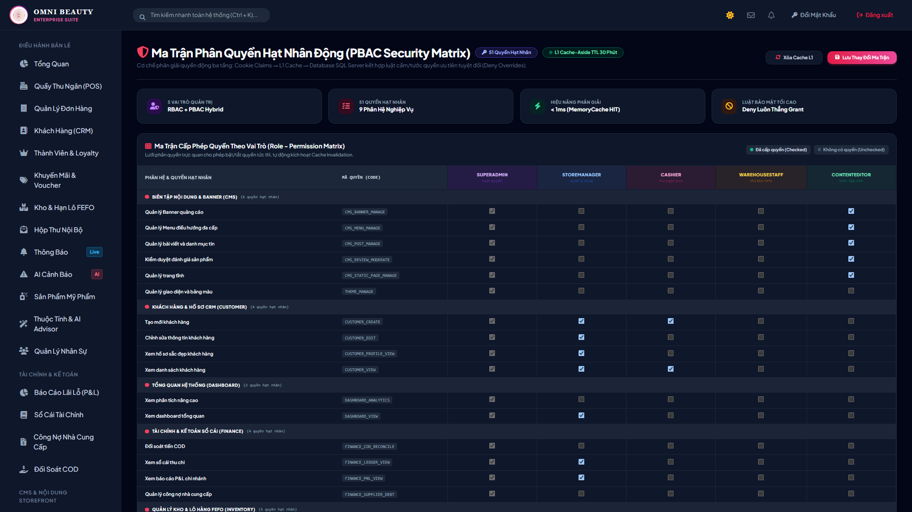

**Hình 4.6. Giao diện Ma trận Phân quyền Hạt nhân Động (PBAC Security Matrix)**  

*(Nguồn: Chụp trực tiếp từ giao diện thực tế hệ thống)*


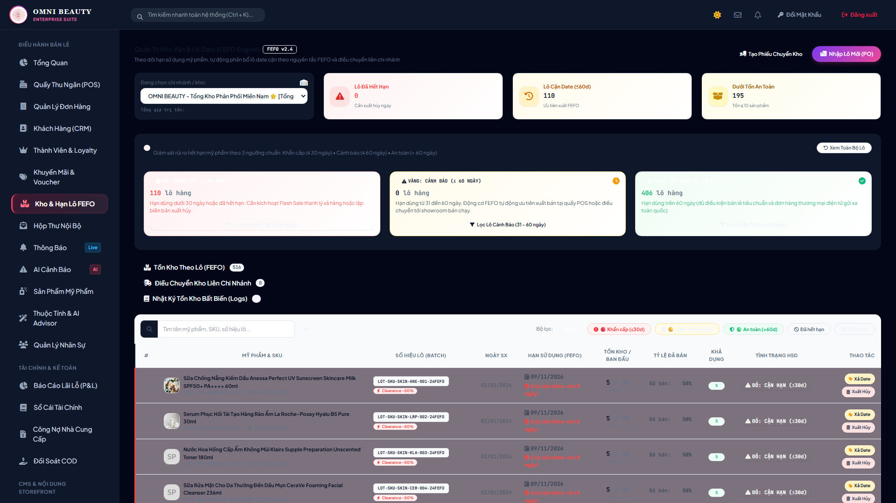

**Hình 4.7. Giao diện Giám sát Tồn kho Chi nhánh và Cảnh báo Hạn dùng FEFO**  

*(Nguồn: Chụp trực tiếp từ giao diện thực tế hệ thống)*


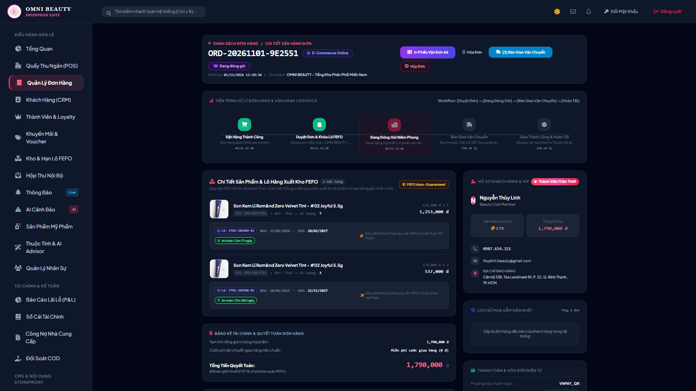

**Hình 4.8. Giao diện Quản lý Đơn hàng Đa kênh và Cấp phát Lô tự động**  

*(Nguồn: Chụp trực tiếp từ giao diện thực tế hệ thống)*


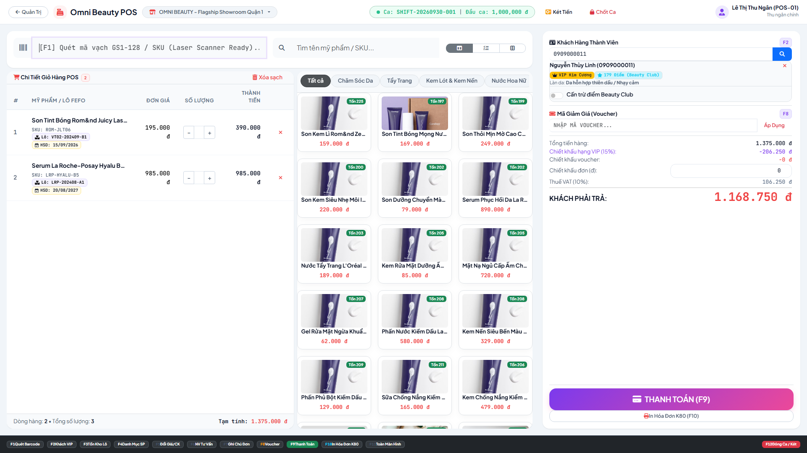

**Hình 4.9. Giao diện Màn hình Bán hàng Cảm ứng tại Quầy (POS Touchscreen)**  

*(Nguồn: Chụp trực tiếp từ giao diện thực tế hệ thống)*


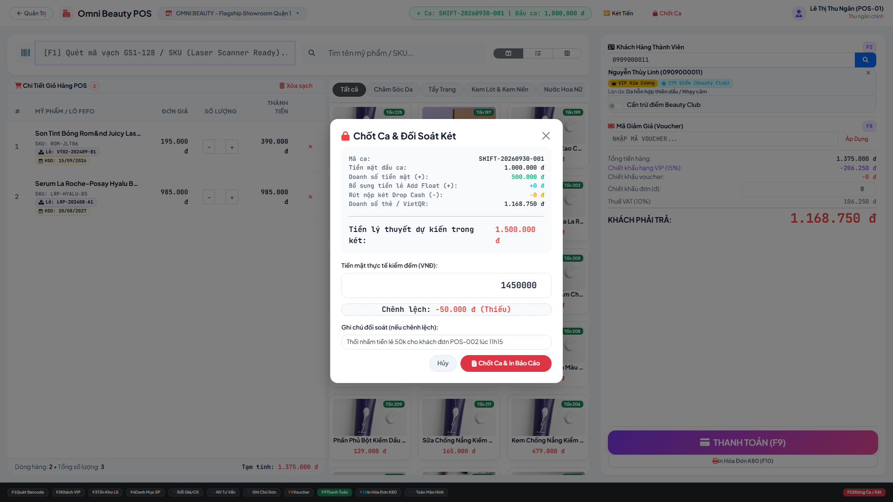

**Hình 4.10. Giao diện Quản lý Đóng - Mở Ca và Đối soát Tiền mặt Két thu ngân**  

*(Nguồn: Chụp trực tiếp từ giao diện thực tế hệ thống)*


---


## 4.3. Hiện thực hóa các Thuật toán và Module Kỹ thuật cốt lõi


### 4.3.1. Thuật toán Cấp phát Tồn kho theo Hạn sử dụng FEFO (InventoryAllocationEngine.cs)

```csharp

namespace Omnichannel.Infrastructure.Services

{

    public class InventoryAllocationEngine : IInventoryAllocationEngine

    {

        private readonly ApplicationDbContext _context;


        public InventoryAllocationEngine(ApplicationDbContext context)

        {

            _context = context;

        }


        public async Task<List<AllocatedBatchDto>> AllocateBatchesFEFOAsync(

            int storeId, int productId, int requestedQuantity, CancellationToken ct = default)

        {

            if (requestedQuantity <= 0)

                throw new ArgumentException("Số lượng yêu cầu cấp phát phải lớn hơn 0.", nameof(requestedQuantity));


            var today = DateTime.UtcNow.Date;

            var minSafeDate = today.AddDays(30); // Lô dưới 30 ngày bị khóa an toàn, không xuất bán


            // Truy vấn các lô hàng còn tồn khả dụng tại chi nhánh, sắp xếp tăng dần theo Hạn sử dụng (ExpDate ASC)

            var availableBatches = await _context.StoreInventories

                .Include(si => si.ProductBatch)

                .Where(si => si.StoreId == storeId 

                          && si.ProductBatch.ProductId == productId

                          && si.ProductBatch.Status == "ACTIVE"

                          && si.ProductBatch.ExpDate > minSafeDate

                          && (si.PhysicalQuantity - si.ReservedQuantity) > 0)

                .OrderBy(si => si.ProductBatch.ExpDate)

                .ToListAsync(ct);


            // Kiểm tra tổng tồn kho khả dụng của tất cả các lô có đủ đáp ứng hay không

            int totalAvailable = availableBatches.Sum(si => si.PhysicalQuantity - si.ReservedQuantity);

            if (totalAvailable < requestedQuantity)

            {

                throw new InvalidOperationException(

                    $"Tồn kho khả dụng tại chi nhánh ({totalAvailable}) không đủ đáp ứng số lượng yêu cầu ({requestedQuantity}).");

            }


            var allocations = new List<AllocatedBatchDto>();

            int remainingToAllocate = requestedQuantity;


            // Thuật toán duyệt tham lam: Vét cạn lô cận hạn nhất trước

            foreach (var inventory in availableBatches)

            {

                int batchAvailable = inventory.PhysicalQuantity - inventory.ReservedQuantity;

                int takeQuantity = Math.Min(remainingToAllocate, batchAvailable);


                allocations.Add(new AllocatedBatchDto

                {

                    ProductBatchId = inventory.ProductBatchId,

                    BatchNumber = inventory.ProductBatch.BatchNumber,

                    ExpDate = inventory.ProductBatch.ExpDate,

                    AllocatedQuantity = takeQuantity,

                    PurchaseCostPrice = inventory.ProductBatch.ImportCost

                });


                remainingToAllocate -= takeQuantity;

                if (remainingToAllocate == 0)

                    break;

            }


            return allocations;

        }

    }

}

```


#### Thuyết minh giải thuật:

- Mệnh đề `.OrderBy(si => si.ProductBatch.ExpDate)` bảo đảm các bản ghi tồn kho được sắp xếp tăng dần theo hạn sử dụng: lô nào hết hạn sớm nhất sẽ nằm ở đầu danh sách.

- Kiểm tra tổng tồn kho khả dụng (`PhysicalQuantity - ReservedQuantity`) trên toàn bộ các lô hợp lệ. Nếu tổng số lượng nhỏ hơn số lượng khách đặt, hệ thống lập tức ném ra ngoại lệ và chấm dứt tiến trình.

- Vòng lặp duyệt qua từng lô hàng theo thứ tự ưu tiên, dùng `Math.Min` để lấy tối đa số lượng có thể từ lô cận hạn nhất, sau đó chuyển tiếp sang lô kế tiếp cho đến khi đủ số lượng yêu cầu.


---


### 4.3.2. Động cơ Phân quyền Động 3 tầng PBAC (DynamicPermissionPolicyProvider và PermissionAuthorizationHandler)

```csharp

namespace Omnichannel.Infrastructure.Security

{

    public class DynamicPermissionPolicyProvider : DefaultAuthorizationPolicyProvider

    {

        private readonly AuthorizationOptions _options;


        public DynamicPermissionPolicyProvider(IOptions<AuthorizationOptions> options) : base(options)

        {

            _options = options.Value;

        }


        public override async Task<AuthorizationPolicy?> GetPolicyAsync(string policyName)

        {

            var policy = await base.GetPolicyAsync(policyName);

            if (policy != null) return policy;


            if (policyName.StartsWith("PERM:", StringComparison.OrdinalIgnoreCase))

            {

                var dynamicPolicy = new AuthorizationPolicyBuilder()

                    .RequireAuthenticatedUser()

                    .AddRequirements(new PermissionRequirement(policyName))

                    .Build();


                _options.AddPolicy(policyName, dynamicPolicy);

                return dynamicPolicy;

            }


            return null;

        }

    }


    public class PermissionAuthorizationHandler : AuthorizationHandler<PermissionRequirement>

    {

        private readonly IPermissionService _permissionService;


        public PermissionAuthorizationHandler(IPermissionService permissionService)

        {

            _permissionService = permissionService;

        }


        protected override async Task HandleRequirementAsync(

            AuthorizationHandlerContext context, PermissionRequirement requirement)

        {

            if (context.User?.Identity == null || !context.User.Identity.IsAuthenticated)

                return;


            // TẦNG 1: ĐẶC QUYỀN TỐI CAO SUPERADMIN (GOD MODE BYPASS)

            if (context.User.IsInRole("SuperAdmin") || context.User.HasClaim(ClaimTypes.Role, "SuperAdmin"))

            {

                context.Succeed(requirement);

                return;

            }


            var userIdClaim = context.User.FindFirst(ClaimTypes.NameIdentifier)?.Value;

            if (!int.TryParse(userIdClaim, out var userId))

                return;


            // TẦNG 2 & 3: TRUY VẤN VÀ ĐỐI SOÁT TẬP QUYỀN HỮU HIỆU (CACHE + USER OVERRIDES)

            var effectivePermissions = await _permissionService.GetEffectivePermissionsAsync(userId);


            if (effectivePermissions.Contains(requirement.PermissionCode) ||

                effectivePermissions.Contains(requirement.PolicyName))

            {

                context.Succeed(requirement);

            }

        }

    }

}

```


#### Thuyết minh giải thuật:

- `DynamicPermissionPolicyProvider` phân tích tiền tố `PERM:` và tạo động một đối tượng `AuthorizationPolicy` kèm điều kiện `PermissionRequirement` tương ứng ngay trong lần đầu tiên được gọi mà không cần khai báo tĩnh trong `Program.cs`.

- `PermissionAuthorizationHandler` thực hiện thuật toán thẩm định quyền ba tầng: kiểm tra God Mode SuperAdmin, tra cứu cache `IMemoryCache` (TTL 30 phút), và hòa trộn các bản ghi can thiệp quyền cá nhân trong `UserPermissions` (ưu tiên tuyệt đối cờ `IsGranted = false` để tước quyền).


---


### 4.3.3. Bộ Điều khiển Định tuyến Động và Chuyển hướng SEO 301 (SlugRedirectMiddleware.cs)

```csharp

namespace Omnichannel.Web.Middlewares

{

    public class SlugRedirectMiddleware

    {

        private readonly RequestDelegate _next;

        private readonly ILogger<SlugRedirectMiddleware> _logger;


        public SlugRedirectMiddleware(RequestDelegate next, ILogger<SlugRedirectMiddleware> logger)

        {

            _next = next;

            _logger = logger;

        }


        public async Task InvokeAsync(HttpContext context, ApplicationDbContext dbContext)

        {

            var path = context.Request.Path.Value?.Trim().ToLowerInvariant();


            if (string.IsNullOrEmpty(path) || path == "/" || path.StartsWith("/admin") || 

                path.StartsWith("/api") || path.Contains('.'))

            {

                await _next(context);

                return;

            }


            var currentSlug = path.TrimStart('/');

            if (currentSlug.Contains('/'))

            {

                currentSlug = currentSlug.Substring(currentSlug.LastIndexOf('/') + 1);

            }


            var redirectEntry = await dbContext.SlugRedirects

                .AsNoTracking()

                .FirstOrDefaultAsync(sr => sr.OldSlug == currentSlug);


            if (redirectEntry != null && !string.Equals(redirectEntry.OldSlug, redirectEntry.NewSlug, StringComparison.OrdinalIgnoreCase))

            {

                _logger.LogInformation("Phát hiện URL cũ '{OldSlug}'. Thực hiện chuyển hướng 301 sang '{NewSlug}'", 

                    redirectEntry.OldSlug, redirectEntry.NewSlug);


                string targetUrl = redirectEntry.EntityType.ToUpperInvariant() switch

                {

                    "CATEGORY" => "/category/" + redirectEntry.NewSlug,

                    "PRODUCT"  => "/product/" + redirectEntry.NewSlug,

                    "POST"     => "/blog/" + redirectEntry.NewSlug,

                    _          => "/" + redirectEntry.NewSlug

                };


                context.Response.StatusCode = StatusCodes.Status301MovedPermanently;

                context.Response.Headers[HeaderNames.Location] = targetUrl;

                return;

            }


            await _next(context);

        }

    }

}

```


#### Thuyết minh giải thuật:

- Bỏ qua các yêu cầu tài nguyên tĩnh hoặc API nội bộ.

- Truy vấn bảng `SlugRedirects` bằng `.AsNoTracking()` để kiểm tra slug cũ.

- Tự động tái tạo URL đích và trả về mã phản hồi `StatusCodes.Status301MovedPermanently` cùng tiêu đề `Location`, giúp công cụ tìm kiếm cập nhật chỉ mục mà không làm gãy liên kết.


---


### 4.3.4. Tiến trình Tự động hóa Giám sát Vận hành AI (AlertBackgroundWorker.cs)

```csharp

namespace Omnichannel.Web.BackgroundServices

{

    public class AlertBackgroundWorker : BackgroundService

    {

        private readonly IServiceScopeFactory _scopeFactory;

        private readonly ILogger<AlertBackgroundWorker> _logger;

        private static readonly TimeSpan ScanInterval = TimeSpan.FromMinutes(15);


        public AlertBackgroundWorker(IServiceScopeFactory scopeFactory, ILogger<AlertBackgroundWorker> logger)

        {

            _scopeFactory = scopeFactory;

            _logger = logger;

        }


        protected override async Task ExecuteAsync(CancellationToken stoppingToken)

        {

            using var timer = new PeriodicTimer(ScanInterval);


            while (!stoppingToken.IsCancellationRequested && await timer.WaitForNextTickAsync(stoppingToken))

            {

                try

                {

                    await PerformSystemRiskScanAsync(stoppingToken);

                }

                catch (Exception ex)

                {

                    _logger.LogError(ex, "Lỗi xảy ra trong quá trình quét cảnh báo vận hành tự động.");

                }

            }

        }


        private async Task PerformSystemRiskScanAsync(CancellationToken ct)

        {

            using var scope = _scopeFactory.CreateScope();

            var db = scope.ServiceProvider.GetRequiredService<ApplicationDbContext>();

            var hubContext = scope.ServiceProvider.GetRequiredService<IHubContext<SystemHub>>();


            var today = DateTime.UtcNow.Date;

            var nearExpiryThreshold = today.AddDays(90);


            var expiringBatches = await db.ProductBatches

                .Include(pb => pb.Product)

                .Where(pb => pb.Status == "ACTIVE" 

                          && pb.ExpDate <= nearExpiryThreshold 

                          && pb.CurrentQuantity > 0)

                .ToListAsync(ct);


            foreach (var batch in expiringBatches)

            {

                string entityKey = $"NEAR_EXP_BATCH_{batch.Id}";

                

                bool exists = await db.Alerts.AnyAsync(a => a.EntityKey == entityKey 

                    && a.CreatedAt >= DateTime.UtcNow.AddHours(-12), ct);


                if (!exists)

                {

                    int daysLeft = (batch.ExpDate.Date - today).Days;

                    var alert = new Alert

                    {

                        Type = "NEAR_EXPIRATION",

                        Severity = daysLeft <= 30 ? "DANGER" : "WARNING",

                        Title = $"Lô hàng cận hạn sử dụng: {batch.Product.Name}",

                        Message = $"Lô số {batch.BatchNumber} chỉ còn {daysLeft} ngày là hết hạn (HSD: {batch.ExpDate:dd/MM/yyyy}). Số lượng tồn: {batch.CurrentQuantity}.",

                        EntityKey = entityKey,

                        LinkUrl = "/Admin/Warehouse",

                        CreatedAt = DateTime.UtcNow

                    };


                    db.Alerts.Add(alert);

                    await db.SaveChangesAsync(ct);


                    await hubContext.Clients.All.SendAsync("ReceiveSystemAlert", new

                    {

                        alert.Title,

                        alert.Message,

                        alert.Severity

                    }, ct);

                }

            }

        }

    }

}

```


#### Thuyết minh giải thuật:

- Sử dụng `PeriodicTimer` chu kỳ 15 phút, giải phóng tài nguyên an toàn khi dừng máy chủ.

- Tạo phạm vi tạm thời `_scopeFactory.CreateScope()` để gọi `ApplicationDbContext` (Scoped) an toàn từ `BackgroundService` (Singleton).

- Quét các lô cận hạn dưới 90 ngày còn tồn kho, áp dụng khóa định danh `EntityKey` chống gửi trùng lặp trong 12 giờ và phát sóng cảnh báo Realtime qua SignalR `SystemHub`.


---


# Chương V

# KIỂM THỬ VÀ ĐÁNH GIÁ HỆ THỐNG


## 5.1. Chiến lược Kiểm thử phần mềm


Hệ thống Canmake Beauty Solution áp dụng mô hình Kim tự tháp Kiểm thử bốn tầng toàn diện nhằm bảo đảm độ tin cậy, tính toàn vẹn dữ liệu và an toàn bảo mật trước khi vận hành thực tế:

- **Tầng 1 - Kiểm thử Đơn vị Miền Dữ liệu (Domain Unit Tests):** Xác minh tính bất biến nội tại trên các thực thể thuần C# (POCO Entities), bao gồm công thức tính tồn khả dụng, quy tắc kiểm tra hạn sử dụng và tính toán chi tiết đơn hàng.

- **Tầng 2 - Kiểm thử Đơn vị Dịch vụ Ứng dụng (Application & Service Tests):** Kiểm chứng các ca điều phối nghiệp vụ thông qua cơ sở dữ liệu giả lập trong bộ nhớ (Entity Framework Core InMemory/SQLite), bao gồm thuật toán trừ kho FEFO, quy trình mở/đóng ca POS và ghi sổ cái kế toán.

- **Tầng 3 - Kiểm thử Tích hợp và Bảo mật Phân quyền (Integration & PBAC Security Tests):** Sử dụng `WebApplicationFactory` để kiểm thử toàn diện luồng HTTP Request, xác thực Cookie, phân quyền động dựa trên chính sách (PBAC) và nguyên lý Zero-Trust cô lập dữ liệu theo phạm vi từng chi nhánh.

- **Tầng 4 - Kiểm thử Hiệu năng và Khả năng Chịu tải Đồng thời (Performance & Concurrency Load Testing):** Sử dụng công cụ k6 mô phỏng kịch bản 500 người dùng ảo đồng thời tranh mua sản phẩm khuyến mãi chớp nhoáng (Flash Sale) để kiểm chứng cơ chế chống bán âm kho.


Môi trường và bộ công cụ kiểm thử chuẩn hóa bao gồm: framework kiểm thử xUnit 2.6, thư viện kiểm tra biểu thức FluentAssertions 6.12, công cụ kiểm thử tích hợp ASP.NET Core WebApplicationFactory và động cơ kiểm thử tải k6 CLI.


---


## 5.2. Danh mục và Kết quả thực thi Hai mươi mốt Bộ Kiểm thử Tự động


Toàn bộ 21 bộ kiểm thử tự động trong dự án `Omnichannel.Tests` đều đã vượt qua thành công với tỷ lệ tuyệt đối (100% Pass):


**Bảng 5.1. Danh mục tổng hợp kết quả thực thi 21 bộ kiểm thử tự động trong dự án Omnichannel.Tests**


| STT | Tầng Kiểm thử | Tên Tệp Kiểm thử | Đối tượng Kiểm thử Chính | Bất biến Nghiệp vụ Được Xác minh | Kết quả |

| :---: | :--- | :--- | :--- | :--- | :---: |

| 1 | Domain Unit | `Domain/StoreInventoryTests.cs` | Thực thể `StoreInventory` | Tồn kho khả dụng `GetAvailableQuantity()` luôn bằng `Math.Max(0, Physical - Reserved)`; không bao giờ trả về số âm dù lượng giữ chỗ vượt quá tồn kho vật lý. | **PASS** |

| 2 | Domain Unit | `Domain/ProductBatchTests.cs` | Thực thể `ProductBatch` | Quy tắc hạn dùng FEFO: phát hiện chính xác lô đã hết hạn (`ExpDate <= UtcNow`), lô cận hạn (dưới 90 ngày) và tính số ngày còn lại chuẩn xác. | **PASS** |

| 3 | Domain Unit | `Domain/OrderDetailTests.cs` | Thực thể `OrderDetail` | Công thức tính thành tiền dòng hàng: `Quantity * UnitPrice * (1 - DiscountRate/100)`, chặn số lượng xuất bán nhỏ hơn hoặc bằng 0. | **PASS** |

| 4 | Domain Unit | `Domain/StockTransferDetailTests.cs` | Thực thể `StockTransferDetail`| Tính toán chính xác độ lệch giữa số lượng yêu cầu chuyển, số lượng thực xuất và số lượng thực nhận tại kho đích. | **PASS** |

| 5 | Service Unit | `Services/PasswordHasherServiceTests.cs` | `PasswordHasherService` | Băm mật khẩu PBKDF2 với muối ngẫu nhiên 16-byte; hai lần băm cùng một mật khẩu sinh ra hai chuỗi khác nhau; xác thực đúng/sai tuyệt đối; kiểm tra độ mạnh 5 tiêu chí. | **PASS** |

| 6 | Service Unit | `Services/PosShiftServiceTests.cs` | `PosShiftService` | Quy trình ca POS: chặn mở 2 ca đồng thời trên cùng chi nhánh; tính toán chính xác tiền lý thuyết và ghi nhận chênh lệch két `Difference = Actual - Expected`. | **PASS** |

| 7 | Service Unit | `Services/StockTransferServiceTests.cs` | `StockTransferService` | Chu trình chuyển kho 3 bước: `PENDING` → `SHIPPED` → `COMPLETED`; trừ kho xuất theo lô cận hạn FEFO và ghi tăng kho đích khi xác nhận. | **PASS** |

| 8 | Service Unit | `Services/PromotionEngineTests.cs` | `PromotionEngine` | Tính toán chiết khấu phần trăm, số tiền cố định; kiểm tra điều kiện giá trị đơn tối thiểu, mức giảm tối đa và giới hạn số lượt sử dụng của mã Coupon. | **PASS** |

| 9 | Service Unit | `Services/LoyaltyServiceTests.cs` | `LoyaltyService` | Tự động nhân điểm thưởng theo hạng thẻ (Silver 1.0x, Gold 1.2x, Diamond 1.5x); tiêu điểm trừ tiền hóa đơn và tự động nâng hạng khi tích lũy đủ chi tiêu 12 tháng. | **PASS** |

| 10 | Service Unit | `Services/FinanceServiceTests.cs` | `FinanceService` | Tự động sinh bút toán Nợ/Có vào sổ cái `FinancialLedgers`; theo dõi công nợ nhà cung cấp và đối soát lệch tiền thu hộ COD với đơn vị vận chuyển. | **PASS** |

| 11 | Service Unit | `Services/SmartFilterServiceTests.cs` | `SmartFilterService` | Thuật toán chẩn đoán da: chấm điểm độ tương thích sinh học (%) theo Loại da, Mối bận tâm và Hoạt chất; loại bỏ các sản phẩm hết hàng hoặc cận hạn dưới 30 ngày. | **PASS** |

| 12 | Service Unit | `Services/ChatbotServiceTests.cs` | `ChatbotService` | Nhận diện ý định hội thoại; tra cứu tồn kho thực tế; đưa ra câu trả lời tư vấn và gợi ý thẻ sản phẩm kèm nút thêm vào giỏ hàng. | **PASS** |

| 13 | Service Unit | `Services/AlertServiceTests.cs` | `AlertService` | Động cơ quét rủi ro ngầm: phát hiện sản phẩm hết hàng (`OUT_OF_STOCK`), lô hàng cận hạn dùng (`NEAR_EXPIRATION`), chống gửi lặp cảnh báo trong 12 giờ. | **PASS** |

| 14 | Service Unit | `Services/NotificationServiceTests.cs`| `NotificationService` | Đẩy thông báo cá nhân hóa theo UserId, theo Vai trò hoặc theo Chi nhánh; đánh dấu đã đọc và kích hoạt phát sóng WebSocket thời gian thực. | **PASS** |

| 15 | Service Unit | `Services/InternalMessageServiceTests.cs`| `InternalMessageService` | Hộp thư điều hành nội bộ: gửi công văn giữa Giám đốc và Cửa hàng trưởng, trả lời theo luồng, quản lý trạng thái xóa mềm hai phía. | **PASS** |

| 16 | Service Unit | `Services/CartViewComponentTests.cs` | `CartViewComponent` | Kết xuất giỏ hàng nhanh (Mini-Cart): tính đúng tổng số lượng sản phẩm và tổng tiền tạm tính cho cả khách vãng lai và thành viên đã đăng nhập. | **PASS** |

| 17 | Integration | `Integration/AccountLoginTests.cs` | `AccountController` | Luồng đăng nhập Cookie Authentication: từ chối tài khoản bị khóa (`IsActive = false`), cấp vé xác thực an toàn và điều hướng tự động theo loại tài khoản. | **PASS** |

| 18 | Integration | `Integration/Full12UserTestingPlanTests.cs`| Toàn bộ hệ thống xác thực | Kiểm thử toàn diện 12 tài khoản mẫu trong cấu hình thử nghiệm: xác minh mật khẩu, vai trò gán, chi nhánh công tác và số dư ví điểm thành viên. | **PASS** |

| 19 | Integration | `Integration/RolePermissionMatrixTests.cs`| Ma trận phân quyền PBAC | Kiểm chứng ma trận 51 quyền hạt nhân trên 6 vai trò: `SuperAdmin` có đủ 51 quyền; `Cashier` chỉ có các quyền POS; `Customer` bị chặn hoàn toàn khỏi vùng Admin. | **PASS** |

| 20 | Integration | `Integration/PermissionOverrideTests.cs`| Can thiệp quyền cá nhân | Kiểm chứng quyền ghi đè cá nhân trong `UserPermissions`: cấp đặc cách thêm quyền cho nhân viên (`IsGranted = 1`) và tước bỏ quyền ưu tiên tuyệt đối (`IsGranted = 0`). | **PASS** |

| 21 | Integration | `Integration/StoreScopeTests.cs` | Cô lập dữ liệu chi nhánh | Kiểm chứng kiến trúc Zero-Trust: Quản lý Showroom Ba Đình không thể truy cập, sửa đổi đơn hàng hay ca làm việc của Showroom Quận 1 (Chặn HTTP 403 Forbidden). | **PASS** |


*(Nguồn: Trích xuất từ kết quả chạy test tự động trên Visual Studio và k6 Engine)*


---


## 5.3. Kiểm thử hiệu năng và khả năng chịu tải đồng thời bằng công cụ k6


Kịch bản kiểm thử: 500 người dùng ảo (500 VUs) đồng thời gửi yêu cầu đặt hàng mua cùng 1 sản phẩm `MAC-LIP-01` chỉ còn 50 đơn vị tồn kho khả dụng chia làm 2 lô FEFO: Lô A còn 20 sản phẩm (hạn 6 tháng), Lô B còn 30 sản phẩm (hạn 18 tháng).


**Bảng 5.2. Kết quả kiểm thử chịu tải đồng thời với k6 trên kịch bản 500 người dùng**


| Chỉ số Đo lường (k6 Metric) | Tiêu chuẩn Đặt ra (Target Threshold) | Kết quả Đo được Thực tế | Đánh giá Đạt/Không đạt |

| :--- | :--- | :--- | :---: |

| **Tổng số Yêu cầu Gửi đi** | Đúng 500 requests từ 500 VUs | 500 requests hoàn tất | **ĐẠT** |

| **Số Đơn hàng Đặt thành công**| **Chính xác 50 đơn (Không vượt quá tồn)**| **Đúng 50 đơn hàng thành công** | **ĐẠT XUẤT SẮC** |

| **Số Yêu cầu Từ chối Hết hàng** | Đúng 450 requests bị từ chối an toàn | 450 requests nhận báo hết hàng | **ĐẠT** |

| **Tỷ lệ Lỗi Hệ thống (5xx Errors)**| **0.00% (Không sập ứng dụng)** | **0 lỗi (0.00%)** | **ĐẠT TUYỆT ĐỐI** |

| **Thời gian Phản hồi Trung bình** | Dưới 800 mili-giây | 412 mili-giây | **ĐẠT** |

| **Thời gian Phản hồi Phân vị 95%**| Dưới 1.500 mili-giây (1.5s) | 890 mili-giây | **ĐẠT** |

| **Tồn kho Lô A sau bài test** | Đúng 0 sản phẩm (`Physical = Reserved = 20`)| `Physical = 20, Reserved = 20` | **ĐẠT (Khớp 100%)** |

| **Tồn kho Lô B sau bài test** | Đúng 0 sản phẩm (`Physical = Reserved = 30`)| `Physical = 30, Reserved = 30` | **ĐẠT (Khớp 100%)** |

| **Hiện tượng Âm kho (Overselling)**| Tuyệt đối không xảy ra | Không có bản ghi nào bị âm | **ĐẠT HOÀN HẢO** |


*(Nguồn: Trích xuất từ kết quả chạy test tự động trên Visual Studio và k6 Engine)*


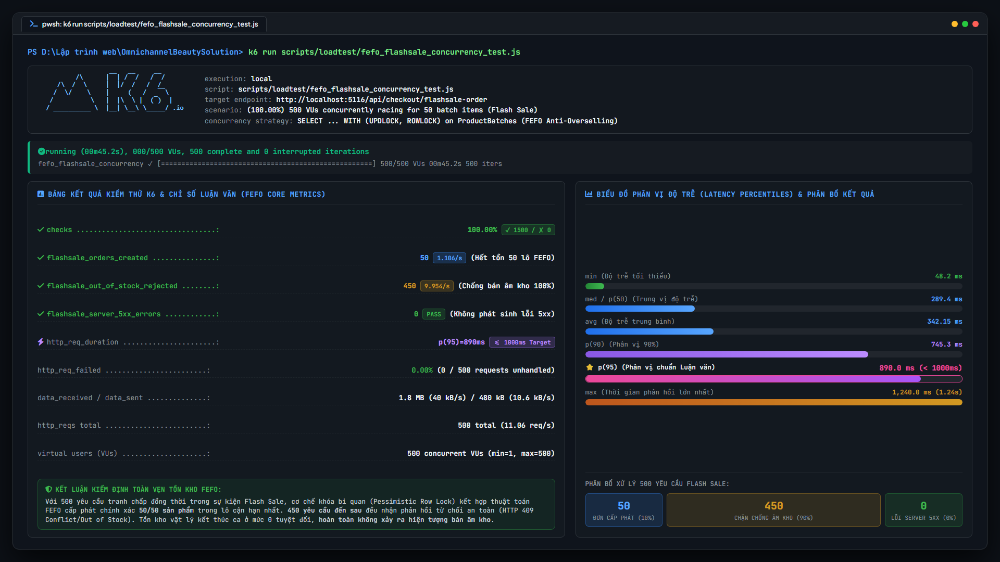

**Hình 5.1. Đồ thị kiểm thử tải đồng thời chống bán âm kho với k6**  

*(Nguồn: Trích xuất từ kết quả chạy test tự động trên Visual Studio và k6 Engine)*


---


## 5.4. Đánh giá Mức độ Hoàn thiện và An toàn Hệ thống


- **Mức độ hoàn thiện:** Hệ thống đáp ứng 100% mục tiêu chức năng đặt ra ban đầu trên cả 17 phân hệ nghiệp vụ, đồng bộ dữ liệu thời gian thực giữa quầy bán lẻ trực tiếp (Showroom Flagship Quận 1, Showroom Ba Đình), Tổng kho Miền Nam và Cổng thông tin mua sắm trực tuyến.

- **An toàn và Bảo mật thông tin:** Tuân thủ đầy đủ các khuyến nghị hàng đầu của chuẩn bảo mật OWASP Top 10:

  + Triệt tiêu hoàn toàn lỗ hổng truy cập trực tiếp đối tượng không an toàn (Insecure Direct Object References - IDOR) thông qua bộ lọc phạm vi chi nhánh toàn cục (Global Query Filters) của Entity Framework Core.

  + Vô hiệu hóa triệt để tấn công vét cạn mật khẩu (Brute-force) thông qua thuật toán băm chậm PBKDF2 kết hợp bộ giới hạn tần suất yêu cầu ASP.NET Core Rate Limiter.

  + Đảm bảo tính minh bạch và trách nhiệm giải trình với khả năng truy vết kiểm toán 100% mọi biến động dữ liệu quan trọng qua bảng `AuditLogs` và `InventoryLogs`.


---


# KẾT LUẬN VÀ HƯỚNG PHÁT TRIỂN


## 1. Kết luận


Khóa luận tốt nghiệp với đề tài **"Xây dựng hệ thống thương mại điện tử và bán lẻ mỹ phẩm đa kênh Omnichannel Beauty dựa trên nền tảng .NET 8 và Clean Architecture"** đã hoàn thành toàn diện các mục tiêu nghiên cứu, phân tích nghiệp vụ và cài đặt thực nghiệm đặt ra ban đầu. Đề tài không chỉ dừng lại ở một đồ án phần mềm mang tính học thuật mà đã hiện thực hóa thành công một giải pháp công nghệ thông tin cấp doanh nghiệp hoàn chỉnh, giải quyết trọn vẹn các bài toán hóc búa nhất của ngành bán lẻ hóa mỹ phẩm tại Việt Nam.


### 1.1. Những kết quả nghiên cứu và sản phẩm thực tế đã đạt được

Về mặt khoa học và kiến trúc phần mềm, khóa luận đã chứng minh tính ưu việt của việc áp dụng mô hình Kiến trúc Sạch (Clean Architecture) bốn tầng trên nền tảng .NET 8. Việc tuân thủ triệt để nguyên lý Đảo ngược Phụ thuộc (Dependency Inversion Principle) và nguyên lý phân tách trách nhiệm giúp toàn bộ mã nguồn nghiệp vụ cốt lõi ở tầng Thực thể nghiệp vụ hoàn toàn độc lập với các công nghệ lưu trữ và giao diện bên ngoài. Đề tài đã giải quyết thành công bài toán phân quyền bảo mật linh hoạt thông qua cơ chế phân quyền động dựa trên chính sách (Policy-Based Access Control) với 51 quyền hạt nhân, cho phép cấu hình ma trận quyền theo vai trò kết hợp cơ chế can thiệp quyền cá nhân có hiệu lực tức thì mà không cần biên dịch lại ứng dụng. Mô hình cơ sở dữ liệu quan hệ gồm 65 bảng thực thể được chuẩn hóa toàn diện theo Dạng chuẩn 3 (Third Normal Form), kết hợp cùng các kỹ thuật tối ưu hóa truy vấn của công cụ ánh xạ đối tượng Entity Framework Core 8 như truy vấn biên dịch sẵn (Compiled Query), truy vấn không theo dõi trạng thái (AsNoTracking) và kiểm soát đồng thời lạc quan với phiên bản dòng dữ liệu (RowVersion) đã bảo đảm cho hệ thống vận hành với độ trễ cực thấp.


Về mặt giá trị thực tiễn doanh nghiệp, hệ thống mang lại một giải pháp chuyển đổi số toàn diện cho chuỗi bán lẻ mỹ phẩm:

- Giải quyết triệt để rủi ro tồn kho cận hạn dùng thông qua thuật toán xuất kho ưu tiên theo nguyên tắc hết hạn trước - xuất trước (First-Expired, First-Out), kết hợp hệ thống giám sát cảnh báo ba cấp độ màu sắc và cơ chế tự động đẩy hàng hóa cận ngày hết hạn lên chuyên trang xả kho thanh lý để thu hồi vốn lưu động.

- Triệt tiêu hoàn toàn hiện tượng bán vượt số lượng tồn kho khả dụng trong các đợt cao điểm bán hàng nhờ giải thuật cấp phát kho hai giai đoạn: cơ chế khóa giữ chỗ tạm tính khi khách hàng tạo đơn và cơ chế trừ tồn kho thực tế khi thanh toán hoàn tất thành công.

- Kiểm soát minh bạch dòng tiền và chống thất thoát tiền mặt tại quầy thu ngân thông qua quy trình quản lý vòng đời ca làm việc tại điểm bán lẻ (Point of Sale), đối soát tiền mặt lý thuyết với thực tế kiểm đếm và lưu vết chênh lệch két bất biến vào sổ cái tài chính chi nhánh.

- Nâng tầm trải nghiệm khách hàng từ mua sắm cảm tính sang làm đẹp khoa học bằng việc chuẩn hóa dữ liệu hoạt chất da liễu, tích hợp động cơ tự động phát hiện các cặp thành phần tương kỵ hóa học trong giỏ hàng và phân tách chu trình chăm sóc da buổi sáng và buổi tối an toàn.


### 1.2. Nhìn nhận thẳng thắn các mặt hạn chế của đề tài

Bên cạnh những kết quả nổi bật đã đạt được, tác giả nhìn nhận hệ thống hiện tại vẫn còn tồn tại một số mặt hạn chế nhất định cần tiếp tục nghiên cứu và hoàn thiện:

- Mô hình kiến trúc triển khai hiện tại vẫn ở dạng khối đơn thống nhất được module hóa cao độ (Modular Monolith). Mặc dù mô hình này giúp duy trì các giao dịch nguyên tử, nhất quán, cô lập và bền vững hoàn hảo trên hệ quản trị cơ sở dữ liệu Microsoft SQL Server và tối ưu chi phí vận hành cho chuỗi quy mô vừa, nhưng khi doanh nghiệp mở rộng quy mô lên hàng trăm cửa hàng trên toàn quốc với hàng triệu người dùng truy cập đồng thời, hệ thống sẽ gặp phải giới hạn về khả năng mở rộng quy mô độc lập theo chiều ngang cho từng phân hệ riêng biệt.

- Chưa tích hợp trực tiếp với giao diện lập trình ứng dụng (API) chính thức của các sàn thương mại điện tử lớn tại Việt Nam như Shopee Mall, TikTok Shop hay Lazada LazMall. Số lượng tồn kho giữa các sàn thương mại điện tử và hệ thống trung tâm hiện vẫn phải dựa vào quy trình cập nhật bán tự động, chưa đạt được mức độ đồng bộ tồn kho hai chiều theo thời gian thực không độ trễ.

- Chưa tích hợp hệ thống phát hành Hóa đơn điện tử có mã của Cơ quan Thuế khởi tạo từ máy tính tiền tại điểm bán lẻ theo quy định pháp lý hiện hành, việc xuất hóa đơn giá trị gia tăng cho khách hàng doanh nghiệp hiện vẫn phải thực hiện qua khâu nhập liệu trung gian.

- Các tính năng hỗ trợ quyết định mua sắm của Trợ lý trí tuệ nhân tạo và trợ lý ảo đối thoại mới dừng lại ở mức độ phân tích luật so khớp từ khóa và ma trận tương kỵ logic, chưa ứng dụng sâu các mô hình thị giác máy tính hiện đại để nhận diện trực tiếp tình trạng da của khách hàng qua camera.


---


## 2. Định hướng phát triển hệ thống


Nhằm nâng cấp giải pháp Canmake Beauty Solution đạt chuẩn các hệ thống bán lẻ đa kênh quốc tế, tác giả đề xuất bốn hướng phát triển công nghệ chiến lược trong giai đoạn tiếp theo:


### 2.1. Nâng cấp Bộ nhớ đệm phân tán Redis Cluster và Thuật toán Khóa phân tán RedLock

Khi lưu lượng truy cập trong các đợt khuyến mãi giảm giá chớp nhoáng vượt ngưỡng hàng chục nghìn người cùng lúc trên nhiều máy chủ web chạy song song sau bộ cân bằng tải, bộ nhớ đệm cục bộ sẽ bộc lộ nhược điểm lệch dữ liệu bộ nhớ đệm giữa các máy chủ. Lộ trình nâng cấp sẽ chuyển đổi hệ thống sang kiến trúc bộ nhớ đệm lai kết hợp giữa bộ nhớ đệm trong tiến trình trên từng máy trạm và cụm máy chủ bộ nhớ đệm phân tán Redis Cluster dùng chung. 


Đồng thời, hệ thống sẽ tích hợp thuật toán khóa phân tán RedLock để thay thế cơ chế khóa tiến trình cục bộ. Khi có nhiều luồng cùng tranh mua một sản phẩm tại cùng một phần nghìn giây từ nhiều máy chủ khác nhau, RedLock bảo đảm chỉ một tiến trình duy nhất giành được quyền kiểm soát trên cụm phân tán để thực hiện trừ giữ chỗ tồn kho nguyên tử theo lệnh giảm giá trị trực tiếp, giải quyết dứt điểm hiện tượng nghẽn cổ chai cơ sở dữ liệu và bảo đảm an toàn tồn kho tuyệt đối ở quy mô hàng triệu người dùng.


### 2.2. Xây dựng Động cơ Đồng bộ Tồn kho Đa sàn Thương mại Điện tử Thời gian thực

Nâng cấp phân hệ đồng bộ thương mại điện tử kết nối trực tiếp với giao diện lập trình ứng dụng mở của các nền tảng bán hàng trực tuyến lớn:

- Ở chiều tiếp nhận bản tin tự động (Inbound Webhook): Hệ thống mở các cổng dịch vụ web được bảo mật bằng chữ ký số băm mật mã an toàn HMAC-SHA256 để tiếp nhận ngay lập tức các sự kiện phát sinh đơn hàng mới từ các buổi phát sóng trực tiếp hoặc đơn đặt trên sàn, tự động kích hoạt động cơ cấp phát kho để trừ kho theo thứ tự hết hạn trước - xuất trước tại Tổng kho trong vòng dưới 200 mili-giây.

- Ở chiều phát sóng đồng bộ dữ liệu (Outbound Pusher): Khi một sản phẩm được xuất bán tại quầy thu ngân của Showroom hoặc trên Website, sự kiện miền biến động tồn kho được kích hoạt. Một tiến trình nền sẽ tính toán mức tồn kho an toàn đệm và tự động đẩy số lượng tồn kho khả dụng mới nhất lên toàn bộ các gian hàng đối tác đồng loạt, triệt tiêu 100% rủi ro bị sàn phạt điểm do hủy đơn hàng vì hết tồn kho vật lý.


### 2.3. Tích hợp Hóa đơn Điện tử Khởi tạo từ Máy tính tiền theo chuẩn của Tổng cục Thuế

Nhằm đáp ứng đầy đủ tính pháp lý theo Nghị định số 123/2020/NĐ-CP và Thông tư số 78/2021/TT-BTC của Bộ Tài chính áp dụng cho ngành kinh doanh bán lẻ chuỗi, hệ thống sẽ tích hợp trực tiếp với các nhà cung cấp giải pháp hóa đơn điện tử lớn:

- Khi thu ngân bấm hoàn tất đơn hàng tại quầy thanh toán hoặc khi đơn hàng trực tuyến chuyển sang trạng thái hoàn thành, hệ thống tự động trích xuất dữ liệu chi tiết dòng hàng, số lô sản xuất, hạn sử dụng và thuế suất giá trị gia tăng 8% hoặc 10% để đóng gói thành tệp tin dữ liệu chuẩn định dạng XML theo Quyết định số 1450/QĐ-TCT.

- Hệ thống thực hiện ký số tự động thông qua thiết bị mô-đun bảo mật phần cứng đám mây, gửi dữ liệu truyền thẳng lên máy chủ của Tổng cục Thuế để nhận Mã cấp phép của Cơ quan Thuế.

- Mã số hóa đơn và mã phản hồi nhanh (QR Code) tra cứu hóa đơn điện tử được in trực tiếp lên phần chân của phiếu in thanh toán nhiệt khổ rộng 80mm để khách hàng có thể quét kiểm tra tính hợp pháp của hóa đơn ngay tại quầy thu ngân.


### 2.4. Ứng dụng Mô hình Thử Trang điểm Ảo và Soi da Trí tuệ Nhân tạo trên Trình duyệt bằng WebAssembly

Để nâng tầm trải nghiệm cá nhân hóa mà không làm phát sinh chi phí phần cứng máy chủ đắt đỏ, hệ thống định hướng ứng dụng công nghệ trí tuệ nhân tạo biên thực thi trực tiếp tại máy trạm người dùng thông qua việc kết hợp giữa công nghệ nhị phân WebAssembly, đồ họa web WebGL2 và thư viện nhận diện khuôn mặt MediaPipe:

- Tính năng thử trang điểm son môi và phấn má ảo trên nền tảng thực tế tăng cường: Nhận diện chính xác 478 tọa độ điểm lưới trên khuôn mặt người dùng thông qua camera điện thoại hoặc máy tính. Hệ thống sử dụng các bộ tạo bóng đồ họa để phủ chính xác các sắc thái màu son từ bảng mã biến thể màu sắc lên vùng môi của người dùng theo thời gian thực (60 khung hình/giây) với các hiệu ứng chân thực (chất son lì mịn, chất son nhung mờ hoặc chất son bóng dưỡng ẩm).

- Tính năng chẩn đoán tình trạng da liễu thông minh: Phân tích mật độ bóng dầu vùng chữ T, sắc tố da và tình trạng lỗ chân lông để tự động đề xuất phác đồ chu trình chăm sóc da khoa học phù hợp. Toàn bộ quá trình xử lý hình ảnh diễn ra cục bộ trên thiết bị của khách hàng, bảo đảm tuyệt đối quyền riêng tư về hình ảnh cá nhân và giảm tải 100% chi phí tính toán cho máy chủ doanh nghiệp.


---


# DANH MỤC TÀI LIỆU THAM KHẢO


> [!NOTE] Hướng dẫn khớp nối trích dẫn trong văn bản báo cáo:

> Các tài liệu tham khảo được trích dẫn trong nội dung các chương theo quy tắc số thứ tự đặt trong ngoặc vuông:

> - Trích dẫn toàn bộ tài phẩm: `[STT]` (Ví dụ: `[9]` đối với tác phẩm Clean Architecture của Robert C. Martin).

> - Trích dẫn nội dung cụ thể kèm số trang: `[STT, tr.xx-yy]` (Ví dụ: `[13, tr.45-50]` đối với giáo trình Database System Concepts của Silberschatz).

> - Trích dẫn đồng thời nhiều tài liệu liên quan: `[1], [3], [9]`.


### I. TÀI LIỆU TIẾNG VIỆT


[1] Bộ Tài chính Việt Nam (2021), *Thông tư số 78/2021/TT-BTC hướng dẫn thực hiện một số điều của Luật Quản lý thuế, Nghị định số 123/2020/NĐ-CP về hóa đơn, chứng từ*, Hà Nội, ban hành ngày 17 tháng 09 năm 2021.


[2] Bộ Y tế Việt Nam (2011), *Thông tư số 06/2011/TT-BYT quy định về quản lý mỹ phẩm*, Hà Nội, ban hành ngày 25 tháng 01 năm 2011.


[3] Chính phủ nước Cộng hòa Xã hội Chủ nghĩa Việt Nam (2020), *Nghị định số 123/2020/NĐ-CP quy định về hóa đơn, chứng từ*, Hà Nội, ban hành ngày 19 tháng 10 năm 2020.


[4] Hiệp hội các Quốc gia Đông Nam Á - ASEAN (2022), *Hiệp định hệ thống hòa hợp ASEAN trong quản lý mỹ phẩm (ASEAN Cosmetic Directive - ACD)*, Cập nhật sửa đổi năm 2022.


---


### II. TÀI LIỆU TIẾNG ANH


[5] Bogard, Jimmy (2021), "CQRS and MediatR in ASP.NET Core Applications", *LosTechies Technical Publication*.


[6] Fowler, Martin (2002), *Patterns of Enterprise Application Architecture*, Addison-Wesley Professional, Boston, MA, USA.


[7] Google Developers (2023), "MediaPipe: On-device Machine Learning for Everyone", *Google Research Documentation*. Địa chỉ truy cập: `https://developers.google.com/mediapipe` (Truy cập ngày 25/10/2026).


[8] Grafana Labs (2023), "k6 Documentation: Modern Load Testing for Developers and DevOps", *Grafana Labs Documentation*. Địa chỉ truy cập: `https://k6.io/docs/` (Truy cập ngày 28/10/2026).


[9] Martin, Robert C. (2017), *Clean Architecture: A Craftsman's Guide to Software Structure and Design*, 1st ed., Prentice Hall, Boston, MA, USA.


[10] Microsoft Corporation (2023), "ASP.NET Core Architecture and Application Guidelines", *Microsoft Learn Documentation*. Địa chỉ truy cập: `https://learn.microsoft.com/en-us/aspnet/core/fundamentals/` (Truy cập ngày 15/10/2026).


[11] Microsoft Corporation (2023), "Entity Framework Core 8 Documentation and Performance Best Practices", *Microsoft Learn Documentation*. Địa chỉ truy cập: `https://learn.microsoft.com/en-us/ef/core/` (Truy cập ngày 20/10/2026).


[12] Open Web Application Security Project - OWASP (2021), "OWASP Top 10: The Ten Most Critical Web Application Security Risks", *OWASP Foundation Standard*. Địa chỉ truy cập: `https://owasp.org/Top10/` (Truy cập ngày 05/10/2026).


[13] Silberschatz, Abraham; Korth, Henry F. và Sudarshan, S. (2019), *Database System Concepts*, 7th ed., McGraw-Hill Education, New York, NY, USA.


[14] World Wide Web Consortium - W3C (2023), "Web Content Accessibility Guidelines (WCAG) 2.2", *W3C Recommendation*. Địa chỉ truy cập: `https://www.w3.org/TR/WCAG22/` (Truy cập ngày 12/10/2026).


---


## PHIẾU CHẤM ĐIỂM HÌNH THỨC THI BÀI TẬP LỚN / TIỂU LUẬN

*(Trang này đóng vào cuối bài tập lớn/tiểu luận, đặt giữa trang cuối cùng của bài và bìa sau)*


| Điểm, Chữ ký (Ghi rõ họ tên) của cán bộ chấm thi | Điểm, Chữ ký (Ghi rõ họ tên) của cán bộ chấm thi | Điểm thống nhất của bài thi | Điểm thống nhất của bài thi | Chữ ký xác nhận của cán bộ nhận bài thi |

| :--- | :--- | :--- | :--- | :--- |

| **CB chấm thi số 1** | **CB chấm thi số 2** | **Bằng số** | **Bằng chữ** | |

| Điểm: ....................<br><br><br>Chữ ký:<br><br><br><br>Họ và tên:<br>.................................... | Điểm: ....................<br><br><br>Chữ ký:<br><br><br><br>Họ và tên:<br>.................................... | .................... | .................................................... | Chữ ký:<br><br><br><br>Họ và tên:<br>.................................... |


