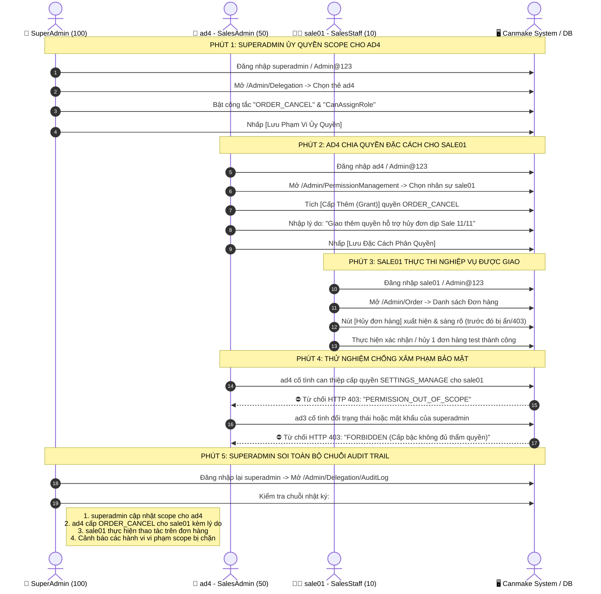

# HƯỚNG DẪN VẬN HÀNH HỆ THỐNG PHÂN QUYỀN PHÂN CẤP & QUẢN TRỊ NHÂN SỰ
# CANMAKE BEAUTY ENTERPRISE SUITE

> **Phiên bản:** 2.0 Enterprise  
> **Cập nhật:** Phiên 8 – Hoàn thiện nghiệm thu toàn diện  
> **Cơ sở dữ liệu:** `OmnichannelBeautyDb`  
> **Địa chỉ truy cập cổng quản trị:** `http://localhost:5116/admin/auth/login`

---

## 1. Tổng Quan Kiến Trúc Phân Quyền Phân Cấp

Hệ thống CANMAKE BEAUTY áp dụng mô hình bảo mật đa tầng **Hybrid RBAC (Role-Based Access Control) kết hợp Scoped PBAC (Policy-Based Access Control with Deny-Overrides)**:

```
[SuperAdmin / Ban Giám Đốc (Level 100)]
         │
         ├── Cấu hình AdminDelegationScope (Quyền, Phòng ban, Cửa hàng, Trần Level)
         │
         ▼
[Admin Nhỏ / Trưởng Phòng ad1..ad4 (Level 50)]
         │
         ├── Quản lý nhân sự & chia quyền hạt nhân trong Scope (UserPermissions Overrides)
         │
         ▼
[Cửa Hàng Trưởng manager_hq, manager_cg (Level 30)]
         │
         ▼
[Nhân Viên Nghiệp Vụ sale01, cashier01, warehouse01, editor01 (Level 10)]
         │
========================================================================
[Ranh Giới Bất Biến] ⛔ UserType = 1 (Khách Hàng) tuyệt đối bị chặn ở Cổng Admin
```

### 3 Nguyên Tắc Cốt Lõi:
1. **Ranh giới loại người dùng (`UserType Boundary`):** Tài khoản khách hàng (`UserType = 1`) chỉ mua sắm tại Storefront; mọi nỗ lực truy cập `/Admin` đều bị `AdminAreaBoundaryFilter` chặn 100%.
2. **Deny luôn thắng (`Deny-Overrides`):** Nếu một quyền bị gắn cờ Thu hồi (Deny = `false`) tại cấp cá nhân, nhân viên sẽ bị tước quyền ngay lập tức dù Vai trò (Role) có quyền đó.
3. **Ủy quyền an toàn không vượt cấp (`Strict Subset Delegation`):**
   - Admin nhỏ chỉ được chia sẻ những quyền mà bản thân mình đang sở hữu VÀ được SuperAdmin giao trong `AdminDelegationScope`.
   - Admin nhỏ chỉ được gán các vai trò có cấp bậc `Level < MaxGrantLevel` và `< Level của chính mình`.
   - Không admin nhỏ nào được phép tác động lên tài khoản ngang hàng hoặc cấp trên.

---

## 2. Hướng Dẫn Dành Cho Quản Trị Viên Tối Cao (SuperAdmin)

Tài khoản: **`superadmin`** (Mật khẩu: `Admin@123`)

### 2.1. Quản Trị Phòng Ban & Sơ Đồ Tổ Chức (`/Admin/Department`)
1. Truy cập menu **Nhân Sự & Phân Quyền** $\rightarrow$ **Phòng Ban & Sơ Đồ**.
2. **Xem sơ đồ dạng cây:** Nhấp vào các nút phòng ban để mở rộng/thu gọn cơ cấu trực thuộc (`BAN_GIAM_DOC` $\rightarrow$ 8 phòng ban chức năng).
3. **Thêm phòng ban mới:** Nhấp **+ Thêm Phòng Ban**, nhập Mã (`Code`), Tên, chọn Phòng ban cha và chỉ định Trưởng phòng (`HeadUser`).
4. **Quy tắc an toàn:** Không được phép xóa phòng ban nếu phòng ban đó đang có nhân sự đang hoạt động.

### 2.2. Trung Tâm Cấu Hình Phạm Vi Cho Admin Nhỏ (`/Admin/Delegation`)
1. Truy cập **Nhân Sự & Phân Quyền** $\rightarrow$ **Ủy Quyền Admin Nhỏ**.
2. Màn hình hiển thị danh thiếp của 4 Admin phụ trách:
   - `ad1` – Admin Giao Diện & Menu (Phòng Giao Diện CMS)
   - `ad2` – Admin Nội Dung & Dữ Liệu (Phòng Dữ Liệu Sản Phẩm)
   - `ad3` – Trưởng Phòng Nhân Sự (Phòng Hành Chính - Nhân Sự)
   - `ad4` – Giám Đốc Sale & Marketing (Phòng Sale + Marketing)
3. Nhấp nút **Cấu hình phạm vi** trên thẻ của từng Admin:
   - **Tab 1 - Chức năng được giao:** Tích chọn các quyền hạt nhân theo module (hoặc tích chọn cả nhóm module).
   - **Tab 2 - Phòng ban & Chi nhánh:** Tích chọn các phòng ban và cửa hàng mà Admin này được quyền quản lý.
   - **Tab 3 - Hành động cho phép:** Bật/tắt các công tắc nghiệp vụ:
     - *Tạo mới nhân sự (`CanCreateUser`)*
     - *Chỉnh sửa nhân sự (`CanEditUser`)*
     - *Xóa mềm nhân sự (`CanDeleteUser`)*
     - *Đặt lại mật khẩu (`CanResetPassword`)*
     - *Gán vai trò cấp dưới (`CanAssignRole`)*
     - *Ủy quyền lại (`CanDelegateFurther`)*
     - *Trần cấp bậc tối đa (`MaxGrantLevel`)*: Khống chế chỉ gán được các Role có Level thấp hơn mức này (mặc định 50).
4. Nhấp **Lưu Phạm Vi Ủy Quyền**. Hệ thống sẽ tự động đối chiếu, cascade revoke các quyền vượt phạm vi cũ và ghi nhật ký kiểm toán.

### 2.3. Ma Trận Phân Quyền Toàn Cục (`/Admin/PermissionManagement`)
- Xem toàn bộ ma trận 14 Vai trò $\times$ 66 Quyền hạt nhân.
- SuperAdmin có thể chỉnh sửa phân quyền cho các vai trò hệ thống (trừ vai trò cố định `SuperAdmin` và `Customer`), sau đó bấm **Lưu Ma Trận Toàn Cục** để đồng bộ tức thì xuống bộ nhớ đệm Cache L1.

---

## 3. Hướng Dẫn Dành Cho Admin Nhỏ (`ad1`..`ad4`)

Tài khoản: **`ad1`**, **`ad2`**, **`ad3`**, **`ad4`** (Mật khẩu: `Admin@123`)

### 3.1. Đăng Nhập & Giao Diện Cá Nhân Hóa
- Khi đăng nhập vào `/admin/auth/login`, thanh Sidebar bên trái sẽ tự động ẩn các phân hệ nằm ngoài thẩm quyền và chỉ hiển thị đúng các chức năng được phân công.
- Ví dụ: `ad4` (SalesAdmin) sẽ chỉ thấy: *Tổng quan, Quản lý Đơn hàng, Khách hàng CRM, Khuyến mãi & Voucher, Báo cáo Doanh số, Quản lý Nhân sự (phòng Sale/Marketing), Chia Quyền Nhân Viên*.

### 3.2. Chia Quyền & Đặc Cách Cho Nhân Viên Cấp Dưới (`/Admin/PermissionManagement`)
1. Truy cập **Chia Quyền Nhân Viên**.
2. Chọn nhân sự cấp dưới cần thao tác (chỉ chọn được nhân sự thuộc các phòng ban trong scope).
3. Bảng **Quyền hạn chi tiết của nhân viên** sẽ hiển thị:
   - **Cột Trạng Thái:**
     - `Quyền gốc (Role)`: Nhân viên đang có quyền này do Vai trò quy định.
     - `Đặc cách cấp (Grant)`: Được admin cấp thêm riêng biệt.
     - `Đặc cách chặn (Deny)`: Bị thu hồi riêng biệt dù Role có quyền.
   - **Nút Hành Động:**
     - Nhấp **Cấp thêm (Grant)** để bổ sung quyền cho nhân viên.
     - Nhấp **Thu hồi (Deny)** để chặn quyền tạm thời (bắt buộc nhập lý do thu hồi để phục vụ kiểm toán).
     - Nhấp **Bỏ đặc cách** để hoàn nguyên về theo Role gốc.
4. **Quy tắc an toàn chống vượt cấp:** Các quyền nằm ngoài phạm vi của Admin sẽ bị làm mờ (disabled) kèm chú thích *"Vượt phạm vi của bạn"*. Mọi hành vi cố tình gửi request can thiệp trái phép đều bị máy chủ trả về mã lỗi `403 FORBIDDEN`.

---

## 4. Hướng Dẫn Quản Lý Nhân Sự (Dành Cho HR `ad3` & `hr01`)

Tài khoản: **`ad3`** (Trưởng phòng Nhân sự), **`hr01`** (Chuyên viên Nhân sự)

### 4.1. Bộ Lọc Nhân Sự Nâng Cao
- **Thanh tìm kiếm tức thì:** Tìm theo Họ tên, Username, Email, Số điện thoại, Mã nhân viên (tự động kích hoạt sau 400ms dừng gõ).
- **Bộ lọc đa tiêu chí:** Lọc theo Cây phòng ban, Vai trò, Chi nhánh cửa hàng, Người quản lý, Trạng thái (Đang hoạt động / Đã khóa), Giới tính, Khoảng ngày vào làm.
- **Thẻ KPI tương tác nhanh:** Nhấp vào các thẻ *Tổng nhân sự*, *Đang hoạt động*, *Đang khóa*, *Mới 30 ngày* để áp bộ lọc tương ứng với 1 click.
- **Lưu trạng thái trên URL:** Mọi điều kiện lọc đều đồng bộ lên thanh địa chỉ, giúp dễ dàng chia sẻ liên kết hoặc tải lại trang không mất bộ lọc.

### 4.2. Thêm Mới Nhân Sự Nội Bộ (`/Admin/User/Create`)
1. Nhấp nút **+ Thêm Nhân Sự**.
2. Điền thông tin cá nhân: Họ tên, Tên đăng nhập (`a-z0-9._`), Email doanh nghiệp, Số điện thoại (10 số chuẩn VN), Ngày sinh, Giới tính, Địa chỉ.
3. Điền thông tin công việc:
   - Chọn Phòng ban trực thuộc (dạng cây thả xuống).
   - Chọn Người quản lý trực tiếp (lọc theo nhân sự cấp cao hơn trong phòng ban).
   - Chọn Chi nhánh cửa hàng (nếu là nhân viên Store/Kho/POS).
   - Chức danh (`JobTitle`), Ngày vào làm.
   - Tích chọn các Vai trò (`Roles`) được gán (chỉ hiển thị các vai trò trong thẩm quyền gán).
4. Thiết lập mật khẩu ban đầu (có thanh đo độ mạnh mật khẩu và nút tạo mật khẩu ngẫu nhiên an toàn).
5. Nhấp **Tạo Nhân Sự**. Hệ thống tự động sinh Mã nhân viên chuẩn (`NVxxxx`).

### 4.3. Xem Hồ Sơ 360 Độ (`/Admin/User/Details/{id}`)
Hồ sơ nhân viên được tổ chức thành 5 tab chuyên sâu:
- **Tab 1 - Tổng quan:** Thông tin cá nhân, sơ đồ báo cáo (Người quản lý trực tiếp, Phòng ban, Chi nhánh), thời gian hoạt động.
- **Tab 2 - Phân quyền hiệu lực:** Bảng kê toàn bộ các quyền nhân viên đang sở hữu, phân biệt rõ quyền đến từ Role nào và quyền nào do Admin đặc cách.
- **Tab 3 - Cấp dưới trực tiếp:** Danh sách các nhân viên đang báo cáo cho nhân sự này.
- **Tab 4 - Lịch sử hoạt động:** Nhật ký Audit Trail ghi lại mọi thay đổi trên tài khoản (ai sửa, đổi mật khẩu, gán quyền khi nào).
- **Tab 5 - Hiệu suất bán hàng (POS):** Doanh số, số đơn hàng đã xử lý, ca làm việc (đối với nhân sự cửa hàng).

### 4.4. Thao Tác Hàng Loạt (Bulk Actions)
1. Tích chọn nhiều nhân sự trên bảng danh sách.
2. Thanh công cụ nổi (**Floating Bulk Bar**) sẽ xuất hiện ở cuối màn hình hiển thị số lượng nhân sự đã chọn.
3. Lựa chọn thao tác:
   - **Khóa tài khoản hàng loạt**
   - **Mở khóa tài khoản hàng loạt**
   - **Chuyển phòng ban hàng loạt**
   - **Gán vai trò bổ sung hàng loạt**
   - **Xóa mềm chuyển vào Thùng rác**
4. Nhấp **Áp dụng** và xác nhận trên modal cảnh báo.

### 4.5. Thùng Rác & Khôi Phục Nhân Sự (`/Admin/User/Trash`)
- Các nhân viên bị xóa mềm sẽ được chuyển vào mục **Thùng rác nhân sự**.
- Nhân viên trong thùng rác bị thu hồi quyền truy cập tức thì và không hiển thị trên danh sách chính.
- HR có thể bấm **Khôi phục** để đưa nhân viên quay trở lại làm việc hoặc bấm **Xóa vĩnh viễn** khi hết thời hạn lưu trữ hồ sơ.

### 4.6. Xuất Dữ Liệu Báo Cáo (Excel / CSV)
- Nhấp nút **Xuất Excel** hoặc **Xuất CSV**.
- File tải về tự động lọc theo đúng các tiêu chí bộ lọc đang chọn trên màn hình.
- File CSV được nhúng mã **UTF-8 BOM** chuẩn quốc tế, đảm bảo mở trực tiếp trên Microsoft Excel hiển thị tiếng Việt có dấu sắc nét 100%, không bị lỗi font ký tự.

---

## 5. Kịch Bản Trình Diễn Nghiệm Thu 5 Phút (Live Demo Script)

Kịch bản này được thiết kế để trình diễn trực tiếp cho Hội đồng Nghiệm thu / Ban Lãnh đạo trong đúng **5 phút**, chứng minh toàn bộ chuỗi ủy quyền xuyên suốt từ SuperAdmin $\rightarrow$ Admin nhỏ $\rightarrow$ Nhân viên nghiệp vụ $\rightarrow$ Nhật ký Kiểm toán Audit Log.



### Các Bước Thực Hiện Chi Tiết Trong Demo:

| Thời Gian | Người Thực Hiện | Thao Tác Cụ Thể | Kết Quả Trực Quan Trên Màn Hình |
|:---:|:---|:---|:---|
| **00:00 - 01:00** | **SuperAdmin** | Đăng nhập tài khoản `superadmin`. Truy cập `/Admin/Delegation`. Nhấp cấu hình `ad4`, xác nhận danh mục 18 quyền nghiệp vụ bán hàng. | Giao diện quản trị hiện đại, thẻ chỉ số rõ ràng, switch toggle trực quan. |
| **01:00 - 02:00** | **Admin nhỏ (`ad4`)** | Đăng xuất, đăng nhập `ad4`. Truy cập `/Admin/PermissionManagement`. Chọn `sale01`, tích **Cấp thêm** quyền `ORDER_CANCEL`, gõ lý do: *"Trưởng ca sáng hỗ trợ khách hủy đơn"* và bấm Lưu. | Hệ thống thông báo xanh: *Đã cấp quyền thành công và cập nhật Cache L1 tức thì!* |
| **02:00 - 03:00** | **Nhân viên (`sale01`)** | Đăng nhập `sale01`. Vào `/Admin/Order`. Xem chi tiết đơn hàng. Nút chức năng hủy đơn hiển thị cho phép thao tác. | Nhân viên thực hiện đúng thẩm quyền được cấp mà không cần phiền đến SuperAdmin. |
| **03:00 - 04:00** | **Thử nghiệm vi phạm** | `ad4` thử can thiệp quyền hệ thống hoặc `ad3` thử khóa tài khoản `superadmin`. | Hệ thống lập tức trả về thông báo lỗi đỏ 403 Forbidden, chứng minh tính toàn vẹn của mô hình bảo mật. |
| **04:00 - 05:00** | **SuperAdmin** | Đăng nhập lại `superadmin`. Vào `/Admin/Delegation/AuditLog`. | Bảng Audit Trail hiển thị đầy đủ dòng thời gian: *Thời điểm, Người thực hiện, Đối tượng nhận quyền, Quyền hạn thay đổi, Lý do, Địa chỉ IP*. |

---

## 6. Tổng Kết Danh Sách 19 Tài Khoản & Quyền Hạn Nghiệm Thu

| # | Tài Khoản | Mật Khẩu | Vai Trò & Cấp Bậc | Phòng Ban Quản Lý | Được Làm Gì | Tuyệt Đối Không Được Làm Gì |
|:--:|:---|:---|:---|:---|:---|:---|
| 1 | `superadmin` | `Admin@123` | **SuperAdmin** (Lv 100) | `BAN_GIAM_DOC` | Toàn quyền 66/66 chức năng; ủy quyền scope cho các admin nhỏ; cấu hình ma trận vai trò toàn cục; quản trị mọi phòng ban, chi nhánh. | *(Không có giới hạn)* |
| 2 | `admin` | `Admin@123456` | **SuperAdmin** (Lv 100) | `BAN_GIAM_DOC` | Tài khoản quản trị dự phòng toàn quyền Ban Giám Đốc. | *(Không có giới hạn)* |
| 3 | `ad1` | `Admin@123` | **UiAdmin** (Lv 50) | `PHONG_GIAO_DIEN_CMS` | Quản lý Banner, Cây Menu, Bố cục Trang chủ UiSection, Tùy biến Theme; quản lý nhân viên `editor01`; chia các quyền CMS giao diện. | Không đụng vào Đơn hàng, Khách hàng, Sản phẩm, Báo cáo tài chính, Nhân sự phòng khác. |
| 4 | `ad2` | `Admin@123` | **DataAdmin** (Lv 50) | `PHONG_DU_LIEU_SAN_PHAM` | Quản lý danh mục Sản phẩm (Thêm/Sửa/Xóa/Import), Bài viết, Đánh giá, Xem tồn kho FEFO; quản lý nhân viên `data01`. | Không đụng vào Đơn hàng, Doanh số, Giao diện Web, Cài đặt hệ thống. |
| 5 | `ad3` | `Admin@123` | **HrAdmin** (Lv 50) | `PHONG_NHAN_SU` | Quản trị nhân sự toàn diện 8 phòng ban (Thêm/Sửa/Xóa mềm/Reset MK); Quản lý cây Phòng ban; Gán các Role có Level < 50; Xuất báo cáo nhân sự. | Không được sửa `superadmin` hay các Admin Level 50; không gán được Role SuperAdmin; không đụng vào Bán hàng, Kho, Tài chính. |
| 6 | `ad4` | `Admin@123` | **SalesAdmin** (Lv 50) | `PHONG_SALE` | Giám đốc Bán hàng & Tiếp thị: Quản lý Đơn hàng, Khách hàng CRM, Khuyến mãi, Voucher, Loyalty, Xem báo cáo doanh số; quản lý `sale01`, `sale02`, `mkt01`. | Không có quyền xóa nhân sự (do HR phụ trách); không can thiệp Sản phẩm, Giao diện, Cài đặt hệ thống. |
| 7 | `sale01` | `Admin@123` | **SalesStaff** (Lv 10) | `PHONG_SALE` | Xem và tạo đơn hàng, tư vấn khách hàng, xem danh mục sản phẩm (Ca sáng). | Mặc định không được hủy đơn hàng (`ORDER_CANCEL`); không xem báo cáo doanh thu; không quản lý nhân sự. |
| 8 | `sale02` | `Admin@123` | **SalesStaff** (Lv 10) | `PHONG_SALE` | Tương tự `sale01` (Ca chiều). | Không có quyền hủy đơn, không xem báo cáo tài chính. |
| 9 | `mkt01` | `Admin@123` | **MarketingStaff** (Lv 10) | `PHONG_MARKETING` | Quản lý Chiến dịch Khuyến mãi, Mã Coupon, Voucher, Banner quảng cáo, Xem thông tin khách hàng CRM & Thành viên. | Không chốt đơn hàng, không xem báo cáo P&L, không sửa thông tin nhân sự. |
| 10 | `hr01` | `Admin@123` | **HrStaff** (Lv 10) | `PHONG_NHAN_SU` | Xem danh sách nhân sự, Thêm mới nhân viên, Sửa thông tin cơ bản nhân sự, Xem cây phòng ban. | Không được xóa nhân sự; không reset mật khẩu; không gán vai trò; không chia quyền. |
| 11 | `data01` | `Admin@123` | **DataStaff** (Lv 10) | `PHONG_DU_LIEU_SAN_PHAM` | Xem và thêm/sửa thông tin sản phẩm, bài viết cẩm nang làm đẹp, xem tồn kho. | Không được xóa sản phẩm (`PRODUCT_DELETE`); không duyệt review; không import hàng loạt. |
| 12 | `manager_hq` | `Admin@123` | **StoreManager** (Lv 30) | `CUA_HANG_BAN_LE` (Q1) | Toàn quyền điều hành Chi nhánh Flagship Quận 1: Bán hàng POS, Quản lý đơn, Xem kho & hạn FEFO, Xem báo cáo bán hàng & Sổ cái tài chính chi nhánh. | Không quản lý nhân sự phòng ban khác; không chỉnh sửa giao diện web toàn cục. |
| 13 | `manager_cg` | `Admin@123` | **StoreManager** (Lv 30) | `CUA_HANG_BAN_LE` (CG) | Toàn quyền điều hành Chi nhánh Cầu Giấy (tương tự `manager_hq` giới hạn tại Chi nhánh 2). | Không can thiệp sang dữ liệu của Chi nhánh 1; không cấu hình hệ thống. |
| 14 | `cashier01` | `Admin@123` | **Cashier** (Lv 10) | `CUA_HANG_BAN_LE` (Q1) | Đăng nhập POS, mở/đóng ca thu ngân, quét mã vạch bán hàng, tích điểm khách hàng tại quầy Q1. | Không được hủy đơn ngoài ca; không xem báo cáo tài chính; không sửa sản phẩm. |
| 15 | `cashier02` | `Admin@123` | **Cashier** (Lv 10) | `CUA_HANG_BAN_LE` (CG) | Thu ngân điểm bán tại Chi nhánh Cầu Giấy. | Tương tự `cashier01` giới hạn tại Chi nhánh Cầu Giấy. |
| 16 | `warehouse01` | `Admin@123` | **WarehouseStaff** (Lv 10) | `PHONG_KHO_VAN` (Q1) | Nhập kho, xuất kho, kiểm kê, điều chỉnh tồn kho theo hạn dùng FEFO, tạo yêu cầu chuyển kho tại Kho Q1. | Không truy cập POS, không chốt đơn hàng, không xem báo cáo doanh thu tài chính. |
| 17 | `warehouse02` | `Admin@123` | **WarehouseStaff** (Lv 10) | `PHONG_KHO_VAN` (CG) | Quản lý kho và lô hàng FEFO tại Kho Chi nhánh Cầu Giấy. | Tương tự `warehouse01` giới hạn tại Chi nhánh 2. |
| 18 | `editor01` | `Admin@123` | **ContentEditor** (Lv 10) | `PHONG_GIAO_DIEN_CMS` | Biên tập bài viết làm đẹp, cập nhật Banner quảng cáo, chỉnh sửa Menu, kiểm duyệt Review của khách hàng. | Không được xóa nhân sự; không xem báo cáo tài chính; không can thiệp đơn hàng POS. |
| 19 | `customer01` | `Admin@123` | **Customer** (Lv 0) | *Khách Mua Sắm Storefront* | Mua sắm mỹ phẩm trực tuyến, tra cứu hạn dùng FEFO, tích điểm thành viên, đánh giá sản phẩm. | **Tuyệt đối không có quyền truy cập khu vực Quản trị (`/Admin`)**. Mọi request đều bị chặn và chuyển hướng. |
