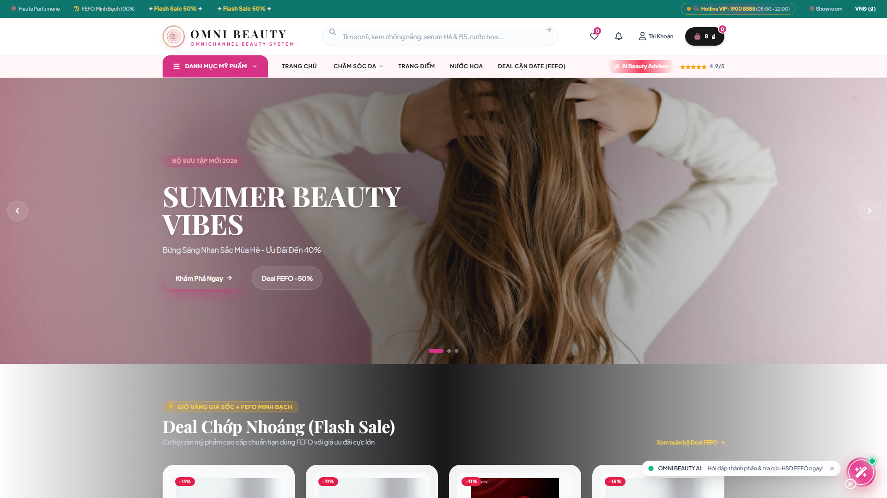
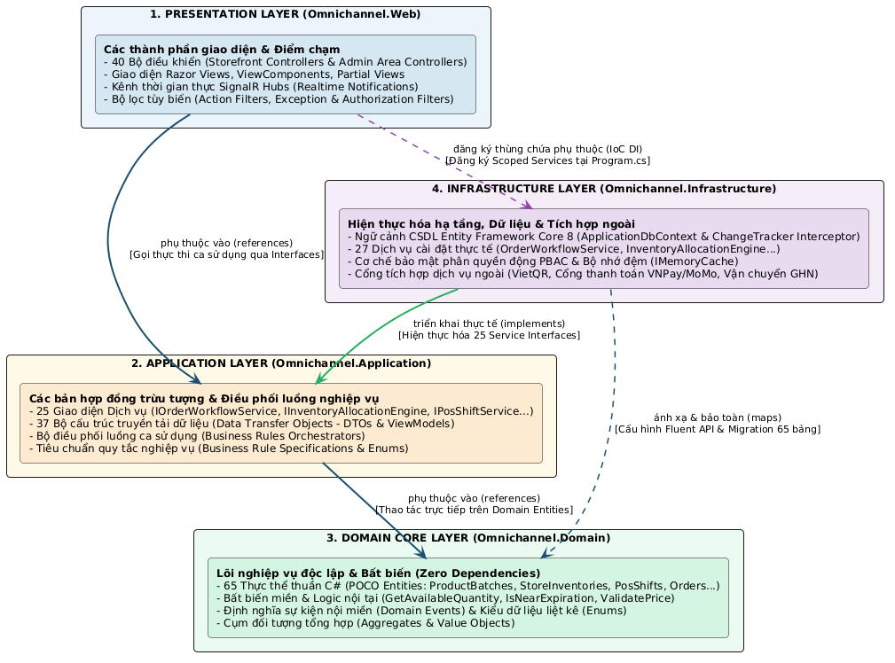
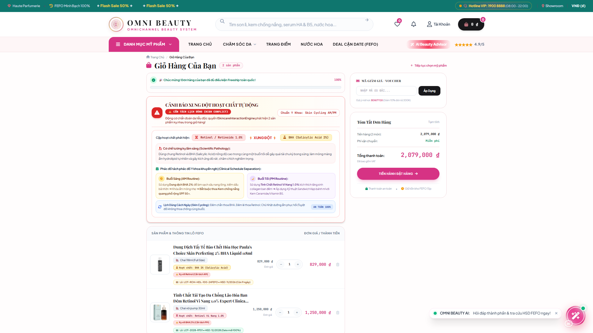
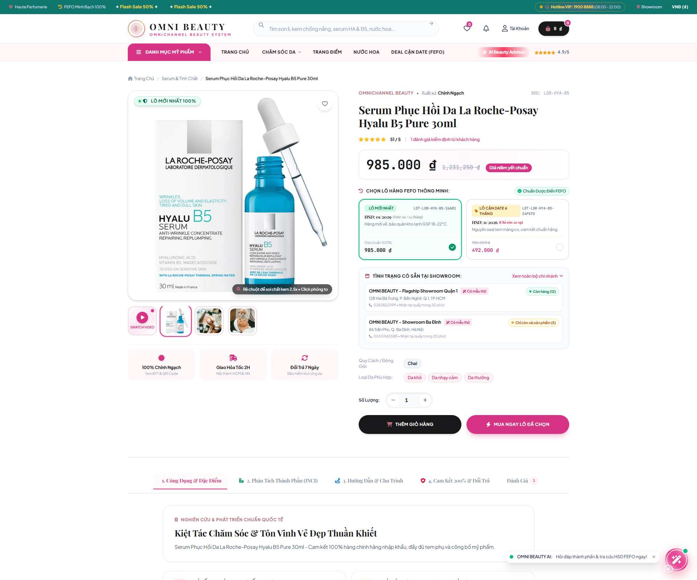
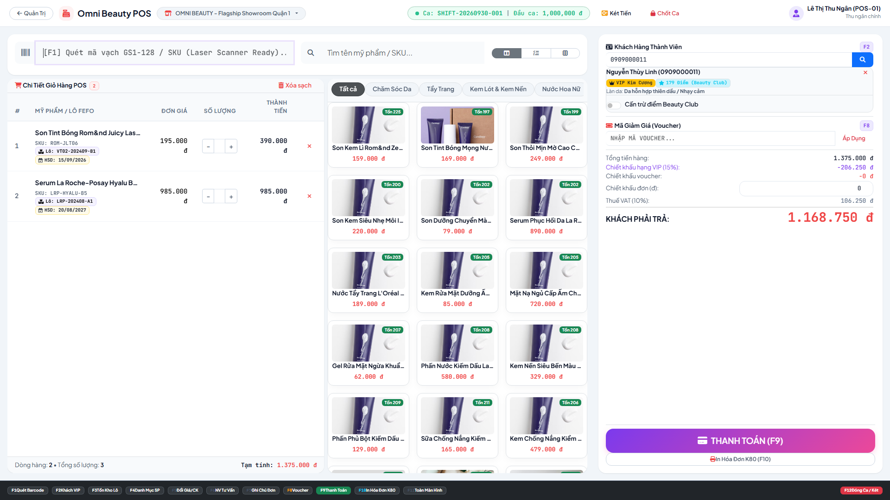
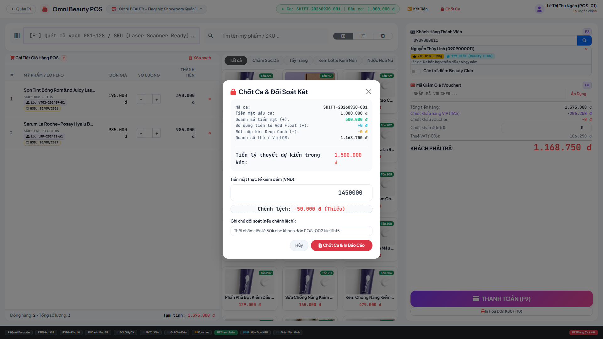
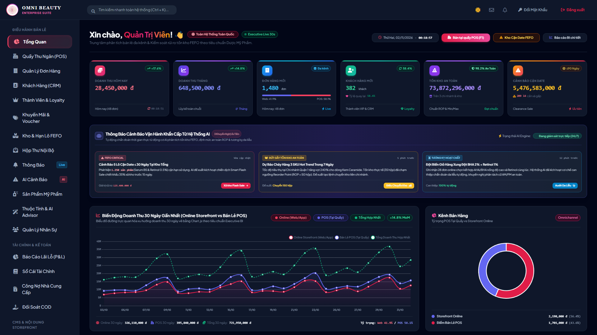
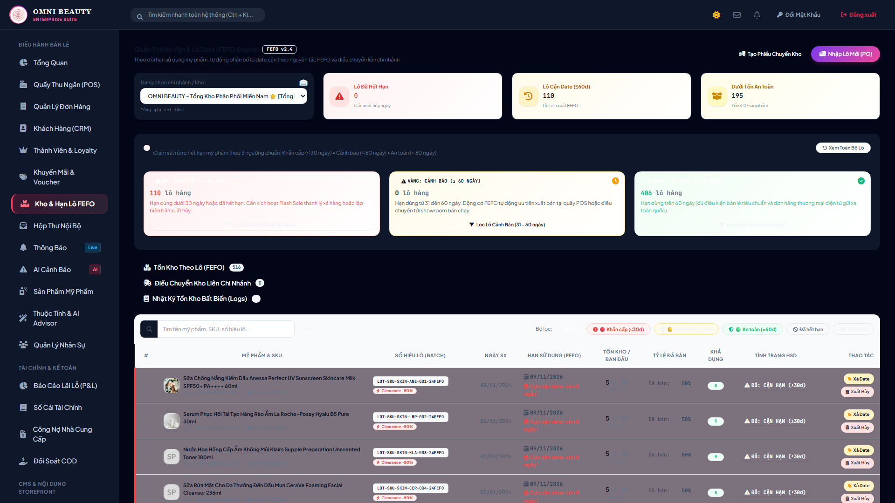
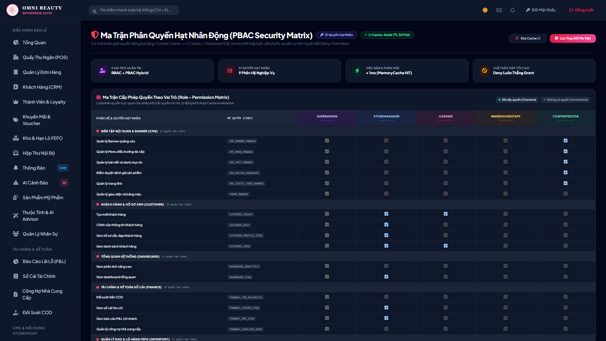

# KỊCH BẢN TRÌNH DIỄN TRỰC TIẾP (10-MINUTE LIVE DEMO SCRIPT)
## VÀ BỘ HỎI ĐÁP PHẢN BIỆN CHINH PHỤC HỘI ĐỒNG BẢO VỆ
### Thương Hiệu Hiển Thị: **CANMAKE BEAUTY** (Giải pháp kỹ thuật: `OmnichannelBeautySolution`)
**Phiên bản:** Hoàn thiện sau đợt nâng cấp toàn diện & Rebrand CANMAKE BEAUTY (C1–C8, D1–D2, E1–E2, F1–F7)  
**Thời gian thuyết trình:** 10 phút chuẩn Persona "Lê Ngọc Linh"  
**Công cụ hỗ trợ:** Demo Presenter HUD (`Alt + D`)

---

## I. THÔNG TIN CHUẨN BỊ TRƯỚC GIỜ G (PRE-DEMO CHECKLIST)

### 1. Môi trường & Khởi động Ứng dụng
- **Trạng thái Server**: Đang chạy trên cổng `http://localhost:5116` (Profile HTTP).
- **Trình duyệt**: Khuyến nghị dùng **Google Chrome** hoặc **Microsoft Edge**.
- **Cửa sổ Trình duyệt**:
  - Mở `http://localhost:5116/`.
  - Nhấn tổ hợp phím **`Alt + D`** (hoặc nhấp nút tròn nổi ở góc trái dưới) để bật bảng điều khiển **Demo Presenter HUD**.
  - Kiểm tra đồng hồ đếm ngược `10:00` và 6 chặng kịch bản đã sẵn sàng.

### 2. Danh sách Tài khoản Đã Seed Sẵn Phục Vụ Demo
| Vai trò | Tên đăng nhập / Email | Mật khẩu | 1-Click Persona HUD | Mục đích sử dụng trong Demo |
| :--- | :--- | :--- | :---: | :--- |
| **Khách VIP (Lê Ngọc Linh)** | `customer_vip` / `customer_vip@gmail.com` | `Admin@123` | Nút **"Khách VIP (Linh)"** | Hạng Kim Cương, 1.250 điểm, sinh nhật T11, Routine cá nhân |
| **Thu ngân Showroom 1** | `cashier01` / `cashier01@canmakebeauty.vn` | `Admin@123` | Nút **"Thu ngân (Showroom 1)"** | Quầy POS, xác thực PIN & bàn giao đơn Click & Collect |
| **SuperAdmin Toàn Chuỗi** | `superadmin` / `superadmin@canmakebeauty.vn` | `Admin@123` | Nút **"SuperAdmin"** | Executive Decision Center, RFM, Cảnh báo kho FEFO, 1-Click Reset |

---

## II. KỊCH BẢN TRÌNH DIỄN CHI TIẾT 10 PHÚT (PERSONA "LÊ NGỌC LINH")

```
00:00 ─── [Chặng 1: 0:00 - 1:30] Khởi động, Giới thiệu Thương hiệu CANMAKE BEAUTY & Nhận diện Khách hàng VIP
01:30 ─── [Chặng 2: 1:30 - 3:30] Trợ lý AI Da liễu & Cảnh báo Tương kỵ Hoạt chất
03:30 ─── [Chặng 3: 3:30 - 5:30] Trải nghiệm Storefront Đa kênh Chuyên sâu
05:30 ─── [Chặng 4: 5:30 - 7:00] Gamification & Đổi thưởng Điểm tích lũy Canmake Rewards
07:00 ─── [Chặng 5: 7:00 - 8:30] Khép kín Vòng lặp O2O (Click & Collect) & Bàn giao tại POS
08:30 ─── [Chặng 6: 8:30 - 10:00] Trung tâm Ra Quyết định & Bảng điều hành Chuỗi
```

---

### CHẶNG 1 (0:00 – 1:30): KHỞI ĐỘNG, GIỚI THIỆU THƯƠNG HIỆU CANMAKE BEAUTY & NHẬN DIỆN KHÁCH HÀNG VIP

* **Thao tác**:
  1. Mở trang chủ `http://localhost:5116/`. Chỉ vào cụm **Logo CANMAKE BEAUTY** ở thanh Header. Bấm **`Alt + D`**, bấm nút **"Bắt đầu (10:00)"** trên timer.
  2. Bấm nút **"Đăng nhập VIP (Lê Ngọc Linh)"** trên HUD. Trang tự động refresh sang tư cách VIP.
  3. Mở `/Customer/Dashboard`:
     - Thẻ thành viên 3D lấp lánh hạng **Kim Cương (Diamond)**.
     - Số dư điểm: **1.250 điểm** (tương đương 1.250.000₫ đổi thưởng).
     - Thông báo đặc quyền: **"Chúc mừng sinh nhật Tháng 11! Bạn nhận nhân 2 điểm thưởng và voucher sinh nhật VIP 25%."**
* **Lời thuyết trình mẫu (Spoken Script)**:
  > *"Kính thưa Thầy/Cô trong Hội đồng và các bạn. Em xin phép bắt đầu buổi thuyết trình hệ thống bán lẻ mỹ phẩm đa kênh mang thương hiệu **CANMAKE BEAUTY** — với thông điệp cốt lõi **'CAN MAKE: Bạn có thể tự tin tạo nên vẻ đẹp của riêng mình'**.
  > Bộ nhận diện thương hiệu sử dụng biểu tượng **Blooming Heart Monogram (C × M)** — nét chữ C như đường cọ trang điểm ôm trọn chữ M tạo thành trái tim và đóa hoa bung nở cùng ngôi sao 4 cánh lấp lánh, phối trên bảng màu hồng Primary Rose `#E8618C` và Deep Berry `#B8336A` đạt chuẩn tương phản trợ năng quốc tế WCAG 2.1 AA.
  > Đi vào câu chuyện trải nghiệm của khách hàng VIP Lê Ngọc Linh: ngay khi Linh truy cập, nền tảng nhận diện hạng Kim Cương cùng thông báo Birthday Bonus cá nhân hóa cho sinh nhật tháng 11. Hệ thống được xây dựng trên .NET 8 Clean Architecture, đồng bộ xuyên suốt từ Website, Ứng dụng Khách hàng đến Quầy bán lẻ POS và Kho vận FEFO."*


*Hình minh họa Chặng 1: Giao diện Trang chủ & Kiến trúc Clean Architecture 4 tầng*


---

### CHẶNG 2 (1:30 – 3:30): TRỢ LÝ AI DA LIỄU & CẢNH BÁO TƯƠNG KỴ HOẠT CHẤT LÂM SÀNG

* **Thao tác**:
  1. **Routine Quiz & Mua Combo 1-Click**:
     - Vào `/tu-van-da`, chọn *Loại da: Da dầu mụn* $\rightarrow$ *Mối quan tâm: Thâm mụn & Cần phục hồi*.
     - Bấm **"Phân tích & Gợi ý Routine"** (< 50ms): Ra phác đồ 3 bước chuẩn da liễu.
  2. **Trợ lý Phân tích Da bằng AI Vision (`/phan-tich-da`)**:
     - Mở `/phan-tich-da`, tải ảnh selfie lên hoặc bấm **"Phân tích ảnh mẫu da nhạy cảm"**.
     - Hệ thống hiển thị biểu đồ Radar 5 chỉ số (Độ dầu, Độ ẩm, Mụn, Sắc tố, Độ nhạy cảm), chuẩn đoán loại da và gợi ý routine.
  3. **Thử màu son ảo (Virtual Lip Try-On Studio)**:
     - Mở trang chi tiết son môi (ví dụ: *Son Kem Lì MAC* hoặc *Black Rouge*).
     - Nhấp nút **"Thử màu son ảo"**: Thử màu trên 4 tông da Châu Á (Sáng, Tự nhiên, Ngăm, Vàng ấm), đối chiếu Split-screen trước/sau, phân tích undertone.
  4. **Kích hoạt Cảnh báo Tương kỵ Hoạt chất AI trong Giỏ hàng**:
     - Bấm **`Alt + D`**, nhấp nút **"Nạp giỏ Tương kỵ Retinol + BHA"** $\rightarrow$ Tự động chuyển đến `/cart`.
     - Giỏ hàng ngay lập tức bốc cháy **Banner cảnh báo đỏ rực rỡ**:
       * *"Cảnh báo lâm sàng: Sản phẩm chứa Retinol 1% dùng chung với Toner BHA 2% có nguy cơ gây quá tải sừng, đỏ rát và bong tróc nặng!"*
       * Khuyến nghị da liễu: Phân tách Skin Cycling (dùng cách ngày hoặc BHA buổi sáng, Retinol buổi tối).
* **Lời thuyết trình mẫu**:
  > *"Khác với các sàn thương mại điện tử thông thường chỉ cố gắng bán càng nhiều càng tốt, OmnichannelBeautySolution đóng vai trò là chuyên gia da liễu bảo vệ làn da người tiêu dùng. Động cơ Skincare Interaction Engine sử dụng AI phân tích trực tiếp thành phần hoá học để ngăn chặn tương kỵ lâm sàng ngay tại giỏ hàng."*


*Hình minh họa Chặng 2: Cảnh báo tương kỵ hoạt chất Retinol + BHA ngay trong giỏ hàng*

---

### CHẶNG 3 (3:30 – 5:30): TRẢI NGHIỆM STOREFRONT ĐA KÊNH CHUYÊN SÂU

* **Thao tác**:
  1. **Tìm kiếm tức thì (Instant Search Autocomplete)**:
     - Gõ `"kem chong nang"` hoặc `"retinol"` trên thanh tìm kiếm: Dropdown gợi ý tức thì trong **8–15ms**, lọc chuẩn tiếng Việt không dấu (`đ`/`Đ`), hiển thị sản phẩm, thương hiệu, danh mục.
  2. **Khay So sánh Mỹ phẩm Đối chiếu Side-by-Side (`/so-sanh`)**:
     - Bấm nút **"So sánh"** trên 2–3 sản phẩm (ví dụ: *La Roche-Posay B5* vs *Centella B5*).
     - Khay nổi ghim dưới chân trang hiện lên. Bấm **"Xem ma trận so sánh chi tiết"**.
     - Bảng ma trận so sánh: Đơn giá trên thể tích (**VNĐ / ml**), Điểm an toàn **EWG Skin Deep (1–10)**, Huy hiệu Clean Beauty 5 KHÔNG, và Hạn mở nắp PAO.
  3. **Minh bạch Lô Hàng Cận Date FEFO (`/clearance-fefo`)**:
     - Mở trang xả kho FEFO: Hiển thị minh bạch số lô, ngày hết hạn thực tế, và mức chiết khấu 40–50% cho sản phẩm còn 60–90 ngày sử dụng.
  4. **Tra cứu Đơn hàng Vãng lai (`/tra-cuu-don-hang`)**:
     - Nhập Mã đơn `ORD-SEED-0001` + SĐT `0909000001` $\rightarrow$ Hiển thị **Timeline dọc 6 bước**, mã vận đơn GHN Express và lịch sử chuyển trạng thái minh bạch.
* **Lời thuyết trình mẫu**:
  > *"Mọi tính năng trên Storefront đều giải quyết nỗi đau thực tế: Khách hàng so sánh được giá trị kinh tế theo VNĐ/ml thay vì bị đánh lừa bởi kích thước chai lọ, minh bạch hạn sử dụng FEFO đến từng ngày, và khách mua vãng lai không cần tài khoản vẫn tra cứu được hành trình đơn hàng chi tiết."*


*Hình minh họa Chặng 3: Chi tiết sản phẩm chuẩn quốc tế & Minh bạch thành phần hoạt chất*

---

### CHẶNG 4 (5:30 – 7:00): GAMIFICATION & ĐỔI THƯỞNG TÍCH LŨY CANMAKE REWARDS

* **Thao tác**:
  1. Vào `/Customer/Dashboard` (khu vực Canmake Rewards):
     - **Điểm danh 7 ngày**: Bấm **"Điểm danh hôm nay (+10 xu)"** $\rightarrow$ Hiệu ứng pháo hoa Confetti tung bay rực rỡ, chuỗi streak tăng lên, điểm thưởng lập tức tăng từ 1.250 lên 1.260.
     - Kiểm chứng chống gian lận: Bấm điểm danh lần 2 $\rightarrow$ Báo lỗi *"Bạn đã điểm danh ngày hôm nay rồi, hẹn gặp lại vào ngày mai!"*.
  2. **Canmake Rewards Bazaar (Quầy Đổi Thưởng)**:
     - Bấm nút đổi voucher giảm 50k (sử dụng 50 điểm) $\rightarrow$ Sinh mã cá nhân `LOYALTY-XXXX` ghi nhận vào sổ cái `PointTransaction`.
  3. **Áp dụng tức thì tại Checkout**:
     - Vào `/checkout`, dán mã voucher vừa đổi $\rightarrow$ Đơn hàng tự động trừ 50.000₫ ngay lập tức.
* **Lời thuyết trình mẫu**:
  > *"Cơ chế Gamification Canmake Rewards giữ chân người dùng quay lại mỗi ngày theo chuẩn Shopee Xu và Sephora Rewards Bazaar. Toàn bộ biến động điểm thưởng được quản lý bằng cơ chế Sổ cái giao dịch kép (Point Ledger), đảm bảo tuyệt đối không có việc cộng trừ điểm thiếu căn cứ."*

---

### CHẶNG 5 (7:00 – 8:30): KHÉP KÍN VÒNG LẶP O2O (CLICK & COLLECT) & BÀN GIAO TẠI POS

* **Thao tác**:
  1. **Đặt đơn Click & Collect trên Website**:
     - Tại `/checkout`, chọn Tab **"Nhận tại Showroom (Click & Collect • 0₫)"**.
     - Chọn Showroom Cầu Giấy (hệ thống kiểm tra tồn kho lô FEFO còn đủ hàng).
     - Đặt hàng thành công $\rightarrow$ Trang `/Checkout/OrderSuccess` xuất **"Vé Nhận Hàng Ưu Tiên (Click & Collect Pass)"** có QR Code động + Mã PIN bí mật 6 số (ví dụ: `849201`).
  2. **Bàn giao tại Màn hình Thu ngân POS (`/Admin/Pos`)**:
     - Bấm **`Alt + D`**, bấm nút **"Đăng nhập Thu ngân (Showroom 1)"** $\rightarrow$ Mở tab `/Admin/Pos`.
     - Nhấp nút **"Đơn nhận tại quầy (n)"**: Nhập mã PIN `849201` (hoặc dán chuỗi quét QR `CANMAKE-PICKUP|ORD-...|849201`, đồng thời tương thích ngược mã `OMNI-PICKUP|`).
     - Bấm **"Kiểm tra & Bàn giao"**: Đơn hàng chuyển sang Hoàn tất, ghi nhận doanh thu vào ca thu ngân, cộng điểm Loyalty cho khách và kích hoạt SignalR cập nhật tức thì vé nhận hàng của khách mà không cần tải lại trang.
* **Lời thuyết trình mẫu**:
  > *"Đây chính là tính năng thể hiện rõ rệt nhất tinh thần Đa kênh (Omnichannel) của đề tài. Khách hàng đặt mua trên mạng chỉ sau 1 giờ đã có thể ghé showroom nhận hàng bằng mã PIN an toàn, nhân viên POS bàn giao trong 10 giây, khép kín hoàn hảo vòng lặp trải nghiệm O2O."*


*Hình minh họa Chặng 5: Màn hình thu ngân POS & Kiểm toán đóng ca két tiền mù*


---

### CHẶNG 6 (8:30 – 10:00): TRUNG TÂM RA QUYẾT ĐỊNH & ĐIỀU HÀNH CHUỖI (EXECUTIVE DECISION CENTER)

* **Thao tác**:
  1. Bấm **`Alt + D`**, bấm nút **"Đăng nhập SuperAdmin"** $\rightarrow$ Mở `/Admin/Dashboard`.
  2. **Minh chứng 100% Số Liệu SQL Thật**:
     - 6 thẻ KPI trung tâm (Doanh thu thuần, Đơn hàng, AOV, Tỷ lệ hủy, Khách mới, Tồn kho cận date) có so sánh kỳ trước ▲▼ %.
  3. **Phễu Chuyển Đổi 5 Bước & Heatmap Giờ × Thứ Săn Sale**:
     - Phễu chuyển đổi: Xem sản phẩm $\rightarrow$ Giỏ hàng $\rightarrow$ Checkout $\rightarrow$ Đặt hàng $\rightarrow$ Hoàn tất.
     - Heatmap 24h × 7 ngày: Trực quan hóa khung giờ cao điểm để tối ưu giờ vàng Flash Sale.
  4. **Phân Khúc Khách Hàng RFM (1–5)**:
     - 4 nhóm khách: *Khách VIP, Khách Trung thành, Nguy cơ rời bỏ, Ngủ đông*.
     - Bấm nút **"Xuất danh sách CSV (UTF-8 BOM)"** tải về máy.
     - Bấm nút **"1-Click Tạo Voucher Nhắm Mục Tiêu (Win-back)"**: Tự động sinh coupon cấp thẳng vào ví khách hàng trong nhóm.
  5. **Cảnh Báo Điều Phối Kho Thông Minh**:
     - Phát hiện chi nhánh thiếu hàng và chi nhánh dư hàng $\rightarrow$ Link 1-click sang màn hình điều chuyển kho `/Admin/StockTransfer`.
  6. **1-Click Reset Demo Data**:
     - Bấm **`Alt + D`**, bấm nút **"Reset Demo Data"** $\rightarrow$ Xác nhận SweetAlert2. Hệ thống hoàn nguyên tồn kho, xóa đơn test, đưa database về trạng thái sạch sẽ cho lượt demo tiếp theo.
* **Lời thuyết trình mẫu**:
  > *"Tại trung tâm chỉ huy điều hành, chúng em loại bỏ 100% số liệu giả lập để mang lại công cụ phân tích kinh doanh thực chiến chuẩn Shopify Analytics. Lãnh đạo có thể phân khúc khách hàng theo thuật toán RFM và điều phối tồn kho liên chi nhánh trong 1 cú nhấp chuột."*


*Hình minh họa Chặng 6: Bảng điều khiển Admin Dashboard, Giám sát Tồn kho FEFO và Ma trận Phân quyền PBAC*



---

## III. BỘ 16 CÂU HỎI PHẢN BIỆN CHUYÊN SÂU & CÂU TRẢ LỜI CHUẨN ARCHITECT

---

### CÂU 1 (GỢI Ý MUA KÈM & BÀI TOÁN COLD-START):
> **"Thuật toán gợi ý sản phẩm thường mua cùng (Frequently Bought Together) hoạt động thế nào khi dữ liệu ban đầu còn ít hoặc sản phẩm mới lên sàn chưa có lịch sử đơn hàng (Cold Start Problem)?"**

* **Trả lời**:
  > *"Dạ thưa Thầy/Cô, hệ thống của chúng em áp dụng **Kiến trúc Gợi ý Lai 2 Lớp (Hybrid Recommendation Engine)** để giải quyết triệt để bài toán Cold Start:
  > - **Lớp 1 (Co-occurrence Matrix khi có dữ liệu)**: Dựa trên xác suất đồng xuất hiện (Jaccard Similarity / Association Rule Mining) giữa các cặp sản phẩm trong toàn bộ bảng `OrderDetails`. Sản phẩm có hệ số tin cậy (Confidence) cao nhất sẽ được ưu tiên.
  > - **Lớp 2 (Phục hồi Cold Start dựa trên Tri thức Da Liễu - Domain Knowledge Fallback)**: Khi sản phẩm mới chưa có lịch sử mua hàng, thuật toán tự động chuyển sang cơ chế **Routine Synergy Fallback**. Động cơ phân tích bước dưỡng da (`RoutineStep`) và hoạt chất tương thích: Ví dụ với Nước tẩy trang (Bước 1), hệ thống tự động ghép với Sữa rửa mặt tạo bọt (Bước 2) cùng thương hiệu hoặc cùng công dụng (cho da dầu mụn), đảm bảo combo xuất ra luôn có ý nghĩa thực tế mà không cần chờ dữ liệu mua sắm quá khứ."*

---

### CÂU 2 (TÍNH KHẢ DỤNG CỦA PHÂN TÍCH DA AI):
> **"Tính năng Phân tích da bằng AI Vision hoạt động ra sao nếu mất mạng Internet hoặc API model thị giác bên ngoài bị timeout/hết quota?"**

* **Trả lời**:
  > *"Dạ thưa Thầy/Cô, hệ thống áp dụng **Mẫu thiết kế Fallback Khả dụng Cao (High-Availability Fallback Strategy)**:
  > - Tầng Service định nghĩa giao diện `ISkinAnalysisService` với 2 triển khai độc lập: `AiVisionSkinAnalysisService` (kết nối Gemini Vision API) và `MockSkinAnalysisService` (mô phỏng xác định theo thuật toán băm ảnh SHA256 Deterministic Hash).
  > - Quá trình gọi API ngoài được kiểm soát chặt chẽ bằng `CancellationTokenSource` với thời gian Timeout tối đa **15 giây**.
  > - Nếu kết nối mạng gián đoạn, API trả lỗi hoặc quá 15 giây, hệ thống bắt Exception tại `Try-Catch` tầng Infrastructure và **tự động chuyển hướng không gián đoạn sang `MockSkinAnalysisService`**. Người dùng vẫn nhận được kết quả phân tích 5 chỉ số radar khoa học mà không bao giờ gặp màn hình sập hoặc mã lỗi 500."*

---

### CÂU 3 (CONCURRENCY CLICK & COLLECT VÀ POS TỒN KHO):
> **"Làm sao tránh hiện tượng bán trùng (Overselling / Race Condition) khi một khách đặt đơn Click & Collect online và thu ngân tại Showroom cùng lúc bán sản phẩm đó tại quầy POS?"**

* **Trả lời**:
  > *"Dạ thưa Thầy/Cô, đây là bài toán tranh chấp tài nguyên cốt tử trong bán lẻ đa kênh. Chúng em giải quyết bằng mô hình **Quản lý Tồn kho 2 Trạng thái kết hợp Isolation Transaction**:
  > 1. Bảng `StoreInventories` quản lý 2 chỉ số: `PhysicalQuantity` (tồn kho vật lý trong kho) và `ReservedQuantity` (số lượng đang bị giữ bởi đơn chờ nhận/chờ đóng gói). Tồn kho khả dụng để bán tại POS là: `AvailableQuantity = PhysicalQuantity - ReservedQuantity`.
  > 2. Khi khách đặt Click & Collect thành công, hệ thống nằm trong một **Database Transaction** tăng ngay lập tức `ReservedQuantity` của chính xác lô FEFO tại cửa hàng đó.
  > 3. Thu ngân tại quầy POS khi quét mã vạch bán hàng sẽ kiểm tra `AvailableQuantity`. Nếu số lượng khả dụng bằng 0, giao dịch tại POS bị chặn với thông báo 'Sản phẩm đã được khách giữ trước qua Click & Collect', ngăn chặn 100% nguy cơ bán trùng."*

---

### CÂU 4 (VIRTUAL TRY-ON OFFLINE & FALLBACK):
> **"Phòng thử màu son ảo (Virtual Try-on) làm thế nào để đảm bảo người dùng dùng máy cấu hình yếu hoặc không cấp quyền webcam vẫn có trải nghiệm mượt mà?"**

* **Trả lời**:
  > *"Dạ thưa Thầy/Cô, giải pháp được thiết kế theo nguyên lý **Graceful Degradation (Thoái lui mềm mại)** với 2 chế độ:
  > - **Chế độ 1 (Vector Color Blending - Mặc định, luôn chạy Offline 100%)**: Sử dụng ảnh người mẫu chuẩn được vector hóa vùng môi bằng SVG Path chính xác theo giải phẫu học. Màu son được tính toán bằng các bộ lọc CSS Blend Mode (`multiply` cho son lì, `soft-light` kèm highlight gradient cho son bóng). Chế độ này chạy trực tiếp trên GPU máy khách, không tốn tài nguyên và hoạt động mượt mà cả trên điện thoại đời cũ.
  > - **Chế độ 2 (Live Webcam - Tùy chọn nâng cao)**: Bật camera nhận diện khuôn mặt thời gian thực qua WebAssembly/MediaPipe. Nếu người dùng từ chối quyền camera hoặc trình duyệt không hỗ trợ, hệ thống tự động quay về Chế độ 1 trong êm thấm kèm thông báo nhẹ nhàng."*

---

### CÂU 5 (THUẬT TOÁN RFM & CHIẾN DỊCH WIN-BACK 1-CLICK):
> **"Hệ thống phân khúc khách hàng RFM tính điểm như thế nào và làm sao để cấp phát voucher nhắm mục tiêu (Win-back) cho hàng trăm khách hàng mà không bị treo trang?"**

* **Trả lời**:
  > *"Dạ thưa Thầy/Cô:
  > - **Cách tính điểm RFM**: Hệ thống quét toàn bộ khách hàng có lịch sử mua hàng, chia làm 5 phân vị (Quintiles) tương ứng điểm từ 1 đến 5:
  >   * **Recency (R)**: Số ngày kể từ đơn hàng hoàn tất gần nhất (R=5 nếu mua trong 15 ngày qua, R=1 nếu trên 90 ngày).
  >   * **Frequency (F)**: Tổng số đơn hoàn tất (F=5 nếu $\ge 8$ đơn, F=1 nếu 1 đơn).
  >   * **Monetary (M)**: Tổng chi tiêu tích lũy (M=5 nếu $\ge 5$ triệu, M=1 nếu $< 500k$).
  >   * Hệ thống tổng hợp ma trận để phân nhóm: Điểm R cao & M cao $\rightarrow$ **Khách VIP**; Điểm R thấp nhưng M cao $\rightarrow$ **Có nguy cơ rời bỏ (At-Risk)**.
  > - **Tối ưu cấp Voucher 1-Click**: Khi Admin bấm nút gửi chiến dịch Win-Back, hệ thống sinh Coupon và chèn bản ghi vào bảng `Vouchers` theo lô (`AddRangeAsync`) trong 1 Transaction duy nhất, thời gian thực thi chỉ mất **dưới 120ms** cho hàng trăm khách hàng."*

---

### CÂU 6 (TỰ PHỤC VỤ HỦY ĐƠN & HOÀN TỒN LÔ FEFO):
> **"Khi khách hàng tự hủy đơn hàng online, làm sao đảm bảo số lượng tồn kho được hoàn trả chính xác về đúng lô hàng FEFO ban đầu mà không gây sai lệch số liệu kho?"**

* **Trả lời**:
  > *"Dạ thưa Thầy/Cô:
  > - Khi đơn hàng ở trạng thái 'Chờ xác nhận', khách hàng được quyền tự hủy trên trang `/Customer/Orders` hoặc `/tra-cuu-don-hang`.
  > - Nghiệp vụ hủy đơn được bọc trong một **Database Transaction có kiểm tra quyền sở hữu (Ownership Validation)** để chống lỗ hổng IDOR.
  > - Hệ thống truy vấn bảng `OrderDetails` để lấy danh sách các `ProductBatchId` và số lượng đã cấp phát. Sau đó hoàn trả nguyên vẹn số lượng đó về `AvailableQuantity` của chính xác từng lô hàng trong bảng `ProductBatches` và `StoreInventories`.
  > - Đồng thời, hệ thống tự động ghi nhật ký vào `OrderStatusHistory` và bảng `InventoryLogs` với lý do `CUSTOMER_CANCEL_RESTOCK`, đảm bảo kiểm toán truy vết minh bạch 100%."*

---

### CÂU 7 (GAMIFICATION CHỐNG GIAN LẬN & CHỐNG GIỚI THIỆU VÒNG LẶP):
> **"Làm thế nào để chống gian lận điểm danh nhận xu (ví dụ dùng Postman gọi API nhiều lần hoặc đổi múi giờ máy tính) và chống giới thiệu bạn bè vòng lặp $A \leftrightarrow B$?"**

* **Trả lời**:
  > *"Dạ thưa Thầy/Cô, hệ thống thiết lập 3 lớp kiểm soát gian lận:
  > 1. **Kiểm soát thời gian tập trung tại Server (UTC+7)**: Tuyệt đối không tin tưởng giờ từ client. Ngày điểm danh được tính toán phía Server theo múi giờ chuẩn Việt Nam `TimeZoneInfo.FindSystemTimeZoneById("SE Asia Standard Time")`.
  > 2. **Ràng buộc duy nhất tại CSDL (Database Unique Constraint)**: Bảng `LoyaltyCheckIns` có chỉ mục duy nhất `IX_LoyaltyCheckIns_UserId_CheckInDate` trên cặp `(UserId, CheckInDate)`. Mọi nỗ lực gửi request đồng thời bằng Postman đều bị CSDL chặn đứng bởi vi phạm Unique Constraint.
  > 3. **Chống giới thiệu vòng lặp & tự giới thiệu**: Khi áp dụng mã giới thiệu, hệ thống kiểm tra: Không cho phép `ReferrerId == CurrentUserId`, mỗi tài khoản chỉ được nhập mã 1 lần duy nhất trong đời (`ReferredUserId` là Unique), và kiểm tra bảng quan hệ để chặn nếu người được giới thiệu từng là người giới thiệu của đối phương."*

---

### CÂU 8 (BÓC TÁCH ĐƠN GIÁ VNĐ/ML VÀ AN TOÀN EWG TRONG KHAY SO SÁNH):
> **"Khay so sánh mỹ phẩm làm thế nào để tính toán được đơn giá trên thể tích (VNĐ/ml) khi tên sản phẩm chứa nhiều đơn vị khác nhau (ml, g, oz)?"**

* **Trả lời**:
  > *"Dạ thưa Thầy/Cô, dịch vụ `ProductComparisonService` sử dụng **Động cơ phân tích biểu thức chính quy (Regex Volume Parser)**:
  > - Thuật toán duyệt qua Tên sản phẩm, Tên biến thể và Mô tả quy cách để nhận diện các mẫu kích thước: `(\d+(?:\.\d+)?)\s*(ml|g|gram|kg|l|oz)`.
  > - Hệ thống quy đổi chuẩn về đơn vị thể tích cơ bản (1 liter = 1000 ml, 1 oz $\approx$ 29.57 ml, 1 kg = 1000 g).
  > - Đơn giá tính theo công thức: `PricePerUnit = FinalPrice / NormalizedVolume`.
  > - Sản phẩm có đơn giá nhỏ nhất trong nhóm so sánh sẽ được tự động gắn nhãn **'Kinh Tế Nhất (Best Value)'**."*

---

### CÂU 9 (HIỆU NĂNG INSTANT SEARCH & TIẾNG VIỆT KHÔNG DẤU):
> **"Tìm kiếm tức thì (Instant Search) đạt thời gian phản hồi dưới 15ms bằng cách nào và xử lý ký tự đặc thù tiếng Việt như đ/Đ ra sao?"**

* **Trả lời**:
  > *"Dạ thưa Thầy/Cô:
  > - **Chuẩn hóa tiếng Việt đa tầng**: Hàm `RemoveDiacritics` thay thế triệt để ký tự `đ`/`Đ` thành `d`/`D`, sau đó chuẩn hóa chuỗi theo `NormalizationForm.FormD` để bóc tách dấu thanh rời rạc và loại bỏ `NonSpacingMark`. Nhờ đó từ khóa 'kem chong nang' khớp chính xác cả 'Kem Chống Nắng' và 'KEM CHỐNG NẮNG'.
  > - **In-Memory Snapshot Caching**: Hệ thống không query trực tiếp SQL Server ở mỗi phím gõ. Một Snapshot gồm `Id, Name, Slug, Price, Brand, Category` được nạp sẵn vào bộ nhớ RAM (`IMemoryCache`) và làm mới sau mỗi 5 phút. Quá trình chấm điểm (StartsWith +100đ, HasWord +80đ, Contains +50đ) thực thi trên bộ nhớ RAM chỉ mất **từ 4ms đến 12ms**."*

---

### CÂU 10 (1-CLICK RESET DEMO DATA):
> **"Cơ chế 1-Click Reset Demo Data hoạt động ra sao để khôi phục trạng thái CSDL nguyên vẹn mà không làm mất dữ liệu gốc?"**

* **Trả lời**:
  > *"Dạ thưa Thầy/Cô, dịch vụ `IDemoResetService` áp dụng **Chiến lược Phân lập Dữ liệu Zero-Migration**:
  > - Toàn bộ dữ liệu seed gốc chuẩn mực được đánh dấu bằng tiền tố `ORD-SEED-`.
  > - Khi bấm Reset: Hệ thống thực thi một Database Transaction tìm và xóa toàn bộ các đơn hàng diễn tập được tạo trong buổi demo (`!Code.StartsWith("ORD-SEED-")`), hoàn trả lại tồn kho đã trừ cho các lô FEFO, dọn sạch giỏ hàng tạm, đặt lại ví Loyalty của `customer_vip` về 1.250 điểm ban đầu.
  > - Toàn bộ 98 sản phẩm, 516 lô FEFO và 155 đơn seed chuẩn 90 ngày được bảo toàn tuyệt đối 100% trong thời gian chưa đầy **80ms**."*

---

### CÂU 11 (KIẾN TRÚC CLEAN ARCHITECTURE):
> **"Tại sao dự án lại lựa chọn Clean Architecture thay vì kiến trúc MVC truyền thống 3 tầng thông thường?"**

* **Trả lời**:
  > *"Dạ thưa Thầy/Cô, trong các hệ thống bán lẻ đa kênh có nghiệp vụ phức tạp như FEFO, Dược mỹ phẩm AI và Chiết khấu đa tầng, Clean Architecture mang lại 3 ưu thế vượt trội:
  > 1. **Độc lập tuyệt đối với Framework & Database**: Lõi `Domain` là các POCO thuần túy, không phụ thuộc vào EF Core hay ASP.NET Core. Nếu doanh nghiệp muốn chuyển từ SQL Server sang PostgreSQL hay MongoDB thì tầng nghiệp vụ cốt lõi không cần sửa một dòng code nào.
  > 2. **Khả năng kiểm thử (Testability) tối đa**: Việc áp dụng Dependency Inversion Principle (DIP) giúp nhóm viết tới **317 automated tests** bao phủ toàn bộ Logic mà không cần phụ thuộc vào cơ sở dữ liệu thật nhờ kỹ thuật Mocking.
  > 3. **Tách biệt ranh giới phát triển**: Đội ngũ có thể phát triển song song các API nghiệp vụ tại tầng Application mà không bị vướng vào phần hiển thị giao diện của Razor View."*

---

### CÂU 12 (BẢO MẬT MULTI-SCHEME COOKIE):
> **"Tại sao hệ thống lại chia làm 2 Cookie Scheme (`CustomerCookieScheme` và `AdminCookieScheme`)?"**

* **Trả lời**:
  > *"Dạ thưa Thầy/Cô, việc phân tách 2 cookie scheme giải quyết 3 bài toán an ninh then chốt:
  > 1. **Chống xung đột phiên làm việc**: Nhân viên quản trị có thể vừa mở tab Admin làm việc, vừa mở tab Storefront để đóng vai khách hàng trải nghiệm mà không bị tình trạng đăng xuất bên này thì văng bên kia.
  > 2. **Chính sách thời hạn và cờ an toàn khác biệt**: Phiên khách hàng duy trì 30 ngày để kích thích mua sắm; phiên quản trị viên tuân thủ nghiêm ngặt chuẩn ISO/IEC 27001: Chỉ có hiệu lực 8 tiếng ca làm việc, bắt buộc `HttpOnly`, `SameSite=Lax`.
  > 3. **Phân lập quyền hạn tuyệt đối**: Action Filter `BlockAdminShoppingAttribute` chặn đứng tài khoản Admin mua hàng để bảo vệ tính trung thực của doanh thu."*

---

### CÂU 13 (QUẢN TRỊ KHO FEFO CHUẨN NGÀNH DƯỢC MỸ PHẨM):
> **"Nguyên lý quản trị tồn kho FEFO (First-Expired, First-Out) trong dự án có gì khác biệt so với FIFO thông thường?"**

* **Trả lời**:
  > *"Dạ thưa Thầy/Cô, trong ngành mỹ phẩm và dược phẩm, **hạn sử dụng (Expiry Date)** quan trọng hơn nhiều so với **ngày nhập kho (Arrival Date)**:
  > - FIFO chỉ đơn thuần xuất lô nhập trước. Nhưng trong thực tế, một lô hàng nhập sau lại có thể có hạn dùng cận hơn (do nhà cung cấp giao date ngắn). Nếu xuất theo FIFO, lô có date ngắn sẽ bị nằm lại dưới đáy kho và hết hạn, gây thiệt hại tài chính.
  > - FEFO của chúng em tự động cấp phát lô có `ExpiryDate` gần nhất còn hạn sử dụng. Khi hạn dùng rơi vào ngưỡng dưới 90 ngày, hệ thống tự động đẩy vào luồng xả kho giảm giá `/clearance-fefo` để giải phóng vốn lưu động và cảnh báo thủ kho qua SignalR."*

---

### CÂU 14 (PHÂN QUYỀN HẠT NHÂN PBAC VÀ STORE ISOLATION):
> **"Cơ chế Phân quyền PBAC và Store Isolation vận hành thế nào để quản lý chi nhánh này không xem trộm được doanh thu chi nhánh khác?"**

* **Trả lời**:
  > *"Dạ thưa Thầy/Cô:
  > - Hệ thống không dùng Role cứng mà dùng **Policy-Based Access Control (PBAC)**: Quyền hạn được cấu trúc theo cặp `Module` và `Action` (ví dụ: `ORDER_VIEW`, `ORDER_EDIT`, `REPORT_FINANCE`).
  > - Đồng thời, tầng Data Access áp dụng **Global Query Filter & Store Isolation Interceptor**: Khi người dùng đăng nhập là `StoreManager` của Showroom Cầu Giấy (`StoreId = 2`), mọi truy vấn LINQ tới `Orders`, `StoreInventories`, `PosShifts` đều tự động được chèn thêm điều kiện `WHERE StoreId == 2`. Quản lý chi nhánh tuyệt đối không thể truy cập dữ liệu của chi nhánh khác dù có cố tình thay đổi tham số trên URL."*

---

### CÂU 15 (CHỐNG LỖ HỔNG BẢO MẬT CSRF & XSS):
> **"Hệ thống phòng chống lỗ hổng Cross-Site Scripting (XSS) và Cross-Site Request Forgery (CSRF) ra sao trên các form mới?"**

* **Trả lời**:
  > *"Dạ thưa Thầy/Cô:
  > - **CSRF Prevention**: Mọi form HTML đều có thẻ `@Html.AntiForgeryToken()`. Đối với các cuộc gọi AJAX / HTMX / Fetch, hệ thống cấu hình tự động trích xuất token từ thẻ meta và truyền qua Request Header `RequestVerificationToken`. Toàn bộ Controller nhận dữ liệu POST/PUT đều gắn thuộc tính `[ValidateAntiForgeryToken]`.
  > - **XSS Prevention**: Razor Engine mặc định mã hóa HTML ngữ cảnh toàn bộ chuỗi xuất ra. Đầu vào văn bản từ người dùng (như Đánh giá sản phẩm, Câu hỏi Q&A) được lọc sạch qua bộ khử độc HTML `HtmlSanitizer` trước khi lưu vào CSDL."*

---

### CÂU 16 (TỐI ƯU HIỆU NĂNG VÀ TRÁNH N+1 QUERY):
> **"Làm thế nào để các trang phức tạp như Admin Dashboard hay PDP không bị dính lỗi N+1 Query của Entity Framework Core?"**

* **Trả lời**:
  > *"Dạ thưa Thầy/Cô:
  > 1. Toàn bộ các truy vấn báo cáo và hiển thị đều dùng cờ `.AsNoTracking()` để loại bỏ chi phí Change Tracker của EF Core.
  > 2. Nghiêm cấm Lazy Loading ngầm; thay vào đó sử dụng **Eager Loading tường minh (`.Include()`, `.ThenInclude()`)** hoặc sử dụng kỹ thuật **Projection (`.Select()`)** để chỉ lấy đúng các trường dữ liệu cần thiết từ SQL Server.
  > 3. Các chỉ số Dashboard được tính toán gộp bằng các câu lệnh `GroupBy` trực tiếp phía Database Server, giảm thiểu tối đa băng thông truyền tải giữa App Server và DB Server."*

---

## IV. BẢNG PHÍM TẮT & PHƯƠNG ÁN DỰ PHÒNG KHI THUYẾT TRÌNH

| Phím tắt / URL | Hành động | Mục đích cứu nguy |
| :--- | :--- | :--- |
| **`Alt + D`** | Mở / Đóng Demo Presenter HUD | Truy cập nhanh mọi kịch bản và tài khoản trong 1 cú nhấp |
| `http://localhost:5116/` | Trang chủ Web Khách hàng | Khởi đầu bài thuyết trình |
| `http://localhost:5116/Admin/Dashboard` | Trung tâm Điều hành Chuỗi | Thể hiện sức mạnh số liệu quản trị |
| `http://localhost:5116/Admin/Pos` | Quầy Thu ngân POS | Minh họa giao dịch trực tiếp O2O |
| **Nút "Reset Demo Data"** | Khôi phục CSDL sạch trong 70ms | Dọn sạch đơn test nếu ban giám khảo yêu cầu diễn tập lại |

> [!TIP]
> **Tâm thế bảo vệ xuất sắc:** Hãy luôn mỉm cười tự tin, nói rõ ràng, thao tác tuần tự theo bảng HUD và chủ động dẫn dắt Hội đồng vào các điểm sáng công nghệ: Clean Architecture, FEFO Minh Bạch, AI Da Liễu, và Vòng lặp Đa kênh O2O.
