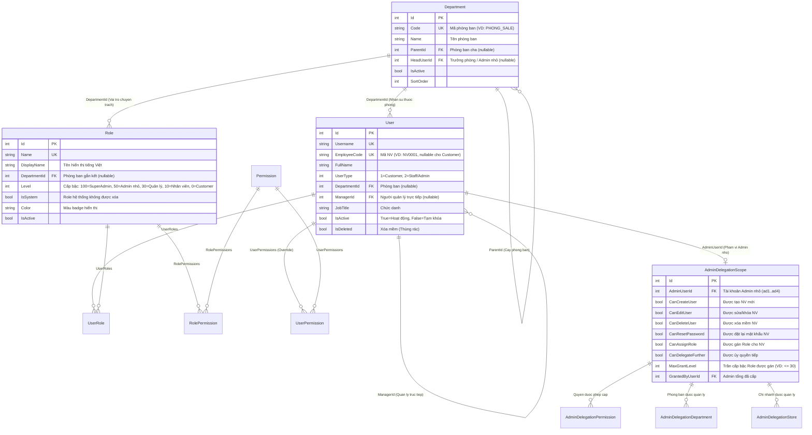
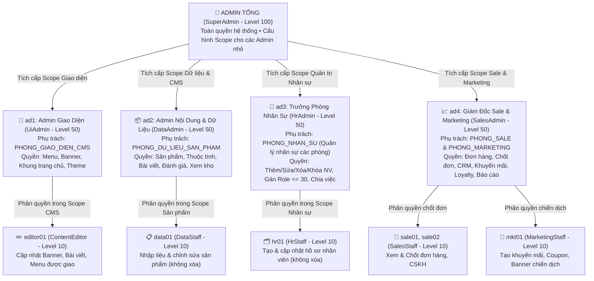

# THIẾT KẾ KIẾN TRÚC PHÂN QUYỀN ỦY QUYỀN PHÂN CẤP (DELEGATED RBAC + PBAC) & QUẢN TRỊ NHÂN SỰ (HRMS)

**Dự án:** CANMAKE BEAUTY — Omnichannel Beauty Solution  
**Phiên bản thiết kế:** 1.0 (Phiên 1 — Khảo sát & Thiết kế kiến trúc)  
**Ngày lập:** 05/11/2026  

---

## 1. TỔNG QUAN KHẢO SÁT HIỆN TRẠNG HỆ THỐNG

### 1.1. Kiến trúc Định danh & Phân quyền hiện có
Qua khảo sát trực tiếp mã nguồn thực tế trong Solution:
- **Domain Entities (`Omnichannel.Domain/Entities/IdentityEntities.cs`):**
  - `Role`: `Id`, `Name` (`varchar(50)`), `Description`, `IsActive`, `CreatedAt`. Hiện có 6 vai trò: `SuperAdmin` (1), `StoreManager` (2), `Cashier` (3), `WarehouseStaff` (4), `ContentEditor` (5), `Customer` (6).
  - `Permission`: `Id`, `Code` (`varchar(100)`), `Name`, `Module` (`varchar(50)`), `Description`. Hiện có **52 mã quyền hạt nhân** chia vào **14 phân hệ (`Module`)**.
  - `User`: `Id`, `Username`, `Email`, `PasswordHash`, `FullName`, `PhoneNumber`, `AvatarUrl`, `AvatarMediaId`, `NormalizedUsername`, `SecurityStamp`, `UserType` (`1` = Khách hàng, `2` = Nhân sự nội bộ), `IsActive`, `StoreId`, `CreatedAt`, `UpdatedAt`.
  - `UserRole`: Bảng trung gian `N-N` giữa `User` và `Role` (`UserId`, `RoleId`, `AssignedAt`).
  - `RolePermission`: Bảng trung gian `N-N` giữa `Role` và `Permission` (`RoleId`, `PermissionId`).
  - `UserPermission`: Bảng ghi đè quyền cá nhân (`UserId`, `PermissionId`, `IsGranted` — `true` = Cấp thêm / Grant Override, `false` = Tước bỏ / Deny Override).
- **Cơ chế Thực thi Quyền (`Omnichannel.Infrastructure/Security/`):**
  - `HasPermissionAttribute`: Kế thừa `AuthorizeAttribute`, sinh Policy động dạng `PERM:{PERMISSION_CODE}`.
  - `DynamicPermissionPolicyProvider`: Tự động khởi tạo `AuthorizationPolicy` chứa `PermissionRequirement` cho mọi policy có tiền tố `PERM:`.
  - `PermissionAuthorizationHandler`:
    1. **Tầng 1:** Nếu User có Role `SuperAdmin` hoặc `SUPER_ADMIN` -> Bypass toàn quyền (`God Mode`).
    2. **Tầng 2:** Đọc `userId` từ Claim `NameIdentifier`, gọi `IPermissionService.GetEffectivePermissionsAsync(userId)`.
    3. **Tầng 3:** Đối sánh mã quyền chuẩn hóa (`MODULE_ACTION` và `MODULE:ACTION`).
  - `PermissionService`:
    - Hợp nhất quyền từ các `Role` đang Active của User, sau đó áp dụng `UserPermission` (`IsGranted = true` thì cộng thêm, `IsGranted = false` thì loại bỏ — **Luật Deny luôn thắng Grant**).
    - Lưu bộ nhớ đệm `IMemoryCache` với khóa `UserPerms:{userId}` (TTL 30 phút). Có sẵn `InvalidateUserPermissionCacheAsync(userId)` và `InvalidateRolePermissionCacheAsync(roleId)`.

### 1.2. Các hạn chế & Lỗ hổng kiến trúc phát hiện qua khảo sát
1. **`PermissionManagementController.cs` bị khóa cứng cho `SuperAdmin` & Giao diện `PermissionManagement/Index.cshtml` chưa nối API thật:**
   - Controller dòng 18: `[Authorize(Roles = "SuperAdmin,SUPER_ADMIN")]` kết hợp `[HasPermission("PERMISSION_MANAGE")]` -> chặn toàn bộ Admin nhỏ.
   - View `Areas/Admin/Views/PermissionManagement/Index.cshtml` (dòng 57–61, 141–170, 203–214):
     - Nút *"Lưu Thay Đổi Ma Trận"* và *"Xóa Cache L1"* hiện chỉ gắn `onclick="alert(...)"` giả lập, **chưa gửi AJAX POST** về `SaveRoleMatrix`!
     - Phần `<thead>` đang fix cứng 5 cột (`SuperAdmin`, `StoreManager`, `Cashier`, `WarehouseStaff`, `ContentEditor`), trong khi `<tbody>` lặp theo `targetRoles`, dẫn đến nếu thêm Role mới (`UiAdmin`, `DataAdmin`, `HrAdmin`, `SalesAdmin`...) sẽ bị lệch cột bảng!
     - Hai action `GetUserOverrides` và `SaveUserOverride` đã có trong Controller (dòng 183–246) nhưng **chưa có giao diện** trên View để tích cấp/thu hồi quyền cho từng cá nhân.
2. **Cơ chế Xác thực Multi-Scheme Cookie (`Program.cs` dòng 168–205 & `AuthController.cs`):**
   - Hệ thống dùng `AuthConstants.DynamicScheme` tự động điều hướng giữa `AdminCookieScheme` (cho đường dẫn `/admin`) và `CustomerCookieScheme` (cho Storefront).
   - Tuy nhiên cần bổ sung kiểm tra `SecurityStamp` / trạng thái `IsActive` & `!IsDeleted` ngay khi xác thực request để khi Admin tổng hoặc Trưởng phòng khóa tài khoản / thu hồi quyền thì phiên đăng nhập của nhân viên đó được cập nhật tức thì.
3. **Chưa có khái niệm Phòng ban (`Department`), Cấp bậc vai trò (`Role.Level`) và Phạm vi ủy quyền (`AdminDelegationScope`):**
   - Tất cả Role đang nằm ngang hàng. Chưa có cơ chế kiểm soát "Admin 1 chỉ được cấp quyền thuộc mảng Giao diện cho nhân viên phòng Giao diện", "Admin 3 (Trưởng phòng Nhân sự) chỉ được gán Role cấp thấp hơn mình".
   - Nếu mở `SaveUserOverride` mà không có `DelegationService` chặn ở tầng Server, một người có quyền truy cập có thể tự cấp quyền `SuperAdmin` hoặc cấp quyền vượt quá quyền hạn của chính mình (Privilege Escalation).
4. **Lỗi Global Query Filter nghiêm trọng trên bảng `Users` (`ApplicationDbContext.cs` dòng 1178):**
   - `modelBuilder.Entity<User>().HasQueryFilter(e => e.IsActive);`
   - Trong `UserController.cs`, cả `Index()` và `ToggleStatus(int userId)` đều truy vấn `_context.Users` **không có `.IgnoreQueryFilters()`**.
   - Hệ quả: Khi khóa một tài khoản (`IsActive = false`), tài khoản đó **biến mất hoàn toàn** khỏi danh sách nhân sự và **không thể mở khóa lại được** vì `FindAsync(userId)` trả về `null`!
5. **Danh sách Nhân sự (`UserController.cs` & `Areas/Admin/Views/User/Index.cshtml`) đang trộn lẫn Khách hàng (`UserType = 1`) và Nhân sự (`UserType = 2`):**
   - Không có bộ lọc theo `UserType`, dẫn đến trang `/Admin/User` hiển thị hàng loạt tài khoản `Customer` như trên ảnh chụp màn hình.
   - Chưa có chức năng Chỉnh sửa (`Edit`), Xóa mềm (`Soft Delete`), Khôi phục (`Trash`), Đặt lại mật khẩu (`ResetPassword`), Tìm kiếm, Lọc đa tiêu chí, Phân trang, hay Xuất Excel/CSV.
   - Trong `UserController.Create`, khi tạo mới nhân sự chưa gán rõ `UserType = 2` (mặc định trong Entity `User.UserType = 1` là Customer!).
6. **Rà soát `[HasPermission]` trên các Controller trong `Areas/Admin/Controllers`:**
   - **Đã có `[HasPermission]` đầy đủ:** `BannerController`, `CustomerController`, `FinanceController`, `LoyaltyController`, `MenuController`, `OrderController`, `PosController`, `PostController`, `ProductController`, `PromotionController`, `ReportController`, `ReviewController`, `SettingsController`, `StockTransferController`, `ThemeConfigController`, `UiSectionController`, `UserController`, `WarehouseController`.
   - **Thiếu `[HasPermission]` (chỉ mới có `[Authorize]`):**
     - `AuditLogController.cs`: Cần bảo vệ bằng `[HasPermission("SETTINGS_VIEW")]` hoặc `SECURITY`.
     - `ProductAttributeController.cs`: Cần bảo vệ bằng `[HasPermission("PRODUCT_VIEW")]` (cho GET) và `[HasPermission("PRODUCT_EDIT")]` (cho POST/PUT/DELETE).
     - `ThemeCustomizerController.cs`: Cần bảo vệ bằng `[HasPermission("THEME_MANAGE")]`.
     - `AlertController.cs`: Cần bảo vệ bằng `[HasPermission("DASHBOARD_VIEW")]` hoặc `INVENTORY_VIEW`.
     - `ChatHistoryController.cs`: Cần bảo vệ bằng `[HasPermission("CUSTOMER_VIEW")]`.
     - `MediaController.cs` & `MediaApiController.cs`: Các thao tác xóa/tải ảnh cần kiểm tra quyền CMS/Product tương ứng.
     - `DashboardController.cs`: Chỉ mới gắn `[HasPermission("DASHBOARD_VIEW")]` ở 1 action (dòng 813), cần gắn ở action `Index` hoặc cấp Controller.

---

## 2. DANH MỤC 52 QUYỀN HIỆN CÓ & CÁC QUYỀN MỚI ĐỀ XUẤT

### 2.1. 52 Quyền hạt nhân hiện có (14 Module)
| Module | Mã Quyền (`Code`) | Tên hiển thị |
|---|---|---|
| **DASHBOARD** (2) | `DASHBOARD_VIEW`, `DASHBOARD_ANALYTICS` | Xem dashboard tổng quan, Xem phân tích nâng cao |
| **CMS** (6) | `CMS_BANNER_MANAGE`, `CMS_MENU_MANAGE`, `CMS_POST_MANAGE`, `CMS_REVIEW_MODERATE`, `CMS_STATIC_PAGE_MANAGE`, `THEME_MANAGE` | Quản lý Banner, Menu, Bài viết, Kiểm duyệt đánh giá, Trang tĩnh, Giao diện & bảng màu |
| **PRODUCT** (5) | `PRODUCT_VIEW`, `PRODUCT_CREATE`, `PRODUCT_EDIT`, `PRODUCT_DELETE`, `PRODUCT_IMPORT` | Xem, Tạo mới, Chỉnh sửa, Xóa, Import sản phẩm |
| **INVENTORY** (5) | `INVENTORY_VIEW`, `INVENTORY_IMPORT`, `INVENTORY_EXPORT`, `INVENTORY_ADJUST`, `INVENTORY_STOCKTAKE` | Xem tồn kho FEFO, Nhập kho, Xuất kho, Điều chỉnh, Kiểm kê |
| **STOCK_TRANSFER** (3) | `TRANSFER_CREATE`, `TRANSFER_APPROVE`, `TRANSFER_RECEIVE` | Tạo phiếu, Phê duyệt, Nhận hàng điều chuyển |
| **POS** (5) | `POS_ACCESS`, `POS_CHECKOUT`, `POS_REFUND`, `POS_SHIFT_OPEN`, `POS_SHIFT_CLOSE` | Truy cập POS, Thanh toán, Hoàn tiền, Mở ca, Đóng ca |
| **ORDER** (4) | `ORDER_VIEW`, `ORDER_CREATE`, `ORDER_EDIT`, `ORDER_CANCEL` | Xem, Tạo mới, Chỉnh sửa/Chốt đơn, Hủy đơn hàng |
| **CUSTOMER** (4) | `CUSTOMER_VIEW`, `CUSTOMER_CREATE`, `CUSTOMER_EDIT`, `CUSTOMER_PROFILE_VIEW` | Xem, Tạo mới, Sửa khách hàng, Xem hồ sơ sắc đẹp |
| **PROMOTION** (3) | `PROMOTION_MANAGE`, `COUPON_MANAGE`, `VOUCHER_MANAGE` | Chương trình khuyến mãi, Mã coupon, Phát hành voucher |
| **LOYALTY** (3) | `LOYALTY_VIEW`, `LOYALTY_ADJUST_POINTS`, `LOYALTY_TIER_MANAGE` | Xem ví điểm, Điều chỉnh điểm, Quản trị hạng thành viên |
| **FINANCE** (4) | `FINANCE_PNL_VIEW`, `FINANCE_LEDGER_VIEW`, `FINANCE_SUPPLIER_DEBT`, `FINANCE_COD_RECONCILE` | Báo cáo P&L, Sổ cái thu chi, Công nợ NCC, Đối soát COD |
| **REPORT** (3) | `REPORT_SALES`, `REPORT_INVENTORY`, `REPORT_FINANCE` | Báo cáo doanh số, Báo cáo tồn kho, Báo cáo tài chính |
| **SETTINGS** (2) | `SETTINGS_VIEW`, `SETTINGS_MANAGE` | Xem cấu hình, Chỉnh sửa cấu hình hệ thống |
| **SECURITY** (3) | `USER_MANAGE`, `ROLE_MANAGE`, `PERMISSION_MANAGE` | Quản lý người dùng, Quản lý vai trò, Quản lý phân quyền |

### 2.2. Danh sách Quyền hạt nhân MỚI cần bổ sung (14 Quyền)
Để tách mịn quyền Thêm/Sửa/Xóa nhân sự, quyền Chốt đơn và quyền Ủy quyền cấp dưới cho các Admin nhỏ, bổ sung 14 mã quyền sau (đồng thời **giữ nguyên `USER_MANAGE`, `ROLE_MANAGE` và `PERMISSION_MANAGE`** làm quyền tổng hợp tương thích ngược):

| Module | Mã Quyền Mới (`Code`) | Tên hiển thị tiếng Việt | Ý nghĩa nghiệp vụ |
|---|---|---|---|
| **HR** | `USER_VIEW` | Xem danh sách & hồ sơ nhân sự | Chỉ xem danh sách nhân sự trong phạm vi phòng ban |
| **HR** | `USER_CREATE` | Thêm mới nhân sự | Tạo tài khoản nhân viên mới trong phạm vi được giao |
| **HR** | `USER_EDIT` | Chỉnh sửa & Khóa/Mở khóa nhân sự | Sửa hồ sơ công việc, khóa/mở khóa nhân viên cấp dưới |
| **HR** | `USER_DELETE` | Xóa mềm & Khôi phục nhân sự | Đưa nhân sự vào thùng rác hoặc khôi phục lại |
| **HR** | `USER_RESET_PASSWORD` | Đặt lại mật khẩu nhân sự | Cấp mật khẩu tạm thời cho nhân viên quên mật khẩu |
| **HR** | `USER_EXPORT` | Xuất dữ liệu nhân sự (Excel/CSV) | Xuất danh sách nhân sự phục vụ báo cáo HCNS |
| **HR** | `USER_ASSIGN_ROLE` | Gán vai trò cho nhân sự | Gán các Role nằm trong giới hạn cấp bậc cho nhân viên |
| **HR** | `DEPARTMENT_VIEW` | Xem sơ đồ phòng ban | Xem cây tổ chức phòng ban và danh sách trưởng phòng |
| **HR** | `DEPARTMENT_MANAGE` | Quản lý cơ cấu phòng ban | Thêm, sửa, đổi trưởng phòng, sắp xếp phòng ban |
| **SECURITY** | `ROLE_VIEW` | Xem danh sách vai trò | Xem thông tin các vai trò trong phạm vi được phép gán |
| **SECURITY** | `ROLE_MANAGE_SCOPED` | Quản lý vai trò cấp phòng ban | Cấu hình vai trò cấp dưới trong phạm vi phòng ban |
| **SECURITY** | `PERMISSION_DELEGATE` | Ủy quyền & Chia quyền cấp dưới | Cho phép Admin nhỏ tích cấp/thu hồi quyền trong phạm vi Scope cho nhân viên dưới quyền |
| **CMS** | `UI_SECTION_MANAGE` | Quản lý bố cục khung trang chủ | Tách riêng quyền chỉnh sửa khung trang chủ (`UiSection`) với quyền đổi màu `THEME_MANAGE` |
| **ORDER** | `ORDER_CONFIRM` | Xác nhận & Chốt đơn hàng | Quyền nghiệp vụ chốt đơn, cập nhật trạng thái xử lý đơn hàng |

> **Quy tắc tương thích ngược trong `PermissionService`:** Nếu một tài khoản có `USER_MANAGE` thì tự động được kế thừa `USER_VIEW`, `USER_CREATE`, `USER_EDIT`, `USER_DELETE`, `USER_RESET_PASSWORD`, `USER_EXPORT`, `USER_ASSIGN_ROLE`, `DEPARTMENT_VIEW`. Nếu có `ROLE_MANAGE` thì tự động có `ROLE_VIEW`, `ROLE_MANAGE_SCOPED`. Nếu có `PERMISSION_MANAGE` thì tự động có `PERMISSION_DELEGATE`. Nếu có `ORDER_EDIT` thì tự động có `ORDER_CONFIRM`.

---

## 3. THIẾT KẾ MÔ HÌNH DỮ LIỆU "DELEGATED RBAC"

### 3.1. Sơ đồ Thực thể Liên kết (ERD)

### 3.2. Chi tiết các Bảng & Cột mở rộng
1. **Bảng mới `Departments`:**
   - Danh mục 9 phòng ban chuẩn được seed sẵn:
     1. `BAN_GIAM_DOC` — Ban Giám Đốc & Quản Trị Tối Cao (`Level 100`)
     2. `PHONG_GIAO_DIEN_CMS` — Phòng Giao Diện, Menu & Trải Nghiệm Web (Do **`ad1`** phụ trách)
     3. `PHONG_DU_LIEU_SAN_PHAM` — Phòng Nội Dung & Dữ Liệu Sản Phẩm (Do **`ad2`** phụ trách)
     4. `PHONG_NHAN_SU` — Phòng Hành Chính - Nhân Sự (Do **`ad3`** phụ trách)
     5. `PHONG_SALE` — Phòng Kinh Doanh & Chốt Đơn (Do **`ad4`** phụ trách)
     6. `PHONG_MARKETING` — Phòng Tiếp Thị, Khuyến Mãi & CRM (Do **`ad4`** kiêm nhiệm quản lý)
     7. `PHONG_KHO_VAN` — Phòng Kho Vận & Kiểm Soát Hạn Dùng FEFO
     8. `PHONG_KE_TOAN` — Phòng Tài Chính - Kế Toán
     9. `CUA_HANG_BAN_LE` — Hệ Thống Cửa Hàng & Thu Ngân POS
2. **Mở rộng bảng `Roles`:**
   - Thêm `DisplayName` (`nvarchar(100)`), `DepartmentId` (`int?`), `Level` (`int`), `IsSystem` (`bit`), `Color` (`varchar(30)`), `UpdatedAt` (`datetime2`).
3. **Mở rộng bảng `Users`:**
   - Thêm `EmployeeCode` (`varchar(30)`, unique index khi `NOT NULL`), `DepartmentId` (`int?`), `ManagerId` (`int?`), `JobTitle` (`nvarchar(100)`), `Gender` (`nvarchar(20)`), `DateOfBirth` (`date?`), `HireDate` (`date?`), `Address` (`nvarchar(300)`), `Notes` (`nvarchar(500)`), `LastLoginAt` (`datetime2?`), `IsDeleted` (`bit`, default `0`), `DeletedAt` (`datetime2?`), `DeletedBy` (`int?`).
   - **Sửa Global Query Filter của `User`:** Đổi từ `HasQueryFilter(e => e.IsActive)` sang `HasQueryFilter(e => !e.IsDeleted)` để tài khoản bị tạm khóa (`IsActive = false`) vẫn hiển thị trong bảng Quản lý nhân sự và mở khóa lại được bình thường, đồng thời chặn đăng nhập đối với `IsActive == false` ở `AuthController` và `PermissionService`.
4. **Bảng mới `AdminDelegationScopes` và 3 bảng liên kết (`AdminDelegationPermissions`, `AdminDelegationDepartments`, `AdminDelegationStores`):**
   - Lưu cấu hình phạm vi quyền hạn mà Admin tổng (`SuperAdmin`) đã tích giao cho từng Admin nhỏ (`ad1`, `ad2`, `ad3`, `ad4`...).
5. **Mở rộng bảng `UserPermissions` & `UserRoles`:**
   - `UserPermission`: thêm `GrantedByUserId` (`int?`), `GrantedAt` (`datetime2`), `Reason` (`nvarchar(255)`).
   - `UserRole`: thêm `AssignedByUserId` (`int?`).

---

## 4. CẤP BẬC VAI TRÒ, TÀI KHOẢN ADMIN NHỎ & MA TRẬN PHÂN QUYỀN

### 4.1. Sơ đồ Luồng Ủy quyền Phân cấp (Admin Tổng -> Admin Nhỏ -> Nhân Viên)

### 4.2. Bảng Phân cấp Vai trò (`Roles`)
| Mã Role (`Name`) | Tên hiển thị (`DisplayName`) | Phòng ban | `Level` | Nhóm đối tượng |
|---|---|---|---|---|
| `SuperAdmin` | Quản Trị Viên Tối Cao (Admin Tổng) | `BAN_GIAM_DOC` | **100** | Admin tổng (`superadmin`, `admin`) |
| `UiAdmin` | Admin Giao Diện & Menu | `PHONG_GIAO_DIEN_CMS` | **50** | Admin nhỏ **`ad1`** |
| `DataAdmin` | Admin Nội Dung & Cơ Sở Dữ Liệu | `PHONG_DU_LIEU_SAN_PHAM` | **50** | Admin nhỏ **`ad2`** |
| `HrAdmin` | Trưởng Phòng Nhân Sự (Quản Trị Phòng Ban) | `PHONG_NHAN_SU` | **50** | Admin nhỏ **`ad3`** |
| `SalesAdmin` | Giám Đốc Kinh Doanh & Marketing | `PHONG_SALE` | **50** | Admin nhỏ **`ad4`** |
| `StoreManager` | Cửa Hàng Trưởng (Quản Lý Chi Nhánh) | `CUA_HANG_BAN_LE` | **30** | Quản lý chi nhánh (`manager_hq`, `manager_cg`) |
| `SalesStaff` | Chuyên Viên Kinh Doanh & Chốt Đơn | `PHONG_SALE` | **10** | Nhân viên Sale (`sale01`, `sale02`) |
| `MarketingStaff` | Chuyên Viên Marketing & Khuyến Mãi | `PHONG_MARKETING` | **10** | Nhân viên Marketing (`mkt01`) |
| `HrStaff` | Chuyên Viên Hành Chính Nhân Sự | `PHONG_NHAN_SU` | **10** | Nhân viên Nhân sự (`hr01`) |
| `DataStaff` | Chuyên Viên Nhập Liệu Sản Phẩm | `PHONG_DU_LIEU_SAN_PHAM` | **10** | Nhân viên Dữ liệu (`data01`) |
| `ContentEditor` | Biên Tập Viên Nội Dung | `PHONG_GIAO_DIEN_CMS` | **10** | Nhân viên CMS (`editor01`) |
| `Cashier` | Thu Ngân Điểm Bán (POS) | `CUA_HANG_BAN_LE` | **10** | Nhân viên Thu ngân (`cashier01`, `cashier02`) |
| `WarehouseStaff` | Nhân Viên Kho & Kiểm Soát FEFO | `PHONG_KHO_VAN` | **10** | Nhân viên Kho (`warehouse01`, `warehouse02`) |
| `Customer` | Khách Hàng Thành Viên | `NULL` | **0** | Tài khoản mua sắm Storefront (`UserType = 1`) |

### 4.3. Ma trận Phân quyền Mặc định theo Vai trò (Module × Role)
| Phân hệ / Quyền | SuperAdmin (100) | UiAdmin `ad1` (50) | DataAdmin `ad2` (50) | HrAdmin `ad3` (50) | SalesAdmin `ad4` (50) | StoreManager (30) | SalesStaff (10) | MarketingStaff (10) | HrStaff (10) | DataStaff (10) | ContentEditor (10) | Cashier (10) | WarehouseStaff (10) |
|---|:---:|:---:|:---:|:---:|:---:|:---:|:---:|:---:|:---:|:---:|:---:|:---:|:---:|
| **DASHBOARD** | Full | `VIEW` | `VIEW` | `VIEW` | `VIEW`, `ANALYTICS` | `VIEW`, `ANALYTICS` | `VIEW` | `VIEW` | `VIEW` | `VIEW` | `VIEW` | `VIEW` | `VIEW` |
| **CMS Giao diện** (`MENU`, `BANNER`, `STATIC`, `THEME`, `UI_SECTION`) | Full | **Full** | — | — | `BANNER` | — | — | `BANNER` | — | — | `BANNER`, `MENU`, `STATIC` | — | — |
| **CMS Nội dung** (`POST`, `REVIEW`) | Full | `POST` | **Full** (`POST`, `REVIEW`) | — | `REVIEW` | — | — | `POST` | — | `POST` | `POST`, `REVIEW` | — | — |
| **PRODUCT** (`VIEW`, `CREATE`, `EDIT`, `DELETE`, `IMPORT`) | Full | `VIEW` | **Full** (Thêm/Sửa/Xóa/Import) | — | `VIEW` | `VIEW`, `EDIT` | `VIEW` | `VIEW` | — | `VIEW`, `CREATE`, `EDIT` | — | `VIEW` | `VIEW` |
| **INVENTORY & TRANSFER** | Full | — | `INVENTORY_VIEW` | — | `INVENTORY_VIEW` | Full | `INVENTORY_VIEW` | — | — | `INVENTORY_VIEW` | — | `INVENTORY_VIEW` | **Full** |
| **ORDER** (`VIEW`, `CREATE`, `EDIT`, `CANCEL`) | Full | — | — | — | **Full** (Quản lý & Chốt đơn) | Full | `VIEW`, `CREATE`, `EDIT` (Chốt đơn) | `VIEW` | — | — | — | `VIEW`, `CREATE` | `VIEW` |
| **POS** | Full | — | — | — | `POS_ACCESS` | Full | — | — | — | — | — | **Full** | — |
| **CUSTOMER (CRM)** | Full | — | — | — | **Full** | Full | `VIEW`, `CREATE`, `EDIT`, `PROFILE` | `VIEW`, `PROFILE` | — | — | — | `VIEW`, `CREATE` | — |
| **PROMOTION & LOYALTY** | Full | — | — | — | **Full** | `VIEW` | `LOYALTY_VIEW` | **Full** (`PROMO`, `COUPON`, `VOUCHER`, `LOYALTY_VIEW`) | — | — | — | `LOYALTY_VIEW` | — |
| **FINANCE & REPORT** | Full | — | `REPORT_INVENTORY` | — | `REPORT_SALES`, `FINANCE_COD` | `REPORT_SALES`, `REPORT_INVENTORY`, `FINANCE_PNL` | `REPORT_SALES` | `REPORT_SALES` | — | — | — | — | `REPORT_INVENTORY` |
| **HR / NHÂN SỰ** (`USER_*`, `DEPARTMENT_*`) | Full | `USER_VIEW` (Phòng CMS) | `USER_VIEW` (Phòng Data) | **Full** (`VIEW`, `CREATE`, `EDIT`, `DELETE`, `RESET_PW`, `EXPORT`, `ASSIGN_ROLE`, `DEPT_MANAGE`) | `USER_VIEW`, `USER_CREATE`, `USER_EDIT`, `USER_ASSIGN_ROLE` (Phòng Sale/Mkt) | `USER_VIEW` (Chi nhánh) | — | — | `USER_VIEW`, `USER_CREATE`, `USER_EDIT` | — | — | — | — |
| **DELEGATION** (`PERMISSION_DELEGATE`) | Full | **Có** (Scope CMS) | **Có** (Scope Data) | **Có** (Scope HR) | **Có** (Scope Sale/Mkt) | — | — | — | — | — | — | — | — |
| **SECURITY & SETTINGS** (`ROLE_MANAGE`, `PERMISSION_MANAGE`, `SETTINGS_*`) | **Chỉ SuperAdmin** | — | — | — | — | — | — | — | — | — | — | — | — |

---

## 5. CÁC NGUYÊN TẮC BẢO MẬT BẮT BUỘC (SECURITY INVARIANTS)

Hệ thống Ủy quyền (`IDelegationService`) cưỡng chế 6 quy tắc bất biến ở tầng Server:

1. **Quy tắc Trần Ủy Quyền (Delegation Ceiling Rule):**
   - Người cấp (`actor`) chỉ được phép cấp mã quyền $p$ cho nhân viên (`target`) khi và chỉ khi:
     $$p \in \text{EffectivePermissions}(\text{actor}) \quad \land \quad p \in \text{AdminDelegationScope.AllowedPermissions}(\text{actor})$$
   - Không ai có thể cấp một quyền mà chính mình không có hoặc nằm ngoài phạm vi được Admin tổng giao.
2. **Quy tắc Phân cấp Thứ bậc (Hierarchy Level Rule):**
   - Mỗi người dùng có cấp bậc cao nhất $\text{MaxLevel}(u) = \max_{r \in \text{Roles}(u)} r.\text{Level}$.
   - Người thao tác (`actor`) không bao giờ được chỉnh sửa, khóa, xóa, đặt lại mật khẩu hoặc thay đổi quyền của người dùng `target` có $\text{MaxLevel}(\text{target}) \ge \text{MaxLevel}(\text{actor})$ (trừ `SuperAdmin`).
   - Khi gán Role mới cho nhân viên, chỉ được phép gán Role $r$ thỏa mãn:
     $$r.\text{Level} \le \text{Scope.MaxGrantLevel}(\text{actor}) \quad \land \quad r.\text{Level} < \text{MaxLevel}(\text{actor})$$
3. **Quy tắc Không Tự Nâng Quyền (No Self-Elevation):**
   - Không tài khoản nào (kể cả Admin nhỏ) được phép tự sửa `UserRole`, `UserPermission`, hoặc `AdminDelegationScope` của chính mình.
4. **Quy tắc Cô lập Phòng ban / Chi nhánh (Organizational Scope Isolation):**
   - Admin nhỏ chỉ nhìn thấy và thao tác trên nhân sự có `DepartmentId` nằm trong `AdminDelegationDepartments` (hoặc `StoreId` nằm trong `AdminDelegationStores`).
   - Riêng `ad3` (Trưởng phòng Nhân sự) được cấp Scope quản lý nhân sự tất cả các phòng ban nghiệp vụ (trừ `BAN_GIAM_DOC` và các tài khoản có $\text{Level} \ge 50$).
5. **Quy tắc Thu hồi Dây chuyền (Cascade Revoke):**
   - Khi Admin tổng thu hồi quyền $p$ khỏi Scope của một Admin nhỏ $A$, hệ thống tự động quét các bản ghi `UserPermission` do $A$ đã cấp (`GrantedByUserId = A.Id` và `IsGranted = true`) đối với quyền $p$ để thu hồi dây chuyền và xóa Cache tức thì, tránh việc quyền bị "rò rỉ" ở cấp dưới.
6. **Quy tắc Tách biệt Tuyệt đối Admin/Staff (`UserType = 2`) và Customer (`UserType = 1`):**
   - Tài khoản `UserType = 1` không bao giờ được đăng nhập hoặc truy cập Area `Admin`, không bao giờ xuất hiện trong danh sách phân quyền nội bộ.
   - Mọi thao tác cấp quyền, thu hồi quyền, gán vai trò, đổi Scope, khóa/xóa nhân sự đều ghi nhận vào bảng `AuditLogs` kèm theo `ActorId`, `TargetUserId`, giá trị trước/sau và địa chỉ IP.

---

## 6. LỘ TRÌNH TRIỂN KHAI CHI TIẾT CÁC PHIÊN TIẾP THEO (PHIÊN 2 -> PHIÊN 8)

| Phiên | Mục tiêu trọng tâm | Các file chính sẽ tạo / chỉnh sửa | Cách kiểm chứng & Rollback |
|---|---|---|---|
| **Phiên 2** | **Database & Migration:** Tạo bảng `Departments`, `AdminDelegationScopes` (+ 3 bảng con), mở rộng `Roles` (`Level`, `DepartmentId`, `DisplayName`) & `Users` (`EmployeeCode`, `DepartmentId`, `ManagerId`, `JobTitle`, `IsDeleted`...), sửa Query Filter `User`, seed 9 phòng ban & 11 quyền mới. | `IdentityEntities.cs`, `ApplicationDbContext.cs`, Migration `AddDelegatedRbacAndDepartments`, `DbInitializer.cs` | Build 0 lỗi, `dotnet ef database update` thành công, dữ liệu cũ nguyên vẹn. Rollback bằng `dotnet ef database update <PreviousMigration>`. |
| **Phiên 3** | **Lõi Bảo mật `DelegationService`:** Xây dựng `IDelegationService` & `DelegationService`, cưỡng chế 6 quy tắc an toàn, Cascade Revoke, mở `PermissionManagementController` cho Admin nhỏ có quyền `PERMISSION_DELEGATE`, vá toàn bộ Controller thiếu `[HasPermission]`, viết Unit Tests. | `IDelegationService.cs`, `DelegationService.cs`, `PermissionService.cs`, `PermissionManagementController.cs`, các Admin Controllers, `Omnichannel.Tests` | Tất cả Unit Test bảo mật xanh 100%, chặn mọi hành vi vượt quyền ở tầng Server. |
| **Phiên 4** | **Seed Tài khoản `ad1`..`ad4` & Nhân viên mẫu:** Tạo các Role mới (`UiAdmin`, `DataAdmin`, `HrAdmin`, `SalesAdmin`, `SalesStaff`, `MarketingStaff`, `HrStaff`, `DataStaff`), tạo tài khoản `ad1`, `ad2`, `ad3`, `ad4`, `sale01`, `sale02`, `mkt01`, `hr01`, `data01`, cấu hình Scope cho `ad1`..`ad4`, cập nhật nút đăng nhập nhanh và xuất `doc/MA_TRAN_PHAN_QUYEN_TAI_KHOAN.md`. | `DbInitializer.cs`, `Areas/Admin/Views/Auth/Login.cshtml`, `doc/MA_TRAN_PHAN_QUYEN_TAI_KHOAN.md` | Đăng nhập thành công tất cả tài khoản bằng `Admin@123`, kiểm tra đúng quyền từng tài khoản. |
| **Phiên 5** | **Giao diện Phân quyền & Ủy quyền:** Xây dựng UI Quản lý Phòng ban (`/Admin/Department`), UI Cấu hình Ủy quyền Admin nhỏ (`/Admin/Delegation`), nâng cấp UI Ma trận Phân quyền & Phân quyền cá nhân theo Scope, cập nhật Sidebar `_AdminLayout.cshtml` tự ẩn/hiện theo quyền. | `DepartmentController.cs`, `DelegationController.cs`, `PermissionManagementController.cs`, Views tương ứng, `_AdminLayout.cshtml` | Admin tổng tích chọn Scope cho `ad1`..`ad4` trực quan; `ad1`..`ad4` đăng nhập vào thấy đúng menu của mình và tích chia quyền được cho nhân viên dưới quyền. |
| **Phiên 6** | **Backend Quản lý Nhân sự (HRMS):** Xây dựng `IStaffManagementService` & `StaffManagementService`, nâng cấp `UserController` với đầy đủ Thêm, Sửa, Xóa mềm, Khôi phục (Thùng rác), Đặt lại mật khẩu, Thao tác hàng loạt, Lọc đa tiêu chí, Tìm kiếm, Phân trang, Xuất CSV/Excel, tách riêng Nhân sự và Khách hàng. | `StaffDtos.cs`, `IStaffManagementService.cs`, `StaffManagementService.cs`, `UserController.cs`, Unit Tests | API lọc, tìm kiếm, phân trang, CRUD, xóa mềm/khôi phục, xuất file hoạt động chính xác và tuân thủ Scope của từng Admin nhỏ. |
| **Phiên 7** | **Giao diện Quản lý Nhân sự Chuyên nghiệp:** Thiết kế lại `Areas/Admin/Views/User/Index.cshtml`, `Create.cshtml`, `Edit.cshtml`, `Details.cshtml`, `Trash.cshtml` với thẻ KPI thống kê, thanh bộ lọc đa năng, chế độ xem Bảng/Thẻ/Phòng ban, tách Tab Nhân sự & Khách hàng, tích hợp nút mở Drawer Phân quyền nhanh. | `Areas/Admin/Views/User/*.cshtml` | Giao diện hiện đại, đầy đủ bộ lọc/tìm kiếm/phân loại, thao tác mượt mà với HTMX + Alpine.js. |
| **Phiên 8** | **Kiểm thử Tổng thể & Nghiệm thu:** Chạy kiểm thử tự động toàn bộ 18+ tài khoản trên tất cả các route Admin, đối chiếu 100% với ma trận thiết kế, hoàn thiện tài liệu hướng dẫn vận hành. | `Omnichannel.Tests`, `doc/HUONG_DAN_PHAN_QUYEN.md` | 0 lỗi biên dịch, 100% test pass, server chạy ổn định trên `http://canmakebeauty.vn` và `http://localhost:5116`. |

