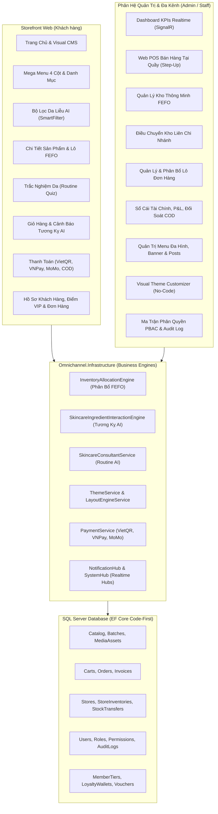

# BẢN ĐỒ CHỨC NĂNG VÀ HIỆN TRẠNG HỆ THỐNG
## Dự án: Omnichannel Beauty Solution (.NET 8 Clean Architecture)

> **Mục tiêu tài liệu:** Cung cấp "bản đồ sự thật" (Source of Truth) phản ánh trung thực toàn bộ những gì hệ thống **ĐANG CÓ**, **ĐANG LÀM DỞ** hoặc **CHƯA CÓ** dựa trên bằng chứng kiểm tra mã nguồn thực tế (File và số dòng cụ thể).

---

## 1. SƠ ĐỒ TỔNG QUAN KIẾN TRÚC VÀ MODULE (MERMAID)

---

## 2. KIỂM KÊ TOÀN BỘ 48 CONTROLLER VÀ PHÂN QUYỀN

### 2.1. Phân hệ Khách hàng (Storefront - 18 Controllers)

| STT | Tên Controller | Đường Dẫn File | Route Chính | Số Action | Phân Quyền / Thuộc Tính | Trạng Thái |
|:---:|:---|:---|:---|:---:|:---|:---:|
| 1 | `AccountController` | `Controllers/AccountController.cs` | `/Account/Login`, `/Account/Register` | 13 | Anonymous / `[Authorize]` đổi mật khẩu | ✅ HOÀN CHỈNH |
| 2 | `AlertApiController` | `Controllers/AlertApiController.cs` | `/api/alerts` | 6 | API thông báo người dùng | ✅ HOÀN CHỈNH |
| 3 | `BlogController` | `Controllers/BlogController.cs` | `/Blog`, `/tin-tuc`, `/tin-tuc/{slug}` | 2 | Công khai | ✅ HOÀN CHỈNH |
| 4 | `CartController` | `Controllers/CartController.cs` | `/cart`, `/api/cart/add` | 10 | Công khai / Dùng `[IgnoreAntiforgeryToken]` | 🟡 MỘT PHẦN (CSRF nợ) |
| 5 | `ChatApiController` | `Controllers/ChatApiController.cs` | `/api/chat` | 2 | Công khai | ✅ HOÀN CHỈNH |
| 6 | `CheckoutController` | `Controllers/CheckoutController.cs` | `/checkout`, `/Checkout/PlaceOrder` | 16 | CSRF form, có mock webhook ngân hàng | ✅ HOÀN CHỈNH |
| 7 | `CustomerController` | `Controllers/CustomerController.cs` | `/Customer/Dashboard`, `/Orders` | 9 | `[Authorize]` (Customer Scheme) | ✅ HOÀN CHỈNH |
| 8 | `HomeController` | `Controllers/HomeController.cs` | `/`, `/clearance-fefo`, `/preview` | 12 | Công khai, SEO sitemap & robots | ✅ HOÀN CHỈNH |
| 9 | `LocationController` | `Controllers/LocationController.cs` | `/api/location` (tỉnh/huyện/xã) | 4 | Công khai | ✅ HOÀN CHỈNH |
| 10 | `MediaController` | `Controllers/MediaController.cs` | `/media/{id}` (stream ảnh nhị phân) | 3 | Công khai | ✅ HOÀN CHỈNH |
| 11 | `NotificationApiController` | `Controllers/NotificationApiController.cs` | `/api/notifications` | 5 | `[Authorize]` | ✅ HOÀN CHỈNH |
| 12 | `OrderController` | `Controllers/OrderController.cs` | `/Order/Tracking`, `/History` | 3 | Tra cứu công khai / xem chi tiết auth | ✅ HOÀN CHỈNH |
| 13 | `ProductController` | `Controllers/ProductController.cs` | `/san-pham/{slug}`, `/tim-kiem` | 10 | Công khai | ✅ HOÀN CHỈNH |
| 14 | `ReviewController` | `Controllers/ReviewController.cs` | `/Review/Submit`, `/VoteHelpful` | 4 | Đánh giá sao & bình chọn hữu ích | ✅ HOÀN CHỈNH |
| 15 | `RoutineQuizController` | `Controllers/RoutineQuizController.cs` | `/tu-van-da`, `/api/quiz/recommend` | 3 | Công khai (AI Routine Builder) | ✅ HOÀN CHỈNH |
| 16 | `SmartFilterApiController` | `Controllers/SmartFilterApiController.cs` | `/api/products/smart-filter` | 2 | Công khai (API lọc da liễu) | ✅ HOÀN CHỈNH |
| 17 | `SmartFilterController` | `Controllers/SmartFilterController.cs` | `/ai-beauty-advisor` | 4 | Công khai | ✅ HOÀN CHỈNH |
| 18 | `WishlistController` | `Controllers/WishlistController.cs` | `/Wishlist`, `/Customer/Wishlist` | 6 | Hỗ trợ lưu DB và LocalStorage | ✅ HOÀN CHỈNH |

### 2.2. Phân hệ Quản trị Doanh nghiệp (Admin Portal - 30 Controllers)

| STT | Tên Controller | Đường Dẫn File | Route Chính | Số Action | Phân Quyền / Quyền Hạn (PBAC) | Trạng Thái / Ghi Chú |
|:---:|:---|:---|:---|:---:|:---|:---:|
| 19 | `AlertController` | `Areas/Admin/Controllers/AlertController.cs` | `/Admin/Alerts` | 6 | `[Authorize]` | 🔴 LỖI (SQL timeout 30s) |
| 20 | `AuditLogController` | `Areas/Admin/Controllers/AuditLogController.cs` | `/Admin/AuditLog` | 2 | `[Authorize]`, SuperAdmin/SETTINGS_VIEW | 🔴 LỖI (SQL timeout 30s) |
| 21 | `AuthController` | `Areas/Admin/Controllers/AuthController.cs` | `/admin/auth/login`, `logout` | 4 | Anonymous cho login / Multi-Scheme | ✅ HOÀN CHỈNH |
| 22 | `BannerController` | `Areas/Admin/Controllers/BannerController.cs` | `/Admin/Banner` | 8 | `CMS_BANNER_MANAGE` | ✅ HOÀN CHỈNH |
| 23 | `ChatHistoryController` | `Areas/Admin/Controllers/ChatHistoryController.cs` | `/Admin/ChatHistory` | 3 | `[Authorize]` | ✅ HOÀN CHỈNH |
| 24 | `CustomerController` | `Areas/Admin/Controllers/CustomerController.cs` | `/Admin/Customer` | 4 | `CUSTOMER_VIEW`, `CUSTOMER_EDIT` | ✅ HOÀN CHỈNH |
| 25 | `DashboardController` | `Areas/Admin/Controllers/DashboardController.cs` | `/Admin/Dashboard` | 3 | `[Authorize]`, SignalR realtime KPIs | ✅ HOÀN CHỈNH |
| 26 | `FinanceController` | `Areas/Admin/Controllers/FinanceController.cs` | `/Admin/Finance/ProfitLoss` | 12 | `FINANCE_PNL_VIEW`, `FINANCE_LEDGER` | ✅ HOÀN CHỈNH |
| 27 | `LoyaltyController` | `Areas/Admin/Controllers/LoyaltyController.cs` | `/Admin/Loyalty` | 4 | `LOYALTY_VIEW`, `LOYALTY_TIER_MANAGE`| ✅ HOÀN CHỈNH |
| 28 | `MediaApiController` | `Areas/Admin/Controllers/MediaApiController.cs` | `/admin/api/media` | 2 | `[Authorize]` | ✅ HOÀN CHỈNH |
| 29 | `MediaController` | `Areas/Admin/Controllers/MediaController.cs` | `/admin/media` | 5 | `[Authorize]` (Quản lý ảnh nhị phân) | ✅ HOÀN CHỈNH |
| 30 | `MenuController` | `Areas/Admin/Controllers/MenuController.cs` | `/Admin/MenuManagement` | 7 | `CMS_MENU_MANAGE` (Index: Anonymous!) | 🔴 CỬA SAU ANONYMOUS |
| 31 | `MessageController` | `Areas/Admin/Controllers/MessageController.cs` | `/Admin/Messages` | 8 | `[Authorize]` (Hộp thư nội bộ) | ✅ HOÀN CHỈNH |
| 32 | `NotificationController`| `Areas/Admin/Controllers/NotificationController.cs` | `/Admin/Notifications` | 5 | `[Authorize]` | ✅ HOÀN CHỈNH |
| 33 | `OrderController` | `Areas/Admin/Controllers/OrderController.cs` | `/Admin/Order` | 5 | `ORDER_VIEW`, `ORDER_EDIT` (Details: Anonym)| 🟡 CỬA SAU ANONYMOUS |
| 34 | `PermissionManagementController` | `Areas/Admin/Controllers/PermissionManagementController.cs` | `/Admin/PermissionManagement` | 5 | **Comment mất `[Authorize]`, Index: Anonym!**| 🚨 BLOCKER AN NINH |
| 35 | `PosController` | `Areas/Admin/Controllers/PosController.cs` | `/Admin/Pos` | 16 | `POS_ACCESS`, `POS_CHECKOUT` (Index: Anonym)| 🟡 CỬA SAU ANONYMOUS |
| 36 | `PostController` | `Areas/Admin/Controllers/PostController.cs` | `/Admin/Post` | 9 | `CMS_POST_MANAGE` | ✅ HOÀN CHỈNH |
| 37 | `ProductAttributeController` | `Areas/Admin/Controllers/ProductAttributeController.cs` | `/Admin/ProductAttribute` | 3 | `[Authorize]` (Thuộc tính mỹ phẩm) | ✅ HOÀN CHỈNH |
| 38 | `ProductController` | `Areas/Admin/Controllers/ProductController.cs` | `/Admin/Product` | 11 | `PRODUCT_VIEW`, `PRODUCT_CREATE` | ✅ HOÀN CHỈNH |
| 39 | `PromotionController`| `Areas/Admin/Controllers/PromotionController.cs` | `/Admin/Promotion` | 10 | `PROMOTION_MANAGE`, `COUPON_MANAGE` | ✅ HOÀN CHỈNH |
| 40 | `ReportController` | `Areas/Admin/Controllers/ReportController.cs` | `/Admin/Report` | 3 | `REPORT_SALES` (Excel, CSV) | ✅ HOÀN CHỈNH |
| 41 | `ReviewController` | `Areas/Admin/Controllers/ReviewController.cs` | `/Admin/Review` | 6 | `CMS_REVIEW_MODERATE` | 🔴 LỖI (SQL timeout 30s) |
| 42 | `SettingsController` | `Areas/Admin/Controllers/SettingsController.cs` | `/Admin/Settings` | 4 | `SETTINGS_VIEW`, `SETTINGS_MANAGE` | ✅ HOÀN CHỈNH |
| 43 | `StockTransferController`| `Areas/Admin/Controllers/StockTransferController.cs`| `/Admin/StockTransfer` | 7 | `TRANSFER_CREATE`, `TRANSFER_APPROVE`| ✅ HOÀN CHỈNH |
| 44 | `ThemeConfigController`| `Areas/Admin/Controllers/ThemeConfigController.cs` | `/Admin/ThemeConfig` | 2 | `THEME_MANAGE` | ✅ HOÀN CHỈNH |
| 45 | `ThemeCustomizerController` | `Areas/Admin/Controllers/ThemeCustomizerController.cs`| `/admin/customizer` | 3 | `[Authorize]` (Live Theme Builder) | ✅ HOÀN CHỈNH |
| 46 | `UiSectionController` | `Areas/Admin/Controllers/UiSectionController.cs` | `/admin/ui-section` | 3 | `THEME_MANAGE` (Bật/tắt section) | ✅ HOÀN CHỈNH |
| 47 | `UserController` | `Areas/Admin/Controllers/UserController.cs` | `/Admin/User` | 4 | `USER_MANAGE` | ✅ HOÀN CHỈNH |
| 48 | `WarehouseController`| `Areas/Admin/Controllers/WarehouseController.cs` | `/Admin/Warehouse` | 10 | `INVENTORY_VIEW`, `IMPORT` (Index: Anonym)| 🔴 HIỆU NĂNG KÉM (25,5s) |

---

## 3. BẢNG PHÂN LOẠI 12 NHÓM NĂNG LỰC TMĐT MỸ PHẨM (G1–G12)

| Nhóm Năng Lực | Chức Năng Cụ Thể | Trạng Thái | Bằng Chứng Mã Nguồn (File#Dòng) | Đánh Giá & Ghi Chú Demo |
| :--- | :--- | :---: | :--- | :--- |
| **G1. Khám phá & Tìm kiếm** | Mega Menu 4 Cột danh mục mỹ phẩm | ✅ HOÀN CHỈNH | `_MegaNav.cshtml#L1-L85` | Dropdown 4 cột mượt mà, phân chia Skincare & Makeup |
| | Lọc thông minh (Smart Filter Da Liễu) | ✅ HOÀN CHỈNH | `SmartFilterController.cs#L38-L530` | Lọc kết hợp Loại da, Vấn đề da, Hoạt chất, Thương hiệu |
| | Tìm kiếm tức thì (Instant Autocomplete) | 🟡 MỘT PHẦN | `ProductController.cs#L621, L935` | Trang `/tim-kiem` có search, nhưng header thiếu autocomplete |
| | Bảng xếp hạng bán chạy (Best Sellers) | ⬜ CHƯA CÓ | Chưa có code | Chưa có trang bảng xếp hạng ranking chuẩn Olive Young |
| **G2. Chi tiết sản phẩm (PDP)** | Biến thể (Màu son / Dung tích) | ✅ HOÀN CHỈNH | `Product/Detail.cshtml#L564-L620` | Swatch mã màu thực tế, đổi giá theo biến thể |
| | Bảng hoạt chất & Điểm an toàn EWG | ✅ HOÀN CHỈNH | `IngredientParserHelper.cs#L1-L150` | Phân tích hoạt chất động kèm công dụng & điểm EWG xanh/vàng |
| | Cảnh báo tương kỵ da liễu trên PDP | 🟡 MỘT PHẦN | `Product/Detail.cshtml#L1118-L1180` | Có thẻ cảnh báo tĩnh (Retinol + BHA), chưa so với giỏ hàng |
| | Tra cứu tồn kho Showroom Realtime | ✅ HOÀN CHỈNH | `StoreInventoryService.cs#L40` | Tra cứu số lượng hàng thực tế theo từng showroom chi nhánh |
| | Video Swatch trên da thật | 🟡 MỘT PHẦN | `ProductController.cs#L145` | Swatch video URL đang gắn cứng link ngoài `mixkit.co` |
| | Thử màu son ảo theo 4 tông da | ⬜ CHƯA CÓ | Chưa có code | Chưa có bộ chọn 4 tông da Châu Á & hiệu ứng lì/bóng |
| | Khay so sánh mỹ phẩm (Compare tray) | ⬜ CHƯA CÓ | Chưa có code | Chưa có tính năng chọn so sánh 2-3 sản phẩm đặt cạnh nhau |
| | Đánh giá có ảnh / Bộ lọc Skin Twin | ⬜ CHƯA CÓ | Chưa có code | Review hiện chỉ có text và rating, chưa có ảnh thật |
| **G3. Cá nhân hóa & Tư vấn** | Routine Quiz (Trắc nghiệm chu trình da) | ✅ HOÀN CHỈNH | `RoutineQuizController.cs#L44-L80` | Gợi ý phác đồ 3 bước Sáng/Tối và 1-click thêm vào giỏ |
| | AI Chatbot tư vấn sắc đẹp | ✅ HOÀN CHỈNH | `ChatbotService.cs#L1-L180` | Hỗ trợ tư vấn hoạt chất, kiểm tra kho tự động |
| | Hồ sơ sắc đẹp & Lịch nhắc mua lại | 🟡 MỘT PHẦN | `CrmEntities.cs#L10`, `CustomerProfileService.cs` | Backend có đầy đủ nhưng UI khách hàng chưa hiển thị |
| **G4. Giỏ hàng & Thanh toán** | Mini Cart Drawer & Giỏ hàng chính | ✅ HOÀN CHỈNH | `CartController.cs#L115`, `Cart/Index.cshtml` | Nạp giỏ hàng động qua HTMX/AJAX, trượt mượt mà |
| | Cảnh báo xung đột hoạt chất trong giỏ | ✅ HOÀN CHỈNH | `Cart/Index.cshtml#L115-L155` | Động cơ da liễu AI cảnh báo xung đột (Retinol vs BHA...) |
| | Gói quà tặng sang trọng & Thiệp viết tay | ✅ HOÀN CHỈNH | `CartController.cs#L498`, `Cart/Index.cshtml` | Tùy chọn hộp nơ quà tặng kèm lời nhắn thiệp viết tay |
| | Đa cổng thanh toán (VietQR, VNPay, MoMo, COD) | ✅ HOÀN CHỈNH | `PaymentService.cs#L31-L363`, `CheckoutController.cs` | Sinh mã VietQR chuẩn Napas 247 + giả lập webhook demo |
| | Phí vận chuyển động GHN Express | ✅ HOÀN CHỈNH | `GhnShippingService.cs#L1-L120` | Tích hợp GHN, tự động fallback phí cố định nếu mất mạng |
| | Thanh săn quà đa tầng & Quầy Sample | ⬜ CHƯA CÓ | Chưa có code | Chưa có thanh nấc quà tặng và quầy chọn sample mini |
| | Bảo mật CSRF trên AJAX Cart/Checkout | 🔴 LỖI | `CartController.cs#L363`, `CheckoutController.cs#L143` | Dùng `[IgnoreAntiforgeryToken]` thay vì CSRF token chuẩn |
| **G5. Khuyến mãi** | Xả kho cận Date FEFO (Clearance) | ✅ HOÀN CHỈNH | `HomeController.cs#L50`, `ClearanceFefo.cshtml` | Giảm 45% cho lô date < 240 ngày, ưu tiên đẩy hàng cận hạn |
| | Quản lý Chiến dịch & Mã Coupon | ✅ HOÀN CHỈNH | `PromotionController.cs#L32`, `PromotionEngine.cs` | Áp dụng mã giảm giá, kiểm tra điều kiện giá trị đơn hàng |
| | Flash Sale đếm ngược thời gian thực | 🟡 MỘT PHẦN | `DashboardController.cs#L513` | Admin có nút đẩy sang Flash Sale, Storefront chưa có đồng hồ |
| **G6. Thành viên & Loyalty** | Hạng VIP & Ví điểm thưởng | ✅ HOÀN CHỈNH | `LoyaltyService.cs#L20-L150`, `LoyaltyEntities.cs` | Tích điểm tự động (10k = 1đ), tiêu điểm giảm trừ trực tiếp |
| | Mã QR định danh thành viên tại quầy | ✅ HOÀN CHỈNH | `LoyaltyService.cs#L115` | Sinh mã QR cá nhân để thu ngân quét tích điểm tại quầy POS |
| | Wishlist & Đăng ký báo có hàng | ✅ HOÀN CHỈNH | `WishlistController.cs#L77-L290` | Lưu sản phẩm yêu thích và đăng ký nhận tin back-in-stock |
| | Gamification: Điểm danh & Mã giới thiệu| ⬜ CHƯA CÓ | Chưa có code | Chưa có tính năng check-in nhận xu và chia sẻ referral code |
| **G7. Hậu mua hàng** | Lịch sử mua hàng & Đặt lại 1-click | ✅ HOÀN CHỈNH | `CustomerController.cs#L654` (`Reorder`) | Đưa toàn bộ sản phẩm đơn cũ vào lại giỏ hàng tức thì |
| | Yêu cầu xuất hóa đơn điện tử VAT | ✅ HOÀN CHỈNH | `CustomerController.cs#L686` | Lưu MST, tên công ty và xuất dữ liệu hóa đơn |
| | Timeline hành trình đơn hàng | 🟡 MỘT PHẦN | `CustomerController.cs#L557`, `OrderDetail.cshtml` | Chỉ có badge trạng thái chữ, chưa có timeline 4 nấc |
| | Yêu cầu Hủy/Đổi trả tự phục vụ | ⬜ CHƯA CÓ | Chưa có code | Khách hàng chưa thể tự gửi yêu cầu hủy hoặc đổi trả online |
| **G8. Cộng đồng & Nội dung** | Blog & Cẩm nang làm đẹp chuẩn SEO | ✅ HOÀN CHỈNH | `BlogController.cs#L22`, `PostController.cs#L29` | Quản lý bài viết cẩm nang da liễu chuẩn SEO |
| | Đánh giá sao kèm Vote Helpful | ✅ HOÀN CHỈNH | `ReviewController.cs#L52-L214` | Bình chọn đánh giá hữu ích, kiểm duyệt đánh giá từ Admin |
| | Hỏi đáp sản phẩm (Product Q&A) | ⬜ CHƯA CÓ | Chưa có code | Chưa có module hỏi đáp giữa khách hàng và chuyên viên |
| **G9. Đa kênh O2O** | Màn hình bán hàng POS tại quầy | ✅ HOÀN CHỈNH | `PosController.cs#L49-L708`, `Pos/Index.cshtml` | Quét barcode, bán theo lô FEFO, in bill, mở/đóng ca |
| | Quản lý Điều chuyển kho liên chi nhánh | ✅ HOÀN CHỈNH | `StockTransferController.cs#L33-L165` | Tạo phiếu xuất kho, duyệt điều chuyển, nhập kho chi nhánh |
| | Click & Collect (Nhận tại Shop 1h) | ⬜ CHƯA CÓ | Chưa có code | Chưa có lựa chọn nhận hàng tại showroom và mã PIN/QR |
| **G10. Quản trị vận hành** | Động cơ phân bổ kho FEFO tự động | ✅ HOÀN CHỈNH | `InventoryAllocationEngine.cs#L1-L210` | Thuật toán tự động cấp phát lô cận date có hạn gần nhất |
| | Quản lý Menu Đa hình SEO | ✅ HOÀN CHỈNH | `MenuController.cs#L34-L165`, `MenuEngineService.cs` | Kéo thả sắp xếp menu, link động, xóa cache tức thì |
| | CMS Visual Theme Customizer (No-Code)| ✅ HOÀN CHỈNH | `ThemeCustomizerController.cs`, `UiSectionController.cs` | Tùy biến màu, font, bật/tắt và đảo section trang chủ |
| | Phân quyền vai trò PBAC | 🟡 MỘT PHẦN | `PermissionManagementController.cs#L18` | Giao diện ma trận đầy đủ nhưng controller bị comment auth |
| **G11. Báo cáo & Phân tích** | Realtime KPIs Dashboard | ✅ HOÀN CHỈNH | `DashboardController.cs#L31`, `_RealtimeKpis.cshtml` | Doanh thu, đơn hàng, biểu đồ cập nhật qua SignalR Hub |
| | Báo cáo Tài chính, Sổ cái, Công nợ, COD| ✅ HOÀN CHỈNH | `FinanceController.cs#L42-L334` | Sổ cái tài chính, công nợ NCC, đối soát COD nhà vận chuyển |
| | Phễu chuyển đổi (Funnel) & Phân khúc RFM| ⬜ CHƯA CÓ | Chưa có code | Chưa có biểu đồ phễu mua hàng và phân khúc khách hàng RFM |
| **G12. Nền tảng kỹ thuật** | Clean Architecture 4 tầng + Tests | ✅ HOÀN CHỈNH | `OmnichannelBeautySolution.sln` | Tách biệt Domain, Application, Infrastructure, Web, Tests |
| | Xác thực Multi-Scheme Cookie | ✅ HOÀN CHỈNH | `Program.cs#L140-L155` | Phiên đăng nhập Admin và Khách hàng hoàn toàn độc lập |
| | Realtime SignalR Hubs & Background Worker| ✅ HOÀN CHỈNH | `NotificationHub.cs`, `AlertBackgroundWorker.cs` | Bắn thông báo đơn mới, quét cảnh báo kho ngầm |
| | Presenter HUD (Thanh hỗ trợ demo) | ⬜ CHƯA CÓ | Chưa có code | Chưa có thanh công cụ điều khiển kịch bản demo 10 phút |

---

## 4. ĐỐI CHIẾU KẾ HOẠCH NÂNG CẤP CŨ (`prompt_sua_loi_theo_phien.md`)

| Phiên Cũ | Tiêu Đề Nhiệm Vụ Cũ | Trạng Thái | Bằng Chứng Mã Nguồn (File#Dòng) | Đánh Giá Hiện Trạng |
| :---: | :--- | :---: | :--- | :--- |
| **1.1** | Xóa bỏ hardcode lô hàng FEFO giả (`Id = 99991, 99992`) | ✅ ĐÃ LÀM | `ProductController.cs#L118-L133` | Đã truy vấn từ `activeBatches` trong CSDL, không còn `new ProductBatch` giả |
| **1.2** | Bóc tách thành phần động & Điểm an toàn EWG | ✅ ĐÃ LÀM | `ProductController.cs#L148`, `IngredientParserHelper.cs` | Đã sinh thành phần theo danh mục, tính điểm EWG động |
| **1.3** | Chuẩn hóa bảo mật CSRF Token cho API AJAX | 🔴 CHƯA LÀM | `CartController.cs#L363`, `CheckoutController.cs#L143` | Vẫn đang dùng `[IgnoreAntiforgeryToken]` trên hàng loạt endpoint AJAX |
| **2.1** | Backend phân tích xung đột & tương kỵ da liễu AI | ✅ ĐÃ LÀM | `SkincareIngredientInteractionEngine.cs#L16-L50` | Đã có bộ quy tắc khoa học (Retinol vs BHA/AHA/BPO, VitC vs Peptides...) |
| **2.2** | Phòng Lab da liễu tại Giỏ hàng & PDP | 🟡 MỘT PHẦN | `Cart/Index.cshtml#L115-L155`, `Detail.cshtml#L1118` | Giỏ hàng đã có banner cảnh báo, nhưng trang chi tiết sản phẩm mới là cảnh báo tĩnh |
| **2.3** | Thử màu trang điểm theo 4 tông da Châu Á & Undertone | ⬜ CHƯA LÀM | Không tìm thấy code liên quan | Chưa có Studio thử màu son/phấn trên nền da thật |
| **3.1** | Thanh tiến độ săn quà đa tầng & Quầy Sample dùng thử | ⬜ CHƯA LÀM | Không tìm thấy code liên quan | Chưa có thanh tiến độ nấc quà và chọn sản phẩm sample miễn phí |
| **3.2** | Khay so sánh mỹ phẩm chuyên sâu (VND/ml, hoạt chất, FEFO) | ⬜ CHƯA LÀM | Không tìm thấy code liên quan | Chưa có tính năng khay so sánh 2-3 sản phẩm cạnh nhau |
| **4.1** | Click & Collect nhận tại Showroom 1h & QR nhận hàng | ⬜ CHƯA LÀM | `CheckoutController.cs#L131, L729` | Checkout chỉ có `STANDARD` và `EXPRESS_2H`, chưa có Click & Collect |
| **4.2** | Cổng xác thực & giao hàng đơn O2O tại POS | ⬜ CHƯA LÀM | `PosController.cs` | POS chưa có module nhập mã PIN / quét QR giao hàng đơn Click & Collect |
| **5.1** | Hồ sơ làn da người đánh giá & Bộ lọc "Match my skin twin" | ⬜ CHƯA LÀM | `ReviewController.cs`, `_ProductReviews.cshtml` | Đánh giá chưa gắn với SkinType/SkinConcern của người viết |
| **6.1** | Demo Presenter HUD & Kiểm thử tổng lực E2E | ⬜ CHƯA LÀM | `_Layout.cshtml` | Chưa có bảng điều khiển thuyết trình 10 phút trên giao diện |

---

## 5. DANH MỤC NỢ KỸ THUẬT XẾP HẠNG (BLOCKER / MAJOR / MINOR)

### 🚨 CẤP ĐỘ 1: BLOCKER (Nguy cơ đổ vỡ kịch bản & Rủi ro an ninh)
1. **Lỗ hổng phân quyền Admin - Permission Management bị vô hiệu hóa:**
   - *Vị trí:* `Omnichannel.Web/Areas/Admin/Controllers/PermissionManagementController.cs#L18-L19` và `#L37`.
   - *Hậu quả:* Bất kỳ ai không đăng nhập cũng có thể mở `/Admin/PermissionManagement` và chỉnh sửa ma trận quyền của toàn bộ hệ thống.
2. **Cửa sau truy cập tự do vào các phân hệ Admin cốt lõi:**
   - *Vị trí:* `PosController.cs#L407` (`Index`), `WarehouseController.cs#L566` (`Index`), `OrderController.cs#L386` (`Details`), `MenuController.cs#L347` (`Index`).
   - *Hậu quả:* Người dùng vô danh không cần đăng nhập vẫn xem được dữ liệu tồn kho, danh mục sản phẩm POS và chi tiết đơn hàng.

### ⚠️ CẤP ĐỘ 2: MAJOR (Ảnh hưởng trải nghiệm & Tính ổn định)
1. **Bảo mật Anti-Forgery (CSRF) bị vô hiệu hóa trên API AJAX:**
   - *Vị trí:* `CartController.cs#L363, L434, L473, L497, L552, L666`, `RoutineQuizController.cs#L52, L73`.
   - *Hậu quả:* Sử dụng `[IgnoreAntiforgeryToken]` để tránh lỗi 400 thay vì xử lý token qua header chuẩn.
2. **Video Swatch Demo phụ thuộc tài nguyên bên ngoài (Mixkit CDN):**
   - *Vị trí:* `ProductController.cs#L145`.
   - *Hậu quả:* Nếu mất kết nối internet khi đang thuyết trình bảo vệ đồ án, video swatch son sẽ không phát được.
3. **Giá gốc sản phẩm giả định (Hardcoded 1.25 multiplier):**
   - *Vị trí:* `ProductController.cs#L950`.
   - *Hậu quả:* `OriginalPrice = Math.Round(p.SellingPrice * 1.25m / 1000m) * 1000m` – tự nhân 1.25 nếu sản phẩm chưa có giá gốc trong CSDL.
4. **Service thừa / Chưa đăng ký DI:**
   - *Vị trí:* `Omnichannel.Infrastructure/Services/VnPayService.cs`.
   - *Hậu quả:* Không được đăng ký trong `Program.cs` vì toàn bộ thanh toán đã được gộp sang `PaymentService.cs`.

### ℹ️ CẤP ĐỘ 3: MINOR (Thẩm mỹ & Tiện ích)
1. **Thiếu Autocomplete tìm kiếm tức thì ở Header:** Thanh tìm kiếm chỉ submit form sang trang `/tim-kiem`, chưa có popover gợi ý sản phẩm ngay khi gõ.
2. **Giao diện trạng thái đơn hàng dạng chữ:** Trang chi tiết đơn hàng hiển thị badge chữ đơn điệu thay vì thanh tiến trình Timeline trực quan.

