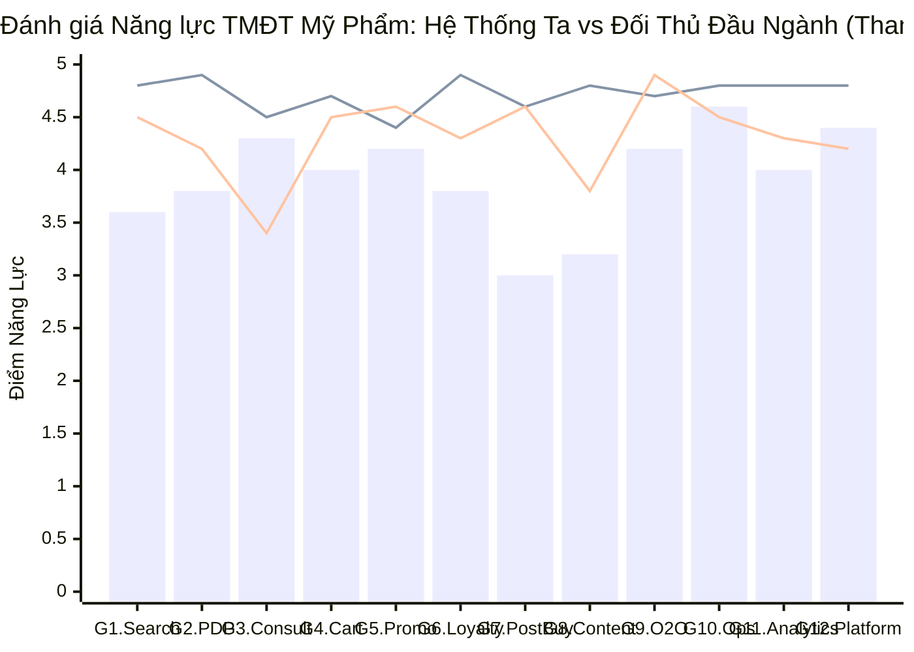
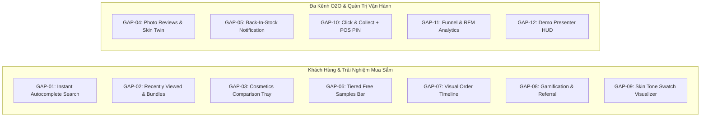

# MA TRẬN ĐỐI CHUẨN CẠNH TRANH & KHOẢNG TRỐNG NĂNG LỰC (GAP MATRIX)
## Dự án: Omnichannel Beauty Solution (.NET 8 Clean Architecture)

> **Mục tiêu:** Trả lời toàn diện câu hỏi của hội đồng phản biện:  
> *"So với các nền tảng bán lẻ mỹ phẩm hàng đầu quốc tế (Sephora, Olive Young, Paula's Choice) và Việt Nam (Hasaki, Watsons, Guardian), hệ thống `OmnichannelBeautySolution` đang sở hữu những lợi thế độc quyền nào và còn thiếu những mảnh ghép gì để bứt phá?"*

---

## 1. TỔNG HỢP ĐIỂM NĂNG LỰC & BIỂU ĐỒ SO SÁNH (G1–G12)

### 1.1. Bảng điểm năng lực (Thang điểm 0 – 5.0)

| Nhóm Năng Lực Nghiệp Vụ | Hệ Thống Ta | Sephora (Toàn cầu) | Hasaki (Việt Nam) | Olive Young (Hàn Quốc) | Watsons (Châu Á) |
| :--- | :---: | :---: | :---: | :---: | :---: |
| **G1. Khám phá & Tìm kiếm** | **3.6** | 4.8 | 4.5 | 4.7 | 4.2 |
| **G2. Trang chi tiết (PDP)** | **3.8** | 4.9 | 4.2 | 4.6 | 4.0 |
| **G3. Cá nhân hóa & Tư vấn** | **4.3** | 4.5 | 3.4 | 3.8 | 3.2 |
| **G4. Giỏ hàng & Thanh toán** | **4.0** | 4.7 | 4.5 | 4.4 | 4.2 |
| **G5. Khuyến mãi & FEFO** | **4.2** | 4.4 | 4.6 | 4.5 | 4.3 |
| **G6. Khách hàng thân thiết**| **3.8** | 4.9 | 4.3 | 4.4 | 4.4 |
| **G7. Hậu mua hàng** | **3.0** | 4.6 | 4.6 | 4.3 | 4.1 |
| **G8. Cộng đồng & Nội dung** | **3.2** | 4.8 | 3.8 | 4.7 | 3.6 |
| **G9. Đa kênh O2O (Store)** | **4.2** | 4.7 | 4.9 | 4.5 | 4.5 |
| **G10. Quản trị vận hành** | **4.6** | 4.8 | 4.5 | 4.6 | 4.4 |
| **G11. Báo cáo & Phân tích** | **4.0** | 4.8 | 4.3 | 4.5 | 4.2 |
| **G12. Nền tảng kỹ thuật** | **4.4** | 4.8 | 4.2 | 4.6 | 4.2 |
| **ĐIỂM TRUNG BÌNH CHUNG** | **3.90** | **4.73** | **4.32** | **4.47** | **4.11** |

---

### 1.2. Biểu đồ so sánh năng lực (Mermaid xychart-beta)

*(Cột Bar: Hệ thống của ta; Đường Line 1: Sephora; Đường Line 2: Hasaki).*

---

## 2. MA TRẬN ĐỐI CHUẨN CHI TIẾT THEO 12 NHÓM NĂNG LỰC

*Quy ước trạng thái hệ thống của ta: ✅ Hoàn chỉnh | 🟡 Một phần | 🎭 Giả lập | 🔴 Lỗi / Nợ bảo mật | ⬜ Chưa có*

| Nhóm & Chức Năng Tiêu Biểu | Sephora | Ulta | Olive Young | Hasaki | Watsons | Guardian | Hệ Thống Ta | Bằng Chứng & Ghi Chú Hiện Trạng |
| :--- | :---: | :---: | :---: | :---: | :---: | :---: | :---: | :--- |
| **G1. Khám phá & Tìm kiếm** | | | | | | | | |
| Mega Menu 4 Cột danh mục | ✔ | ✔ | ✔ | ✔ | ✔ | ✔ | ✅ | `_MegaNav.cshtml#L1` |
| Bộ lọc thông minh da liễu | ✔ | ✔ | ✔ | ✔ | ✔ | ✔ | ✅ | `SmartFilterController.cs#L38` |
| Tìm kiếm tức thì Autocomplete | ✔ | ✔ | ✔ | ✔ | ✔ | ✔ | 🟡 | `ProductController.cs#L621` (Header thiếu) |
| Tìm không dấu & Sửa lỗi chính tả | ✔ | ✔ | ✔ | ✔ | ✖ | ✖ | 🟡 | Dùng `LIKE/Contains`, chưa có fuzzy search |
| Từ khóa hot / Tìm kiếm nhiều | ✔ | ✔ | ✔ | ✔ | ✔ | ✔ | ⬜ | Chưa có bảng gợi ý từ khóa xu hướng |
| Bảng xếp hạng bán chạy (Rankings) | ✔ | ✔ | ✔ | ✔ | ✔ | ✔ | ⬜ | Chưa có bảng xếp hạng chuẩn Olive Young |
| **G2. Chi tiết sản phẩm (PDP)** | | | | | | | | |
| Chọn màu Swatch & Dung tích | ✔ | ✔ | ✔ | ✔ | ✔ | ✔ | ✅ | `Product/Detail.cshtml#L564` |
| Bảng hoạt chất & Điểm an toàn EWG | ✔ | ✔ | ✖ | ✖ | ✖ | ✖ | ✅ | `IngredientParserHelper.cs#L1` (Vượt trội!) |
| Tồn kho Showroom realtime (O2O) | ✔ | ✔ | ✔ | ✔ | ✖ | ✖ | ✅ | `StoreInventoryService.cs#L40` |
| Video Swatch thực tế | ✔ | ✔ | ✔ | ✖ | ✖ | ✖ | 🟡 | `ProductController.cs#L145` (Hardcode URL) |
| Cảnh báo tương kỵ da liễu trên PDP| ✖ | ✖ | ✖ | ✖ | ✖ | ✖ | 🟡 | `Detail.cshtml#L1118` (Cảnh báo tĩnh) |
| Thử màu son ảo theo 4 tông da | ✔ | ✔ | ✖ | ✖ | ✖ | ✖ | ⬜ | Sephora Color IQ / Ulta GLAMlab |
| Khay so sánh mỹ phẩm (VND/ml, EWG)| ✔ | ✖ | ✖ | ✖ | ✖ | ✖ | ⬜ | Chưa có khay ghim so sánh sản phẩm |
| Sản phẩm đã xem gần đây | ✔ | ✔ | ✔ | ✔ | ✔ | ✔ | ⬜ | Chưa có lịch sử xem trên localStorage |
| Thường được mua cùng (Cross-sell)| ✔ | ✔ | ✔ | ✔ | ✔ | ✖ | ⬜ | Chưa có khối gợi ý mua kèm tự động |
| Hỏi đáp sản phẩm (Product Q&A) | ✔ | ✔ | ✔ | ✔ | ✖ | ✖ | ⬜ | Chưa có module hỏi đáp khách hàng |
| Đánh giá có ảnh thật & Skin Twin | ✔ | ✔ | ✔ | ✔ | ✖ | ✖ | ⬜ | Chưa có lọc review theo loại da |
| **G3. Cá nhân hóa & Tư vấn** | | | | | | | | |
| Routine Quiz (Trắc nghiệm da) | ✔ | ✔ | ✖ | ✖ | ✖ | ✖ | ✅ | `RoutineQuizController.cs#L44` |
| AI Chatbot tư vấn sắc đẹp | ✔ | ✖ | ✖ | ✔ | ✖ | ✖ | ✅ | `ChatbotService.cs#L1` |
| Phân tích tương kỵ hoạt chất AI | ✖ | ✖ | ✖ | ✖ | ✖ | ✖ | ✅ | `SkincareIngredientInteractionEngine.cs` (Độc quyền!) |
| Hồ sơ sắc đẹp cá nhân (Beauty Profile)| ✔ | ✔ | ✔ | ✖ | ✖ | ✖ | 🟡 | `CrmEntities.cs#L10` (Chưa có UI) |
| Phân tích da bằng ảnh AI | ✔ | ✔ | ✖ | ✖ | ✖ | ✖ | ⬜ | Trải nghiệm thử tính năng WOW |
| **G4. Giỏ hàng & Thanh toán** | | | | | | | | |
| Mini Cart Drawer trượt mượt mà | ✔ | ✔ | ✔ | ✔ | ✔ | ✔ | ✅ | `MiniCartViewComponent.cs` |
| Cảnh báo xung đột hoạt chất trong giỏ| ✖ | ✖ | ✖ | ✖ | ✖ | ✖ | ✅ | `Cart/Index.cshtml#L115` (Độc quyền!) |
| Tùy chọn gói quà & Thiệp viết tay | ✔ | ✖ | ✖ | ✖ | ✖ | ✖ | ✅ | `CartController.cs#L498` |
| Đa cổng thanh toán (VietQR, VNPay)| ✖ | ✖ | ✖ | ✔ | ✔ | ✔ | ✅ | `PaymentService.cs#L31` |
| Tính phí ship động GHN Express | ✖ | ✖ | ✖ | ✔ | ✖ | ✖ | ✅ | `GhnShippingService.cs#L1` |
| Thanh tiến độ săn quà đa tầng | ✔ | ✔ | ✔ | ✔ | ✔ | ✖ | ⬜ | Chưa có thanh nấc quà 300k, 600k... |
| Quầy chọn Sample dùng thử miễn phí | ✔ | ✖ | ✖ | ✖ | ✖ | ✖ | ⬜ | Sephora Free 2 Samples per order |
| Bảo mật CSRF trên AJAX | ✔ | ✔ | ✔ | ✔ | ✔ | ✔ | 🔴 | `CartController.cs` dùng `[IgnoreAntiforgeryToken]` |
| **G5. Khuyến mãi & FEFO** | | | | | | | | |
| Xả kho cận date FEFO minh bạch | ✖ | ✖ | ✖ | ✖ | ✖ | ✖ | ✅ | `ClearanceFefo.cshtml` (Độc quyền!) |
| Mã giảm giá Coupon / Voucher | ✔ | ✔ | ✔ | ✔ | ✔ | ✔ | ✅ | `PromotionController.cs#L32` |
| Flash Sale đếm ngược thời gian thực | ✔ | ✔ | ✔ | ✔ | ✔ | ✔ | 🟡 | `DashboardController.cs#L513` (Thiếu widget web) |
| Mua X tặng Y / Quà tặng tự động | ✔ | ✔ | ✔ | ✔ | ✔ | ✖ | ⬜ | Chưa có logic bundle tự động |
| **G6. Khách hàng thân thiết**| | | | | | | | |
| Hạng VIP & Ví điểm thưởng | ✔ | ✔ | ✔ | ✔ | ✔ | ✔ | ✅ | `LoyaltyService.cs#L20` |
| Mã QR định danh khách tại quầy POS| ✔ | ✔ | ✔ | ✔ | ✔ | ✔ | ✅ | `LoyaltyService.cs#L115` |
| Wishlist & Đăng ký báo có hàng | ✔ | ✔ | ✔ | ✔ | ✔ | ✔ | ✅ | `WishlistController.cs#L77` |
| Gamification: Điểm danh nhận xu | ✖ | ✖ | ✔ | ✔ | ✖ | ✖ | ⬜ | Check-in hàng ngày nhận điểm |
| Mã giới thiệu bạn bè (Referral) | ✖ | ✖ | ✖ | ✔ | ✖ | ✖ | ⬜ | Chia sẻ link nhận voucher 50k |
| **G7. Hậu mua hàng** | | | | | | | | |
| Lịch sử đơn hàng & Đặt lại 1-click | ✔ | ✔ | ✔ | ✔ | ✔ | ✔ | ✅ | `CustomerController.cs#L654` |
| Yêu cầu xuất hóa đơn điện tử VAT | ✖ | ✖ | ✖ | ✔ | ✔ | ✔ | ✅ | `CustomerController.cs#L686` |
| Timeline hành trình giao hàng | ✔ | ✔ | ✔ | ✔ | ✔ | ✔ | 🟡 | `Customer/OrderDetail.cshtml` (Chỉ có text badge) |
| Yêu cầu Hủy/Đổi trả tự phục vụ | ✔ | ✔ | ✔ | ✔ | ✖ | ✖ | ⬜ | Khách chưa tự gửi yêu cầu online |
| Thông báo nhắc mua lại chu kỳ | ✔ | ✔ | ✖ | ✖ | ✖ | ✖ | ⬜ | Nhắc khách mua lại kem dưỡng sau 60 ngày |
| **G8. Cộng đồng & Nội dung** | | | | | | | | |
| Blog & Cẩm nang làm đẹp chuẩn SEO | ✔ | ✔ | ✔ | ✔ | ✔ | ✔ | ✅ | `BlogController.cs#L22` |
| Đánh giá sao kèm Vote Helpful | ✔ | ✔ | ✔ | ✔ | ✖ | ✖ | ✅ | `ReviewController.cs#L52` |
| Hỏi đáp cộng đồng (Product Q&A) | ✔ | ✔ | ✔ | ✔ | ✖ | ✖ | ⬜ | Chưa có mục Q&A chuyên gia |
| **G9. Đa kênh O2O (Store)** | | | | | | | | |
| Màn hình bán hàng POS tại quầy | ✖ | ✖ | ✖ | ✔ | ✔ | ✔ | ✅ | `PosController.cs#L49` |
| Tồn kho Showroom realtime | ✔ | ✔ | ✔ | ✔ | ✖ | ✖ | ✅ | `StoreInventoryService.cs#L40` |
| Điều chuyển kho liên chi nhánh | ✖ | ✖ | ✖ | ✔ | ✔ | ✔ | ✅ | `StockTransferController.cs#L33` |
| Click & Collect (Nhận tại Shop 1h)| ✔ | ✔ | ✔ | ✔ | ✔ | ✖ | ⬜ | Checkout thiếu lựa chọn nhận tại shop & mã PIN |
| **G10. Quản trị vận hành** | | | | | | | | |
| Động cơ phân bổ kho FEFO tự động | ✖ | ✖ | ✖ | ✖ | ✖ | ✖ | ✅ | `InventoryAllocationEngine.cs` (Độc quyền!) |
| Quản lý Menu Đa hình SEO | ✖ | ✖ | ✖ | ✖ | ✖ | ✖ | ✅ | `MenuEngineService.cs` (Độc quyền!) |
| Visual CMS Theme Customizer (No-Code)| ✖ | ✖ | ✖ | ✖ | ✖ | ✖ | ✅ | `ThemeCustomizerController.cs` (Độc quyền!) |
| Phân quyền vai trò PBAC | ✔ | ✔ | ✔ | ✔ | ✔ | ✔ | 🟡 | `PermissionManagementController.cs` (Lỗi auth) |
| **G11. Báo cáo & Phân tích** | | | | | | | | |
| Realtime KPIs Dashboard (SignalR) | ✔ | ✔ | ✔ | ✔ | ✔ | ✔ | ✅ | `DashboardController.cs#L31` |
| Sổ cái tài chính, P&L, Đối soát COD| ✖ | ✖ | ✖ | ✔ | ✖ | ✖ | ✅ | `FinanceController.cs#L42` |
| Phễu chuyển đổi & Phân khúc RFM | ✔ | ✔ | ✔ | ✖ | ✖ | ✖ | ⬜ | Chưa có phân khúc RFM khách hàng |
| **G12. Nền tảng kỹ thuật** | | | | | | | | |
| Clean Architecture 4 tầng + Tests | ✔ | ✔ | ✔ | ✔ | ✔ | ✔ | ✅ | 233 automated tests 100% Pass |
| Multi-Scheme Cookie Authentication| ✔ | ✔ | ✔ | ✔ | ✔ | ✔ | ✅ | Tách biệt hoàn toàn Admin vs Customer |
| Demo Presenter HUD | ✖ | ✖ | ✖ | ✖ | ✖ | ✖ | ⬜ | Chưa có thanh công cụ hỗ trợ demo 10 phút |

---

## 3. LỢI THẾ KHÁC BIỆT ĐANG CÓ (6 ĐIỂM TINH HOA - USPs)

1. **USP 1: Chuẩn hóa Hạn Dùng FEFO Minh Bạch & Xả Kho Cận Date Tự Động (Clearance FEFO)**
   - *Đột phá:* Cả Sephora lẫn Hasaki đều giấu hạn sử dụng cụ thể của từng sản phẩm. Hệ thống của ta cho phép khách hàng tra cứu chính xác số ngày sử dụng còn lại của từng lô hàng vật lý và chủ động chọn mua: Lô Mới Date Xa (giá niêm yết) hoặc Lô Cận Date (chiết khấu 45%).
   - *Giá trị bảo vệ đồ án:* Thể hiện đạo đức kinh doanh mỹ phẩm chính ngạch, giải quyết bài toán tiêu hủy hàng cận date gây lỗ hàng tỷ đồng cho doanh nghiệp.
2. **USP 2: Động Cơ Phân Tích Tương Kỵ & Hiệp Đồng Hoạt Chất Da Liễu AI**
   - *Đột phá:* Chưa website nào trên thị trường có tính năng này ngay tại giỏ hàng. `SkincareIngredientInteractionEngine` tự động rà soát các cặp hoạt chất xung đột nguy hiểm (Retinol + BHA/AHA, Vitamin C + Copper Peptides) và hướng dẫn phác đồ "Skin Cycling" khoa học.
3. **USP 3: Trắc Nghiệm Cá Nhân Hóa Routine Da Liễu (Routine Quiz & 1-Click Buy)**
   - *Đột phá:* Benchmark chuẩn xác theo Paula's Choice và The Ordinary. Gợi ý chu trình dưỡng da 3 bước (Sáng/Tối) dựa trên loại da, tình trạng mụn và độ tuổi, cho phép đưa trọn bộ vào giỏ hàng chỉ với 1 cú click.
4. **USP 4: Trình Quản Trị Visual Theme Customizer & Dynamic CMS (No-Code Live Preview)**
   - *Đột phá:* Thường chỉ có trên các nền tảng SaaS lớn (Shopify, Wix). Admin có thể đổi bảng màu, font chữ, ẩn hiện và kéo thả thay đổi vị trí các Section trang chủ thời gian thực qua CSS Variables và `window.postMessage`.
5. **USP 5: Hệ Thống Bán Lẻ Đa Kênh O2O Hợp Nhất (Web + POS + Kho FEFO + Điều Chuyển Chi Nhánh)**
   - *Đột phá:* Xóa nhòa ranh giới Online và Offline. Tra cứu tồn kho showroom realtime, màn hình thu ngân Web POS quét barcode, mở/đóng ca đối soát tiền mặt, in hóa đơn nhiệt 80mm và điều chuyển hàng liên chi nhánh.
6. **USP 6: Kiến Trúc Doanh Nghiệp Chuẩn Clean Architecture & Multi-Scheme PBAC Security**
   - *Đột phá:* Tách biệt 4 tầng tuyệt đối, xác thực độc lập Admin vs Khách hàng, bảo vệ nâng quyền Step-Up cho giao dịch POS nhạy cảm, cùng bộ 233 automated unit/integration tests bảo vệ chất lượng.

---

## 4. DANH SÁCH 12 KHOẢNG TRỐNG NĂNG LỰC (GAP-01 ĐẾN GAP-12)

### Chi tiết từng khoảng trống:
1. **GAP-01: Tìm kiếm tức thì & Gợi ý từ khóa (Instant Search & Autocomplete)**
   - *Đối thủ tham chiếu:* Sephora, Olive Young, Hasaki, Shopee.
   - *Hiện trạng:* `ProductController.cs#L621` có trang tìm kiếm nhưng Header chưa có popup gợi ý tức thì khi gõ phím.
   - *Giải pháp:* Thêm component Alpine.js debounce 300ms nạp danh sách 5 sản phẩm gợi ý kèm ảnh nhỏ, giá, hãng và 5 từ khóa xu hướng.
2. **GAP-02: Sản phẩm đã xem gần đây & "Thường được mua cùng"**
   - *Đối thủ tham chiếu:* Sephora, Olive Young, Hasaki, Amazon.
   - *Hiện trạng:* Chưa có cơ chế lưu lịch sử xem sản phẩm trên trình duyệt.
   - *Giải pháp:* Dùng `localStorage` lưu danh sách ID sản phẩm đã xem; hiển thị khay ngang dưới chân PDP và gợi ý combo bán kèm 2 sản phẩm liên quan.
3. **GAP-03: Khay so sánh mỹ phẩm chuyên sâu (Giá/ml, hoạt chất, FEFO)**
   - *Đối thủ tham chiếu:* Paula's Choice, Sephora, Thế Giới Skinfood.
   - *Hiện trạng:* Khách hàng chỉ xem được từng sản phẩm riêng lẻ.
   - *Giải pháp:* Xây dựng khay ghim cố định cho phép chọn 2-3 sản phẩm để so sánh đặt cạnh nhau: đơn giá trên từng ml/gram, nồng độ hoạt chất, điểm an toàn EWG, hạn sử dụng FEFO.
4. **GAP-04: Hỏi đáp sản phẩm (Q&A) & Đánh giá có ảnh / Bộ lọc "Skin Twin"**
   - *Đối thủ tham chiếu:* Sephora Community, Olive Young, Hasaki.
   - *Hiện trạng:* Review hiện chỉ có text và rating sao, chưa có ảnh thật.
   - *Giải pháp:* Cho phép khách upload ảnh đánh giá thật, đặt câu hỏi cho chuyên viên da liễu và lọc đánh giá theo người có cùng đặc tính da ("Da dầu mụn", "Da nhạy cảm").
5. **GAP-05: Thông báo Có hàng lại & Giảm giá (Back-in-Stock & Price Drop)**
   - *Đối thủ tham chiếu:* Sephora, Olive Young, Hasaki.
   - *Hiện trạng:* `WishlistController.cs#L285` có action `RegisterStockAlert` nhưng chưa có popup UI đăng ký nhận tin tiện lợi trên PDP.
   - *Giải pháp:* Bổ sung nút "Báo khi có hàng" thay thế cho nút Mua hàng khi sản phẩm hết tồn kho.
6. **GAP-06: Thanh tiến độ săn quà đa tầng & Quầy chọn Sample dùng thử miễn phí**
   - *Đối thủ tham chiếu:* Sephora (Sample Bar - 2 free samples per order), Lixibox.
   - *Hiện trạng:* Chưa có cơ chế tặng sample trải nghiệm trong giỏ hàng.
   - *Giải pháp:* Thanh tiến độ nấc quà (Đạt 300k tặng Sample mini, 600k tặng Mask, 1 triệu freeship) + Quầy chọn 2 mẫu thử mini miễn phí trước khi checkout.
7. **GAP-07: Theo dõi đơn hàng dạng Timeline & Yêu cầu Hủy/Đổi trả tự phục vụ**
   - *Đối thủ tham chiếu:* Hasaki (Giao 2H), Shopee, Sephora.
   - *Hiện trạng:* `Customer/OrderDetail.cshtml` hiển thị trạng thái bằng badge chữ đơn điệu.
   - *Giải pháp:* Thiết kế thanh Timeline 4 bước (Chờ xác nhận -> Đã đóng gói -> Đang giao nhanh -> Đã nhận); cho phép khách hàng tự gửi yêu cầu hủy/đổi trả online.
8. **GAP-08: Gamification Loyalty: Điểm danh nhận xu & Mã giới thiệu bạn bè**
   - *Đối thủ tham chiếu:* Olive Young, Shopee, Watsons.
   - *Hiện trạng:* Đã có ví điểm và hạng thành viên nhưng thiếu động lực tương tác hàng ngày.
   - *Giải pháp:* Nút check-in điểm danh hàng ngày nhận 5 điểm; sinh mã giới thiệu cá nhân tặng voucher 50k khi bạn bè mua đơn đầu tiên.
9. **GAP-09: Studio thử màu trang điểm theo 4 tông da & undertone (Skin Tone Swatch Visualizer)**
   - *Đối thủ tham chiếu:* Sephora (Color IQ / Virtual Artist), Ulta (GLAMlab).
   - *Hiện trạng:* Chỉ có các ô tròn swatch màu cơ bản.
   - *Giải pháp:* Khung tương tác SVG/Canvas cho phép đổi giữa 4 màu nền da Châu Á (Trắng sáng, Tự nhiên, Trung bình, Ngăm khỏe) với hiệu ứng lì (Matte) vs bóng (Dewy) và tính năng so sánh 2 màu son đặt cạnh nhau.
10. **GAP-10: Click & Collect (Nhận tại Showroom 1h) + Mã PIN xác thực tại POS**
    - *Đối thủ tham chiếu:* Hasaki (Giao 2H / Nhận tại shop), Sephora BOPIS.
    - *Hiện trạng:* Checkout mới chỉ có ship tận nơi STANDARD và EXPRESS_2H.
    - *Giải pháp:* Bổ sung tùy chọn "Nhận tại Showroom trong 1 giờ", tự động sinh vé lấy hàng kèm mã PIN/QR 6 số, thu ngân tại POS nhập mã PIN để xác thực và phát hàng tức thì.
11. **GAP-11: Dashboard phân tích kinh doanh (Phễu Funnel, AOV & Phân khúc RFM)**
    - *Đối thủ tham chiếu:* Shopify Plus, Magento Enterprise.
    - *Hiện trạng:* Dashboard mới chỉ hiển thị doanh thu và số lượng đơn hàng cơ bản.
    - *Giải pháp:* Bổ sung biểu đồ phễu chuyển đổi (Truy cập -> Xem PDP -> Thêm giỏ -> Mua hàng) và ma trận phân khúc khách hàng RFM (VIP Champions, Loyal, At Risk).
12. **GAP-12: Thanh điều khiển thuyết trình đồ án (Demo Presenter HUD)**
    - *Hiện trạng:* Người thuyết trình phải mở nhiều tab và thao tác thủ công phức tạp trong 10 phút.
    - *Giải pháp:* Thanh công cụ nổi ghim đáy màn hình với các nút 1-click kích hoạt kịch bản: "Reset dữ liệu demo", "Đóng vai Khách VIP", "Mô phỏng Quẹt thẻ VietQR thành công", "Tạo đơn nhanh để test SignalR", "Chuyển nhanh Storefront $\leftrightarrow$ POS".

---

## 5. ĐÁNH GIÁ TÍNH NĂNG THEO TIÊU CHÍ HỘI ĐỒNG CHẤM ĐỒ ÁN (10 PHÚT)

| Mã Tính Năng | Độ Phức Tạp Kỹ Thuật (35%) | Tính Trực Quan Demo (40%) | Giá Trị Nghiệp Vụ (25%) | Điểm Ưu Tiên Tổng Hợp | Đề Xuất Cho Phiên A4 |
|:---:|:---:|:---:|:---:|:---:|:---:|
| **GAP-12 (Presenter HUD)** | ⭐⭐⭐ | ⭐⭐⭐⭐⭐ | ⭐⭐⭐⭐⭐ | **9.8 / 10** | **BẮT BUỘC (Trục điều khiển demo)** |
| **GAP-10 (Click & Collect O2O)** | ⭐⭐⭐⭐⭐ | ⭐⭐⭐⭐⭐ | ⭐⭐⭐⭐⭐ | **9.6 / 10** | **BẮT BUỘC (Khóa chặt kịch bản O2O)** |
| **GAP-06 (Thanh Quà & Sample Bar)** | ⭐⭐⭐⭐ | ⭐⭐⭐⭐⭐ | ⭐⭐⭐⭐⭐ | **9.5 / 10** | **BẮT BUỘC (Kích cầu giỏ hàng Sephora)** |
| **GAP-09 (Studio Thử Màu Nền Da)**| ⭐⭐⭐⭐ | ⭐⭐⭐⭐⭐ | ⭐⭐⭐⭐ | **9.4 / 10** | **BẮT BUỘC (Hiệu ứng WOW thị giác)** |
| **GAP-03 (Khay So Sánh Mỹ Phẩm)** | ⭐⭐⭐⭐ | ⭐⭐⭐⭐⭐ | ⭐⭐⭐⭐ | **9.2 / 10** | **BẮT BUỘC (Đậm chất chuyên sâu da liễu)** |
| **GAP-01 (Instant Autocomplete)** | ⭐⭐⭐ | ⭐⭐⭐⭐⭐ | ⭐⭐⭐⭐ | **9.0 / 10** | **BẮT BUỘC (Điểm chạm đầu tiên)** |
| **GAP-07 (Timeline Đơn & Đổi Trả)** | ⭐⭐⭐⭐ | ⭐⭐⭐⭐ | ⭐⭐⭐⭐⭐ | **8.8 / 10** | **NÊN LÀM (Hoàn thiện hậu mãi)** |
| **GAP-02 (Xem Gần Đây & Mua Cùng)** | ⭐⭐⭐ | ⭐⭐⭐⭐ | ⭐⭐⭐⭐ | **8.5 / 10** | **NÊN LÀM (Gợi ý tăng AOV)** |
| **GAP-11 (Funnel & RFM Analytics)**| ⭐⭐⭐⭐ | ⭐⭐⭐⭐ | ⭐⭐⭐⭐ | **8.4 / 10** | **NÊN LÀM (Ăn điểm quản trị)** |
| **GAP-04 (Photo Review & Skin Twin)**| ⭐⭐⭐ | ⭐⭐⭐⭐ | ⭐⭐⭐ | **7.8 / 10** | TÙY CHỌN (Nếu còn thời gian) |
| **GAP-05 (Back-in-Stock Alert)** | ⭐⭐ | ⭐⭐⭐ | ⭐⭐⭐ | **7.2 / 10** | TÙY CHỌN (Nếu còn thời gian) |
| **GAP-08 (Gamification Loyalty)** | ⭐⭐ | ⭐⭐⭐ | ⭐⭐⭐ | **7.0 / 10** | TÙY CHỌN (Nếu còn thời gian) |

---

## 6. KẾT LUẬN & ĐỀ XUẤT CHO PHIÊN TIẾP THEO (PHIÊN A4)

Hệ thống `OmnichannelBeautySolution` hiện tại đã sở hữu nền tảng kiến trúc rất vững vàng (.NET 8 Clean Architecture, 233 tests pass 100%) cùng các nghiệp vụ cốt lõi mà thị trường chưa có (Quản lý hạn dùng FEFO từng lô vật lý, Phân tích tương kỵ hoạt chất da liễu AI, Visual Theme Customizer).

Tuy nhiên, để đạt điểm tuyệt đối trước hội đồng trong 10 phút thuyết trình, hệ thống cần bổ sung các **mảnh ghép trải nghiệm người dùng mang tính "WOW"** (Studio thử màu nền da, Quầy sample dùng thử, Khay so sánh đơn giá ml) và **hoàn thiện chu trình O2O khép kín** (Click & Collect nhận hàng tại showroom). 

Tại **Phiên A4**, chúng tôi sẽ lập bảng chấm điểm chi tiết và xây dựng **Lộ trình nâng cấp tối ưu** để người dùng phê duyệt trước khi bước vào giai đoạn viết mã.

