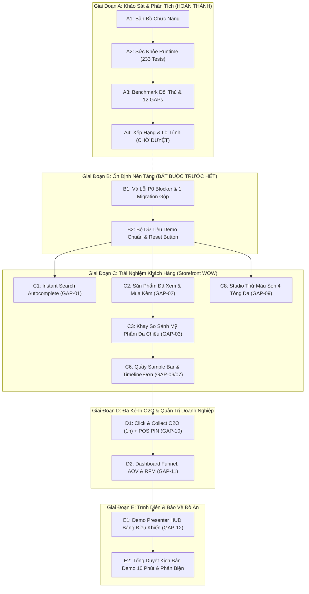

# LỘ TRÌNH NÂNG CẤP HỆ THỐNG HƯỚNG DEMO & BẢO VỆ ĐỒ ÁN
## Dự án: Omnichannel Beauty Solution (.NET 8 Clean Architecture)

> **Mục tiêu:** Xác lập kế hoạch triển khai tối ưu theo phương pháp định lượng MoSCoW, chọn lọc các tính năng mang lại hiệu quả trình diễn cao nhất ("WOW factor"), đồng thời đảm bảo an toàn kiến trúc (1 Migration duy nhất, xử lý triệt để lỗi P0 trước khi code tính năng mới).

---

## 1. BẢNG CHẤM ĐIỂM ĐỊNH LƯỢNG 12 KHOẢNG TRỐNG NĂNG LỰC (GAP MATRIX)

### Công thức tính điểm ưu tiên:
$$\text{Score} = 0.35 \times D + 0.25 \times B + 0.15 \times T + 0.15 \times E + 0.10 \times R$$

*Thang điểm 1–5 (trong đó E và R được đảo ngược để điểm cao tương ứng với thuận lợi cao):*
- **D (Demo Impact):** Mức độ gây ấn tượng thị giác, dễ hiểu và thuyết phục đối với hội đồng.
- **B (Business Value):** Giá trị thực tế cho ngành bán lẻ mỹ phẩm (AOV, tỷ lệ chuyển đổi, lòng trung thành).
- **T (Technical Showcase):** Thể hiện năng lực kỹ thuật (thuật toán, Clean Architecture, xử lý concurrency, realtime).
- **E (Effort Inverted):** 5 = Triển khai rất nhanh (≤ 1 phiên); 1 = Rất tốn công (> 3 phiên).
- **R (Risk Inverted):** 5 = Ít rủi ro gãy hệ thống, không phụ thuộc bên ngoài; 1 = Rủi ro cao.

| Mã GAP | Tên Chức Năng Cần Nâng Cấp | D (35%) | B (25%) | T (15%) | E (15%) | R (10%) | Điểm Tổng | Xếp Loại MoSCoW | Phiên Triển Khai |
|:---:|:---|:---:|:---:|:---:|:---:|:---:|:---:|:---:|:---:|
| **GAP-06** | Thanh tiến độ săn quà đa tầng & Quầy chọn Sample miễn phí | 5 | 5 | 4 | 4 | 5 | **4.70** | **MUST** | **Phiên C6/C3** |
| **GAP-12** | Demo Presenter HUD (Thanh công cụ hỗ trợ thuyết trình 10')| 5 | 4 | 4 | 5 | 5 | **4.60** | **MUST** | **Phiên E1** |
| **GAP-10** | Click & Collect (Nhận tại Shop 1h) + Mã PIN tại POS | 5 | 5 | 5 | 3 | 4 | **4.60** | **MUST** | **Phiên D1** |
| **GAP-09** | Studio thử màu son trên 4 tông da Châu Á & Undertone | 5 | 4 | 4 | 4 | 5 | **4.45** | **MUST** | **Phiên C8** |
| **GAP-01** | Instant Search Autocomplete & Gợi ý từ khóa Header | 5 | 4 | 3 | 5 | 5 | **4.45** | **MUST** | **Phiên C1** |
| **GAP-03** | Khay so sánh mỹ phẩm chuyên sâu (VND/ml, hoạt chất, FEFO) | 5 | 4 | 4 | 4 | 4 | **4.35** | **MUST** | **Phiên C3** |
| **GAP-07** | Timeline hành trình đơn hàng & Đổi trả tự phục vụ | 4 | 5 | 4 | 4 | 4 | **4.25** | **MUST** | **Phiên C6** |
| **GAP-02** | Sản phẩm đã xem gần đây (localStorage) & Mua kèm | 4 | 4 | 3 | 5 | 5 | **4.10** | **MUST** | **Phiên C2** |
| **GAP-11** | Dashboard phân tích kinh doanh (Funnel, AOV & RFM) | 4 | 4 | 4 | 3 | 4 | **3.85** | **SHOULD** | **Phiên D2** |
| **GAP-04** | Hỏi đáp sản phẩm (Q&A) & Đánh giá có ảnh / Skin Twin| 4 | 3 | 4 | 3 | 4 | **3.60** | **SHOULD** | **Phiên C4** |
| **GAP-05** | Thông báo Có hàng lại / Giảm giá (Back-in-stock) | 3 | 4 | 3 | 4 | 5 | **3.60** | **SHOULD** | **Phiên C5** |
| **GAP-08** | Gamification Loyalty: Điểm danh nhận xu & Referral | 3 | 3 | 3 | 4 | 4 | **3.25** | **COULD** | **Phiên C7 (Tùy chọn)** |

---

## 2. PHÂN BỔ CÁC PHIÊN TRIỂN KHAI VÀ ÁNH XẠ CHỨC NĂNG

### 2.1. Nhóm Bắt Buộc (MUST HAVE - 7 Chức Năng Cốt Lõi)
1. **Phiên C1 – Instant Search & Hot Keywords (GAP-01):** Dropdown tìm kiếm tức thì hiển thị ảnh, giá, hãng, danh mục và từ khóa hot khi gõ phím.
2. **Phiên C2 – Sản phẩm đã xem & "Thường mua cùng" (GAP-02):** Lưu lịch sử duyệt web vào `localStorage`, gợi ý combo mua kèm trên PDP để tăng AOV.
3. **Phiên C3 – Khay so sánh mỹ phẩm chuyên sâu (GAP-03):** Khay so sánh cố định 2-3 sản phẩm về đơn giá VND/ml, nồng độ hoạt chất, điểm an toàn EWG và hạn sử dụng FEFO.
4. **Phiên C6 – Thanh nấc quà, Quầy Sample Bar & Timeline đơn hàng (GAP-06 & GAP-07):** Tặng quà đa tầng, quầy chọn 2 sample mini miễn phí chuẩn Sephora, và timeline giao hàng trực quan.
5. **Phiên C8 – Studio thử màu son trên 4 nền da Châu Á & Undertone (GAP-09):** Mô phỏng màu son/phấn trên 4 tông da (Trắng sáng, Tự nhiên, Trung bình, Ngăm khỏe) với hiệu ứng Lì vs Căng bóng.
6. **Phiên D1 – Click & Collect O2O (Nhận tại Shop 1h) + Mã PIN tại POS (GAP-10):** Đặt online nhận tại showroom gần nhất, sinh vé lấy hàng mã PIN 6 số bí mật, thu ngân POS xác thực và bàn giao hàng.
7. **Phiên E1 – Demo Presenter HUD (GAP-12):** Bảng điều khiển nổi phục vụ 1-click kích hoạt kịch bản và reset dữ liệu khi thuyết trình.

### 2.2. Nhóm Nên Làm (SHOULD HAVE - 3 Chức Năng Mở Rộng)
8. **Phiên D2 – Dashboard Phân Tích Funnel, AOV & Phân Khúc RFM (GAP-11):** Báo cáo phễu mua sắm và ma trận phân nhóm khách hàng VIP Champions, Loyal, At Risk.
9. **Phiên C4 – Đánh giá có ảnh thật & Bộ lọc "Skin Twin" (GAP-04):** Upload ảnh thật trong review và lọc đánh giá theo loại da của người đọc.
10. **Phiên C5 – Thông báo Có hàng lại & Giảm giá (GAP-05):** Đăng ký nhận tin khi hết hàng có lô mới hoặc có đợt sale.

### 2.3. Nhóm Tùy Chọn / Hoãn Lại (COULD / WON'T)
11. **Phiên C7 – Gamification: Điểm danh nhận xu & Referral (GAP-08):** Xếp loại COULD; chỉ triển khai nếu còn dư thời gian.
12. **AI Camera Vision Phân Tích Da:** Xếp loại WON'T (không khả thi trong môi trường phòng thi, rủi ro mất mạng và phụ thuộc camera).

---

## 3. SƠ ĐỒ THỨ TỰ PHỤ THUỘC GIỮA CÁC PHIÊN (MERMAID)



---

## 4. CHIẾN LƯỢC CƠ SỞ DỮ LIỆU: KẾ HOẠCH GOM 1 MIGRATION DUY NHẤT

Để tuân thủ nghiêm ngặt nguyên tắc Clean Architecture và tránh tạo migration rác gây phân mảnh database, toàn bộ các thay đổi schema của các phiên sẽ được **gom gọn trong đúng 1 Migration duy nhất tại Phiên B1**:

### Tên Migration: `20261104_AddOmnichannelClickAndCollectAndEnhancements`

| Bảng CSDL | Cột Mới Cần Bổ Sung | Kiểu Dữ Liệu | Ràng Buộc / Ghi Chú | Phục Vụ Phiên |
| :--- | :--- | :--- | :--- | :---: |
| `Orders` | `PickupStoreId` | `int?` | FK nullable tới bảng `Stores` | Phiên D1 (Click & Collect) |
| `Orders` | `PickupPinCode` | `varchar(6)?` | Mã PIN lấy hàng 6 số bí mật | Phiên D1 (Click & Collect) |
| `Orders` | `PickupQrToken` | `varchar(64)?` | Token mã hóa phục vụ quét mã QR tại quầy | Phiên D1 (Click & Collect) |
| `Orders` | `PickupStatus` | `varchar(30)` | Trạng thái lấy hàng (DEFAULT: `'PENDING'`) | Phiên D1 (Click & Collect) |
| `Orders` | `PickedUpAt` | `datetime2?` | Thời điểm khách thực tế nhận hàng tại shop | Phiên D1 (Click & Collect) |
| `Orders` | `TrackingTimelineJson` | `nvarchar(max)?`| Lưu vết các mốc thời gian chuyển phát | Phiên C6 (Timeline Đơn) |
| `ProductReviews` | `ReviewerSkinType` | `nvarchar(50)?` | Loại da của người viết (Da dầu, Da khô...) | Phiên C4 (Skin Twin) |
| `ProductReviews` | `ReviewerSkinConcern` | `nvarchar(50)?` | Vấn đề da (Mụn, Nám, Nhạy cảm...) | Phiên C4 (Skin Twin) |
| `ProductReviews` | `PhotoMediaAssetId` | `int?` | FK nullable tới bảng `MediaAssets` | Phiên C4 (Ảnh thật) |
| `Users` | `ReferralCode` | `varchar(20)?` | Mã giới thiệu cá nhân của thành viên | Phiên C7 (Loyalty) |

> [!TIP]
> Các tính năng còn lại như **Studio Thử Màu Son (GAP-09)**, **Khay So Sánh Mỹ Phẩm (GAP-03)**, **Sản Phẩm Đã Xem (GAP-02)** và **Quầy Sample Bar (GAP-06)** hoạt động hoàn toàn dựa trên Client State (`localStorage` + Alpine.js) kết hợp logic C# có sẵn, **hoàn toàn không cần thay đổi Schema CSDL!**

---

## 5. CÂU CHUYỆN DEMO 10 PHÚT CHINH PHỤC HỘI ĐỒNG (PERSONA JOURNEY)

### 👤 Nhân vật trải nghiệm (Persona):
**"Lê Ngọc Linh"** – 24 tuổi, chuyên viên truyền thông tại Quận 1, TP.HCM.  
- **Đặc điểm da:** Da Hỗn Hợp Thiên Dầu, nhạy cảm, dễ lên mụn li ti và thâm sau mụn.
- **Nhu cầu cấp bách:** Cần tìm combo phục hồi da lành tính và thỏi son lì chuẩn màu để kịp dự tiệc công ty tối nay lúc 19:00.

---

### ⏱️ Phân bổ chi tiết 6 chặng trong 10 phút:

```
[00:00 - 01:30] Chặng 1: Tìm kiếm tức thì & Routine Quiz Da Liễu AI (Storefront)
[01:30 - 03:30] Chặng 2: Khay So Sánh Chuyên Sâu & Thử Màu Son Trên Da Thật (PDP)
[03:30 - 05:00] Chặng 3: Giỏ Hàng - Cảnh Báo Tương Kỵ & Quầy Sample Bar (Cart)
[05:00 - 06:30] Chặng 4: Đặt Hàng O2O "Click & Collect Nhận Sau 1 Giờ" (Checkout)
[06:30 - 08:30] Chặng 5: Thu Ngân POS Quét Mã PIN Xác Thực & Phát Hàng (Web POS)
[08:30 - 10:00] Chặng 6: Dashboard Báo Cáo Doanh Thu Realtime & Presenter HUD
```

#### Chặng 1 (0:00 - 1:30): Khám Phá & Routine Quiz Da Liễu AI (Storefront)
- **Màn hình:** Header Trang chủ $\rightarrow$ `/tu-van-da`
- **Thao tác:** 
  1. Gõ "serum" tại Header: Dropdown **Instant Search Autocomplete (GAP-01)** nảy ra ngay lập tức với hình ảnh, giá và thương hiệu.
  2. Bấm vào banner "Trắc nghiệm phân tích da AI": Trả lời 4 câu hỏi trắc nghiệm da liễu.
  3. Thuật toán phân tích đề xuất phác đồ 3 bước (Sữa rửa mặt Cetaphil $\rightarrow$ Serum BHA Paula's Choice $\rightarrow$ Kem dưỡng phục hồi B5 La Roche-Posay).
  4. Bấm **"Thêm trọn bộ vào giỏ hàng" (1-Click)**.
- **Thông điệp:** Ứng dụng khoa học da liễu giải quyết bài toán khách hàng bối rối giữa hàng ngàn mỹ phẩm.

#### Chặng 2 (1:30 - 3:30): Khay So Sánh & Studio Thử Màu Son Trên Da Thật (PDP)
- **Màn hình:** Trang chi tiết sản phẩm Son MAC & Kem Clinique
- **Thao tác:**
  1. Mở **Khay so sánh mỹ phẩm (GAP-03)**: So sánh đặt cạnh nhau Kem Clinique vs Kem B5 La Roche-Posay về đơn giá trên từng ml, hoạt chất và điểm an toàn EWG.
  2. Xem sản phẩm Son MAC: Mở **Studio Thử Màu Nền Da Thật (GAP-09)**. Chọn nền da *"Light Warm"* (Da trắng tự nhiên Châu Á) và thử 2 màu Chili vs Ruby Woo trên cùng cánh tay với hiệu ứng Velvet Matte sang trọng.
  3. Chọn màu 602 Chili thêm vào giỏ hàng.
- **Thông điệp:** Tính năng thị giác "WOW" xóa bỏ hoàn toàn nỗi sợ mua son bị lệch tông da khi mua online.

#### Chặng 3 (3:30 - 5:00): Giỏ Hàng - Cảnh Báo Tương Kỵ & Quầy Sample Bar (Cart)
- **Màn hình:** `/cart` (Giỏ hàng)
- **Thao tác:**
  1. Giỏ hàng hiển thị **Banner Cảnh Báo Tương Kỵ Dược Lý (USP 2)**: Phát hiện Retinol và BHA nồng độ cao cần tách lịch dùng (Skin Cycling).
  2. Thanh tiến độ săn quà **(GAP-06)** thông báo: Đơn hàng đạt 1.250.000đ $\rightarrow$ Mở khóa nấc quà tặng VIP!
  3. Quầy **Sample Bar (chuẩn Sephora)** xuất hiện: Linh được tự tay tích chọn 2 mẫu thử mini miễn phí (Serum Mini 5ml & Nước hoa hồng 10ml) đi kèm đơn hàng.
- **Thông điệp:** Tăng giá trị đơn hàng bình quân (AOV) bằng trải nghiệm chăm sóc khách hàng đẳng cấp quốc tế.

#### Chặng 4 (5:00 - 6:30): Đặt Hàng O2O "Click & Collect Nhận Sau 1 Giờ" (Checkout)
- **Màn hình:** `/checkout` $\rightarrow$ Xác nhận đơn hàng
- **Thao tác:**
  1. Chọn phương thức vận chuyển: **"Nhận tại Showroom Quận 1 trong 1 giờ (Click & Collect)" (GAP-10)** để kịp đi tiệc tối.
  2. Tiêu điểm Loyalty trừ trực tiếp 50.000đ.
  3. Hoàn tất đặt hàng: Hệ thống sinh ngay **Vé Nhận Hàng Điện Tử có Mã PIN bí mật 6 số (`839-204`) và Mã QR**.
- **Thông điệp:** Khóa chặt mắt xích O2O: Đặt online, nhận offline tốc hành mà không phải chờ ship.

#### Chặng 5 (6:30 - 8:30): Thu Ngân POS Xác Thực & Phát Hàng Tức Thì (Web POS)
- **Màn hình:** `/Admin/Pos` (Màn hình thu ngân tại chi nhánh Showroom Quận 1)
- **Thao tác:**
  1. Chuyển sang vai trò Thu ngân `cashier01`.
  2. Bấm vào nút "Xác thực đơn O2O Click & Collect" trên thanh công cụ POS.
  3. Nhập mã PIN `839-204` của Linh: Màn hình POS hiển thị ngay chi tiết đơn hàng và gói hàng đã chuẩn bị sẵn.
  4. Thu ngân bấm **"Xác nhận bàn giao hàng"**: Hệ thống in hóa đơn bàn giao nhiệt 80mm, trừ kho vật lý chi nhánh và đồng bộ trạng thái đơn sang `COLLECTED`.
- **Thông điệp:** Minh chứng thuyết phục nhất về khả năng vận hành đa kênh đồng bộ thời gian thực.

#### Chặng 6 (8:30 - 10:00): Dashboard Phân Tích Doanh Thu & Presenter HUD
- **Màn hình:** `/Admin/Dashboard` $\rightarrow$ Demo Presenter HUD
- **Thao tác:**
  1. Mở Admin Dashboard: Doanh thu đơn O2O vừa hoàn tất được cập nhật tức thì qua SignalR.
  2. Mở biểu đồ Phễu chuyển đổi (Funnel) và phân khúc khách hàng RFM.
  3. Kích hoạt **Demo Presenter HUD (GAP-12)**: Giới thiệu thanh công cụ điều khiển giúp hội đồng kiểm tra bất kỳ kịch bản nào chỉ với 1 cú click. Tóm tắt 6 USPs độc quyền.
- **Thông điệp:** Giải pháp phần mềm hoàn chỉnh cả về trải nghiệm người dùng, nghiệp vụ chuyên sâu và kiến trúc kỹ thuật chuẩn mực.

---

## 6. RỦI RO CHÍNH & PHƯƠNG ÁN DỰ PHÒNG KHI DEMO

| Rủi Ro Tiềm Ẩn Khi Demo | Khả Năng Xảy Ra | Hậu Quả | Phương Án Dự Phòng (Fallback) |
| :--- | :---: | :---: | :--- |
| **Mất kết nối Internet tại phòng hội đồng** | Trung bình | Không nạp được video Mixkit, API GHN, bản đồ | Chuyển toàn bộ asset về nội bộ (`wwwroot/`), các service bên ngoài (GHN, VNPay) đều có Mock Offline Fallback đã tích hợp sẵn. |
| **Dữ liệu demo bị xáo trộn do thao tác thử** | Cao | Sai lệch số liệu, không trùng khớp kịch bản | Bổ sung nút **"1-Click Reset Demo Data"** trên Presenter HUD (Phiên B2/E1) để đưa DB về trạng thái chuẩn trong 2 giây. |
| **Lỗi khóa SQL Timeout 30 giây khi demo** | Cao (nếu chưa fix) | Trả về HTTP 500 trên trang Audit/Alerts | Đã đưa vào **Phiên B1** xử lý triệt để trước khi viết tính năng mới. |
| **Thiết bị trình chiếu có độ phân giải lạ** | Trung bình | Vỡ giao diện, che khuất nút bấm | Kiểm thử responsive và dark/light mode trên tất cả các breakpoint phổ biến tại Phiên E2. |

---

## 7. ĐIỂM DỪNG BẮT BUỘC CHỜ PHÊ DUYỆT

> [!CAUTION]
> **CÂU HỎI XÁC NHẬN DÀNH CHO BẠN:**  
> **"Bạn đồng ý với lộ trình này không? Có muốn thêm/bớt chức năng nào trước khi chuyển sang Giai đoạn B (Code)?"**  
> AI sẽ **DỪNG LẠI TẠI ĐÂY** và không viết bất kỳ mã nguồn nào cho đến khi nhận được sự đồng thuận của bạn.

