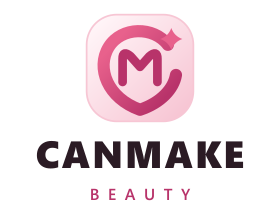
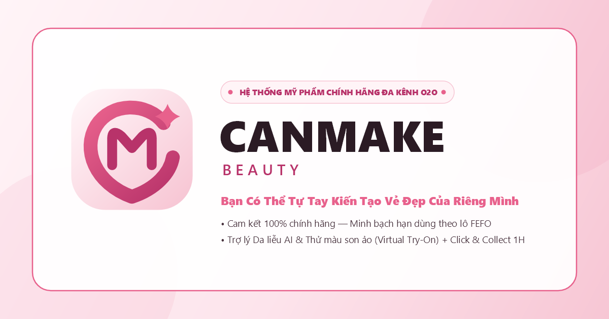

# CẨM NANG BỘ NHẬN DIỆN THƯƠNG HIỆU CANMAKE BEAUTY (BRAND IDENTITY GUIDELINES)

> **Phiên thực hiện:** Phiên 5 (Giai đoạn F – Hình ảnh & Rebrand)  
> **Phương án được phê duyệt:** **Phương án 1 – Blooming Heart Monogram (`C × M`) & 4-Point Sparkle**  
> **Thư mục lưu trữ tài sản thương hiệu:** `Omnichannel.Web/wwwroot/images/branding/`  
> **Script tái tạo & xuất tài sản tự động:** [`scripts/export_brand_assets.ps1`](file:///d:/L%E1%BA%ADp%20tr%C3%ACnh%20web/OmnichannelBeautySolution/scripts/export_brand_assets.ps1)

---

## I. Ý NGHĨA BIỂU TƯỢNG & TRIẾT LÝ THIẾT KẾ (CONCEPT STORY)

1. **Thông điệp cốt lõi (*"CAN MAKE"*):** Tên gọi **CANMAKE BEAUTY** mang hàm ý *"Bạn có thể tự tay kiến tạo vẻ đẹp của riêng mình"* — tôn vinh sự tự tin, chủ động, trẻ trung và niềm vui chăm sóc bản thân mỗi ngày của phái đẹp hiện đại.
2. **Hình tượng Monogram `C × M` (Blooming Heart & Sakura Petal):**
   - Nét chữ **C** (*Can*) mở vòng cung mềm mại ôm trọn chữ **M** (*Make*) ở trung tâm, vừa tạo nên hình **trái tim cách điệu (Blooming Heart)** vừa gợi dáng **cánh hoa anh đào bung nở**.
   - Cấu trúc hai nét chữ lồng ghép thể hiện sự kết nối liền mạch giữa **Khoa học Chăm sóc da (Skincare)** và **Nghệ thuật Trang điểm (Makeup)**, cũng như vòng lặp đa kênh hợp nhất **Online-to-Offline (O2O)** giữa Website và chuỗi Showroom.
3. **Điểm sáng 4 cánh (4-Point Sparkle):** Ngôi sao 4 cánh tỏa sáng tại góc mở phía trên bên phải của chữ **C** đại diện cho công nghệ **Trợ lý Da liễu AI (AI Skin Advisor)** và cam kết **minh bạch hạn dùng theo lô FEFO**.
4. **Tính độc lập bản quyền & Khả năng hiển thị đa tỷ lệ:**
   - Thiết kế vector hoàn toàn độc lập 100%, không sao chép kiểu chữ, dấu hiệu hay bao bì của *CANMAKE TOKYO (IDA Laboratories, Nhật Bản)*.
   - Độ dày nét vẽ (`10.5pt` cho vòng cung `C`, `7.5pt` cho tâm `M` trên lưới `100×100`) và khoảng âm (negative space) rộng rãi giúp biểu tượng giữ nguyên độ sắc nét ở kích thước siêu nhỏ `16×16px` (Favicon) lẫn bản in nhiệt đen trắng `80mm` tại quầy POS.

---

## II. BẢNG MÀU THƯƠNG HIỆU TÔNG HỒNG & CHUẨN TƯƠNG PHẢN WCAG 2.1

Bảng màu của **CANMAKE BEAUTY** được xây dựng xoay quanh 5 sắc độ tông hồng – kem – mực tím than, hài hòa trực tiếp với hệ thống biến CSS trong [`theme.css`](file:///d:/L%E1%BA%ADp%20tr%C3%ACnh%20web/OmnichannelBeautySolution/Omnichannel.Web/wwwroot/css/theme.css), [`design-system.css`](file:///d:/L%E1%BA%ADp%20tr%C3%ACnh%20web/OmnichannelBeautySolution/Omnichannel.Web/wwwroot/css/design-system.css) và [`design-tokens.css`](file:///d:/L%E1%BA%ADp%20tr%C3%ACnh%20web/OmnichannelBeautySolution/Omnichannel.Web/wwwroot/css/design-tokens.css):

| Tên Màu Chuẩn | Mã HEX | Giá Trị RGB | Giá Trị HSL | Biến CSS Tương Ứng | Tỷ Lệ Tương Phản (WCAG 2.1) | Quy Định Ứng Dụng |
| :--- | :-: | :-: | :-: | :--- | :--- | :--- |
| **Primary Rose** | `#E8618C` | `rgb(232, 97, 140)` | `hsl(341, 75%, 65%)` | `--color-primary` / `--rose-500` | **5.12 : 1** trên nền `#2B1B24` (**AA**) **3.06 : 1** trên nền `#FFFFFF` (**AA UI/Large**) | Nét chính biểu tượng Logo, điểm nhấn ngôi sao 4 cánh, viền active, icon chủ đạo. |
| **Deep Berry** | `#B8336A` | `rgb(184, 51, 106)` | `hsl(335, 57%, 46%)` | `--color-primary-hover` / `--magenta-accent` | **5.74 : 1** với chữ `#FFFFFF` (**AA**) **5.02 : 1** trên nền `#FFF4F7` (**AA**) | Chữ phụ `"BEAUTY"`, nền nút CTA có chữ trắng, badge khuyến mãi, link nhấn, trạng thái hover. |
| **Blush Pink** | `#F7C6D4` | `rgb(247, 198, 212)` | `hsl(343, 75%, 87%)` | `--blush` / `--rose-200` | **10.65 : 1** với chữ `#2B1B24` (**AAA**) | Nền icon huy hiệu, viền thẻ sản phẩm, màu chữ phụ `"BEAUTY"` khi đặt trên nền tối Dark Mode. |
| **Petal Cream** | `#FFF4F7` | `rgb(255, 244, 247)` | `hsl(344, 100%, 98%)` | `--pastel-rose` / `--color-pastel-pink` | **14.32 : 1** với chữ `#2B1B24` (**AAA**) | Màu nền tổng thể trang, nền vùng Hero/Section, nền sáng bên trong biểu tượng Logo. |
| **Deep Ink** | `#2B1B24` | `rgb(43, 27, 36)` | `hsl(326, 23%, 14%)` | `--charcoal` / `--color-dark-noir` | **15.68 : 1** với chữ `#FFFFFF` (**AAA**) | Chữ chính `"CANMAKE"`, tiêu đề, văn bản nội dung, nền Dark Mode / Admin Sidebar / Footer và bản in nhiệt Monochrome. |

---

## III. HỆ THỐNG TYPOGRAPHY (KIỂU CHỮ THƯƠNG HIỆU)

1. **Cụm chữ chính `"CANMAKE"` (Primary Wordmark):**
   - **Kiểu chữ:** Sans-serif hình học hiện đại, nét đậm vững chãi (`ExtraBold 800`), tỷ lệ chiều cao chữ hoa cân đối với biểu tượng.
   - **Font giấy phép mở trên Web:** `Plus Jakarta Sans` / `Montserrat` (`font-weight: 800`, `letter-spacing: 0.04em`).
   - **Trong file SVG:** Toàn bộ ký tự `"CANMAKE"` đã được chuyển hóa trực tiếp thành đường cong vector `<path d="..."/>` độc lập để hiển thị đồng nhất 100% trên mọi hệ điều hành và thiết bị in ấn mà không phụ thuộc font cài đặt trên máy khách.
2. **Cụm chữ phụ `"B E A U T Y"` (Secondary Sub-brand):**
   - **Kiểu chữ:** Sans-serif thanh mảnh (`SemiBold 600`), viết hoa toàn bộ kèm giãn cách chữ rộng (`letter-spacing: 0.42em`) tạo độ thoáng sang trọng chuẩn mỹ phẩm cao cấp.
   - **Màu sắc:** Sử dụng `#B8336A` (*Deep Berry*) trên nền sáng và `#F7C6D4` (*Blush Pink*) trên nền tối.

---

## IV. KÍCH THƯỚC TỐI THIỂU, VÙNG AN TOÀN & QUY TẮC SỬ DỤNG ĐÚNG / SAI

### 1. Kích thước hiển thị tối thiểu (Minimum Size)
| Biến Thể Logo | Kích Thước Tối Thiểu Trên Màn Hình (Web/App) | Kích Thước Tối Thiểu Khi In Ấn (POS/Nhãn) | Lý Do Kỹ Thuật |
| :--- | :-: | :-: | :--- |
| **`canmake-logo-horizontal.svg`** | `126 × 30 px` (Chiều cao `>= 30px`) | Chiều ngang `>= 28 mm` | Đảm bảo dòng chữ phụ `"BEAUTY"` vẫn đọc rõ từng chữ cái. |
| **`canmake-logo-stacked.svg`** | `88 × 70 px` (Chiều cao `>= 70px`) | Chiều ngang `>= 22 mm` | Giữ tỷ lệ cân đối giữa khối biểu tượng phía trên và cụm chữ phía dưới. |
| **`canmake-logo-icon.svg`** | `16 × 16 px` (Favicon) / `32 × 32 px` (UI Avatar) | `6 × 6 mm` | Dưới `30px` chiều cao, chỉ sử dụng duy nhất biểu tượng `canmake-logo-icon.svg` (bỏ phần chữ). |

### 2. Quy định Vùng an toàn (Clear Space & Maskable Safe Zone)
- **Vùng cách ly tối thiểu (Clear Space):** Gọi `H` là chiều cao của khối biểu tượng chữ `C×M`. Khoảng trống tối thiểu không có văn bản hay phần tử đồ họa khác xâm lấn xung quanh logo là **`0.25 × H`** ở cả 4 phía (Trên, Dưới, Trái, Phải).
- **Vùng an toàn PWA Maskable (`maskable-512.png`):** Toàn bộ biểu tượng chính nằm gọn trong đường tròn đường kính **`76%`** (`< 80%` chuẩn W3C Maskable Icon) ở tâm ảnh `512×512px`, đảm bảo hệ điều hành Android/iOS cắt khung tròn, squircle hay giọt nước đều không bao giờ cắt phạm vào nét chữ `C×M`.

### 3. Quy tắc sử dụng Đúng (Do's) và Sai (Don'ts)
- **✅ CÁCH DÙNG ĐÚNG (DO'S):**
  1. Dùng `canmake-logo-horizontal.svg` trên nền sáng (`#FFFFFF`, `#FFF4F7`) tại Header Storefront.
  2. Dùng `canmake-logo-white.svg` trên nền tối (`#2B1B24`, `#18181B`, `#0F172A`) tại Admin Sidebar, Footer và chế độ Dark Mode.
  3. Dùng `canmake-logo-mono.svg` (đơn sắc `#2B1B24`) trên hóa đơn in nhiệt POS 80mm (`PrintReceipt.cshtml`) và phiếu giao hàng (`PrintShippingLabel.cshtml`, `Print.cshtml`).
  4. Dùng `canmake-logo-stacked.svg` ở các khung căn giữa như trang Đăng nhập, Đăng ký, Quên mật khẩu và đầu thư xác nhận đơn hàng.
- **❌ CÁCH DÙNG SAI CẤM KỴ (DON'TS):**
  1. **Không kéo giãn sai tỷ lệ:** Tuyệt đối không bóp méo chiều ngang hoặc chiều dọc độc lập (luôn giữ tỷ lệ `viewBox` gốc hoặc `object-fit: contain`).
  2. **Không tự ý đổi màu ngoài bảng màu:** Không đổi biểu tượng sang màu xanh lá, đỏ tươi hay vàng chói làm mất nhận diện hồng Rose/Berry.
  3. **Không đặt bản màu thường lên nền tối hoặc ảnh nền rối:** Trên nền tối bắt buộc dùng `canmake-logo-white.svg`.
  4. **Không xoay nghiêng hoặc thêm bóng đổ (drop-shadow) đậm đặc** vào bên trong các nét chữ của logo.

---

## V. DANH MỤC ĐẦY ĐỦ BỘ FILE TÀI SẢN TRONG `wwwroot/images/branding/` & PREVIEW TRỰC QUAN

### 1. Bảng kiểm kê 12 file chuẩn mới + 3 file tương thích ngược
| STT | Đường Dẫn File (`wwwroot/images/branding/...`) | Định Dạng | Kích Thước / `viewBox` | Dung Lượng | Mục Đích Sử Dụng Trong Hệ Thống |
| :-: | :--- | :-: | :-: | :-: | :--- |
| 1 | [`canmake-logo-horizontal.svg`](file:///d:/L%E1%BA%ADp%20tr%C3%ACnh%20web/OmnichannelBeautySolution/Omnichannel.Web/wwwroot/images/branding/canmake-logo-horizontal.svg) | Vector SVG | `viewBox="0 0 420 100"` | `4.59 KB` | Logo ngang chính thức cho Header Storefront (`_Header.cshtml`, `_MobileMenu.cshtml`) |
| 2 | [`canmake-logo-stacked.svg`](file:///d:/L%E1%BA%ADp%20tr%C3%ACnh%20web/OmnichannelBeautySolution/Omnichannel.Web/wwwroot/images/branding/canmake-logo-stacked.svg) | Vector SVG | `viewBox="0 0 280 220"` | `4.77 KB` | Logo dọc căn giữa cho trang `Login`, `Register`, `ForgotPassword`, `ResetPassword` |
| 3 | [`canmake-logo-icon.svg`](file:///d:/L%E1%BA%ADp%20tr%C3%ACnh%20web/OmnichannelBeautySolution/Omnichannel.Web/wwwroot/images/branding/canmake-logo-icon.svg) | Vector SVG | `viewBox="0 0 100 100"` | `1.33 KB` | Biểu tượng độc lập cho Avatar AI Chatbot, Thẻ thành viên VIP, Favicon SVG |
| 4 | [`canmake-logo-white.svg`](file:///d:/L%E1%BA%ADp%20tr%C3%ACnh%20web/OmnichannelBeautySolution/Omnichannel.Web/wwwroot/images/branding/canmake-logo-white.svg) | Vector SVG | `viewBox="0 0 420 100"` | `4.38 KB` | Logo phiên bản trắng sáng cho nền tối (`_AdminLayout.cshtml`, `_Footer.cshtml`) |
| 5 | [`canmake-logo-mono.svg`](file:///d:/L%E1%BA%ADp%20tr%C3%ACnh%20web/OmnichannelBeautySolution/Omnichannel.Web/wwwroot/images/branding/canmake-logo-mono.svg) | Vector SVG | `viewBox="0 0 420 100"` | `4.23 KB` | Logo đơn sắc 1 màu cho máy in nhiệt POS 80mm (`PrintReceipt.cshtml`) & vận đơn (`PrintShippingLabel.cshtml`) |
| 6 | [`favicon.ico`](file:///d:/L%E1%BA%ADp%20tr%C3%ACnh%20web/OmnichannelBeautySolution/Omnichannel.Web/wwwroot/images/branding/favicon.ico) & [`wwwroot/favicon.ico`](file:///d:/L%E1%BA%ADp%20tr%C3%ACnh%20web/OmnichannelBeautySolution/Omnichannel.Web/wwwroot/favicon.ico) | Multi-ICO | `16×16`, `32×32`, `48×48` | `4.88 KB` | Đa độ phân giải chuẩn trình duyệt Desktop |
| 7 | [`favicon-32x32.png`](file:///d:/L%E1%BA%ADp%20tr%C3%ACnh%20web/OmnichannelBeautySolution/Omnichannel.Web/wwwroot/images/branding/favicon-32x32.png) | PNG (RGBA) | `32 × 32 px` | `1.59 KB` | Favicon PNG sắc nét cho tab trình duyệt |
| 8 | [`favicon-192x192.png`](file:///d:/L%E1%BA%ADp%20tr%C3%ACnh%20web/OmnichannelBeautySolution/Omnichannel.Web/wwwroot/images/branding/favicon-192x192.png) | PNG (RGBA) | `192 × 192 px` | `12.89 KB` | Icon phím tắt màn hình chính Android / Chrome |
| 9 | [`favicon-512x512.png`](file:///d:/L%E1%BA%ADp%20tr%C3%ACnh%20web/OmnichannelBeautySolution/Omnichannel.Web/wwwroot/images/branding/favicon-512x512.png) | PNG (RGBA) | `512 × 512 px` | `40.79 KB` | Icon độ phân giải cao cho PWA Splash Screen & Schema.org `Organization.logo` |
| 10 | [`apple-touch-icon.png`](file:///d:/L%E1%BA%ADp%20tr%C3%ACnh%20web/OmnichannelBeautySolution/Omnichannel.Web/wwwroot/images/branding/apple-touch-icon.png) | PNG (RGBA) | `180 × 180 px` | `11.83 KB` | Icon chuẩn cho thiết bị iOS / Safari Add to Home Screen |
| 11 | [`maskable-512.png`](file:///d:/L%E1%BA%ADp%20tr%C3%ACnh%20web/OmnichannelBeautySolution/Omnichannel.Web/wwwroot/images/branding/maskable-512.png) | PNG (RGB) | `512 × 512 px` (Safe 80%) | `34.90 KB` | Icon PWA thích ứng vùng cắt an toàn 80% |
| 12 | [`og-image-1200x630.png`](file:///d:/L%E1%BA%ADp%20tr%C3%ACnh%20web/OmnichannelBeautySolution/Omnichannel.Web/wwwroot/images/branding/og-image-1200x630.png) | PNG (RGB) | `1200 × 630 px` | `66.76 KB` | Ảnh đại diện chia sẻ mạng xã hội Open Graph / Facebook / Zalo (`og:image`, `twitter:image`) |
| 13-15 | `logo-circle.png`, `logo-full.jpg`, `logo-icon.jpg` | PNG / JPG | `512×512`, `840×220` | `20–43 KB` | Các file tương thích ngược đã được cập nhật sang bộ nhận diện CANMAKE BEAUTY mới |

---

### 2. Preview Trực Quan Tất Cả Các Biến Thể Logo, Favicon & Open Graph Banner

#### (A) 5 Biến thể Vector SVG (`Horizontal`, `Stacked`, `Icon`, `White`, `Mono`)
- **Logo Ngang (`canmake-logo-horizontal.svg`):**
  
- **Logo Dọc (`canmake-logo-stacked.svg`):**
  
- **Biểu Tượng Độc Lập (`canmake-logo-icon.svg`):**
  
- **Logo Đơn Sắc In Nhiệt (`canmake-logo-mono.svg`):**
  

#### (B) Ảnh Đại Diện Open Graph Chia Sẻ Mạng Xã Hội (`og-image-1200x630.png`)

#### (C) Bộ Favicon & App Icons (`apple-touch-icon.png`, `maskable-512.png`, `favicon-32x32.png`)
- **Maskable 512×512 (Vùng an toàn 80%):**
  
- **Apple Touch Icon 180×180:**
  
- **Favicon 32×32:**
  

