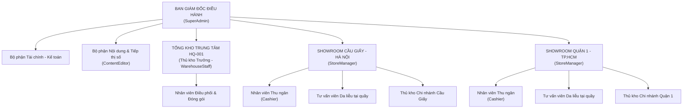

# CHƯƠNG 1: CƠ SỞ LÝ LUẬN VỀ HỆ THỐNG THÔNG TIN QUẢN LÝ BÁN HÀNG ĐA KÊNH VÀ TỔNG QUAN CHUỖI CỬA HÀNG MỸ PHẨM CANMAKE BEAUTY

## 1.1. Cơ sở lý luận về Hệ thống thông tin quản lý và Thương mại điện tử đa kênh (Omnichannel)

### 1.1.1. Hệ thống thông tin và Hệ thống thông tin quản lý trong doanh nghiệp bán lẻ chuỗi

Trong khoa học quản trị hiện đại, hệ thống thông tin được định nghĩa là một tập hợp có cấu trúc bao gồm con người, phần cứng, phần mềm, mạng truyền thông và các nguồn tài nguyên dữ liệu, cùng phối hợp thực hiện các quy trình thu thập, biến đổi, lưu trữ và phân phối thông tin nhằm phục vụ công tác điều hành tác nghiệp và hỗ trợ ra quyết định. Khi được thiết kế chuyên biệt để phục vụ mục tiêu quản trị doanh nghiệp, hệ thống này phát triển thành hệ thống thông tin quản lý. Nhiệm vụ cốt lõi của một hệ thống thông tin quản lý không chỉ dừng lại ở việc tự động hóa các thao tác thủ công riêng lẻ, mà quan trọng hơn là thiết lập cơ chế kiểm soát, đo lường và cung cấp các báo cáo phân tích tổng hợp kịp thời, chính xác cho các cấp quản trị từ vận hành tác nghiệp đến chiến lược.

Đối với mô hình kinh doanh bán lẻ theo chuỗi phân tán tại nhiều địa bàn địa lý, vai trò của hệ thống thông tin quản lý mang tính chất sống còn. Doanh nghiệp bán lẻ chuỗi về bản chất là một cấu trúc vận hành phức hợp, nơi diễn ra sự tương tác liên tục và đan xen giữa ba luồng vận động chính yếu:

Thứ nhất là luồng hàng hóa vật lý. Đây là sự luân chuyển hiện vật của sản phẩm từ các nhà cung cấp hoặc nhà máy sản xuất, đi qua hệ thống kiểm định chất lượng tại Tổng kho trung tâm, sau đó được điều phối vận chuyển đến các kho chi nhánh tại từng Showroom bán lẻ và cuối cùng trao tận tay người tiêu dùng. Luồng hàng hóa này đòi hỏi sự giám sát nghiêm ngặt về số lượng, vị trí lưu trữ, điều kiện bảo quản và hạn sử dụng để hạn chế tối đa tình trạng thất thoát hoặc hao hụt.

Thứ hai là luồng giao dịch tài chính. Luồng vận động này diễn ra theo chiều ngược lại của luồng hàng hóa, phản ánh các dòng tiền thanh toán từ khách hàng qua nhiều phương thức khác nhau như tiền mặt tại quầy thu ngân, chuyển khoản ngân hàng qua mã phản hồi nhanh, thanh toán qua cổng điện tử hoặc thu tiền mặt khi giao hàng tận nơi. Luồng tài chính còn bao gồm các nghĩa vụ thanh toán công nợ cho nhà cung cấp, chi phí vận chuyển phát sinh cho các đối tác logistics và các khoản đối soát doanh thu định kỳ theo từng ca bán hàng.

Thứ ba là luồng thông tin điều hành. Đây là luồng dữ liệu hai chiều đóng vai trò điều hướng toàn bộ hoạt động của hai luồng trên. Từ trụ sở chính, các mệnh lệnh điều hành, chính sách giá bán, chương trình khuyến mãi, định mức tồn kho an toàn và quy định phân quyền được truyền phát xuống từng chi nhánh. Ngược lại, dữ liệu doanh số thực tế, biến động tồn kho chi tiết theo từng lô hàng, phản hồi của người mua và tình trạng ca làm việc được tổng hợp theo thời gian thực từ các điểm bán truyền ngược về máy chủ trung tâm để ban lãnh đạo theo dõi.

Nếu thiếu một hệ thống thông tin quản lý hợp nhất, ba luồng vận động nói trên sẽ bị chia cắt nghiêm trọng. Trụ sở chính sẽ không thể biết chính xác tại chi nhánh cụ thể nào đang thừa hàng hay thiếu hàng, số tiền mặt thu được tại các két bán lẻ có khớp đúng với doanh số ghi nhận hay không, và việc ra quyết định điều chuyển hàng hóa sẽ hoàn toàn phụ thuộc vào những phỏng đoán cảm tính, dẫn đến tổn thất kinh tế và suy giảm năng lực cạnh tranh.

---

### 1.1.2. Mô hình Thương mại điện tử B2C kết hợp Bán lẻ hợp nhất đa kênh (Omnichannel O2O)

Sự tiến hóa của các mô hình phân phối thương mại điện tử phục vụ khách hàng cá nhân trong ngành bán lẻ trải qua ba giai đoạn phát triển mang tính bước ngoặt: bán hàng đơn kênh, bán hàng đa kênh rời rạc và bán hàng đa kênh hợp nhất. 

Ở giai đoạn bán hàng đơn kênh, doanh nghiệp chỉ tiếp cận người tiêu dùng thông qua một phương thức duy nhất, hoặc là cửa hàng bán lẻ truyền thống, hoặc là một trang web bán lẻ trực tuyến. Ranh giới vận hành rất đơn giản nhưng phạm vi tiếp cận thị trường bị giới hạn nghiêm ngặt. Khi thị trường mở rộng, các doanh nghiệp chuyển sang mô hình bán hàng đa kênh rời rạc bằng cách đồng thời mở thêm cửa hàng vật lý, xây dựng website thương mại điện tử, lập gian hàng trên các sàn mạng xã hội và tham gia các sàn giao dịch trực tuyến. Tuy nhiên, bản chất cốt tử của mô hình đa kênh rời rạc là mỗi kênh kinh doanh vận hành như một ốc đảo dữ liệu độc lập. Bộ phận quản trị website sử dụng một cơ sở dữ liệu riêng, quầy thu ngân tại showroom sử dụng một phần mềm bán lẻ riêng, và nhân viên trực tin nhắn mạng xã hội ghi nhận đơn hàng trên các sổ sách hoặc bảng tính tách biệt. 

Sự phân mảnh này dẫn đến việc khách hàng phải chịu đựng một trải nghiệm mua sắm đứt đoạn: điểm thưởng tích lũy khi mua sắm trực tiếp tại showroom không thể sử dụng để trừ tiền khi đặt hàng qua mạng; mã giảm giá phát hành trong các chiến dịch tiếp thị số không được hệ thống thu ngân tại quầy chấp nhận; và khách hàng không thể kiểm tra xem sản phẩm mình cần có sẵn tại cửa hàng gần nhất hay không trước khi đến mua.

Mô hình bán lẻ đa kênh hợp nhất trực tuyến và trực tiếp ra đời như một lời giải toàn diện cho sự phân mảnh nói trên. Điểm khác biệt mấu chốt của bán hàng hợp nhất không nằm ở số lượng kênh phân phối mà nằm ở kiến trúc dữ liệu tập trung duy nhất đóng vai trò là nguồn chân lý duy nhất cho toàn bộ hệ thống. Mọi điểm chạm từ ứng dụng web, máy tính bảng của nhân viên tư vấn da liễu tại cửa hàng, màn hình quầy thu ngân cho đến ứng dụng di động đều truy vấn và ghi nhận vào cùng một cơ sở dữ liệu trung tâm theo thời gian thực. Bất kỳ một sự kiện mua sắm nào phát sinh tại một kênh đều ngay lập tức cập nhật số dư tồn kho và biến động tài chính trên toàn chuỗi. Nhờ sự hợp nhất này, doanh nghiệp có thể triển khai hoàn hảo các nghiệp vụ kết hợp trực tiếp và trực tuyến hiện đại, tiêu biểu là mô hình mua hàng trên mạng và đến nhận hàng trực tiếp tại cửa hàng trong vòng một giờ, giúp khách hàng tiết kiệm chi phí vận chuyển và nhận được sản phẩm một cách nhanh chóng nhất.

Để làm rõ sự khác biệt mang tính bản chất về mặt kiến trúc công nghệ và hiệu quả vận hành giữa hai mô hình, bảng đối sánh dưới đây tổng hợp năm tiêu chí kỹ thuật cốt lõi được đúc kết từ thực tiễn khảo sát tại chuỗi cửa hàng CANMAKE BEAUTY:

**Bảng 1.1: Bảng đối sánh đặc trưng kỹ thuật giữa mô hình Đa kênh rời rạc (Multi-channel) và Đa kênh hợp nhất (Omnichannel) tại chuỗi CANMAKE BEAUTY**

| Tiêu chí so sánh | Mô hình Đa kênh rời rạc (Multi-channel) | Mô hình Đa kênh hợp nhất (Omnichannel O2O) |
| :--- | :--- | :--- |
| **Kiến trúc cơ sở dữ liệu** | Dữ liệu phân mảnh trên nhiều hệ quản trị độc lập. Website sử dụng cơ sở dữ liệu MySQL riêng, quầy thu ngân cửa hàng dùng phần mềm cài cục bộ với cơ sở dữ liệu Access hoặc SQL Express riêng, đồng bộ định kỳ vào cuối ngày qua tệp Excel. | Sử dụng một cơ sở dữ liệu quan hệ Microsoft SQL Server tập trung chuẩn hóa dạng chuẩn ba, lưu trữ toàn bộ dữ liệu danh mục, đơn hàng, khách hàng và tồn kho cho toàn bộ Tổng kho và các Showroom. |
| **Đồng bộ tồn kho thời gian thực** | Phân chia hạn mức tồn kho cứng cho từng kênh. Thường xuyên xảy ra hiện tượng tồn ảo, bán vượt quá số lượng hàng hóa thực tế trên website trong khi tại showroom hàng vẫn nằm trên kệ nhưng không được khai thác bán trực tuyến. | Đồng bộ tồn kho theo thời gian thực qua cơ chế khóa giữ chỗ hai giai đoạn và trường kiểm soát phiên bản dữ liệu. Số dư khả dụng của từng lô hàng được cập nhật tức thời trên mọi điểm chạm ngay khi có giao dịch. |
| **Liên thông đơn hàng O2O (BOPIS)** | Không thể thực hiện được. Khách hàng đặt mua trên website bắt buộc phải chờ giao hàng từ kho thương mại điện tử trong từ hai đến ba ngày; showroom không có thông tin đơn hàng để chuẩn bị hoặc xuất giao tại quầy. | Khách hàng đặt mua trực tuyến có thể chọn nhận hàng tại Showroom Cầu Giấy hoặc Showroom Quận 1. Đơn hàng được định tuyến tức thời về quầy thu ngân chi nhánh qua kết nối SignalR để nhân viên đóng gói sẵn trong một giờ. |
| **Hồ sơ sắc đẹp và ví điểm thưởng** | Khách hàng phải đăng ký nhiều tài khoản riêng biệt. Lịch sử soi da tại quầy ghi trên sổ tay nhân viên; điểm tích lũy khi mua tại showroom không thể tra cứu hoặc quy đổi khi mua sắm trực tuyến trên website. | Một hồ sơ khách hàng định danh duy nhất xuyên suốt mọi kênh. Dữ liệu loại da, lịch sử kích ứng và ví điểm thưởng thành viên được tra cứu và sử dụng đồng nhất cả tại quầy thu ngân POS và trên giao diện website. |
| **Hạch toán tài chính kế toán** | Báo cáo doanh thu và chi phí rời rạc, đối soát thủ công vào cuối tháng. Rất khó tính toán chính xác giá vốn hàng bán và lợi nhuận ròng của từng chi nhánh do độ trễ cập nhật số liệu và sai lệch kiểm kê. | Tự động hóa sổ cái tài chính, hạch toán giá vốn đích danh theo từng lô sản xuất thực tế xuất bán. Tự động đối soát công nợ tiền thu hộ COD từ đơn vị vận chuyển và kiểm soát két tiền mặt thu ngân theo từng ca. |

Nhìn vào bảng đối sánh kỹ thuật trên, có thể nhận thấy mô hình bán lẻ đa kênh hợp nhất mang lại sự vượt trội hoàn toàn về mặt năng lực kiểm soát dữ liệu và hiệu quả kinh doanh. Việc chuyển đổi từ kiến trúc cơ sở dữ liệu phân mảnh sang một cơ sở dữ liệu tập trung theo chuẩn 3NF không chỉ giúp loại bỏ hoàn toàn tình trạng sai lệch tồn kho mà còn tạo tiền đề vững chắc cho việc triển khai các quy trình nghiệp vụ phức tạp xuyên suốt các điểm chạm. Đặc biệt, việc hợp nhất hồ sơ khách hàng và cơ chế hạch toán giá vốn theo lô đích danh chính là nền tảng cốt lõi giúp chuỗi cửa hàng CANMAKE BEAUTY tối ưu hóa dòng tiền, giảm thiểu chi phí quản lý vận hành thủ công và mang lại cho người tiêu dùng một hành trình trải nghiệm chăm sóc sắc đẹp hoàn chỉnh, an toàn và chuyên nghiệp nhất.

---

### 1.1.3. Đặc thù quản trị hàng hóa và chuỗi cung ứng trong ngành Dược – Mỹ phẩm

Khác biệt với các mặt hàng tiêu dùng nhanh, thực phẩm đóng gói hay sản phẩm thời trang may mặc, ngành bán lẻ dược mỹ phẩm sở hữu những quy luật quản trị chuỗi cung ứng vô cùng đặc thù và khắt khe. Những đặc thù này chi phối trực tiếp đến cách thức thiết kế cơ sở dữ liệu và cấu trúc giải thuật nghiệp vụ của hệ thống phần mềm:

Thứ nhất là bài toán quản trị danh mục sản phẩm đa biến thể kết hợp phân loại khoa học da liễu. Trong ngành mỹ phẩm, một dòng sản phẩm chăm sóc hay trang điểm gốc thường không tồn tại dưới dạng một mã hàng đơn lẻ mà được phân nhánh thành rất nhiều biến thể dựa trên các thuộc tính vật lý. Ví dụ, một dòng son môi cao cấp có thể có cùng một công thức nền nhưng lại sở hữu hàng chục biến thể màu sắc khác nhau, mỗi màu được nhận diện bằng một mã màu Hex chuyên biệt để kết xuất các bảng màu mẫu trực quan trên màn hình cho người mua lựa chọn. Tương tự, một dòng kem dưỡng ẩm hoặc tinh chất phục hồi da có thể có nhiều quy cách đóng gói dung tích khác nhau như ba mươi mililít, năm mươi mililít hoặc kích thước nhỏ dùng thử mười lăm mililít. Điều này đòi hỏi hệ thống phải phân định rõ ràng giữa cấu trúc sản phẩm cha để quản lý thông tin chung và cấu trúc biến thể sản phẩm con mang mã đơn vị lưu kho và mã vạch thương phẩm quốc tế EAN-13 riêng biệt để theo dõi tồn kho và định giá bán chính xác. 

Không chỉ dừng lại ở các thuộc tính đóng gói, mỹ phẩm tiếp xúc trực tiếp lên các tế bào sống của biểu bì da người, do đó danh mục sản phẩm bắt buộc phải được gắn kết với hệ thống phân loại da liễu chuyên sâu. Hệ thống phải lưu trữ chi tiết danh mục các hoạt chất chính, nồng độ hoạt chất, thang đo mức độ an toàn theo tiêu chuẩn của Tổ chức Hoạt động Môi trường quốc tế EWG với thang điểm từ một đến mười, cùng các chứng nhận mỹ phẩm sạch như không chứa cồn khô, không chứa hương liệu nhân tạo, không paraben và an toàn cho phụ nữ trong thai kỳ.

Thứ hai là nguyên tắc quản trị kho theo lô sản xuất và giải thuật xuất kho ưu tiên theo hạn sử dụng. Trong quản trị chuỗi cung ứng truyền thống, giải thuật nhập trước xuất trước FIFO và phương pháp bình quân gia quyền là hai phương pháp phổ biến nhất. Tuy nhiên, khi áp dụng vào ngành mỹ phẩm nhập khẩu, cả hai phương pháp này đều bộc lộ những khiếm khuyết nghiêm trọng dẫn đến thất bại trong vận hành. Do đặc thù chuỗi cung ứng mỹ phẩm phụ thuộc vào kế hoạch sản xuất của các thương hiệu quốc tế tại Pháp, Hàn Quốc hay Nhật Bản, kết hợp thời gian vận chuyển đường biển và thủ tục thông quan kiểm nghiệm kéo dài, trật tự nhập hàng vào kho không đồng nghĩa với trật tự ngày sản xuất. 

Một lô mỹ phẩm nhập về kho vào tháng Năm hoàn toàn có thể mang hạn sử dụng ngắn hơn một lô mỹ phẩm đã nhập từ tháng Ba. Nếu áp dụng máy móc nguyên tắc FIFO, hệ thống sẽ ưu tiên xuất lô nhập tháng Ba, khiến cho lô nhập tháng Năm bị ứ đọng lại trong kho cho đến khi cận hạn dùng hoặc hết hạn hoàn toàn. Tương tự, phương pháp tính giá bình quân gia quyền cào bằng giá trị của mọi sản phẩm trong kho, làm lu mờ giá vốn thực tế của các lô hàng cận date cần bán thanh lý hạ giá. Khi một lô mỹ phẩm bị quá hạn, doanh nghiệp bắt buộc phải làm thủ tục tiêu hủy theo quy định an toàn y tế và môi trường, đồng nghĩa với việc mất trắng một trăm phần trăm giá trị vốn hàng bán cùng chi phí vận hành xử lý rác thải nguy hại.

Chính vì vậy, nguyên tắc xuất kho bắt buộc và tối ưu nhất cho ngành mỹ phẩm là nguyên tắc hết hạn trước xuất trước FEFO. Theo nguyên tắc này, mỗi khi có yêu cầu xuất bán lẻ tại quầy thu ngân hay duyệt đơn hàng trực tuyến, thuật toán hệ thống sẽ tự động quét toàn bộ các lô hàng có sẵn trong kho chi nhánh, sắp xếp theo thời hạn sử dụng tăng dần và tự động phân bổ lô có ngày hết hạn gần nhất ra xuất trước, với điều kiện lô đó vẫn nằm trong ngưỡng an toàn cho phép lưu hành. Đồng thời, hệ thống phải theo dõi song song thời hạn an toàn sau khi mở nắp niêm phong PAO được ký hiệu bằng số tháng như sáu tháng, mười hai tháng hay hai mươi tư tháng để hướng dẫn người tiêu dùng bảo quản đúng cách sau khi đưa vào sử dụng.

Thứ ba là phương pháp hạch toán giá vốn đích danh theo từng lô xuất thực tế và quy trình kiểm soát ca làm việc tại quầy thu ngân bán lẻ. Do biến động về tỷ giá hối đoái, thuế nhập khẩu và các chính sách chiết khấu của nhà cung cấp theo từng đợt nhập khẩu, mỗi lô mỹ phẩm nhập kho đều có một đơn giá vốn nhập kho riêng biệt. Để phản ánh chính xác hiệu quả kinh doanh, hệ thống CANMAKE BEAUTY áp dụng phương pháp hạch toán giá vốn đích danh gắn chặt với mã định danh của từng lô sản xuất. Khi một đơn hàng xuất bán lô nào, giá vốn hàng bán của đơn hàng đó sẽ được tính toán trực tiếp từ đơn giá nhập của chính lô đó, mang lại số liệu lợi nhuận gộp chân thực tuyệt đối cho từng chi nhánh. 

Tại quầy thu ngân bán lẻ trực tiếp, nơi dòng tiền mặt luân chuyển liên tục với cường độ giao dịch cao, hệ thống áp dụng cơ chế quản trị vòng đời ca làm việc nghiêm ngặt. Mỗi nhân viên thu ngân khi nhận ca phải tiến hành mở ca làm việc trên giao diện điểm bán, khai báo số tiền mặt có sẵn trong két để làm quỹ tiền thối đầu ca. Trong suốt ca, mọi giao dịch bán hàng, thu tiền mặt, các nghiệp vụ tiếp thêm tiền lẻ hay rút bớt tiền mặt gửi vào két an toàn đều phải được ghi nhận thành các phiếu biến động két tiền mặt chi tiết. Khi kết thúc ca, nhân viên bắt buộc phải kiểm đếm thực tế toàn bộ tiền mặt trong két và nhập vào hệ thống để máy tính tự động so sánh với số dư lý thuyết được tính toán từ các giao dịch. Mọi sai lệch thừa thiếu đều được lập biên bản kiểm toán tức thời, giúp phân định rõ ràng trách nhiệm cá nhân và triệt tiêu nguy cơ thất thoát dòng tiền của cửa hàng.

---

## 1.2. Cơ sở pháp lý điều chỉnh hoạt động kinh doanh mỹ phẩm trực tuyến và sự đáp ứng của hệ thống CANMAKE BEAUTY

### 1.2.1. Quy định về quản lý và công bố sản phẩm mỹ phẩm (Thông tư số 06/2011/TT-BYT của Bộ Y tế và Hiệp định Mỹ phẩm ASEAN)

Kinh doanh mỹ phẩm là ngành nghề kinh doanh có điều kiện chịu sự quản lý chặt chẽ của Nhà nước nhằm bảo đảm an toàn tính mạng và sức khỏe cho người tiêu dùng. Văn bản quy phạm pháp luật nền tảng điều chỉnh trực tiếp hoạt động này là Thông tư số 06/2011/TT-BYT ngày 21 tháng 02 năm 2011 của Bộ Y tế quy định về quản lý mỹ phẩm, được ban hành dựa trên việc nội luật hóa các điều khoản của Hiệp định hệ thống hòa hợp mỹ phẩm ASEAN.

Theo quy định tại Điều 3 của Thông tư số 06/2011/TT-BYT, tất cả các sản phẩm mỹ phẩm trước khi được đưa ra lưu thông trên thị trường Việt Nam bắt buộc phải được cơ quan quản lý nhà nước có thẩm quyền cấp Số tiếp nhận Phiếu công bố sản phẩm mỹ phẩm. Đối với mỹ phẩm sản xuất trong nước, cơ quan có thẩm quyền cấp là Sở Y tế nơi đặt nhà máy sản xuất; đối với mỹ phẩm nhập khẩu, cơ quan cấp phép là Cục Quản lý Dược thuộc Bộ Y tế. Số phiếu tiếp nhận này có hiệu lực trong thời hạn năm năm kể từ ngày cấp và là căn cứ pháp lý duy nhất chứng minh sản phẩm đã được cơ quan y tế kiểm tra hồ sơ thông tin sản phẩm và cho phép lưu hành hợp pháp. Bên cạnh đó, Điều 18 của Thông tư quy định khắt khe về nội dung ghi nhãn bắt buộc trên bao bì thương phẩm, bao gồm: tên sản phẩm và chức năng của nó; danh sách đầy đủ các thành phần công thức được ghi theo danh pháp quốc tế INCI; tên và địa chỉ của tổ chức, cá nhân chịu trách nhiệm đưa sản phẩm ra thị trường; nước xuất xứ sản xuất; định lượng thể tích hoặc khối lượng tịnh; số lô sản xuất; ngày sản xuất và hạn dùng được ghi rõ ràng theo định dạng ngày, tháng, năm; và các cảnh báo về an toàn khi sử dụng.

Để đáp ứng tuyệt đối các quy định pháp lý khắt khe nêu trên, hệ thống phần mềm CANMAKE BEAUTY đã được thiết kế kiến trúc cơ sở dữ liệu và quy trình nghiệp vụ tương thích hoàn toàn:

Về mặt cấu trúc dữ liệu, bảng thực thể sản phẩm `Products` trong hệ thống được thiết kế bổ sung các trường dữ liệu bắt buộc: trường `CosmeticNotificationNumber` kiểu chuỗi ký tự độ dài năm mươi ký tự dùng để lưu trữ chính xác Số phiếu tiếp nhận công bố mỹ phẩm được cấp bởi Cục Quản lý Dược; trường `OriginCountry` lưu trữ quốc gia xuất xứ; và trường `ImporterInfo` lưu trữ tên đơn vị chịu trách nhiệm nhập khẩu. Khi sản phẩm được hiển thị trên giao diện bán lẻ trực tuyến, các thông tin pháp lý này được kết xuất công khai, minh bạch tại khu vực thông tin chi tiết giúp khách hàng dễ dàng đối chiếu, tra cứu tính hợp pháp của sản phẩm trên cổng thông tin công cộng của cơ quan quản lý dược.

Về quản lý thành phần, hệ thống số hóa toàn bộ bảng thành phần hóa học thông qua việc liên kết thực thể sản phẩm với danh mục hoạt chất `ActiveIngredients` bằng bảng trung gian `ProductIngredients`. Bảng này lưu trữ đầy đủ tên danh pháp quốc tế INCI, hàm lượng nồng độ phần trăm, công dụng sinh học và mức độ an toàn theo tiêu chuẩn EWG, cho phép người tiêu dùng tra cứu chi tiết công thức sản phẩm trước khi mua hàng.

Về quản lý lô và hạn dùng, hệ thống ràng buộc chặt chẽ thông qua bảng `ProductBatches` với các trường `BatchNumber`, `ManufacturingDate` và `ExpDate`. Hệ thống cài đặt quy tắc nghiệp vụ tự động khóa kiểm soát an toàn: một tiến trình kiểm tra tự động chạy ngầm liên tục rà soát dữ liệu tồn kho, khi một lô sản xuất chạm ngưỡng cận hạn nguy hiểm có số ngày sử dụng còn lại dưới ba mươi ngày, hệ thống sẽ tự động cập nhật trạng thái của lô hàng sang trạng thái khóa xuất bán trên toàn bộ hệ thống bao gồm cả kênh trực tuyến và quầy thu ngân POS, ngăn chặn triệt để hành vi vô tình hay cố ý bán sản phẩm cận hạn gây hại cho làn da của người tiêu dùng.

---

### 1.2.2. Quy định về giao dịch thương mại điện tử và bảo vệ dữ liệu cá nhân (Nghị định số 52/2013/NĐ-CP, Nghị định số 85/2021/NĐ-CP và Nghị định số 13/2023/NĐ-CP)

Hoạt động vận hành website thương mại điện tử bán hàng trực tuyến chịu sự điều chỉnh trực tiếp của Nghị định số 52/2013/NĐ-CP ngày 16 tháng 05 năm 2013 của Chính phủ về thương mại điện tử, được sửa đổi, bổ sung bởi Nghị định số 85/2021/NĐ-CP ngày 25 tháng 09 năm 2021. Các văn bản này quy định rõ nghĩa vụ của thương nhân thiết lập website bán lẻ trực tuyến phải công khai đầy đủ thông tin về chủ sở hữu website, thông tin chi tiết về hàng hóa dịch vụ, giá bán niêm yết rõ ràng bằng Đồng Việt Nam đã bao gồm thuế giá trị gia tăng, các khoản chi phí vận chuyển phát sinh, phương thức giao kết hợp đồng điện tử, điều kiện thanh toán và chính sách đổi trả hàng hóa minh bạch.

Đặc biệt, trong kỷ nguyên số hóa dữ liệu, việc bảo vệ thông tin người dùng được luật hóa chặt chẽ tại Nghị định số 13/2023/NĐ-CP ngày 17 tháng 04 năm 2023 của Chính phủ về bảo vệ dữ liệu cá nhân. Trong ngành bán lẻ mỹ phẩm, dữ liệu khách hàng không đơn thuần là số điện thoại hay địa chỉ nhận hàng, mà còn bao gồm các thông tin cá nhân mang tính nhạy cảm cao như phân loại nền da, tình trạng bệnh lý da liễu, tiền sử dị ứng với các thành phần hóa chất và hình ảnh chụp khuôn mặt khi thực hiện soi da. Theo Nghị định số 13/2023/NĐ-CP, doanh nghiệp có trách nhiệm áp dụng các biện pháp kỹ thuật và an ninh mạng để bảo vệ dữ liệu cá nhân khỏi hành vi đánh cắp, rò rỉ, truy cập trái phép hoặc sử dụng sai mục đích khi chưa có sự đồng ý của chủ thể dữ liệu.

Nhằm tuân thủ tuyệt đối các quy định pháp luật về thương mại điện tử và bảo vệ dữ liệu cá nhân, hệ thống CANMAKE BEAUTY đã hiện thực hóa các giải pháp bảo mật kỹ thuật đa tầng trong mã nguồn giải pháp:

Một là, cơ chế bảo vệ danh tính và mã hóa mật khẩu một chiều. Hệ thống không bao giờ lưu trữ mật khẩu của người dùng dưới dạng văn bản thô. Dịch vụ xác thực `PasswordHasherService` áp dụng thuật toán PBKDF2 kết hợp hàm băm bảo mật SHA256 với chuỗi muối ngẫu nhiên có độ dài một trăm hai mươi tám bit và số vòng lặp băm lên đến một trăm nghìn lần theo khuyến nghị của các cơ quan an ninh mạng quốc tế. Điều này bảo đảm rằng ngay cả khi cơ sở dữ liệu bị tấn công trích xuất dữ liệu, mật khẩu của người dùng vẫn được bảo vệ an toàn trước các cuộc tấn công vét cạn hoặc tấn công bằng bảng cầu vồng.

Hai là, cơ chế tách biệt phiên đăng nhập đa lược đồ xác thực. Hệ thống sử dụng kỹ thuật xác thực phiên làm việc tách biệt thông qua hai Cookie độc lập: lược đồ `CanmakeBeauty.Admin.Session` dành riêng cho ban giám đốc, nhân viên quản lý chi nhánh và thu ngân làm việc trên các cổng quản trị hậu cần; và lược đồ `CanmakeBeauty.Customer.Session` dành riêng cho khách hàng mua sắm tại cổng thông tin bán hàng trực tuyến. Cơ chế phân tách phiên làm việc này giúp triệt tiêu hoàn toàn nguy cơ tấn công leo thang đặc quyền hoặc chiếm đoạt phiên đăng nhập chéo giữa người dùng phổ thông và người dùng quản trị.

Ba là, mô hình kiểm soát truy cập dựa trên quyền hạn hạt nhân PBAC và cơ chế cô lập dữ liệu đa chi nhánh. Hệ thống phân rã toàn bộ hoạt động của doanh nghiệp thành năm mươi mốt quyền hạn nguyên tử trên mười bảy phân hệ chức năng. Nhân viên tại Showroom Cầu Giấy chỉ được cấp quyền xem và xử lý các đơn hàng, tồn kho thuộc phạm vi chi nhánh của mình thông qua điều kiện lọc mã định danh cửa hàng `StoreId` được gắn chặt vào danh tính người dùng trong phiên làm việc, hoàn toàn bị chặn quyền truy cập vào dữ liệu khách hàng hay doanh thu của Showroom Quận 1.

Bốn là, cơ chế lưu vết nhật ký kiểm toán tự động bất biến. Toàn bộ các hành động thêm mới, chỉnh sửa hoặc xóa dữ liệu trên hệ thống, đặc biệt là các can thiệp vào hồ sơ làn da khách hàng, biến động giá sản phẩm và các thao tác trong ca bán lẻ POS, đều được hệ thống tự động ghi nhận vào bảng `AuditLogs`. Mỗi bản ghi kiểm toán lưu trữ đầy đủ thời điểm thực hiện, mã người dùng, địa chỉ mạng IP, tên bảng bị tác động và dữ liệu chi tiết trước và sau khi thay đổi dưới định dạng JSON, tạo cơ sở pháp lý vững chắc phục vụ công tác thanh tra nội bộ và chứng minh sự tuân thủ pháp luật khi có yêu cầu từ cơ quan quản lý nhà nước.

---

## 1.3. Cơ sở lý luận về nền tảng công nghệ phát triển hệ thống

### 1.3.1. Nền tảng ASP.NET Core 8.0, ngôn ngữ C# 12 và kiến trúc Clean Architecture 4 tầng

Nền tảng công nghệ đóng vai trò là khung xương quyết định sự ổn định, hiệu năng xử lý và khả năng mở rộng của một hệ thống thương mại điện tử doanh nghiệp. Giải pháp CANMAKE BEAUTY được xây dựng trên nền tảng khung ứng dụng ASP.NET Core 8.0 kết hợp với ngôn ngữ lập trình C# 12 hiện đại của Microsoft. ASP.NET Core 8.0 sở hữu môi trường thực thi mã nguồn mở với máy ảo được tối ưu hóa sâu sắc về quản lý bộ nhớ, cơ chế biên dịch động hiện đại và mô hình xử lý bất đồng bộ theo luồng tác vụ. Nền tảng này cho phép máy chủ tiếp nhận và phản hồi hàng chục nghìn yêu cầu HTTP đồng thời với độ trễ phản hồi cực thấp và mức tiêu hao tài nguyên phần cứng tối thiểu.

Về phương pháp luận kiến trúc phần mềm, hệ thống tuân thủ nghiêm ngặt mô hình kiến trúc sạch Clean Architecture bốn tầng, được định hình nhằm thực hiện triệt để nguyên lý Đảo ngược Phụ thuộc trong bộ nguyên lý thiết kế hướng đối tượng SOLID. Mô hình này tổ chức mã nguồn thành bốn tầng độc lập có ranh giới trách nhiệm rõ ràng:

Tầng thứ nhất là Tầng miền nghiệp vụ cốt lõi `Omnichannel.Domain`. Tầng này nằm ở vị trí trung tâm của toàn bộ kiến trúc, chứa đựng toàn bộ các thực thể nghiệp vụ cốt lõi, các cấu trúc dữ liệu cơ sở và các quy tắc nghiệp vụ nội tại của doanh nghiệp. Toàn bộ các lớp trong tầng Domain được lập trình dưới dạng các đối tượng thuần túy bằng ngôn ngữ C#, tuyệt đối không chứa bất kỳ phụ thuộc nào vào các thư viện ngoài, không phụ thuộc vào hệ quản trị cơ sở dữ liệu hay bất kỳ công nghệ giao diện web nào. Nhờ đó, logic nghiệp vụ của doanh nghiệp được bảo tồn nguyên vẹn và bất biến trước những thay đổi công nghệ bên ngoài.

Tầng thứ hai là Tầng ứng dụng `Omnichannel.Application`. Tầng này bao bọc xung quanh tầng Domain, đóng vai trò là nhạc trưởng điều phối các luồng xử lý nghiệp vụ của hệ thống. Tầng ứng dụng chứa đựng các giao diện dịch vụ trừu tượng như giao diện quản lý giỏ hàng `ICartService`, giao diện điều phối đơn hàng `IOrderWorkflowService`, giao diện động cơ kho `IInventoryAllocationEngine` và giao diện phân quyền `IPermissionService`. Ngoài ra, tầng này còn định nghĩa các đối tượng truyền tải dữ liệu DTO và các mô hình hiển thị ViewModel dùng để giao tiếp dữ liệu an toàn giữa các tầng mà không làm lộ cấu trúc thực thể gốc.

Tầng thứ ba là Tầng hạ tầng kỹ thuật `Omnichannel.Infrastructure`. Tầng này đảm nhận việc cài đặt chi tiết và hiện thực hóa các giao diện trừu tượng được định nghĩa tại tầng Application. Đây là nơi chứa bộ điều phối cơ sở dữ liệu `ApplicationDbContext` của Entity Framework Core 8, các đoạn mã cấu hình bảng dữ liệu, các dịch vụ xử lý thuật toán phân bổ lô kho theo FEFO, cơ chế bảo mật xác thực phân quyền động, các tác vụ chạy ngầm định kỳ và các dịch vụ tích hợp với các hệ thống đối tác bên ngoài như cổng thanh toán VNPay, MoMo và đơn vị vận chuyển Giao Hàng Nhanh.

Tầng thứ tư là Tầng trình bày giao diện `Omnichannel.Web`. Đây là điểm vào chính của ứng dụng web, tiếp nhận các yêu cầu HTTP từ trình duyệt người dùng và phản hồi kết quả kết xuất. Tầng này được tổ chức theo mô hình MVC bao gồm các bộ điều khiển Controller, các trang giao diện Razor Views, các phân vùng giao diện quản trị chuyên biệt và các kênh truyền thông thời gian thực SignalR Hubs. Tầng Web hoàn toàn không được chứa mã nguồn xử lý truy vấn dữ liệu trực tiếp mà bắt buộc phải giao tiếp thông qua các dịch vụ nghiệp vụ được tiêm phụ thuộc từ tầng Application.

Sự phân tách bốn tầng này bảo đảm rằng mọi sự phụ thuộc mã nguồn đều hướng vào bên trong tâm của kiến trúc. Tầng ngoài phụ thuộc vào tầng trong, nhưng tầng trong không bao giờ phụ thuộc vào tầng ngoài. Khi doanh nghiệp có nhu cầu thay đổi công nghệ cơ sở dữ liệu từ Microsoft SQL Server sang PostgreSQL, hoặc nâng cấp giao diện từ Razor Views sang một nền tảng ứng dụng di động mới, toàn bộ mã nguồn nghiệp vụ tại tầng Domain và Application hoàn toàn được giữ nguyên mà không cần phải viết lại, mang lại khả năng bảo trì và tuổi thọ công nghệ tối đa cho hệ thống.

---

### 1.3.2. Hệ quản trị cơ sở dữ liệu Microsoft SQL Server và công nghệ ánh xạ đối tượng Entity Framework Core 8

Hệ thống CANMAKE BEAUTY lựa chọn Microsoft SQL Server 2022 làm hệ quản trị cơ sở dữ liệu quan hệ trung tâm. Đây là hệ quản trị cơ sở dữ liệu cấp doanh nghiệp đạt chuẩn công nghiệp cao nhất về độ an toàn, bảo mật và hiệu năng xử lý giao dịch thương mại. Việc xử lý các giao dịch mua bán, trừ kho và thu chi tiền mặt trong hệ thống bán lẻ đòi hỏi cơ sở dữ liệu phải bảo đảm tuyệt đối bốn đặc tính ACID: Tính nguyên tố bảo đảm một giao dịch phức hợp gồm việc tạo đơn hàng, trừ tồn kho và ghi nhận hóa đơn hoặc là thành công trọn vẹn hoặc là bị hoàn tác toàn bộ nếu có bất kỳ lỗi nào phát sinh giữa chừng; Tính nhất quán bảo đảm các ràng buộc kiểm tra toàn vẹn như số lượng tồn kho không âm và ngày hết hạn lớn hơn ngày sản xuất luôn được tuân thủ; Tính cô lập bảo đảm các giao dịch xảy ra đồng thời không đọc phải dữ liệu rác của nhau; và Tính bền vững bảo đảm một khi giao dịch đã hoàn tất thành công thì dữ liệu sẽ được ghi vĩnh viễn vào bộ nhớ thứ cấp ngay cả khi xảy ra sự cố sập nguồn điện máy chủ.

Trong môi trường thương mại điện tử có lưu lượng truy cập cao, đặc biệt là trong các sự kiện bán hàng giảm giá chớp nhoáng đối với các lô mỹ phẩm cận date, bài toán xung đột dữ liệu đồng thời khi nhiều khách hàng cùng bấm nút đặt mua một sản phẩm cuối cùng tại cùng một tích tắc là thách thức kỹ thuật rất lớn. Nếu sử dụng cơ chế khóa bi quan truyền thống bằng việc khóa cứng toàn bộ bảng dữ liệu, hiệu năng của hệ thống sẽ bị suy giảm nghiêm trọng và dễ dẫn đến hiện tượng bế tắc tiến trình. Để giải quyết triệt để vấn đề này, hệ thống CANMAKE BEAUTY áp dụng cơ chế khóa lạc quan dựa trên trường kiểm soát phiên bản dữ liệu `RowVersion` kiểu mảng nhị phân `byte[]` được khai báo trong thực thể `StoreInventory`.

Trường `RowVersion` trong SQL Server hoạt động như một dấu thời gian tự động tăng mỗi khi bản ghi tương ứng có sự thay đổi. Khi một tiến trình đọc bản ghi tồn kho để chuẩn bị trừ hàng, nó sẽ đọc kèm giá trị `RowVersion` hiện tại. Khi tiến trình gửi lệnh cập nhật số lượng tồn mới xuống cơ sở dữ liệu, câu lệnh SQL sẽ tự động chèn thêm điều kiện kiểm tra xem giá trị `RowVersion` trong cơ sở dữ liệu có còn khớp đúng với giá trị đã đọc ban đầu hay không. Nếu có một tiến trình khác đã nhanh tay cập nhật bản ghi trước đó, giá trị `RowVersion` bị thay đổi, câu lệnh cập nhật sẽ không tác động vào dòng nào và Entity Framework Core sẽ ném ra ngoại lệ xung đột đồng thời `DbUpdateConcurrencyException`. Lúc này, hệ thống bắt giữ ngoại lệ và kích hoạt cơ chế nạp lại dữ liệu mới nhất để thông báo chính xác cho người dùng rằng sản phẩm đã hết hàng, bảo đảm một trăm phần trăm không bao giờ xảy ra lỗi âm kho hay bán vượt quá số lượng hàng hóa thực tế.

Bên cạnh đó, để duy trì độ sẵn sàng cao của hệ thống trước các sự cố gián đoạn kết nối mạng nội bộ tạm thời giữa máy chủ ứng dụng web và máy chủ cơ sở dữ liệu, cấu hình kết nối của `ApplicationDbContext` được kích hoạt tính năng tự động thử lại kết nối `EnableRetryOnFailure` với số lần thử tối đa là năm lần và thời gian chờ tối đa giữa các lần là ba mươi giây. Tính năng này giúp các thao tác giao dịch tự động phục hồi mà không làm phát sinh lỗi gián đoạn trải nghiệm của người dùng.

---

### 1.3.3. Công nghệ giao tiếp thời gian thực SignalR, giao diện hiện đại và tích hợp cổng đối tác

Nhằm mang lại trải nghiệm tương tác liền mạch, mượt mà và hiện đại cho cả khách hàng lẫn đội ngũ nhân viên vận hành, hệ thống tích hợp các công nghệ truyền thông và giao diện tiên tiến:

Về công nghệ truyền thông hai chiều thời gian thực: Hệ thống sử dụng thư viện SignalR Core của Microsoft để thiết lập kết nối giao thức WebSocket liên tục giữa máy chủ và các trình duyệt máy khách. SignalR cho phép máy chủ chủ động đẩy các gói tin dữ liệu tức thời xuống máy khách mà không cần máy khách phải liên tục gửi các yêu cầu thăm dò gây lãng phí băng thông mạng. Công nghệ này được ứng dụng xuất sắc tại ba điểm chạm nghiệp vụ: chuông thông báo trên bảng điều khiển của người quản trị lập tức phát âm thanh và hiển thị thông tin ngay khi có đơn hàng trực tuyến mới; màn hình phụ của khách hàng tại quầy thu ngân POS tự động hiển thị từng món hàng và mã VietQR thanh toán đồng bộ theo từng tiếng bíp quét mã vạch của thu ngân; và hệ thống phát cảnh báo tức thời xuống quầy của thủ kho khi một lô hàng chạm ngưỡng tồn kho tối thiểu.

Về công nghệ giao diện người dùng: Thay vì áp dụng các khung ứng dụng giao diện đơn trang cồng kềnh như React hay Angular đòi hỏi phải đóng gói các tệp mã nguồn JavaScript dung lượng hàng megabyte làm chậm tốc độ tải trang ban đầu trên các thiết bị di động, hệ thống lựa chọn kiến trúc kết xuất phía máy chủ tối ưu hóa bằng Razor Views kết hợp với hệ thống định kiểu hiện đại Tailwind CSS. Để mang lại trải nghiệm tương tác bất đồng bộ mượt mà như một ứng dụng đơn trang mà vẫn giữ cho mã nguồn nhẹ nhàng và tối ưu hóa SEO, hệ thống tích hợp thư viện HTMX. Thư viện này cho phép các thành phần giao diện như ngăn kéo giỏ hàng, bảng đổi điểm thưởng hay khối phân trang danh mục thực hiện các yêu cầu nạp tải từng đoạn mã HTML nhỏ một cách bất đồng bộ qua các thuộc tính mở rộng. Kết hợp cùng thư viện Alpine.js để xử lý các trạng thái đóng mở menu hay chuyển đổi bảng màu son ngay tại trình duyệt, hệ thống đạt được tốc độ phản hồi cực nhanh và tối ưu hóa điểm số trải nghiệm trang web của Google.

Về khả năng tích hợp cổng đối tác: Hệ thống được tích hợp toàn diện với các hạ tầng tài chính và logistics hiện đại tại Việt Nam bao gồm: dịch vụ tạo mã VietQR động theo chuẩn Napas247 nhúng sẵn số tiền và nội dung chuyển khoản tự động; cổng thanh toán trực tuyến VNPay với thuật toán ký số điện tử bảo mật HMAC-SHA512 chống giả mạo gói tin; ví điện tử MoMo; và hệ thống giao diện lập trình ứng dụng của Công ty Cổ phần Giao Hàng Nhanh phục vụ việc tự động tính toán cước phí vận chuyển dựa trên khoảng cách địa lý và trọng lượng kiện hàng, đồng thời tự động đẩy thông tin đơn hàng sang hệ thống nhà vận chuyển ngay khi người quản lý duyệt đơn.

Nhằm cung cấp cơ sở khoa học cho việc lựa chọn các công nghệ nêu trên, bảng dưới đây tổng hợp so sánh giữa giải pháp công nghệ được lựa chọn trong dự án CANMAKE BEAUTY với các giải pháp công nghệ thay thế phổ biến khác:

**Bảng 1.2: Bảng so sánh và luận chứng lựa chọn giải pháp công nghệ phát triển hệ thống CANMAKE BEAUTY**

| Hạng mục công nghệ | Giải pháp được lựa chọn trong dự án CANMAKE BEAUTY | Giải pháp công nghệ thay thế phổ biến | Luận chứng lý do và lợi thế kỹ thuật lựa chọn |
| :--- | :--- | :--- | :--- |
| **Nền tảng & Ngôn ngữ** | .NET 8 kết hợp ngôn ngữ lập trình C# 12 | Node.js (JavaScript/TypeScript) hoặc PHP 8 (Laravel) | .NET 8 mang lại hiệu năng xử lý đa luồng bất đồng bộ vượt trội, kiểm soát kiểu dữ liệu tĩnh mạnh mẽ, hạn chế tối đa các lỗi ngoại lệ lúc chạy và có khả năng tương thích cao với các hệ thống quản trị doanh nghiệp. |
| **Kiến trúc phần mềm** | Kiến trúc sạch Clean Architecture 4 tầng phân tách độc lập | Kiến trúc nguyên khối Monolithic 3 tầng truyền thống | Clean Architecture cô lập hoàn toàn logic nghiệp vụ cốt lõi khỏi sự phụ thuộc vào cơ sở dữ liệu và giao diện, tuân thủ nguyên lý DIP, giúp hệ thống dễ dàng bảo trì, mở rộng và viết kiểm thử tự động toàn diện. |
| **Hệ quản trị CSDL** | Microsoft SQL Server 2022 (Chuẩn hóa dạng 3NF) | MySQL / MariaDB hoặc MongoDB (NoSQL) | SQL Server hỗ trợ tính toàn vẹn giao dịch ACID hoàn hảo, kiểm soát xung đột đồng thời bằng kiểu `RowVersion` chuẩn xác và khả năng đánh chỉ mục phân nhóm tối ưu cho các bảng giao dịch tài chính lớn. |
| **Công nghệ ánh xạ dữ liệu** | Entity Framework Core 8 (Code-First) | Dapper hoặc ADO.NET thuần túy | EF Core 8 kết hợp sự an toàn và tốc độ phát triển nhanh với cú pháp truy vấn LINQ hướng đối tượng, tích hợp sẵn cơ chế kiểm tra tranh chấp dữ liệu lạc quan và quản lý di trú lược đồ dữ liệu tự động. |
| **Truyền thông thời gian thực** | ASP.NET Core SignalR Core | Thăm dò định kỳ HTTP Polling hoặc Firebase | SignalR duy trì kết nối WebSocket liên tục, tối ưu băng thông mạng, không phụ thuộc vào hạ tầng đám mây bên thứ ba và tích hợp mượt mà với cơ chế ủy quyền nội bộ của ASP.NET Core. |
| **Giao diện người dùng** | Razor Views kết hợp Tailwind CSS, HTMX và Alpine.js | Ứng dụng đơn trang React.js / Vue.js cồng kềnh | Tối ưu hóa tuyệt đối cho công cụ tìm kiếm SEO sản phẩm mỹ phẩm, tốc độ tải trang ban đầu dưới một giây, không bị phình to mã nguồn JavaScript trên trình duyệt của nhân viên thu ngân và khách hàng. |

---

### 1.3.4. Phương pháp phân tích thiết kế hệ thống hướng đối tượng (OOAD với ngôn ngữ UML 2.5 và mô hình Boundary – Control – Entity)

Để chuyển hóa các yêu cầu nghiệp vụ phức tạp của chuỗi bán lẻ mỹ phẩm thành một hệ thống phần mềm có cấu trúc chuẩn mực và dễ bảo trì, khóa luận áp dụng phương pháp phân tích và thiết kế hệ thống hướng đối tượng kết hợp với ngôn ngữ mô hình hóa thống nhất UML phiên bản 2.5. 

Phương pháp phân tích hướng đối tượng cho phép nhìn nhận thế giới thực của doanh nghiệp như một tập hợp các đối tượng tương tác với nhau, nơi mỗi đối tượng đóng gói cả dữ liệu thuộc tính và các hành vi xử lý nội tại. Quá trình mô hình hóa hệ thống bằng UML 2.5 được triển khai qua các góc nhìn bổ trợ lẫn nhau: Biểu đồ ca sử dụng Use Case giúp trực quan hóa ranh giới chức năng của hệ thống và các điểm chạm tương tác của từng nhóm tác nhân người dùng; Biểu đồ hoạt động Activity Diagram thể hiện tường minh luồng đi của các tiến trình nghiệp vụ, các điểm rẽ nhánh điều kiện và các hành vi xử lý song song; Biểu đồ tuần tự Sequence Diagram diễn giải chi tiết thứ tự thời gian của các thông điệp trao đổi giữa các thành phần phần mềm để hoàn thành một ca sử dụng; và Biểu đồ lớp Class Diagram phản ánh cấu trúc tĩnh, các mối quan hệ liên kết, kế thừa và phụ thuộc giữa các lớp đối tượng trong hệ thống.

Đặc biệt, trong quá trình phân tích ca sử dụng, khóa luận áp dụng triệt để mô hình kiến trúc ba lớp BCE:

Lớp biên Boundary đóng vai trò là giao diện trung gian kết nối giữa tác nhân bên ngoài với hệ thống bên trong. Trong hệ thống CANMAKE BEAUTY, các lớp biên chính là các trang giao diện Razor Views, các bảng điều khiển quản trị, các cửa sổ biểu mẫu nhập liệu và các điểm cuối giao diện lập trình Web API. Lớp biên có nhiệm vụ thu nhận các thao tác bấm chuột, quét mã vạch của người dùng, thực hiện kiểm tra sơ bộ tính hợp lệ của dữ liệu đầu vào và hiển thị các kết quả phản hồi từ hệ thống.

Lớp điều khiển Control đóng vai trò là bộ não xử lý logic và điều phối quy trình nghiệp vụ. Lớp điều khiển tiếp nhận các yêu cầu từ lớp biên, triệu gọi các quy tắc tính toán nghiệp vụ, áp dụng các giải thuật kiểm tra tồn kho, tính giá khuyến mãi hay xét duyệt phân quyền, sau đó cập nhật dữ liệu vào các lớp thực thể tương ứng. Trong dự án, các lớp điều khiển được hiện thực hóa thông qua các bộ điều khiển Controller tại tầng Web kết hợp cùng các lớp dịch vụ nghiệp vụ tại tầng Application.

Lớp thực thể Entity đại diện cho các khái niệm và nguồn dữ liệu cốt lõi, lâu bền của doanh nghiệp cần được lưu trữ vào bộ nhớ thứ cấp. Các lớp thực thể như sản phẩm, lô hàng, đơn hàng, hóa đơn hay tài khoản người dùng chỉ chứa các thuộc tính mô tả và các quy tắc nghiệp vụ tự thân của chính thực thể đó, hoàn toàn không chứa các đoạn mã xử lý giao diện hay các lệnh giao tiếp mạng.

Việc áp dụng mô hình phân tích BCE mang lại một cấu trúc mã nguồn có tính kết dính nội tại cao và độ phụ thuộc lẫn nhau thấp, tạo tiền đề hoàn hảo để ánh xạ trực tiếp sang các tầng của kiến trúc Clean Architecture bốn tầng trong giai đoạn hiện thực hóa mã nguồn.

---

## 1.4. Tổng quan về Chuỗi cửa hàng mỹ phẩm CANMAKE BEAUTY

### 1.4.1. Giới thiệu chung, tầm nhìn, sứ mệnh và mô hình chuỗi điểm bán

Chuỗi cửa hàng mỹ phẩm CANMAKE BEAUTY được thành lập và phát triển với định vị là một thương hiệu bán lẻ mỹ phẩm và sản phẩm chăm sóc sắc đẹp chính hãng tiên phong tại thị trường Việt Nam trong việc ứng dụng công nghệ số vào mô hình bán lẻ kết hợp trực tuyến và trực tiếp. Xuất phát điểm từ một cửa hàng bán lẻ truyền thống chuyên cung cấp các dòng dược mỹ phẩm nhập khẩu, doanh nghiệp đã nhanh chóng nhận diện xu hướng làm đẹp khoa học và yêu cầu khắt khe của người tiêu dùng hiện đại, từ đó quyết định tái cấu trúc toàn diện mô hình vận hành sang hệ sinh thái bán lẻ đa kênh hợp nhất.

Tầm nhìn chiến lược của CANMAKE BEAUTY là trở thành chuỗi bán lẻ mỹ phẩm ứng dụng công nghệ làm đẹp uy tín và tiện lợi hàng đầu tại Việt Nam, nơi mọi khách hàng đều có thể tiếp cận các giải pháp chăm sóc da khoa học, chuẩn hóa và an toàn nhất thông qua sự hỗ trợ của các công cụ thông minh. Sứ mệnh của chuỗi là mang đến cho người tiêu dùng những sản phẩm chăm sóc sắc đẹp chính hãng một trăm phần trăm có nguồn gốc xuất xứ minh bạch, bảng thành phần được phân tích khoa học rõ ràng, đồng thời xây dựng một hành trình mua sắm nhất quán, tiện lợi từ không gian số đến các cửa hàng vật lý thực tế.

Mô hình mạng lưới hoạt động của chuỗi CANMAKE BEAUTY hiện nay được tổ chức thành cấu trúc hình sao tập trung gồm một trung tâm điều phối tổng và mạng lưới các chi nhánh bán lẻ trực thuộc:

Tổng kho phân phối trung tâm mang mã hiệu HQ-001 đặt tại địa bàn quận Cầu Giấy, thành phố Hà Nội. Đây là đại bản doanh đầu não chịu trách nhiệm tiếp nhận các lô hàng mỹ phẩm nhập khẩu nguyên đai nguyên kiện từ các hãng sản xuất quốc tế, thực hiện công tác kiểm định chất lượng, lưu trữ bảo quản trong điều kiện nhiệt độ tiêu chuẩn của kho dược, và điều phối vận chuyển bổ sung hàng hóa định kỳ cho toàn bộ các điểm bán lẻ trong chuỗi.

Showroom bán lẻ Cầu Giấy đặt tại quận Cầu Giấy, thành phố Hà Nội. Đây là chi nhánh bán lẻ trọng điểm đại diện cho thị trường miền Bắc, phục vụ lượng khách hàng mua sắm trực tiếp tại quầy, cung cấp dịch vụ tư vấn soi da chuyên sâu và đồng thời là điểm xử lý các đơn hàng trực tuyến chọn hình thức nhận hàng tại cửa hàng cho khu vực Hà Nội.

Showroom bán lẻ Quận 1 đặt tại vị trí trung tâm Quận 1, Thành phố Hồ Chí Minh. Chi nhánh này đại diện cho thị trường sôi động tại khu vực miền Nam, sở hữu lưu lượng giao dịch bán lẻ tại quầy rất lớn, đồng thời đóng vai trò là một kho vệ tinh phục vụ dịch vụ giao hàng hỏa tốc trong hai giờ cho khách hàng mua sắm trực tuyến tại khu vực nội thành Thành phố Hồ Chí Minh.

---

### 1.4.2. Cơ cấu tổ chức nhân sự và chức năng nhiệm vụ của các bộ phận

Cơ cấu tổ chức bộ máy nhân sự của chuỗi cửa hàng mỹ phẩm CANMAKE BEAUTY được thiết kế theo mô hình trực tuyến chức năng, bảo đảm sự chỉ đạo tập trung, xuyên suốt từ ban giám đốc xuống các bộ phận chuyên môn, đồng thời phân định quyền hạn và trách nhiệm rõ ràng cho từng vị trí công việc:

Ban Giám đốc điều hành: Là cơ quan lãnh đạo cao nhất của chuỗi, chịu trách nhiệm hoạch định chiến lược kinh doanh toàn chuỗi, phê duyệt ngân sách tài chính, ban hành các chính sách chiết khấu, phân bổ chỉ tiêu doanh thu và giám sát toàn diện hoạt động của các chi nhánh thông qua bảng điều khiển trung tâm. Trong hệ thống phần mềm, vai trò của Ban Giám đốc tương ứng với vai trò Quản trị viên tối cao mang mã hiệu `SuperAdmin` với toàn quyền can thiệp hệ thống và phê duyệt phân quyền bảo mật.

Quản lý chi nhánh: Mỗi Showroom bán lẻ được điều hành bởi một Quản lý chi nhánh. Vị trí này chịu trách nhiệm trực tiếp về doanh số của cửa hàng phụ trách, phân công ca kíp làm việc cho nhân viên thu ngân, giám sát chất lượng phục vụ khách hàng, kiểm tra đối soát két tiền mặt cuối ca và phê duyệt các phiếu đề xuất điều chuyển hàng hóa bổ sung từ Tổng kho trung tâm. Trên phần mềm, vị trí này tương ứng với vai trò Quản lý chi nhánh mang mã hiệu `StoreManager`, có quyền truy cập toàn diện vào dữ liệu kinh doanh của chi nhánh mình nhưng bị cô lập dữ liệu hoàn toàn đối với chi nhánh khác.

Bộ phận Thu ngân và Tư vấn viên tại quầy: Đây là lực lượng trực tiếp tiếp xúc với khách hàng tại các Showroom. Nhân viên thu ngân chịu trách nhiệm mở ca bán hàng, quét mã vạch sản phẩm, kiểm tra tồn kho tại chỗ, áp dụng các mã giảm giá, hỗ trợ khách hàng quét mã VietQR thanh toán và in hóa đơn bán lẻ. Tư vấn viên da liễu sử dụng các công cụ chẩn đoán da trên hệ thống để tư vấn sản phẩm phù hợp và hỗ trợ khách hàng kích hoạt hồ sơ thành viên. Trên phần mềm, vị trí này đảm nhiệm vai trò Thu ngân mang mã hiệu `Cashier`.

Bộ phận Kho vận và Điều phối: Bao gồm các nhân viên thủ kho làm việc tại Tổng kho HQ-001 và kho của từng chi nhánh. Bộ phận này chịu trách nhiệm kiểm đếm số lượng, kiểm tra số lô và hạn sử dụng khi tiếp nhận hàng mới, sắp xếp hàng hóa lên giá kệ theo nguyên tắc FEFO, thực hiện đóng gói các kiện hàng đặt mua trực tuyến và hoàn tất thủ tục xuất nhập trong quy trình điều chuyển hàng hóa liên chi nhánh ba bước. Trên phần mềm, vị trí này đảm nhiệm vai trò Nhân viên thủ kho mang mã hiệu `WarehouseStaff`.

Bộ phận Nội dung và Tiếp thị số: Chịu trách nhiệm quản lý hình ảnh thương hiệu, biên tập các bài viết chia sẻ kiến thức chăm sóc da chuyên sâu trên trang nhật ký làm đẹp, cấu hình hệ thống cây menu đa hình và tối ưu hóa thẻ siêu dữ liệu phục vụ công tác SEO. Trên phần mềm, vị trí này đảm nhiệm vai trò Biên tập viên nội dung mang mã hiệu `ContentEditor`.

Bộ phận Tài chính – Kế toán: Đặt tại trụ sở chính, chịu trách nhiệm theo dõi sổ cái thu chi toàn chuỗi, theo dõi công nợ phải trả cho các nhà cung cấp mỹ phẩm, quản lý dòng tiền gửi về từ các chi nhánh và thực hiện đối soát tự động tiền thu hộ COD từ các công ty vận chuyển đối tác.

Sơ đồ dưới đây trực quan hóa cấu trúc bộ máy tổ chức quản lý của chuỗi cửa hàng mỹ phẩm CANMAKE BEAUTY:

> **[HƯỚNG DẪN CHÈN SƠ ĐỒ 1.1 - SƠ ĐỒ CƠ CẤU TỔ CHỨC QUẢN LÝ CỦA CHUỖI CỬA HÀNG MỸ PHẨM CANMAKE BEAUTY]:**
> - **Mã nguồn vẽ sơ đồ:** Sử dụng mã nguồn Mermaid được cung cấp ở trên hoặc mở file ảnh tương ứng nếu đã xuất ra định dạng hình ảnh.
> - **Cách xuất và chèn vào tài liệu Word/Docs:** Sao chép đoạn mã Mermaid vào trình biên dịch trực tuyến như `mermaid.live` hoặc công cụ xuất ảnh đồ họa để xuất ra tệp ảnh định dạng PNG độ phân giải cao (1920x1080 pixel). Chèn ảnh vào giữa trang tài liệu.
> - **Yêu cầu trình bày chú thích dưới sơ đồ (Canh giữa, in nghiêng):** *Sơ đồ 1.1: Sơ đồ cơ cấu tổ chức quản lý của chuỗi cửa hàng mỹ phẩm CANMAKE BEAUTY*

Đoạn sơ đồ cơ cấu tổ chức trên có mối quan hệ hữu cơ mật thiết với việc thiết kế kiến trúc phân quyền bảo mật trong hệ thống phần mềm CANMAKE BEAUTY. Sự phân cấp chức năng giữa Ban Giám đốc, các cấp quản lý chi nhánh và các nhân viên thừa hành tác nghiệp tại các bộ phận kho, thu ngân và nội dung chính là căn cứ thực tế để hệ thống thiết lập sáu nhóm vai trò người dùng chuẩn mực: Quản trị viên tối cao `SuperAdmin`, Quản lý chi nhánh `StoreManager`, Thu ngân quầy `Cashier`, Thủ kho `WarehouseStaff`, Biên tập viên `ContentEditor` và Khách hàng thành viên `Customer`. Mỗi vai trò được gán một tập hợp quyền hạn nguyên tử tương ứng trong ma trận phân quyền PBAC năm mươi mốt quyền hạn, bảo đảm nguyên tắc đặc quyền tối thiểu trong an ninh mạng: nhân viên ở vị trí nào chỉ được cấp đúng những quyền hạn cần thiết để hoàn thành công việc của mình, không thể can thiệp sang quyền hạn của bộ phận khác và tuyệt đối không thể xem hoặc sửa đổi dữ liệu kinh doanh của các chi nhánh không thuộc phạm vi quản lý được phân công.

---

## Tiểu kết Chương 1

Chương 1 đã hoàn thành việc xây dựng nền tảng lý luận khoa học vững chắc và phác họa tổng quan bức tranh tổ chức hoạt động của chuỗi cửa hàng mỹ phẩm CANMAKE BEAUTY. Thông qua việc phân tích sâu sắc các lý luận về hệ thống thông tin quản lý trong doanh nghiệp bán lẻ chuỗi, chương 1 đã làm rõ sự cần thiết khách quan của việc chuyển dịch từ mô hình đa kênh phân mảnh truyền thống sang mô hình bán lẻ đa kênh hợp nhất O2O, nơi dữ liệu tồn kho, khách hàng và giao dịch tài chính được đồng bộ theo thời gian thực dựa trên một nguồn chân lý dữ liệu duy nhất. Các bài toán nghiệp vụ đặc thù mang tính sống còn của ngành mỹ phẩm như quản trị danh mục đa biến thể màu sắc và dung tích, giải thuật xuất kho theo hạn sử dụng FEFO kết hợp hạn dùng sau mở nắp PAO, cơ chế hạch toán giá vốn lô đích danh và kiểm soát két tiền mặt thu ngân đã được phân tích thấu đáo, chứng minh sự thất bại tất yếu của các phương pháp quản lý thủ công hay phương pháp FIFO truyền thống.

Bên cạnh đó, chương 1 đã đối soát toàn diện hệ thống với các văn bản quy phạm pháp luật hiện hành của Việt Nam, khẳng định sự tuân thủ nghiêm ngặt của giải pháp phần mềm đối với các quy định về công bố sản phẩm mỹ phẩm theo Thông tư 06/2011/TT-BYT, các quy định thương mại điện tử theo Nghị định 52/2013/NĐ-CP và các tiêu chuẩn bảo vệ dữ liệu cá nhân nhạy cảm theo Nghị định 13/2023/NĐ-CP thông qua cơ chế mã hóa mật khẩu PBKDF2-SHA256, phân tách phiên Cookie đa lược đồ, kiểm soát truy cập phân tán PBAC và lưu vết nhật ký kiểm toán bất biến. Về mặt kỹ thuật, việc lựa chọn nền tảng .NET 8, ngôn ngữ C# 12, kiến trúc Clean Architecture bốn tầng, hệ quản trị Microsoft SQL Server 2022 với kiểm soát khóa lạc quan `RowVersion`, công nghệ thời gian thực SignalR cùng các thư viện giao diện hiện đại Tailwind CSS, HTMX, Alpine.js đã được luận chứng khoa học và thuyết phục. Toàn bộ cơ sở lý thuyết và cơ cấu tổ chức nhân sự này chính là nền móng cốt lõi để tiến hành công tác khảo sát, phân tích chi tiết và thiết kế kỹ thuật cho hệ thống trong Chương 2 tiếp theo.
