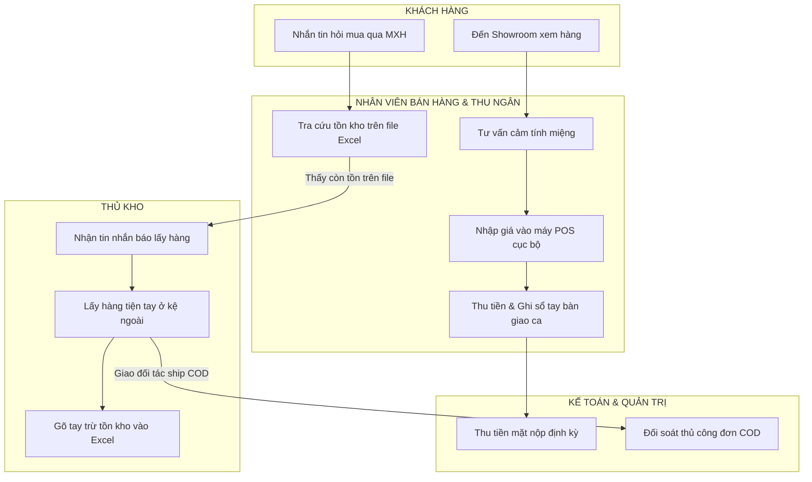
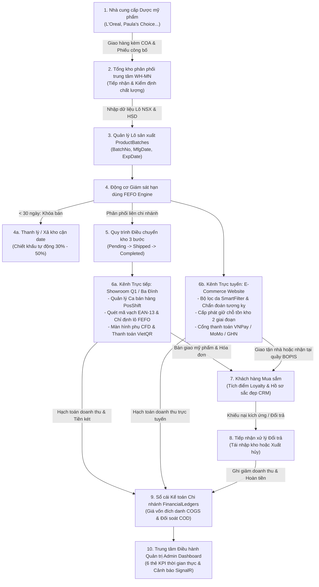

# CHƯƠNG 2: KHẢO SÁT, PHÂN TÍCH VÀ THIẾT KẾ HỆ THỐNG WEBSITE QUẢN LÝ BÁN HÀNG CHO CHUỖI CỬA HÀNG MỸ PHẨM CANMAKE BEAUTY

## 2.1. Khảo sát hiện trạng và xác lập bài toán nghiệp vụ tại chuỗi cửa hàng CANMAKE BEAUTY

### 2.1.1. Khảo sát quy trình hoạt động nghiệp vụ hiện tại (Quy trình As-Is)

Nhằm thu thập đầy đủ các yêu cầu chức năng và phi chức năng phục vụ cho việc phát triển giải pháp phần mềm, quá trình khảo sát thực địa đã được tiến hành trực tiếp tại Tổng kho phân phối trung tâm HQ-001 tại quận Cầu Giấy, thành phố Hà Nội, cùng hai điểm bán lẻ đại diện là Showroom Cầu Giấy và Showroom Quận 1 tại Thành phố Hồ Chí Minh. Hiện trạng vận hành của chuỗi CANMAKE BEAUTY trước khi có hệ thống tập trung mang tính chất bán tự động kết hợp nhiều thao tác thủ công, phân mảnh trên nhiều công cụ độc lập:

Quy trình khách mua hàng trực tiếp tại các Showroom: Khi khách hàng bước vào cửa hàng, nhân viên bán hàng tiếp đón và tư vấn trực tiếp dựa trên kinh nghiệm cá nhân. Khách hàng xem các mẫu thử mỹ phẩm được bày trên kệ trưng bày. Khi khách chọn được món hàng ưng ý, nhân viên bán hàng mang sản phẩm ra quầy thu ngân. Tại quầy, thu ngân sử dụng một phần mềm tính tiền cài đặt cục bộ trên máy tính để chọn tên sản phẩm hoặc nhập giá tiền thủ công. Khách hàng thanh toán bằng tiền mặt hoặc chuyển khoản ngân hàng cá nhân thông qua việc quét mã chuyển tiền in tĩnh dán trên mặt bàn. Thu ngân in hóa đơn bán lẻ trao cho khách và hoàn tất giao dịch. Điểm yếu của quy trình này là thông tin tồn kho chỉ được trừ cục bộ trên máy tính tại quầy, hoàn toàn không được liên thông với bất kỳ kênh bán hàng nào khác của chuỗi.

Quy trình chốt đơn bán hàng qua mạng xã hội và tin nhắn trực tuyến: Chuỗi duy trì một trang mạng xã hội và một kênh bán lẻ trực tuyến đơn giản. Khách hàng nhắn tin hỏi mua sản phẩm, nhân viên trực tin nhắn phải mở một bảng tính Excel lưu trữ tồn kho chung của chuỗi để kiểm tra xem sản phẩm còn hay hết. Nếu thấy trên tệp bảng tính còn tồn, nhân viên xác nhận chốt đơn với khách, xin thông tin họ tên, số điện thoại, địa chỉ nhận hàng và hình thức thanh toán thu tiền tận nơi. Sau đó, nhân viên này sao chép thủ công các dòng thông tin vào một bảng tính theo dõi đơn hàng chờ giao, đồng thời gọi điện thoại hoặc nhắn tin nội bộ cho thủ kho yêu cầu tìm hàng và đóng gói.

Quy trình quản lý kho và theo dõi hạn sử dụng mỹ phẩm: Công tác quản lý kho hàng tại Tổng kho và các kho chi nhánh phụ thuộc hoàn toàn vào các tệp bảng tính Excel do nhân viên thủ kho tự thiết lập và cập nhật thủ công. Mỗi khi tiếp nhận một lô mỹ phẩm nhập khẩu mới, thủ kho dùng thước kiểm đếm số lượng hộp, đọc hạn sử dụng in bằng chữ nhỏ trên đáy hộp và gõ tay số liệu vào bảng tính. Do khối lượng hàng hóa xuất nhập trong ngày rất lớn, việc cập nhật số liệu thường xuyên bị chậm trễ từ một đến hai ngày. Khi nhận được lệnh chuẩn bị hàng, nhân viên kho bước vào các dãy kệ chứa hàng và thường lấy ngay những thùng hàng hoặc hộp mỹ phẩm đặt ở vị trí thuận tay nhất phía ngoài cửa kho mà không kiểm tra xem lô hàng đó có ngày hết hạn như thế nào so với các lô nằm sâu bên trong.

Quy trình thu ngân bàn giao tiền mặt và đối soát cuối ca làm việc: Tại quầy bán lẻ, mỗi ngày chia làm hai ca làm việc gồm ca sáng và ca chiều. Khi kết thúc ca, nhân viên thu ngân mở ngăn kéo két tiền, đếm toàn bộ số tiền mặt có trong két và ghi chép vào một cuốn sổ tay bàn giao ca. Thu ngân ca sau tiếp nhận số tiền, ký xác nhận vào sổ và tiếp tục bán hàng. Số tiền mặt doanh thu tích lũy qua các ngày sẽ được gom lại và người quản lý chi nhánh mang nộp trực tiếp vào tài khoản ngân hàng của doanh nghiệp theo định kỳ vài ngày một lần.

Sơ đồ quy trình dưới đây mô tả trực quan các bước vận hành nghiệp vụ thủ công hiện tại của chuỗi CANMAKE BEAUTY:

> **[HƯỚNG DẪN CHÈN SƠ ĐỒ 2.1 - SƠ ĐỒ QUY TRÌNH BÁN HÀNG VÀ QUẢN LÝ KHO HIỆN TẠI (AS-IS)]:**
> - **Mã nguồn vẽ sơ đồ:** Sao chép đoạn mã Mermaid ở trên vào công cụ xuất đồ họa trực tuyến hoặc biên dịch sang định dạng hình ảnh PNG độ phân giải 1920x1080 pixel.
> - **Cách chèn vào tài liệu:** Căn giữa hình ảnh trên trang văn bản, định dạng độ rộng hình ảnh chiếm khoảng 85% chiều rộng trang in.
> - **Tên chú thích hình đặt dưới ảnh (Canh giữa, in nghiêng):** *Sơ đồ 2.1: Sơ đồ quy trình bán hàng và quản lý kho hiện tại (As-Is)*

---

### 2.1.2. Đánh giá các hạn chế và điểm nghẽn của mô hình hiện tại

Qua quá trình theo dõi trực tiếp các hoạt động tác nghiệp tại các chi nhánh và phân tích số liệu lịch sử của chuỗi CANMAKE BEAUTY, mô hình vận hành thủ công phân mảnh hiện tại đã bộc lộ năm điểm nghẽn nghiêm trọng, kìm hãm sự phát triển và gây thất thoát tài chính lớn cho doanh nghiệp:

Thứ nhất là độ trễ đồng bộ tồn kho giữa kênh bán hàng trực tuyến và các Showroom bán lẻ trực tiếp dẫn đến hiện tượng bán khống tồn kho. Do số liệu tồn kho trên tệp bảng tính Excel chỉ được cập nhật sau khi thủ kho hoàn tất kiểm đếm cuối ngày, trong suốt thời gian bán hàng ban ngày, số liệu tồn kho hiển thị cho nhân viên trực tin nhắn hoàn toàn là số liệu tĩnh. Khi có một mặt hàng đang được ưa chuộng, tại Showroom Cầu Giấy khách hàng trực tiếp đã mua hết sạch sản phẩm trên kệ, nhưng nhân viên trực mạng xã hội vẫn thấy trên bảng tính còn số lượng tồn nên tiếp tục nhận đơn và hứa hẹn giao hàng cho khách hàng trực tuyến. Đến khi chuyển thông tin xuống kho để đóng gói, thủ kho mới thông báo sản phẩm đã hết sạch. Doanh nghiệp buộc phải gọi điện xin lỗi khách hàng và hủy đơn, gây bức xúc lớn cho người tiêu dùng và làm tổn hại nghiêm trọng đến uy tín của thương hiệu CANMAKE BEAUTY.

Thứ hai là quy trình xuất kho diễn ra theo thói quen tiện tay thay vì kiểm soát theo hạn sử dụng, khiến các lô hàng mới nhập bị xuất bán hết trước trong khi các lô sản xuất cũ cận hạn dùng bị ứ đọng lại sâu trong kho. Do bao bì mỹ phẩm giữa các lô nhập khẩu cách nhau vài tháng thường có mẫu mã hoàn toàn giống nhau, nhân viên thủ kho khi soạn hàng thường bốc các thùng hàng đặt ở vị trí thuận tiện bên ngoài cửa kho để kịp tiến độ đóng gói. Hậu quả là những lô hàng nhập từ các đợt trước bị đẩy lùi vào các góc khuất bên trong kệ chứa hàng. Đến khi thủ kho rà soát định kỳ hàng quý, nhiều lô mỹ phẩm đắt tiền đã trôi qua hạn sử dụng an toàn hoặc chỉ còn dưới một tháng, bắt buộc doanh nghiệp phải làm thủ tục tiêu hủy toàn bộ, gây thiệt hại hàng trăm triệu đồng giá vốn mỗi năm.

Thứ ba là thiếu công cụ tra cứu nhanh thành phần hoạt chất khoa học và tiền sử kích ứng da của khách hàng tại các điểm chạm bán lẻ. Khi khách hàng đến cửa hàng hoặc nhắn tin nhờ tư vấn về một dòng tinh chất phục hồi da hay sản phẩm trị mụn, nhân viên bán hàng chỉ có thể đọc các thông tin quảng cáo in vắn tắt trên vỏ hộp. Nhân viên hoàn toàn không nắm được nồng độ các hoạt chất đặc trị có trong sản phẩm, không biết độ pH hoạt động và không có công cụ để tra cứu xem khách hàng có tiền sử dị ứng với thành phần nào hay không. Thực tế đã ghi nhận nhiều trường hợp khách hàng mua cùng lúc sản phẩm tẩy da chết hóa học nồng độ cao và tinh chất chứa dẫn xuất vitamin A mạnh về sử dụng chung trong một buổi dưỡng da, dẫn đến tình trạng da bị bỏng rát, kích ứng nghiêm trọng và quay lại khiếu nại chất lượng sản phẩm của cửa hàng.

Thứ tư là rủi ro thất thoát dòng tiền mặt tại két quầy thu ngân và sự chậm trễ trong công tác đối soát tiền thu hộ từ các đơn vị giao vận chuyển. Việc kiểm soát tiền mặt tại các Showroom phụ thuộc hoàn toàn vào tính tự giác của nhân viên thu ngân qua việc ghi chép sổ tay. Quản lý cửa hàng không có công cụ để biết chính xác trong ca làm việc thu ngân đã thực hiện bao nhiêu đơn hàng thanh toán tiền mặt, số tiền thối lại cho khách là bao nhiêu, và số dư tiền mặt lý thuyết hiện tại trong két phải là con số nào. Mọi sự nhầm lẫn hoặc thâm hụt tiền mặt chỉ được phát hiện sau nhiều ngày khi tiến hành nộp tiền vào ngân hàng, lúc này việc truy cứu trách nhiệm cá nhân trở nên vô cùng phức tạp. Đồng thời, đối với hàng trăm đơn hàng trực tuyến giao tận nhà thu tiền hộ COD mỗi tuần, nhân viên kế toán phải đối chiếu thủ công từng dòng mã vận đơn giữa bảng kê của bưu tá với sổ theo dõi đơn hàng, tiêu tốn hàng chục giờ làm việc mỗi tháng và thường xuyên xảy ra tình trạng sót đơn chưa thu được tiền.

Thứ năm là sự thiếu vắng cơ chế cô lập dữ liệu nghiệp vụ giữa các chi nhánh cửa hàng và thiếu công cụ tùy biến giao diện chiến dịch linh hoạt cho bộ phận tiếp thị. Do toàn bộ dữ liệu lưu trữ chung trên các tệp bảng tính chia sẻ trên đám mây, nhân viên tại Showroom Cầu Giấy hoàn toàn có thể nhìn thấy toàn bộ thông tin doanh số, thông tin khách hàng và tồn kho của Showroom Quận 1, vi phạm nghiêm trọng nguyên tắc bảo mật thông tin nội bộ. Mặt khác, mỗi khi bộ phận tiếp thị muốn phát động một chiến dịch khuyến mại mới, thay đổi các biểu ngữ quảng cáo trên trang chủ hoặc tạo ra các trang bài viết cẩm nang làm đẹp chuẩn SEO, họ đều phải phụ thuộc hoàn toàn vào nhân sự kỹ thuật bên ngoài để can thiệp mã nguồn, làm chậm trễ tiến độ tiếp cận khách hàng trong các dịp lễ tết cao điểm.

---

### 2.1.3. Đề xuất quy trình nghiệp vụ bán lẻ đa kênh số hóa mới (Quy trình To-Be)

Để khắc phục triệt để năm điểm nghẽn nêu trên, khóa luận đề xuất quy trình nghiệp vụ bán lẻ đa kênh hợp nhất số hóa mới. Trọng tâm của quy trình To-Be là thiết lập một luồng vận hành khép kín và tự động hóa cao độ từ lúc tiếp nhận hàng hóa tại Tổng kho cho đến khi sản phẩm được tiêu thụ qua các kênh và số liệu tài chính được ghi nhận vào sổ cái:

Giai đoạn nhập kho và khởi tạo lô hàng chuẩn hóa tại Tổng kho trung tâm: Khi các lô hàng dược mỹ phẩm từ nhà cung cấp quốc tế được vận chuyển đến Tổng kho HQ-001, thủ kho tiếp nhận hồ sơ kiểm nghiệm chất lượng và phiếu công bố sản phẩm mỹ phẩm. Thay vì ghi chép sổ sách, thủ kho đăng nhập vào phân hệ quản lý kho trên hệ thống để tạo phiếu nhập kho. Tại đây, thủ kho bắt buộc phải khai báo số lô sản xuất, ngày sản xuất và hạn sử dụng chính xác cho từng mặt hàng. Dữ liệu này được lưu vào bảng `ProductBatches` và khởi tạo số dư tồn kho vật lý tại bảng `StoreInventories`. Thuật toán giám sát hạn dùng FEFO tự động kích hoạt để phân loại màu sắc cảnh báo cho lô hàng: màu xanh lá cây cho các lô an toàn có hạn dùng trên chín mươi ngày, màu vàng cho các lô cận hạn từ ba mươi đến chín mươi ngày, và màu đỏ cho các lô nguy hiểm dưới ba mươi ngày.

Giai đoạn điều chuyển hàng hóa liên chi nhánh ba bước nghiêm ngặt: Khi các Showroom bán lẻ tại Cầu Giấy hoặc Quận 1 có nhu cầu bổ sung hàng hóa, Quản lý chi nhánh tạo phiếu đề xuất điều chuyển trên hệ thống ở trạng thái Chờ duyệt. Người phụ trách điều phối tại Tổng kho xem xét và phê duyệt phiếu điều chuyển. Ngay khi lệnh xuất kho được xác nhận, hệ thống tự động trừ số lượng tồn kho vật lý tại Tổng kho và chuyển trạng thái phiếu sang Đang vận chuyển. Khi kiện hàng đến Showroom chi nhánh, thủ kho chi nhánh dùng máy quét mã vạch kiểm đếm thực tế từng hộp sản phẩm và bấm nút xác nhận tiếp nhận. Hệ thống ngay lập tức chuyển trạng thái phiếu sang Hoàn tất và tự động ghi tăng số lượng tồn kho vật lý tại chi nhánh nhận, đồng thời ghi nhận một bản ghi biến động kho bất biến vào sổ cái `InventoryLogs`.

Giai đoạn phân bổ tồn kho và bán hàng hợp nhất đa kênh:
Đối với kênh bán lẻ trực tiếp tại Showroom: Nhân viên thu ngân đăng nhập vào phân hệ Smart POS toàn màn hình. Khi bắt đầu ngày làm việc, hệ thống bắt buộc thu ngân phải thực hiện nghiệp vụ mở ca và khai báo số dư tiền mặt đầu ca để làm quỹ tiền thối. Trong suốt ca, khi khách hàng chọn mua sản phẩm, thu ngân quét mã vạch EAN-13 trên thân hộp. Hệ thống tự động kích hoạt thuật toán xuất kho FEFO để chỉ định xuất đúng lô sản xuất có hạn sử dụng gần nhất hiện có trong kho chi nhánh đó. Đồng thời, thông tin món hàng, đơn giá và số tiền phải thanh toán được truyền phát tức thời sang màn hình phụ CFD hướng về phía khách hàng thông qua kết nối SignalR. Nếu khách chọn thanh toán không dùng tiền mặt, màn hình phụ tự động hiển thị mã VietQR động chứa chính xác số tiền cần trả. Khách quét mã chuyển khoản thành công, hệ thống nhận được tín hiệu sẽ tự động in hóa đơn nhiệt và trừ tồn kho vật lý ngay tại thời điểm đó.

Đối với kênh bán hàng trực tuyến qua website: Khách hàng truy cập website, có thể sử dụng công cụ chẩn đoán da thông minh để kiểm tra loại da của mình hoặc chọn các sản phẩm đưa vào giỏ hàng. Khi khách hàng bấm nút tiến hành thanh toán, hệ thống áp dụng cơ chế khóa giữ chỗ tồn kho mềm hai giai đoạn: tại giai đoạn một, hệ thống tạm thời tăng trường số lượng giữ chỗ `ReservedQuantity` của lô hàng có hạn dùng gần nhất tại chi nhánh gần khách hàng nhất và cho phép khách mười lăm phút để hoàn tất thanh toán. Trong thời gian mười lăm phút này, số lượng khả dụng để bán cho người khác sẽ tự động giảm đi, bảo đảm không ai có thể mua trùng sản phẩm này. Khi khách hàng thanh toán thành công qua cổng VNPay, MoMo hoặc xác nhận đặt đơn COD, giai đoạn hai được kích hoạt: hệ thống chính thức trừ số lượng tồn kho vật lý `PhysicalQuantity`, giải phóng số lượng giữ chỗ và chuyển đơn hàng sang trạng thái chờ đóng gói. Trường hợp khách hàng không thanh toán sau mười lăm phút, tiến trình nền tự động hoàn trả số lượng giữ chỗ về kho để người khác tiếp tục mua.

Giai đoạn hậu mãi, đổi trả và hạch toán sổ cái tài chính tự động: Toàn bộ doanh thu bán hàng tại quầy POS, doanh thu từ các đơn hàng trực tuyến và các bút toán giá vốn đích danh theo từng lô xuất bán đều được các trình xử lý sự kiện miền tự động đồng bộ vào bảng sổ cái tài chính `FinancialLedgers`. Khi phát sinh nghiệp vụ khách hàng bị kích ứng cần đổi trả sản phẩm, nhân viên tiếp nhận và phân loại: nếu sản phẩm còn nguyên vẹn tem niêm phong sẽ được nhập lại vào kho đúng lô ban đầu; nếu sản phẩm đã bị mở nắp hoặc hư hỏng sẽ được đưa vào danh mục chờ tiêu hủy. Mọi dòng tiền hoàn trả cho khách đều được ghi giảm doanh thu tương ứng trên sổ cái kế toán của chi nhánh phát sinh giao dịch.

Dưới đây là sơ đồ luồng vận hành hàng hóa và chuỗi cung ứng khép kín được thiết kế chuẩn xác theo hiện trạng mã nguồn thực tế của hệ thống CANMAKE BEAUTY:

> **[HƯỚNG DẪN CHÈN HÌNH 2.1 / SƠ ĐỒ 2.2 - SƠ ĐỒ LUỒNG VẬN HÀNH HÀNG HÓA VÀ DỮ LIỆU ĐA KÊNH ĐỀ XUẤT TẠI CANMAKE BEAUTY]:**
> - **File ảnh có sẵn trong dự án:** `d:\Lập trình web\OmnichannelBeautySolution\doc\Hinh_2_1_Luong_Van_Hanh_Hang_Hoa.png`
> - **Cách tự tạo mới hoặc xuất lại ảnh:** Mở tệp mã nguồn PlantUML `d:\Lập trình web\OmnichannelBeautySolution\doc\Hinh_2_1_Luong_Van_Hanh_Hang_Hoa.puml` bằng phần mềm PlantUML hoặc chạy kịch bản tự động `generate_plantuml_hinh2_1.js` trong thư mục `doc/` để kết xuất tệp ảnh PNG chất lượng cao.
> - **Yêu cầu bố cục ảnh:** Đặt ảnh nằm ngang giữa trang giấy, bảo đảm các khối chữ và mũi tên chỉ hướng luồng hàng hóa từ Nhà cung cấp đến Sổ cái tài chính rõ nét, không bị nhòe vỡ chữ.
> - **Tên chú thích hình đặt dưới ảnh (Canh giữa, in nghiêng):** *Hình 2.1: Sơ đồ luồng vận hành hàng hóa và dữ liệu đa kênh đề xuất tại CANMAKE BEAUTY*

---

## 2.2. Phân tích yêu cầu hệ thống và Mô hình hóa chức năng tổng quát

### 2.2.1. Xác định các tác nhân hệ thống (Actors) và phạm vi truy cập dữ liệu

Trong phương pháp phân tích thiết kế hệ thống hướng đối tượng, tác nhân được định nghĩa là bất kỳ thực thể nào bên ngoài hệ thống có hành vi tương tác trực tiếp, gửi thông tin vào hoặc nhận kết quả phản hồi từ hệ thống phần mềm. Dựa trên cơ cấu tổ chức nhân sự của chuỗi CANMAKE BEAUTY và các luồng tích hợp dịch vụ bên ngoài, hệ thống xác định chính xác mười một tác nhân tương tác, bao gồm sáu tác nhân con người nội bộ, một tác nhân tiến trình ngầm tự động và bốn tác nhân hệ thống đối tác bên thứ ba:

Nhóm tác nhân con người nội bộ bao gồm:
1. Quản trị viên tối cao mang mã hiệu `SuperAdmin`: Là người sở hữu đặc quyền cao nhất trong hệ thống, thường là thành viên Ban Giám đốc hoặc Trưởng phòng Công nghệ thông tin. Tác nhân này có toàn quyền cấu hình các tham số toàn hệ thống, tạo mới chi nhánh, thiết lập ma trận phân quyền năm mươi mốt quyền hạn cho các vai trò và thực hiện ghi đè quyền hạn cho từng nhân viên cụ thể.
2. Quản lý chi nhánh mang mã hiệu `StoreManager`: Là người trực tiếp phụ trách điều hành một Showroom bán lẻ. Phạm vi truy cập dữ liệu của tác nhân này bị ràng buộc chặt chẽ theo mã định danh chi nhánh `StoreId`. Quản lý chi nhánh có quyền theo dõi toàn bộ báo cáo doanh thu, duyệt mở đóng ca thu ngân, kiểm tra biên bản lệch két tiền mặt và phê duyệt các phiếu đề xuất điều chuyển hàng hóa cho cửa hàng mình quản lý.
3. Nhân viên thu ngân mang mã hiệu `Cashier`: Là nhân sự trực tiếp làm việc tại quầy bán lẻ của các Showroom. Tác nhân này chỉ có quyền truy cập vào giao diện điểm bán lẻ thông minh Smart POS để thực hiện mở đóng ca làm việc, quét mã vạch sản phẩm, kiểm tra tồn kho tại chỗ, nhận tiền thanh toán và in hóa đơn cho khách. Thu ngân tuyệt đối không có quyền xem các báo cáo tài chính tổng hợp hay thay đổi giá bán sản phẩm.
4. Nhân viên thủ kho mang mã hiệu `WarehouseStaff`: Là nhân sự phụ trách công tác kho bãi tại Tổng kho trung tâm hoặc kho chi nhánh. Tác nhân này có quyền truy cập vào giao diện quản trị kho chuyên biệt để tạo phiếu nhập lô hàng mới, theo dõi cảnh báo hạn sử dụng theo nguyên tắc FEFO, đóng gói đơn hàng và xác nhận các bước xuất nhập trong phiếu điều chuyển kho liên chi nhánh.
5. Biên tập viên nội dung mang mã hiệu `ContentEditor`: Là nhân sự thuộc bộ phận tiếp thị và truyền thông. Tác nhân này có quyền truy cập vào phân hệ CMS để soạn thảo các bài viết cẩm nang làm đẹp, quản lý danh mục bài viết, quản trị các biểu ngữ quảng cáo và cấu hình cây menu đa hình điều hướng trang web phục vụ tối ưu hóa công cụ tìm kiếm.
6. Khách hàng thành viên mang mã hiệu `Customer`: Là người tiêu dùng tương tác với hệ thống thông qua cổng bán hàng trực tuyến Storefront. Khách hàng có quyền tra cứu sản phẩm, sử dụng bộ lọc chẩn đoán da, đưa hàng vào giỏ, đặt hàng trực tuyến, thanh toán qua cổng điện tử, theo dõi tiến trình đơn hàng và quản lý hồ sơ làn da cùng ví điểm thưởng cá nhân.

Tác nhân tiến trình ngầm tự động:
7. Tiến trình nền cảnh báo thông minh mang mã hiệu `AlertBackgroundWorker`: Là một dịch vụ chạy ngầm định kỳ được cấu hình sẵn trong máy chủ ứng dụng web ASP.NET Core. Cứ mỗi mười lăm phút, tiến trình này tự động kích hoạt để quét toàn bộ dữ liệu cơ sở dữ liệu nhằm phát hiện các sự cố vận hành như: phát hiện các lô mỹ phẩm cận hạn dùng dưới ba mươi ngày để khóa bán, phát hiện các mặt hàng chạm ngưỡng tồn kho tối thiểu, phát hiện các ca thu ngân đóng ca có chênh lệch két tiền mặt vượt định mức cho phép, và quét dọn các giỏ hàng hết hạn giữ chỗ mười lăm phút để hoàn trả tồn kho về trạng thái sẵn sàng bán.

Nhóm tác nhân hệ thống đối tác bên thứ ba bao gồm:
8. Cổng thanh toán trực tuyến `VNPay`: Hệ thống tài chính trung gian tiếp nhận yêu cầu thanh toán thẻ và tài khoản ngân hàng nội địa, thực hiện kiểm tra chữ ký số bảo mật HMAC-SHA512 và gửi thông báo xác nhận kết quả thanh toán tức thời về điểm cuối tiếp nhận Webhook của hệ thống.
9. Dịch vụ ví điện tử `MoMo`: Cổng thanh toán ví điện tử tiếp nhận giao dịch thông qua cơ chế quét mã thanh toán trên ứng dụng di động và phản hồi trạng thái hoàn tất giao dịch bất đồng bộ.
10. Hạ tầng chuyển khoản ngân hàng tự động `VietQR Napas247`: Hệ thống cổng thanh toán liên ngân hàng quốc gia, cung cấp định dạng mã phản hồi nhanh chứa sẵn số tài khoản nhận tiền, số tiền chính xác đến từng đồng và nội dung chuyển khoản là mã đơn hàng để khách hàng tự quét thanh toán nhanh chóng và chính xác.
11. Đơn vị dịch vụ logistics `Giao Hàng Nhanh - GHN`: Hệ thống giao nhận vận chuyển đối tác, cung cấp giao diện lập trình ứng dụng để hệ thống tự động tính cước phí giao hàng dựa trên tọa độ địa chỉ của khách hàng và tự động khởi tạo vận đơn giao nhận ngay khi người quản lý duyệt xuất kho đơn hàng.

Bảng dưới đây tổng hợp chi tiết đặc tả của toàn bộ mười một tác nhân trong hệ thống CANMAKE BEAUTY:

**Bảng 2.1: Bảng đặc tả chi tiết các tác nhân tham gia hệ thống CANMAKE BEAUTY**

| STT | Mã tác nhân | Tên gọi vai trò tác nhân | Phạm vi quản lý dữ liệu | Lược đồ xác thực / Cơ chế phiên | Trách nhiệm và quyền hạn nghiệp vụ chính yếu |
| :---: | :--- | :--- | :--- | :--- | :--- |
| 1 | `SuperAdmin` | Quản trị viên tối cao | Toàn quyền trên toàn bộ Tổng kho và tất cả các Showroom | Cookie: `CanmakeBeauty.Admin.Session` | Cấu hình tham số hệ thống, tạo mới chi nhánh, quản trị danh mục 51 quyền hạn nguyên tử, gán quyền vai trò và ghi đè quyền cá nhân. |
| 2 | `StoreManager` | Quản lý chi nhánh | Giới hạn nghiêm ngặt theo mã chi nhánh `StoreId` phụ trách | Cookie: `CanmakeBeauty.Admin.Session` | Quản lý doanh số bán lẻ chi nhánh, duyệt ca làm việc thu ngân, xác nhận biên bản lệch két và duyệt phiếu điều chuyển kho chi nhánh. |
| 3 | `Cashier` | Nhân viên thu ngân | Giới hạn tại quầy POS của chi nhánh được phân công | Cookie: `CanmakeBeauty.Admin.Session` | Mở đóng ca bán hàng, khai báo số dư két đầu ca, quét mã vạch sản phẩm, áp mã giảm giá, thu tiền và in hóa đơn nhiệt cho khách. |
| 4 | `WarehouseStaff` | Nhân viên thủ kho | Giới hạn tại Tổng kho hoặc kho chi nhánh làm việc | Cookie: `CanmakeBeauty.Admin.Session` | Nhập lô hàng mới, khai báo hạn dùng, giám sát cảnh báo FEFO, đóng gói đơn hàng và xác nhận phiếu điều chuyển kho liên chi nhánh. |
| 5 | `ContentEditor` | Biên tập viên nội dung | Toàn hệ thống đối với các tài nguyên truyền thông | Cookie: `CanmakeBeauty.Admin.Session` | Quản lý bài viết cẩm nang làm đẹp, tạo chuyên mục bài viết, quản lý biểu ngữ quảng cáo và cấu hình cây menu đa hình chuẩn SEO. |
| 6 | `Customer` | Khách hàng thành viên | Chỉ có quyền truy cập vào dữ liệu cá nhân của chính mình | Cookie: `CanmakeBeauty.Customer.Session` | Xem danh mục, thực hiện trắc nghiệm chẩn đoán da, đặt hàng trực tuyến, thanh toán điện tử, tra cứu đơn hàng và đổi điểm thưởng ví Loyalty. |
| 7 | `AlertWorker` | Tiến trình nền cảnh báo | Toàn bộ cơ sở dữ liệu trên máy chủ dịch vụ | Tiến trình nội bộ (IHostedService Background Worker) | Quét định kỳ 15 phút phát hiện lô cận hạn nguy hiểm, rà soát ngưỡng tồn kho tối thiểu, cảnh báo lệch két và giải phóng tồn kho giữ chỗ. |
| 8 | `VNPay` | Cổng thanh toán VNPay | Phạm vi giao dịch đơn hàng thanh toán qua VNPay | Ký số điện tử bảo mật HMAC-SHA512 qua API Webhook | Tiếp nhận yêu cầu thanh toán thẻ nội địa/quốc tế và gửi thông báo xác thực kết quả thanh toán về hệ thống xử lý gạch nợ tự động. |
| 9 | `MoMo` | Ví điện tử MoMo | Phạm vi giao dịch đơn hàng thanh toán qua MoMo | Xác thực khóa bảo mật qua Webhook API | Cung cấp cổng thanh toán ví điện tử và gửi thông báo xác nhận trạng thái trừ tiền tài khoản ví của người dùng. |
| 10 | `VietQR` | Cổng VietQR Napas247 | Phạm vi các giao dịch chuyển khoản ngân hàng | Chuẩn sinh mã QR động VietQR Compact2 | Cung cấp định dạng mã phản hồi nhanh chuyển khoản ngân hàng 24/7 chứa sẵn thông tin tài khoản, số tiền và nội dung đơn hàng. |
| 11 | `GHN` | Đơn vị vận chuyển GHN | Phạm vi tính cước phí và vận chuyển kiện hàng | Xác thực mã Token đối tác qua HTTP Header API | Tự động tính cước vận chuyển theo trọng lượng và địa chỉ, cấp mã vận đơn theo dõi tiến trình phát hàng tận nơi. |

---

### 2.2.2. Xây dựng Biểu đồ phân rã chức năng (Business Function Decomposition - BFD)

Để quản lý độ phức tạp của một hệ thống thương mại điện tử và bán lẻ đa kênh quy mô lớn, phương pháp phân rã chức năng nghiệp vụ được áp dụng nhằm chia nhỏ toàn bộ bài toán tổng thể thành hai khối chức năng lớn là Khối Khách hàng Storefront và Khối Quản trị Điều hành Back-Office, từ đó tiếp tục phân rã thành các nhánh chức năng con độc lập và mạch lạc:

Khối chức năng Khách hàng Storefront tập trung vào việc phục vụ toàn diện hành trình mua sắm và chăm sóc sắc đẹp của người tiêu dùng trên giao diện trực tuyến. Khối này bao gồm sáu nhánh chức năng chính: Nhánh Trải nghiệm Danh mục và Tìm kiếm; Nhánh Tư vấn Chăm sóc da Thông minh; Nhánh Giỏ hàng và Đặt hàng Đa kênh; Nhánh Thanh toán Trực tuyến Đa phương thức; Nhánh Cổng Thông tin Thành viên Cá nhân; và Nhánh Tương tác Đánh giá và Cẩm nang Làm đẹp.

Khối chức năng Quản trị Điều hành Back-Office dành cho đội ngũ quản lý và nhân viên tác nghiệp, bao gồm mười một nhánh chức năng nghiệp vụ chuyên biệt: Nhánh Quản trị Điểm bán lẻ Trực tiếp Smart POS; Nhánh Quản trị Kho Dược Mỹ phẩm và Hạn dùng FEFO; Nhánh Quản trị Đơn hàng và Vận chuyển Đa kênh; Nhánh Quản lý Điều chuyển Hàng hóa Liên chi nhánh; Nhánh Quản trị Quan hệ Khách hàng CRM và Hồ sơ Làn da; Nhánh Quản lý Chương trình Khách hàng Thân thiết và Ví điểm Loyalty; Nhánh Quản trị Động cơ Khuyến mại và Mã giảm giá; Nhánh Kế toán Sổ cái và Quản lý Tài chính Chi nhánh; Nhánh Quản trị Nội dung và Hệ thống Điều hướng CMS; Nhánh Quản trị An ninh và Ma trận Phân quyền Động PBAC; và Nhánh Giám sát Tự động, Cảnh báo AI và Thông báo Thời gian thực SignalR.

Sơ đồ phân rã chức năng tổng quát dưới đây thể hiện rõ cấu trúc thứ bậc của toàn bộ hệ thống CANMAKE BEAUTY:

```mermaid
flowchart TD
    ROOT["HỆ THỐNG QUẢN LÝ BÁN HÀNG CHUỖI MỸ PHẨM CANMAKE BEAUTY"]

    ROOT --> STOREFRONT["KHỐI KHÁCH HÀNG (STOREFRONT)"]
    ROOT --> ADMIN["KHỐI QUẢN TRỊ ĐIỀU HÀNH (ADMIN BACK-OFFICE)"]

    STOREFRONT --> F1["1. Trải nghiệm Danh mục & Tìm kiếm<br/>- Mega Menu chuẩn SEO<br/>- Swatch màu & Dung tích<br/>- Bảng thành phần EWG"]
    STOREFRONT --> F2["2. Tư vấn Da thông minh<br/>- Routine Quiz AI chẩn đoán<br/>- Lab kiểm tra tương kỵ da<br/>- Chatbot hỗ trợ 24/7"]
    STOREFRONT --> F3["3. Giỏ hàng & Đặt hàng<br/>- Khóa giữ chỗ tồn kho 2 giai đoạn<br/>- Free Sample Bar quà tặng<br/>- Chọn nhận tại quầy BOPIS"]
    STOREFRONT --> F4["4. Thanh toán Đa kênh<br/>- VietQR Napas247 động<br/>- Cổng VNPay / MoMo<br/>- Đổi điểm ví Loyalty"]
    STOREFRONT --> F5["5. Cổng Thành viên & Lịch nhắc<br/>- Hồ sơ làn da cá nhân<br/>- Lịch nhắc mua lại định kỳ<br/>- Tra cứu đơn & Tích điểm"]

    ADMIN --> A1["1. Quầy Bán lẻ Smart POS<br/>- Mở/Đóng ca & Kiểm két mù<br/>- Màn hình phụ khách CFD<br/>- In hóa đơn nhiệt K80"]
    ADMIN --> A2["2. Quản trị Kho Lô FEFO<br/>- Nhập lô Mfg/ExpDate<br/>- Phân màu cảnh báo hạn dùng<br/>- Điều chuyển liên kho 3 bước"]
    ADMIN --> A3["3. Quản trị Đơn hàng Đa kênh<br/>- Xử lý đơn trực tuyến & POS<br/>- Đẩy đơn tự động qua GHN<br/>- In nhãn vận đơn đóng gói"]
    ADMIN --> A4["4. CRM Hồ sơ Da & Loyalty<br/>- Quản lý da liễu 360 độ<br/>- Phân hạng VIP tự động<br/>- Lịch sử tương kỵ kích ứng"]
    ADMIN --> A5["5. Tài chính & Giá vốn COGS<br/>- Sổ cái thu chi chi nhánh<br/>- Giá vốn đích danh theo lô<br/>- Đối soát tiền thu hộ COD"]
    ADMIN --> A6["6. Bảo mật Động PBAC<br/>- Ma trận 51 quyền x 6 vai trò<br/>- Cô lập dữ liệu chi nhánh<br/>- Nhật ký kiểm toán AuditLogs"]
    ADMIN --> A7["7. CMS, Menu & Cảnh báo Realtime<br/>- Cây Menu đa hình chuẩn SEO<br/>- Chuông thông báo đẩy SignalR<br/>- Tiến trình nền tự động cảnh báo"]
```

> **[HƯỚNG DẪN CHÈN SƠ ĐỒ 2.3 - BIỂU ĐỒ PHÂN RÃ CHỨC NĂNG HỆ THỐNG QUẢN LÝ BÁN HÀNG CHUỖI MỸ PHẨM CANMAKE BEAUTY]:**
> - **Mã nguồn vẽ sơ đồ:** Sử dụng mã nguồn Mermaid được thiết lập ở trên, sao chép vào trình biên dịch đồ họa trực tuyến hoặc sử dụng công cụ Mermaid CLI để kết xuất ảnh định dạng PNG độ nét cao.
> - **Cách chèn vào tài liệu:** Đặt sơ đồ nằm giữa trang tài liệu, định dạng kích thước cân đối, bảo đảm nhìn rõ cả hai khối phân rã lớn và các nhánh chức năng cấp hai.
> - **Tên chú thích hình đặt dưới ảnh (Canh giữa, in nghiêng):** *Sơ đồ 2.3: Biểu đồ phân rã chức năng hệ thống quản lý bán hàng chuỗi mỹ phẩm CANMAKE BEAUTY*

Sơ đồ phân rã chức năng trên đóng vai trò là kim chỉ nam định hình toàn bộ cấu trúc kiến trúc phần mềm. Từ việc phân chia các khối chức năng này, nhóm phát triển có thể thiết lập các phân vùng giao diện chuyên biệt, xác định các ranh giới xử lý của từng dịch vụ và phân chia các bảng dữ liệu tương ứng trong cơ sở dữ liệu.

---

### 2.2.3. Phân tích chi tiết yêu cầu chức năng theo 17 phân hệ nghiệp vụ thực tế

Căn cứ trên hiện trạng mã nguồn thực tế đang hoạt động của giải pháp `OmnichannelBeautySolution`, toàn bộ hệ thống được hiện thực hóa một cách toàn diện qua mười bảy phân hệ nghiệp vụ có tính liên kết chặt chẽ:

1. Phân hệ Quản lý Điểm bán lẻ trực tiếp (Smart POS), Ca làm việc và Giao nhận đơn O2O Click & Collect:  
Phân hệ này cung cấp giao diện bán hàng cảm ứng toàn màn hình `_PosLayout` dành riêng cho thu ngân tại các Showroom. Hệ thống hỗ trợ thao tác nhanh thông qua các phím tắt từ F1 đến F12, tích hợp máy quét mã vạch EAN-13 để tra cứu giá và tồn kho tức thời. Phân hệ quản lý nghiêm ngặt vòng đời ca bán hàng `PosShift`: bắt buộc khai báo số dư quỹ tiền lẻ đầu ca, ghi nhận chi tiết các giao dịch nộp rút tiền mặt giữa ca và thực hiện đối soát két mù cuối ca để phát hiện sai lệch tiền mặt. Phân hệ còn tích hợp chức năng đồng bộ màn hình phụ khách hàng CFD và hỗ trợ quy trình xử lý đơn hàng O2O nhận tại quầy.

2. Phân hệ Quản trị Kho Dược – Mỹ phẩm và Giám sát Hạn dùng theo nguyên tắc FEFO:  
Phân hệ này đảm nhận việc số hóa toàn bộ hoạt động kho bãi tại Tổng kho và các chi nhánh. Mỗi sản phẩm nhập kho đều được gắn chặt với số lô, ngày sản xuất và hạn sử dụng trong bảng `ProductBatches`. Hệ thống tự động phân loại màu sắc hạn dùng theo ba cấp độ: màu xanh lá cây cho lô an toàn trên chín mươi ngày, màu vàng cho lô cận date từ ba mươi đến chín mươi ngày để kích hoạt xả kho chiết khấu, và màu đỏ cho lô nguy hiểm dưới ba mươi ngày để tự động khóa bán. Toàn bộ mọi biến động tăng giảm kho đều được ghi nhận bất biến vào sổ cái kho `InventoryLogs`.

3. Phân hệ Quản lý Đặt hàng Đa kênh và Cấp phát Tồn kho 2 giai đoạn:  
Phân hệ này điều phối toàn bộ các đơn hàng phát sinh từ cả kênh trực tuyến lẫn tại quầy. Khi khách đặt hàng trên website, hệ thống áp dụng cơ chế cấp phát tồn kho hai giai đoạn: giai đoạn một tạm thời tăng số lượng giữ chỗ `ReservedQuantity` theo lô có hạn dùng gần nhất trong mười lăm phút để chống bán vượt tồn; giai đoạn hai chính thức trừ tồn kho vật lý `PhysicalQuantity` và giải phóng lượng giữ chỗ khi đơn hàng được thanh toán thành công.

4. Phân hệ Điều chuyển Hàng hóa Liên chi nhánh 3 bước:  
Phân hệ này quản lý luồng luân chuyển hàng hóa giữa Tổng kho trung tâm và các Showroom nhằm bảo đảm tính toàn vẹn tồn kho trên toàn chuỗi. Quy trình tuân thủ nghiêm ngặt ba trạng thái: Bước một là tạo phiếu đề xuất ở trạng thái Chờ duyệt; Bước hai là Tổng kho duyệt và xuất kho theo nguyên tắc FEFO, hệ thống tự động trừ tồn kho vật lý tại kho xuất và chuyển trạng thái phiếu sang Đang vận chuyển; Bước ba là kho nhận kiểm đếm thực tế và bấm nút hoàn tất để hệ thống tự động ghi tăng tồn kho tại kho đích.

5. Phân hệ Quản trị Quan hệ Khách hàng (CRM), Hồ sơ Làn da và Đánh giá đồng điệu Skin Twin:  
Phân hệ này xây dựng hồ sơ làm đẹp toàn diện ba trăm sáu mươi độ cho từng khách hàng trong bảng `CustomerProfiles`. Hệ thống lưu trữ các đặc điểm da liễu, loại da khoa học, tình trạng bệnh lý mụn, thâm nám, tiền sử dị ứng thành phần và hình ảnh soi da thực tế. Tính năng đánh giá đồng điệu Skin Twin cho phép khách hàng tìm kiếm và tham khảo các đánh giá, phản hồi thực tế từ những người dùng khác có cùng đặc điểm nền da và bệnh lý da tương đồng.

6. Phân hệ Chương trình Thành viên VIP và Ví điểm thưởng Loyalty:  
Phân hệ này tự động hóa cơ chế gắn kết và tri ân khách hàng. Dựa trên tổng chi tiêu tích lũy trong mười hai tháng, hệ thống tự động xét thăng hạng thành viên qua bốn bậc: Thành viên Tiêu chuẩn, Bạc, Vàng và Kim Cương. Mỗi bậc thành viên được hưởng tỷ lệ tích điểm và các ưu đãi quà tặng chuyên biệt. Khách hàng sở hữu một ví điểm thưởng duy nhất `LoyaltyWallets` có thể sử dụng để trừ tiền trực tiếp trên cả hóa đơn mua tại quầy POS lẫn đơn hàng đặt trên website.

7. Phân hệ Động cơ Khuyến mãi Chiến dịch, Flash Sale và Mã giảm giá Coupon:  
Phân hệ này cho phép bộ phận tiếp thị thiết lập các chương trình khuyến mãi phong phú: giảm giá trực tiếp theo tỷ lệ phần trăm hoặc số tiền cố định, thiết lập sự kiện bán hàng chớp nhoáng theo khung giờ cho các lô hàng cận hạn, và tạo lập các mã giảm giá Coupon có ràng buộc về giá trị đơn hàng tối thiểu, giới hạn số lượt sử dụng và hạn định thời gian áp dụng.

8. Phân hệ Kế toán Sổ cái, Hạch toán Giá vốn đích danh theo lô (Batch-Specific COGS) và Đối soát COD/Công nợ:  
Phân hệ này số hóa toàn diện công tác kế toán quản trị chuỗi bán lẻ. Hệ thống tự động ghi nhận các bút toán thu và chi vào sổ cái `FinancialLedgers`, tính toán giá vốn hàng bán đích danh theo đơn giá nhập của từng lô xuất thực tế, tự động đối soát số tiền thu hộ COD từ đơn vị vận chuyển GHN để phát hiện lệch tiền, và theo dõi chặt chẽ công nợ phải trả cho từng nhà cung cấp mỹ phẩm.

9. Phân hệ Bảo mật Động, Cách ly Phiên Multi-Scheme Cookie và Ma trận Phân quyền Hạt nhân PBAC:  
Phân hệ này thiết lập lá chắn an ninh đa tầng cho hệ thống. Mật khẩu được mã hóa một chiều bằng PBKDF2-SHA256; phiên làm việc được tách biệt tuyệt đối giữa quản trị viên và khách hàng bằng hai Cookie độc lập; toàn bộ quyền hạn được phân rã thành năm mươi mốt quyền nguyên tử được kiểm tra động thông qua `PermissionAuthorizationHandler`; và dữ liệu giữa các chi nhánh được cô lập tuyệt đối dựa trên mã định danh cửa hàng `StoreId`.

10. Phân hệ Tư vấn Da thông minh (Routine Quiz AI), Phòng Lab Kiểm tra Tương kỵ Hoạt chất và Chatbot 24/7:  
Phân hệ này tích hợp các công nghệ thông minh hỗ trợ khách hàng: bài trắc nghiệm Routine Quiz giúp xác định chuẩn xác tình trạng da và tự động gợi ý chu trình dưỡng da sáng tối phù hợp; động cơ kiểm tra tương kỵ tự động rà soát giỏ hàng để phát hiện và cảnh báo các cặp hoạt chất xung đột gây kích ứng da; và trợ lý ảo Chatbot thông minh hỗ trợ giải đáp thắc mắc về thành phần mỹ phẩm liên tục hai tư trên bảy.

11. Phân hệ Quản trị Danh mục, Sản phẩm Đa biến thể, Bảng thành phần EWG động và Khay So sánh Giá/ml:  
Phân hệ này quản lý cấu trúc sản phẩm đa tầng từ sản phẩm cha đến các biến thể con theo màu sắc Swatch và dung tích. Trang chi tiết sản phẩm hiển thị bảng thành phần phân tích theo thang điểm an toàn quốc tế EWG từ một đến mười và tự động tính toán đơn giá trên từng mililít hoặc gam sản phẩm để người tiêu dùng dễ dàng so sánh hiệu quả kinh tế giữa các dung tích đóng gói.

12. Phân hệ Quản trị Cây Menu Đa hình và Chuyển hướng SEO 301 tự động:  
Phân hệ này cung cấp công cụ quản lý cấu trúc cây điều hướng trang web đa cấp độ cho phép liên kết linh hoạt tới danh mục sản phẩm, bài viết cẩm nang hoặc các trang liên kết tùy chọn. Đồng thời, hệ thống tích hợp cơ chế tự động ghi nhận lịch sử thay đổi đường dẫn URL và tự động thực hiện chuyển hướng vĩnh viễn chuẩn SEO 301 thông qua bảng `SlugRedirects` nhằm bảo toàn thứ hạng tìm kiếm trên Google khi có sự điều chỉnh đường dẫn sản phẩm.

13. Phân hệ Quản trị Nội dung Blog, Cẩm nang Làm đẹp và Trang Tĩnh:  
Phân hệ này hỗ trợ bộ phận biên tập xây dựng các bài viết chia sẻ kiến thức chăm sóc da chuyên sâu với trình soạn thảo nội dung phong phú, hỗ trợ chèn hình ảnh, video và tự động tối ưu hóa các thẻ tiêu đề, mô tả phục vụ công tác tiếp thị số.

14. Phân hệ Quản trị Banner, Chiến dịch Truyền thông và Trình Tùy biến Giao diện Trực quan:  
Phân hệ này cho phép nhân viên tiếp thị cấu hình các biểu ngữ quảng cáo đa thiết bị, phân tách hình ảnh riêng cho màn hình máy tính và điện thoại di động, lên lịch trình hiển thị tự động theo ngày giờ của từng chiến dịch truyền thông mà không cần can thiệp vào mã nguồn giao diện.

15. Phân hệ Kiểm duyệt Đánh giá Thực tế và Chương trình Tặng Mẫu thử (Free Sample Bar tại Giỏ hàng):  
Phân hệ này quản lý các phản hồi, bình luận và chấm điểm sao của khách hàng đã mua sản phẩm, có cơ chế duyệt hiển thị để ngăn chặn thư rác. Đồng thời, phân hệ tích hợp thanh quà tặng mẫu thử miễn phí Free Sample Bar ngay tại giỏ hàng, cho phép khách hàng tự tay chọn lựa các gói mẫu thử mỹ phẩm mini kèm theo đơn hàng khi đạt các mốc giá trị thanh toán nhất định.

16. Phân hệ Giám sát Tự động và Cảnh báo Vận hành Thông minh (Background Worker):  
Phân hệ này vận hành tiến trình nền tự động quét cơ sở dữ liệu định kỳ mười lăm phút một lần để phát hiện sớm các nguy cơ rủi ro: cảnh báo các lô hàng cận hạn sử dụng nguy hiểm, cảnh báo các mặt hàng sắp hết tồn kho an toàn và cảnh báo các ca thu ngân có sai lệch tiền mặt lớn để gửi thông báo trực tiếp đến người quản lý.

17. Phân hệ Thông báo Đẩy Thời gian thực (SignalR) và Hộp thư Điều hành Nội bộ:  
Phân hệ này sử dụng công nghệ WebSockets của SignalR để truyền phát các thông báo tức thời đến đúng tài khoản người dùng hoặc vai trò tương ứng khi có sự kiện nghiệp vụ mới, đồng thời cung cấp hộp thư nội bộ an toàn giúp nhân viên giữa các chi nhánh và phòng ban trao đổi công việc nhanh chóng.

Nhằm thể hiện sự ánh xạ tường minh và chuẩn mực giữa giao diện, mã nguồn và cơ sở dữ liệu theo nguyên lý thiết kế hướng đối tượng, bảng dưới đây trích xuất toàn diện năm mươi hai điểm chạm nghiệp vụ thực tế của hệ thống CANMAKE BEAUTY:

**Bảng 2.2: Bảng ma trận ánh xạ các điểm chạm chức năng với Controller, Service và Bảng cơ sở dữ liệu tương ứng**

| STT | Vùng Giao diện / Điểm chạm Nghiệp vụ | Phân vùng | Controller / ViewComponent / Hub | Service Xử lý Chính | Thực thể (Entity Class) | Bảng CSDL (SQL Server) |
| :---: | :--- | :--- | :--- | :--- | :--- | :--- |
| 1 | Dải thông báo khuyến mãi đầu trang | Storefront | `HomeController`, `_Header.cshtml` | `SettingsService` | `Banner`, `Setting` | `Banners`, `Settings` |
| 2 | Nhận diện thương hiệu, hotline và địa chỉ chi nhánh | Storefront | `LocationController`, `_Footer.cshtml` | `SettingsService` | `Store`, `Setting` | `Stores`, `Settings` |
| 3 | Thanh điều hướng đa cấp Mega Menu | Storefront | `HeaderMenuViewComponent` | `MenuEngineService` | `Menu`, `MenuItem` | `Menus`, `MenuItems` |
| 4 | Chuyển hướng URL tự động chuẩn SEO 301 | Global Web | `SlugRedirectMiddleware` | `MenuEngineService` | `SlugRedirect` | `SlugRedirects` |
| 5 | Băng chuyền trình chiếu ảnh trang chủ | Storefront | `HomeController.Index` | `ProductService` | `Banner` | `Banners` |
| 6 | Lưới danh mục mỹ phẩm nổi bật | Storefront | `HomeController.Index`, `ProductController.Category` | `ProductService` | `Category` | `Categories` |
| 7 | Khu vực xả kho hàng cận date FEFO Clearance | Storefront | `HomeController.ClearanceFefo` | `InventoryAllocationEngine` | `ProductBatch`, `Product`, `StoreInventory` | `ProductBatches`, `Products`, `StoreInventories` |
| 8 | Lưới sản phẩm phân tab Mới, Bán chạy, Gợi ý | Storefront | `HomeController.GetProductTab` | `ProductService` | `Product`, `ProductVariant`, `Brand`, `Category` | `Products`, `ProductVariants`, `Brands`, `Categories` |
| 9 | Cửa sổ xem nhanh sản phẩm Quick-View | Storefront | `ProductController.QuickView` | `ProductService` | `Product`, `ProductVariant`, `ProductSwatch` | `Products`, `ProductVariants`, `ProductSwatches` |
| 10 | Bộ chọn màu son Swatch và dung tích đóng gói | Storefront Detail | `ProductController.Detail` | `ProductService` | `ProductVariant`, `ProductSwatch`, `ProductAttribute` | `ProductVariants`, `ProductSwatches`, `ProductAttributes` |
| 11 | Bảng phân tích hoạt chất và loại da khoa học | Storefront Detail | `ProductController.Detail` | `ProductService` | `ActiveIngredient`, `SkinType`, `SkinConcern` | `ActiveIngredients`, `ProductIngredients`, `SkinTypes` |
| 12 | Hệ thống đánh giá sao và bình luận thực tế | Storefront Detail | `ReviewController` | `ProductReviewService` | `ProductReview` | `ProductReviews` |
| 13 | Tìm kiếm sản phẩm trực tiếp và bộ lọc đa tiêu chí | Storefront | `ProductController.Search` | `ProductService` | `Product`, `Brand`, `Category`, `ProductVariant` | `Products`, `Brands`, `Categories`, `ProductVariants` |
| 14 | Trắc nghiệm chẩn đoán loại da Routine Quiz AI | Storefront AI | `SmartFilterController`, `SmartFilterApiController` | `SmartFilterService` | `SkinType`, `SkinConcern`, `ActiveIngredient` | `SkinTypes`, `SkinConcerns`, `ActiveIngredients` |
| 15 | Trợ lý ảo AI Chatbot tư vấn mỹ phẩm 24/7 | Storefront AI | `ChatApiController`, `_ChatbotWidget.cshtml` | `ChatbotService` | `ChatSession`, `ChatMessage` | `ChatSessions`, `ChatMessages` |
| 16 | Danh sách sản phẩm yêu thích và báo khi có hàng | Storefront | `WishlistController` | `CustomerProfileService` | `WishlistItem`, `StockAlert` | `WishlistItems`, `StockAlerts` |
| 17 | Ngăn kéo giỏ hàng nhanh Mini-Cart Drawer | Storefront Global | `MiniCartViewComponent` | `CartService` | `Cart`, `CartItem`, `ProductVariant` | `Carts`, `CartItems`, `ProductVariants` |
| 18 | Trang giỏ hàng chi tiết và áp dụng khuyến mại | Storefront | `CartController.Index` | `CartService`, `PromotionEngine` | `Cart`, `CartItem`, `Promotion`, `Coupon` | `Carts`, `CartItems`, `Promotions`, `Coupons` |
| 19 | Quy trình đặt hàng và cấp phát tồn kho 2 giai đoạn | Storefront | `CheckoutController.Index`, `ProcessOrder` | `OrderWorkflowService`, `InventoryAllocationEngine` | `Order`, `OrderDetail`, `StoreInventory`, `ProductBatch` | `Orders`, `OrderDetails`, `StoreInventories`, `ProductBatches` |
| 20 | Thanh toán chuyển khoản mã VietQR Napas247 động | Checkout / POS | `CheckoutController`, `PosController` | `PaymentService` | `Order`, `Invoice` | `Orders`, `Invoices` |
| 21 | Cổng thanh toán trực tuyến bảo mật VNPay | Checkout | `CheckoutController.VnpayCallback` | `VnPayService`, `PaymentService` | `Order`, `Invoice`, `FinancialLedger` | `Orders`, `Invoices`, `FinancialLedgers` |
| 22 | Cổng thanh toán ví điện tử MoMo | Checkout | `CheckoutController.MomoCallback` | `PaymentService` | `Order`, `Invoice` | `Orders`, `Invoices` |
| 23 | Tính cước phí và phát đơn Giao Hàng Nhanh GHN | Checkout / Admin | `LocationController`, `OrderController` | `GhnShippingService` | `Order`, `Store` | `Orders`, `Stores` |
| 24 | Xác thực danh tính đăng nhập, đăng ký tài khoản | Identity | `AccountController` | `PasswordHasherService`, `PermissionService` | `User`, `Role`, `UserRole` | `Users`, `Roles`, `UserRoles` |
| 25 | Cổng thành viên tra cứu đơn hàng và điểm tích lũy | Customer Portal | `CustomerController.Orders`, `OrderDetail` | `OrderManagementService`, `LoyaltyService` | `Order`, `OrderDetail`, `LoyaltyWallet`, `MemberTier` | `Orders`, `OrderDetails`, `LoyaltyWallets`, `MemberTiers` |
| 26 | Hồ sơ sắc đẹp cá nhân và lịch nhắc mua lại định kỳ | Customer Portal | `CustomerController.Profile`, `SkinHistory` | `CustomerProfileService` | `CustomerProfile`, `SkinHistory`, `RepurchaseSchedule` | `CustomerProfiles`, `SkinHistories`, `RepurchaseSchedules` |
| 27 | Chuyên mục bài viết blog và cẩm nang làm đẹp | Storefront CMS | `BlogController.Index`, `Detail` | `MenuEngineService` | `Post`, `PostCategory` | `Posts`, `PostCategories` |
| 28 | Bảng điều khiển trung tâm Admin Dashboard | Admin Area | `DashboardController.Index`, `GetRealtimeStats` | `ReportService`, `AlertService` | `Order`, `ProductBatch`, `StoreInventory`, `User` | `Orders`, `ProductBatches`, `StoreInventories`, `Users` |
| 29 | Màn hình bán lẻ thu ngân Smart POS toàn màn hình | Admin POS | `PosController.Index`, `PrintReceipt` | `PosService`, `InventoryAllocationEngine` | `Order`, `OrderDetail`, `StoreInventory`, `Invoice` | `Orders`, `OrderDetails`, `StoreInventories`, `Invoices` |
| 30 | Quản lý vòng đời ca thu ngân và kiểm két tiền mặt | Admin POS | `PosController.OpenShift`, `CloseShift` | `PosShiftService` | `PosShift`, `PosDrawerTransaction` | `PosShifts`, `PosDrawerTransactions` |
| 31 | Quản trị kho mỹ phẩm và giám sát hạn dùng FEFO | Admin Warehouse | `WarehouseController.Index`, `Import` | `InventoryAllocationEngine` | `ProductBatch`, `StoreInventory`, `Store`, `Supplier` | `ProductBatches`, `StoreInventories`, `Stores`, `Suppliers` |
| 32 | Sổ cái nhật ký biến động kho bất biến | Admin Warehouse | `WarehouseController.InventoryLogs` | `InventoryAllocationEngine` | `InventoryLog` | `InventoryLogs` |
| 33 | Điều chuyển hàng hóa liên chi nhánh 3 bước | Admin Warehouse | `StockTransferController.Index`, `Create` | `StockTransferService` | `StockTransfer`, `StockTransferDetail` | `StockTransfers`, `StockTransferDetails` |
| 34 | Quản trị danh mục sản phẩm và SKU Master | Admin Catalog | `ProductController` (Admin) | `ProductService` | `Product`, `Category`, `Brand`, `Supplier` | `Products`, `Categories`, `Brands`, `Suppliers` |
| 35 | Quản trị thuộc tính, biến thể màu và hoạt chất | Admin Catalog | `ProductAttributeController` | `ProductService` | `ProductAttribute`, `ProductVariant`, `ActiveIngredient` | `ProductAttributes`, `ProductVariants`, `ActiveIngredients` |
| 36 | Quản lý đơn hàng đa kênh và in nhãn vận đơn GHN | Admin Sales | `OrderController` (Admin) | `OrderManagementService`, `OrderWorkflowService` | `Order`, `OrderDetail`, `Invoice` | `Orders`, `OrderDetails`, `Invoices` |
| 37 | Quản trị hồ sơ khách hàng CRM 360 độ | Admin CRM | `CustomerController` (Admin) | `CustomerCrmService` | `User`, `CustomerProfile`, `SkinHistory`, `Order` | `Users`, `CustomerProfiles`, `SkinHistories`, `Orders` |
| 38 | Quản trị bậc thành viên VIP và ví điểm Loyalty | Admin Loyalty | `LoyaltyController.Index`, `AdjustPoints` | `LoyaltyService` | `MemberTier`, `LoyaltyWallet`, `PointTransaction` | `MemberTiers`, `LoyaltyWallets`, `PointTransactions` |
| 39 | Quản trị chiến dịch khuyến mại và mã giảm giá Coupon | Admin Marketing | `PromotionController.Index`, `Create` | `PromotionEngine` | `Promotion`, `PromotionItem`, `Coupon`, `CouponUsage` | `Promotions`, `PromotionItems`, `Coupons`, `CouponUsages` |
| 40 | Trình dựng cây menu đa hình Visual Menu Tree | Admin CMS | `MenuController.Index`, `SaveMenuItem` | `MenuEngineService` | `Menu`, `MenuItem`, `SlugRedirect` | `Menus`, `MenuItems`, `SlugRedirects` |
| 41 | Quản trị bài viết làm đẹp và chuyên mục tin tức | Admin CMS | `PostController.Index`, `Create`, `Edit` | `MenuEngineService` | `Post`, `PostCategory` | `Posts`, `PostCategories` |
| 42 | Quản trị biểu ngữ quảng cáo Banner đa thiết bị | Admin CMS | `BannerController.Index`, `Create`, `Edit` | `SettingsService` | `Banner` | `Banners` |
| 43 | Kiểm duyệt đánh giá nhận xét của khách hàng | Admin CMS | `ReviewController` (Admin) | `ProductReviewService` | `ProductReview` | `ProductReviews` |
| 44 | Sổ cái tài chính tổng hợp thu chi chi nhánh | Admin Finance | `FinanceController.Ledger` | `FinanceService` | `FinancialLedger` | `FinancialLedgers` |
| 45 | Báo cáo kết quả hoạt động kinh doanh lãi lỗ P&L | Admin Finance | `FinanceController.ProfitLoss` | `FinanceService` | `FinancialLedger`, `Order`, `OrderDetail` | `FinancialLedgers`, `Orders`, `OrderDetails` |
| 46 | Quản lý công nợ phải trả nhà cung cấp mỹ phẩm | Admin Finance | `FinanceController.SupplierDebts` | `FinanceService` | `SupplierDebt`, `Supplier` | `SupplierDebts`, `Suppliers` |
| 47 | Đối soát tiền thu hộ COD từ đơn vị vận chuyển | Admin Finance | `FinanceController.CodReconciliations` | `FinanceService` | `CodReconciliation`, `Order` | `CodReconciliations`, `Orders` |
| 48 | Trung tâm xuất báo cáo quản trị Excel và PDF | Admin Reports | `ReportController.Index`, `ExportSalesExcel` | `ReportService`, `ExportService` | `Order`, `OrderDetail`, `Product`, `Store` | `Orders`, `OrderDetails`, `Products`, `Stores` |
| 49 | Quản trị nhân sự và ma trận phân quyền động PBAC | Admin Security | `UserController`, `PermissionManagementController` | `PermissionService` | `User`, `Role`, `Permission`, `RolePermission` | `Users`, `Roles`, `Permissions`, `RolePermissions` |
| 50 | Tra cứu nhật ký kiểm toán bảo mật Audit Logs | Admin Security | `AuditLogController.Index` | `AuditLogService` | `AuditLog` | `AuditLogs` |
| 51 | Trung tâm cảnh báo rủi ro vận hành tự động AI | Admin AI & Ops | `AlertController`, `AlertApiController` | `AlertService`, `ChatbotService` | `Alert`, `ChatSession`, `ChatMessage` | `Alerts`, `ChatSessions`, `ChatMessages` |
| 52 | Trung tâm thông báo đẩy thời gian thực và hộp thư | Admin Realtime | `NotificationController`, `NotificationHub` | `NotificationService`, `InternalMessageService` | `Notification`, `InternalMessage` | `Notifications`, `InternalMessages` |

---

### 2.2.4. Phân tích yêu cầu phi chức năng

Bên cạnh việc hoàn thiện các yêu cầu chức năng nghiệp vụ, việc xác lập và đáp ứng các yêu cầu phi chức năng là điều kiện tiên quyết để bảo đảm hệ thống vận hành bền bỉ, an toàn và mang lại trải nghiệm mượt mà cho người sử dụng:

Yêu cầu về hiệu năng và cơ chế lưu trữ bộ nhớ đệm đa tầng: Hệ thống phải duy trì thời gian phản hồi cho các yêu cầu duyệt sản phẩm trên website dưới một giây trong điều kiện tải bình thường và dưới một phẩy năm giây khi có lưu lượng truy cập cao. Đối với phân hệ quầy thu ngân Smart POS, thao tác quét mã vạch và tính tiền phải phản hồi tức thì trong vòng dưới hai trăm mili giây để tránh gây ùn tắc tại quầy. Để đạt được chỉ số hiệu năng này, hệ thống áp dụng cơ chế bộ nhớ đệm nội bộ `IMemoryCache` theo mô hình Cache-Aside: dữ liệu cây danh mục sản phẩm, danh mục hoạt chất, các biểu ngữ đầu trang và ma trận phân quyền người dùng được lưu tạm trên bộ nhớ RAM máy chủ. Khi có truy vấn lặp lại, hệ thống nạp dữ liệu trực tiếp từ RAM mà không phải thực hiện các phép nối bảng phức tạp trên cơ sở dữ liệu.

Yêu cầu về tính toàn vẹn giao dịch ACID và chống xung đột đồng thời: Hệ thống phải bảo đảm tuyệt đối tính toàn vẹn của dữ liệu tồn kho và dữ liệu tài chính trong mọi tình huống. Khi xử lý đơn hàng phức hợp bao gồm việc tạo đơn, trừ tồn kho, cập nhật điểm thưởng và ghi sổ cái tài chính, toàn bộ chuỗi tác vụ bắt buộc phải được bọc trong một khối giao dịch cơ sở dữ liệu `IDbContextTransaction`. Nếu có bất kỳ bước nào thất bại, toàn bộ giao dịch sẽ bị hoàn tác tự động, ngăn chặn tình trạng dữ liệu mâu thuẫn. Đặc biệt, để đối phó với hiện tượng nhiều khách hàng cùng thanh toán cho một lô sản phẩm cuối cùng tại cùng một thời điểm, trường dấu thời gian `RowVersion` trong bảng `StoreInventories` kết hợp cùng cơ chế khóa lạc quan của Entity Framework Core bảo đảm triệt tiêu một trăm phần trăm lỗi âm kho hay bán vượt quá số lượng hàng hóa thực tế có trong kho.

Yêu cầu về bảo mật đa lớp và bảo vệ dữ liệu nhạy cảm: Hệ thống phải được trang bị các lớp phòng thủ toàn diện chống lại các mối đe dọa an ninh mạng phổ biến:
- Phòng chống tấn công giả mạo yêu cầu từ trang khác CSRF: Toàn bộ các biểu mẫu gửi dữ liệu lên máy chủ đều được tích hợp thẻ mã chống giả mạo tự động thông qua cơ chế `AutoValidateAntiforgeryTokenAttribute`.
- Phòng chống tấn công chèn mã kịch bản XSS: Dữ liệu văn bản do người dùng nhập vào đều được mã hóa ký tự đặc biệt tự động trước khi kết xuất ra màn hình thông qua cơ chế an toàn của Razor Views.
- Phòng chống tấn công truy cập trực tiếp đối tượng không hợp lệ IDOR: Các điểm cuối xử lý xem thông tin đơn hàng hay cập nhật hồ sơ khách hàng đều có cơ chế kiểm tra chéo xem mã định danh người dùng đăng nhập có đúng là chủ sở hữu của bản ghi đó hay không trước khi trả về kết quả.
- Ngăn chặn hành vi xung đột lợi ích nội bộ bằng bộ lọc `BlockAdminShoppingAttribute`: Nhân viên quản trị đang đăng nhập phiên làm việc bằng tài khoản quản lý chi nhánh hoặc thu ngân sẽ bị hệ thống tự động ngăn chặn hành vi đặt mua hàng trực tuyến trên cùng phiên đăng nhập đó, buộc phải đăng xuất để sử dụng tài khoản khách hàng thông thường nhằm bảo đảm tính minh bạch trong kiểm toán.
- Ghi nhận nhật ký kiểm toán tự động bất biến: Một bộ chặn lưu dữ liệu `AuditSaveChangesInterceptor` được cài đặt trực tiếp vào đường ống xử lý của Entity Framework Core. Mỗi khi có thao tác thêm, sửa hoặc xóa dữ liệu trên các bảng quan trọng, bộ chặn này tự động trích xuất các giá trị cũ và giá trị mới dưới định dạng JSON, ghi nhận kèm địa chỉ IP và mã người dùng vào bảng `AuditLogs` mà không đòi hỏi lập trình viên phải viết mã thủ công trong từng hàm xử lý nghiệp vụ.

Yêu cầu về tính công thái học và thiết kế bốn bố cục giao diện chuyên biệt: Nhằm tối ưu hóa hiệu suất làm việc cho từng nhóm đối tượng nhân sự với các đặc thù công việc khác nhau, hệ thống không sử dụng một giao diện quản trị cào bằng mà được thiết kế thành bốn bố cục giao diện độc lập:
- Bố cục quản trị chung `_AdminLayout.cshtml`: Thiết kế theo phong cách trang nhã, tối ưu hóa không gian hiển thị các bảng số liệu, biểu đồ kinh doanh và cây danh mục dành cho Ban Giám đốc và bộ phận tài chính.
- Bố cục quầy thu ngân `_PosLayout.cshtml`: Thiết kế theo chuẩn giao diện bán lẻ chuyên dụng toàn màn hình, các nút bấm có kích thước lớn tối ưu cho màn hình cảm ứng, bảng màu tương phản cao giúp giảm mỏi mắt cho thu ngân làm việc liên tục trong ca, và hỗ trợ thao tác hoàn toàn bằng bàn phím qua các phím tắt chuyên dụng.
- Bố cục kho vận dược mỹ phẩm `_WarehouseLayout.cshtml`: Thiết kế mật độ thông tin cao, ưu tiên hiển thị rõ ràng mã lô sản xuất, ngày hết hạn và áp dụng các thẻ màu sắc cảnh báo hạn sử dụng đỏ, vàng, xanh trực quan giúp thủ kho nhận diện nhanh tình trạng hàng hóa khi thao tác trên máy tính bảng hoặc máy quét cầm tay.
- Bố cục quản trị nội dung CMS `_CmsLayout.cshtml`: Thiết kế giao diện tập trung vào trải nghiệm soạn thảo, cung cấp khung nhìn trước bài viết thời gian thực và trình dựng cây menu trực quan dạng kéo thả, giúp biên tập viên tiếp thị thao tác trực quan mà không cần hiểu biết sâu về kỹ thuật lập trình.
