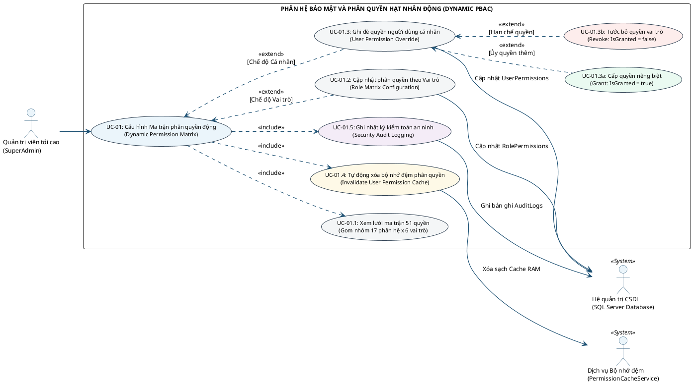
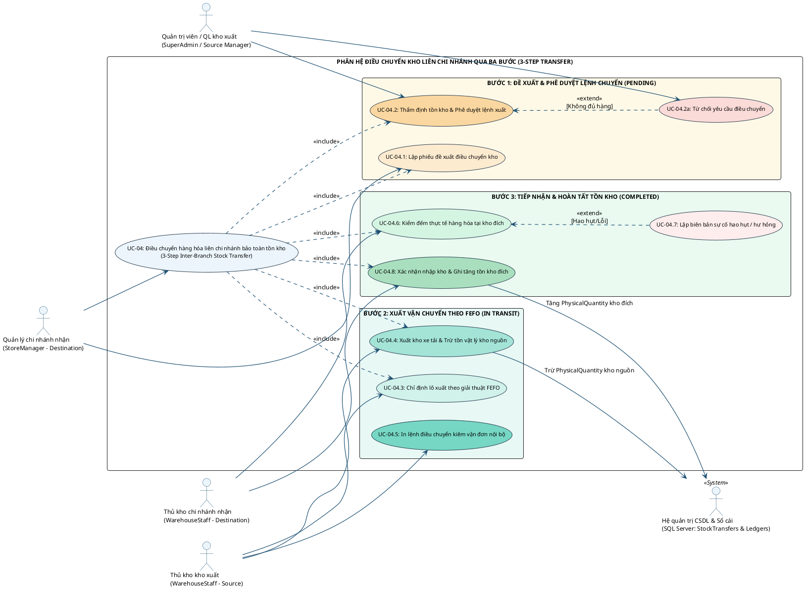
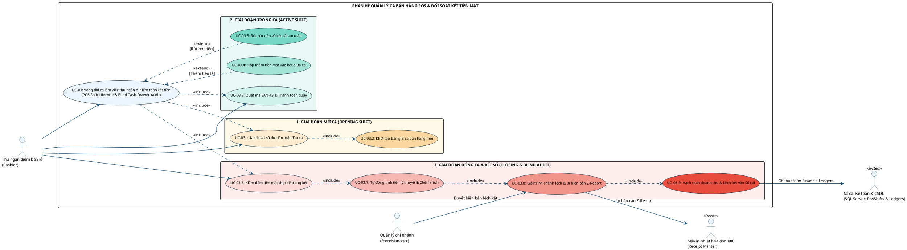
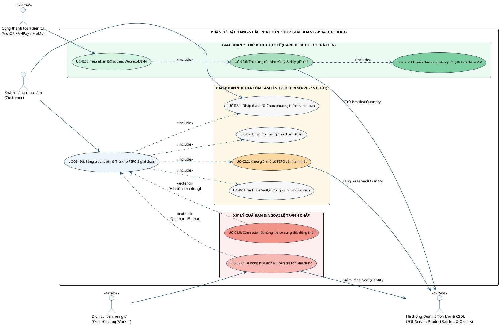
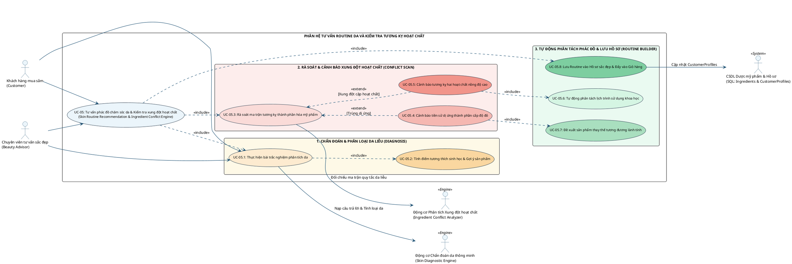
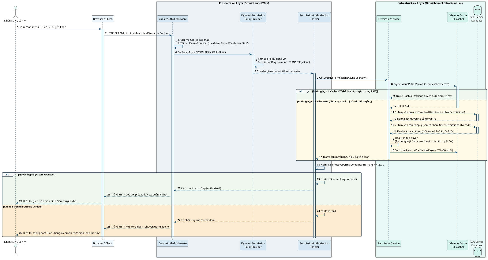
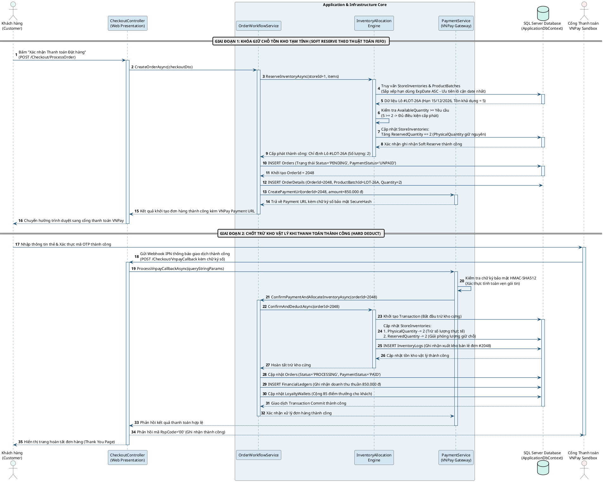
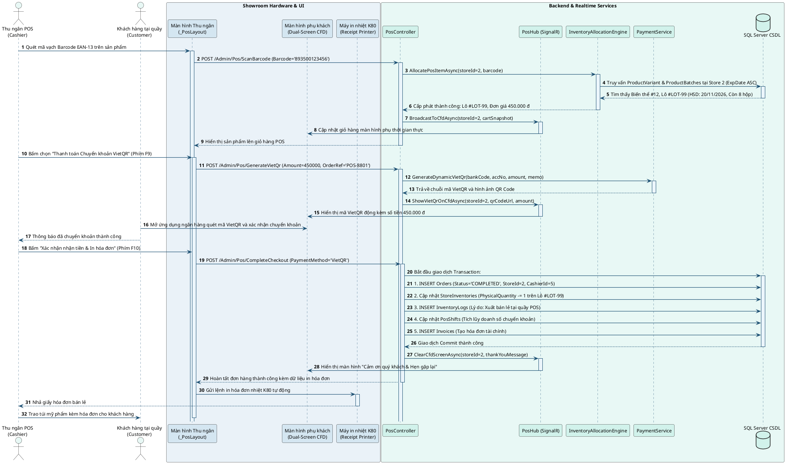
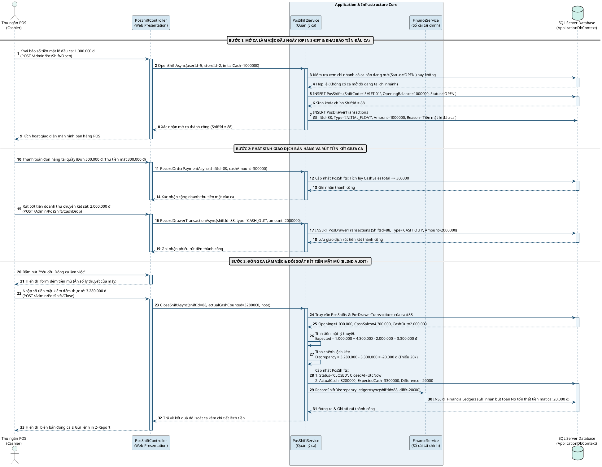

## 2.3. Mô hình hóa nghiệp vụ hướng đối tượng bằng ngôn ngữ mô hình hóa thống nhất UML

### 2.3.1. Mô hình hóa Use Case tổng quát và phân rã theo nhóm phân hệ và tác nhân

Trong kỹ thuật phần mềm hướng đối tượng, biểu đồ ca sử dụng đóng vai trò là công cụ trực quan hóa ranh giới chức năng của hệ thống và các điểm chạm tương tác của từng tác nhân người dùng. Hệ thống OMNI BEAUTY được thiết kế thành một biểu đồ ca sử dụng tổng quát cấp hệ thống và năm biểu đồ ca sử dụng phân rã chi tiết theo từng nhóm phân hệ nghiệp vụ trọng tâm:

#### 1. Sơ đồ 2.4: Biểu đồ Use Case tổng quát của hệ thống OMNI BEAUTY

Biểu đồ Use Case tổng quát bao quát toàn bộ các gói chức năng chính yếu trong hệ thống và phản ánh đầy đủ mối liên kết giữa sáu nhóm tác nhân nội bộ với các ca sử dụng cấp cao:

```plantuml
@startuml Hinh2_2_So_Do_Use_Case_Tong_Quat_Omni_Beauty
left to right direction
skinparam backgroundColor #FFFFFF
skinparam defaultFontName "Times New Roman"
skinparam defaultFontSize 12
skinparam roundCorner 8
skinparam shadowing false
skinparam ArrowColor #1B4F72
skinparam ArrowThickness 1.2
skinparam ActorBorderColor #1B4F72
skinparam ActorBackgroundColor #EBF5FB
skinparam packageStyle rectangle

skinparam usecaseBackgroundColor #F4F6F7
skinparam usecaseBorderColor #2C3E50
skinparam usecaseFontSize 11
skinparam usecaseBorderThickness 1

actor "Quản trị viên tối cao\n(SuperAdmin)" as SuperAdmin
actor "Quản lý chi nhánh\n(StoreManager)" as StoreManager
actor "Thu ngân điểm bán lẻ\n(Cashier)" as Cashier
actor "Nhân viên thủ kho\n(WarehouseStaff)" as WarehouseStaff
actor "Biên tập viên CMS\n(ContentEditor)" as ContentEditor
actor "Khách hàng mua sắm\n(Customer)" as Customer

rectangle "HỆ THỐNG THƯƠNG MẠI ĐIỆN TỬ VÀ BÁN LẺ MỸ PHẨM ĐA KÊNH OMNI BEAUTY" {

    package "1. BÁN LẺ & GIAO DỊCH ĐA KÊNH" #FDEDEC {
        usecase "UC-POS: Quản lý ca bán lẻ & Két tiền mù" as UC_POS
        usecase "UC-ORDER: Xử lý đơn & Cấp phát kho 2 giai đoạn" as UC_ORDER
        usecase "UC-CHECKOUT: Quét mã vạch & Thanh toán đa kênh" as UC_CHECKOUT
    }

    package "2. QUẢN TRỊ KHO & VẬN HÀNH HẠN DÙNG (FEFO)" #FEF9E7 {
        usecase "UC-BATCH: Quản lý Lô NSX & Giám sát FEFO 3 cấp" as UC_BATCH
        usecase "UC-IMPORT: Nhập kho theo PO & In tem mã vạch" as UC_IMPORT
        usecase "UC-TRF: Điều chuyển kho liên chi nhánh 3 bước" as UC_TRF
        usecase "UC-STOCKTAKE: Kiểm kê & Cân bằng tồn tự động" as UC_STOCKTAKE
        usecase "UC-CLEARANCE: Xả kho cận date & Xuất hủy hàng" as UC_CLEARANCE
    }

    package "3. TRẢI NGHIỆM KHÁCH HÀNG & CHĂM SÓC DA (CRM)" #EAFAF1 {
        usecase "UC-SMARTFILTER: Khám phá sản phẩm qua Bộ lọc da" as UC_SMARTFILTER
        usecase "UC-AI: Trắc nghiệm phân tích da & Trợ lý Routine AI" as UC_AI
        usecase "UC-CRM: Quản lý Hồ sơ sắc đẹp & Lịch sử da" as UC_CRM
        usecase "UC-LOYALTY: Ví điểm thưởng & Thăng hạng VIP tự động" as UC_LOYALTY
    }

    package "4. QUẢN TRỊ NỘI DUNG SỐ & TIẾP THỊ (CMS & PROMO)" #F4ECF7 {
        usecase "UC-MENU: Quản trị Cây Menu điều hướng đa hình" as UC_MENU
        usecase "UC-CMS: Biên tập bài viết cẩm nang & Banner sự kiện" as UC_CMS
        usecase "UC-MODERATE: Kiểm duyệt đánh giá & Ảnh swatch thực tế" as UC_MODERATE
        usecase "UC-PROMO: Cấu hình Khuyến mãi, Coupon & Voucher" as UC_PROMO
    }

    package "5. TÀI CHÍNH, BÁO CÁO & GIÁM SÁT TOÀN CHUỖI" #EBF5FB {
        usecase "UC-DASHBOARD: Giám sát Dashboard & Cảnh báo rủi ro AI" as UC_DASHBOARD
        usecase "UC-FINANCE: Hạch toán Sổ cái kép & Đối soát COD/P&L" as UC_FINANCE
        usecase "UC-REPORT: Báo cáo Doanh thu & Tồn kho đa chi nhánh" as UC_REPORT
    }

    package "6. BẢO MẬT & HỆ THỐNG LÕI (PBAC & CORE)" #F2F4F4 {
        usecase "UC-PBAC: Cấu hình Ma trận phân quyền động 51 quyền" as UC_PBAC
        usecase "UC-SETTINGS: Quản lý Người dùng & Cấu hình tham số" as UC_SETTINGS
    }
}

SuperAdmin --> UC_PBAC
SuperAdmin --> UC_SETTINGS
SuperAdmin --> UC_DASHBOARD
SuperAdmin --> UC_FINANCE
SuperAdmin --> UC_REPORT
SuperAdmin --> UC_TRF
SuperAdmin --> UC_PROMO

StoreManager --> UC_POS
StoreManager --> UC_ORDER
StoreManager --> UC_TRF
StoreManager --> UC_STOCKTAKE
StoreManager --> UC_FINANCE
StoreManager --> UC_REPORT
StoreManager --> UC_PROMO

Cashier --> UC_POS
Cashier --> UC_CHECKOUT
Cashier --> UC_ORDER
Cashier --> UC_LOYALTY
Cashier --> UC_CRM

WarehouseStaff --> UC_BATCH
WarehouseStaff --> UC_IMPORT
WarehouseStaff --> UC_TRF
WarehouseStaff --> UC_STOCKTAKE
WarehouseStaff --> UC_CLEARANCE
WarehouseStaff --> UC_REPORT

ContentEditor --> UC_MENU
ContentEditor --> UC_CMS
ContentEditor --> UC_MODERATE

Customer --> UC_SMARTFILTER
Customer --> UC_AI
Customer --> UC_ORDER
Customer --> UC_CHECKOUT
Customer --> UC_CRM
Customer --> UC_LOYALTY
Customer --> UC_MODERATE
@enduml
```

> **[HƯỚNG DẪN CHÈN SƠ ĐỒ 2.4 - BIỂU ĐỒ USE CASE TỔNG QUÁT CỦA HỆ THỐNG OMNI BEAUTY]:**
> - **File ảnh có sẵn trong dự án:** `d:\Lập trình web\OmnichannelBeautySolution\doc\Hinh_2_2_So_Do_Use_Case_Tong_Quat.png`
> - **Cách tự chụp hoặc kết xuất mới:** Chạy kịch bản `generate_plantuml_hinh2_2.js` trong thư mục `doc/` hoặc sử dụng mã PlantUML ở trên để xuất tệp PNG độ phân giải 1920x1080.
> - **Yêu cầu bố cục ảnh:** Đặt ảnh giữa trang văn bản, bảo đảm sáu gói chức năng hiển thị rõ ràng, đường nối giữa các tác nhân và ca sử dụng không bị chồng chéo.
> - **Tên chú thích hình đặt dưới ảnh (Canh giữa, in nghiêng):** *Sơ đồ 2.4: Biểu đồ Use Case tổng quát của hệ thống OMNI BEAUTY*

Biểu đồ Use Case tổng quát thể hiện rõ sự phân định trách nhiệm nghiệp vụ của từng tác nhân theo chuẩn kiến trúc hướng dữ liệu. Tác nhân `SuperAdmin` nắm giữ toàn quyền trên các ca sử dụng quản trị hệ thống lõi, cấu hình phân quyền và giám sát báo cáo tài chính toàn chuỗi. Tác nhân `StoreManager` tập trung vào điều hành chi nhánh, phê duyệt đơn hàng, quản lý ca thu ngân và đề xuất điều chuyển kho. Các tác nhân thừa hành tác nghiệp như `Cashier`, `WarehouseStaff` và `ContentEditor` được phân bổ chính xác vào các ca sử dụng chuyên trách về bán lẻ tại quầy, quản trị kho hàng theo lô và biên tập nội dung số. Tác nhân `Customer` tương tác với các ca sử dụng tiền tuyến từ tìm kiếm sản phẩm, trắc nghiệm da, đặt hàng đến tích lũy điểm thưởng.

---

#### 2. Sơ đồ 2.5: Biểu đồ Use Case phân rã nhóm chức năng Quản trị Bảo mật và Phân quyền Động PBAC

Biểu đồ này phân tích chi tiết ca sử dụng `UC-01` thuộc phân hệ bảo mật, làm rõ cấu trúc phân cấp và mối quan hệ giữa cấu hình ma trận vai trò và ghi đè quyền hạn cá nhân:

> **[HƯỚNG DẪN CHÈN SƠ ĐỒ 2.5 - BIỂU ĐỒ USE CASE PHÂN RÃ NHÓM QUẢN TRỊ BẢO MẬT VÀ PHÂN QUYỀN ĐỘNG PBAC]:**
> - **File ảnh có sẵn trong dự án:** `d:\Lập trình web\OmnichannelBeautySolution\doc\Hinh_2_3_So_Do_Use_Case_Chi_Tiet_UC01.png`
> - **Cách tự tạo ảnh:** Chạy kịch bản `generate_plantuml_hinh2_3.js` trong thư mục `doc/` để kết xuất tệp ảnh PNG chuẩn 1920x1080.
> - **Tên chú thích hình đặt dưới ảnh (Canh giữa, in nghiêng):** *Sơ đồ 2.5: Biểu đồ Use Case phân rã nhóm chức năng Quản trị Bảo mật và Phân quyền Động PBAC*

Trong sơ đồ phân rã trên, ca sử dụng `UC-01` bắt buộc phải bao gồm ba ca sử dụng con thông qua quan hệ `<<include>>`: ca `UC-01.1` nạp lưới ma trận dữ liệu, ca `UC-01.4` làm mới bộ nhớ đệm để quyền hạn mới có hiệu lực tức thời, và ca `UC-01.5` ghi nhận vết kiểm toán an ninh. Hai nhánh nghiệp vụ cấu hình phân quyền theo vai trò `UC-01.2` và ghi đè quyền cá nhân `UC-01.3` mở rộng từ ca chính thông qua quan hệ `<<extend>>`. Đáng chú ý, cơ chế ghi đè cá nhân tiếp tục phân nhánh thành cấp quyền đặc xá `UC-01.3a` và tước bỏ quyền kế thừa `UC-01.3b`, tạo nên sự linh hoạt tuyệt đối trong công tác quản trị nhân sự phân tán.

---

#### 3. Sơ đồ 2.6: Biểu đồ Use Case phân rã nhóm chức năng Quản trị Kho Lô Hạn dùng FEFO và Điều chuyển Liên chi nhánh

Sơ đồ này mô tả chi tiết ca sử dụng `UC-02` và quy trình điều chuyển hàng hóa bảo toàn tồn kho ba bước giữa các chi nhánh:

> **[HƯỚNG DẪN CHÈN SƠ ĐỒ 2.6 - BIỂU ĐỒ USE CASE PHÂN RÃ NHÓM ĐIỀU CHUYỂN KHO LIÊN CHI NHÁNH]:**
> - **File ảnh có sẵn trong dự án:** `d:\Lập trình web\OmnichannelBeautySolution\doc\Hinh_2_4_So_Do_Use_Case_Chi_Tiet_UC02.png`
> - **Cách tự tạo ảnh:** Chạy kịch bản `generate_plantuml_hinh2_4.js` trong thư mục `doc/` để kết xuất tệp ảnh PNG chuẩn 1920x1080.
> - **Tên chú thích hình đặt dưới ảnh (Canh giữa, in nghiêng):** *Sơ đồ 2.6: Biểu đồ Use Case phân rã nhóm chức năng Quản trị Kho Lô Hạn dùng FEFO và Điều chuyển Liên chi nhánh*

Quy trình điều chuyển kho liên chi nhánh thể hiện sự phối hợp chặt chẽ giữa bốn nhóm nhân sự. Ca sử dụng lập đề xuất `UC-04.1` và phê duyệt `UC-04.2` là điều kiện tiên quyết bắt buộc. Nhánh mở rộng `UC-04.2a` xử lý trường hợp kho nguồn không đủ số lượng tồn khả dụng và từ chối lệnh chuyển. Tại bước xuất hàng, ca `UC-04.3` áp dụng thuật toán FEFO để chọn đúng lô cận hạn nhất đưa lên xe vận chuyển. Khi hàng đến nơi, nếu phát sinh sự cố vỡ hỏng trong quá trình chuyên chở, ca mở rộng `UC-04.7` được kích hoạt để ghi nhận hao hụt và hạch toán tổn thất vào sổ cái trước khi ca `UC-04.8` hoàn tất việc ghi tăng tồn kho tại chi nhánh đích.

---

#### 4. Sơ đồ 2.7: Biểu đồ Use Case phân rã nhóm chức năng Bán hàng tại quầy Smart POS và Quản lý Ca thu ngân

Sơ đồ này phân rã toàn bộ chu trình tác nghiệp của nhân viên thu ngân tại Showroom từ mở ca, tính tiền đến đối soát két mù cuối ca:

> **[HƯỚNG DẪN CHÈN SƠ ĐỒ 2.7 - BIỂU ĐỒ USE CASE PHÂN RÃ NHÓM BÁN HÀNG TẠI QUẦY SMART POS VÀ QUẢN LÝ CA THU NGÂN]:**
> - **File ảnh có sẵn trong dự án:** `d:\Lập trình web\OmnichannelBeautySolution\doc\Hinh_2_5_So_Do_Use_Case_Chi_Tiet_UC03.png`
> - **Cách tự tạo ảnh:** Chạy kịch bản `generate_plantuml_hinh2_5.js` trong thư mục `doc/` để kết xuất tệp ảnh PNG chuẩn 1920x1080.
> - **Tên chú thích hình đặt dưới ảnh (Canh giữa, in nghiêng):** *Sơ đồ 2.7: Biểu đồ Use Case phân rã nhóm chức năng Bán hàng tại quầy Smart POS và Quản lý Ca thu ngân*

Chuỗi nghiệp vụ ca bán lẻ bao gồm ba giai đoạn tuần tự khép kín. Giai đoạn mở ca bắt buộc thu ngân phải thực hiện khai báo quỹ tiền thối `UC-03.1`. Trong ca, ngoài việc quét mã tính tiền `UC-03.3`, hệ thống hỗ trợ hai nhánh mở rộng khi có biến động tiền mặt phát sinh là nộp thêm tiền lẻ `UC-03.4` và rút bớt tiền mặt doanh thu về két sắt trung tâm `UC-03.5`. Khi đóng ca, nghiệp vụ kiểm đếm két mù `UC-03.6` được thực hiện hoàn toàn độc lập, hệ thống tự động so khớp để tìm ra độ lệch `UC-03.7`, yêu cầu giải trình và in báo cáo Z-Report `UC-03.8` dưới sự phê duyệt trực tiếp của Quản lý chi nhánh trước khi hạch toán vào sổ cái kế toán `UC-03.9`.

---

#### 5. Sơ đồ 2.8: Biểu đồ Use Case phân rã nhóm chức năng Mua sắm Trực tuyến, Đặt hàng Đa kênh và Thanh toán

Biểu đồ này làm rõ cơ chế đặt hàng trực tuyến kết hợp kỹ thuật cấp phát giữ chỗ tồn kho hai giai đoạn chống bán khống:

> **[HƯỚNG DẪN CHÈN SƠ ĐỒ 2.8 - BIỂU ĐỒ USE CASE PHÂN RÃ NHÓM MUA SẮM TRỰC TUYẾN VÀ ĐẶT HÀNG ĐA KÊNH]:**
> - **File ảnh có sẵn trong dự án:** `d:\Lập trình web\OmnichannelBeautySolution\doc\Hinh_2_6_So_Do_Use_Case_Chi_Tiet_UC04.png`
> - **Cách tự tạo ảnh:** Chạy kịch bản `generate_plantuml_hinh2_6.js` trong thư mục `doc/` để kết xuất tệp ảnh PNG chuẩn 1920x1080.
> - **Tên chú thích hình đặt dưới ảnh (Canh giữa, in nghiêng):** *Sơ đồ 2.8: Biểu đồ Use Case phân rã nhóm chức năng Mua sắm Trực tuyến, Đặt hàng Đa kênh và Thanh toán*

Sơ đồ phân rã ca sử dụng đặt hàng trực tuyến minh họa rõ nét cơ chế phân chia hai giai đoạn nhằm bảo đảm tính toàn vẹn tồn kho. Trong giai đoạn một, khách hàng thực hiện các ca sử dụng bao hàm `<<include>>` từ chọn phương thức thanh toán `UC-02.1`, giữ chỗ mềm lô hàng theo FEFO `UC-02.2` đến sinh mã thanh toán QR động `UC-02.4`. Khi có tín hiệu xác nhận thanh toán từ cổng trung gian kích hoạt ca `UC-02.5`, hệ thống lập tức thực hiện giao dịch trừ kho vật lý `UC-02.6` và tích điểm thưởng `UC-02.7`. Ngược lại, nếu khách hàng không thanh toán sau mười lăm phút hoặc xảy ra xung đột đồng thời khi có người mua trước, các ca mở rộng `UC-02.8` và `UC-02.9` sẽ được kích hoạt để giải phóng lượng giữ chỗ hoặc cảnh báo hết hàng an toàn.

---

#### 6. Sơ đồ 2.9: Biểu đồ Use Case phân rã nhóm chức năng Tư vấn Da AI, Hồ sơ Sắc đẹp CRM và Ví điểm Loyalty

Biểu đồ này phân tích quy trình chẩn đoán da liễu thông minh, rà soát xung đột thành phần và xây dựng chu trình dưỡng da cá nhân hóa:

> **[HƯỚNG DẪN CHÈN SƠ ĐỒ 2.9 - BIỂU ĐỒ USE CASE PHÂN RÃ NHÓM TƯ VẤN DA AI VÀ HỒ SƠ SẮC ĐẸP CRM]:**
> - **File ảnh có sẵn trong dự án:** `d:\Lập trình web\OmnichannelBeautySolution\doc\Hinh_2_7_So_Do_Use_Case_Chi_Tiet_UC05.png`
> - **Cách tự tạo ảnh:** Chạy kịch bản `generate_plantuml_hinh2_7.js` trong thư mục `doc/` để kết xuất tệp ảnh PNG chuẩn 1920x1080.
> - **Tên chú thích hình đặt dưới ảnh (Canh giữa, in nghiêng):** *Sơ đồ 2.9: Biểu đồ Use Case phân rã nhóm chức năng Tư vấn Da AI, Hồ sơ Sắc đẹp CRM và Ví điểm Loyalty*

Biểu đồ trên phản ánh sự kết hợp chặt chẽ giữa tương tác người dùng và các động cơ thuật toán chuyên dụng. Cả khách hàng trực tuyến lẫn chuyên viên tư vấn tại quầy đều có thể khởi tạo bài trắc nghiệm phân tích da `UC-05.1`. Động cơ chẩn đoán tính toán điểm số tương thích sinh học `UC-05.2` và kích hoạt ca rà soát ma trận thành phần `UC-05.3`. Nếu phát hiện thành phần trùng với tiền sử dị ứng đã lưu trong hồ sơ, ca mở rộng `UC-05.4` sẽ cảnh báo và kích hoạt đề xuất hoạt chất thay thế dịu nhẹ `UC-05.7`. Trường hợp phát hiện hai sản phẩm có hoạt chất xung đột nồng độ cao như Retinol và BHA, ca mở rộng `UC-05.5` sẽ tự động kích hoạt ca phân tách lịch trình dưỡng da sáng tối `UC-05.6` trước khi lưu vào hồ sơ sắc đẹp cá nhân `UC-05.8`.

---

### 2.3.2. Đặc tả chi tiết Use Case, Biểu đồ Hoạt động và Biểu đồ Tuần tự cho 4 nghiệp vụ cốt lõi đầu tiên

#### 1. Nghiệp vụ 1 (UC-01 & SD-01): Quản trị Ma trận Phân quyền Động 3 tầng (Dynamic PBAC) và Phân giải quyền hạn khi xử lý yêu cầu HTTP

##### A. Bảng đặc tả chi tiết ca sử dụng UC-01

**Bảng 2.3: Đặc tả chi tiết ca sử dụng UC-01: Quản trị Ma trận phân quyền động 3 tầng (Dynamic PBAC)**

| Mục đặc tả | Nội dung đặc tả chi tiết |
| :--- | :--- |
| **Mã ca sử dụng** | `UC-01` |
| **Tên ca sử dụng** | Quản trị Ma trận Phân quyền Động 3 tầng và Phân giải Quyền hạn Yêu cầu HTTP |
| **Tác nhân chính** | Quản trị viên tối cao (`SuperAdmin`), Người dùng tác nghiệp gửi yêu cầu |
| **Mô tả tóm tắt** | Cho phép Quản trị viên tối cao cấu hình lưới ma trận năm mươi mốt quyền hạn cho sáu vai trò, ghi đè quyền cá nhân cấp hoặc tước quyền, tự động làm mới bộ nhớ đệm phân quyền và thực hiện thẩm định quyền hạn động ba tầng khi có yêu cầu HTTP gửi đến hệ thống. |
| **Tiền điều kiện** | Tác nhân quản trị đã đăng nhập thành công vào hệ thống bằng tài khoản có vai trò `SuperAdmin` và sở hữu phiên làm việc hợp lệ trong Cookie `OmniBeauty.Admin.Session`. |
| **Hậu điều kiện** | Ma trận quyền hạn mới được lưu vĩnh viễn vào các bảng `RolePermissions` hoặc `UserPermissions`, bộ nhớ đệm quyền hạn của các tài khoản bị ảnh hưởng bị xóa ngay lập tức, và bản ghi kiểm toán được tạo lập trong bảng `AuditLogs`. |
| **Luồng sự kiện chính (Main Flow)** | 1. Quản trị viên truy cập vào phân hệ Quản lý Phân quyền tại đường dẫn `/Admin/PermissionManagement`. 2. Hệ thống kiểm tra quyền `PERM:SECURITY:MANAGE`, truy vấn danh mục năm mươi mốt quyền hạn nguyên tử chia theo mười bảy phân hệ và hiển thị lưới ma trận quyền hạn. 3. Quản trị viên lựa chọn chế độ phân quyền theo Vai trò hoặc chọn một nhân viên cụ thể để cấu hình ghi đè quyền cá nhân. 4. Quản trị viên thực hiện tích chọn hoặc bỏ chọn các ô quyền hạn tương ứng trên giao diện. 5. Quản trị viên bấm nút "Lưu thay đổi ma trận phân quyền". 6. Hệ thống mở một giao dịch cơ sở dữ liệu `IDbContextTransaction`, cập nhật các bản ghi trong bảng `RolePermissions` hoặc `UserPermissions`. 7. Hệ thống gọi phương thức xóa khóa bộ nhớ đệm `IMemoryCache` tương ứng với mã người dùng bị tác động. 8. Hệ thống tự động ghi nhật ký kiểm toán vào bảng `AuditLogs` lưu vết chi tiết danh sách quyền vừa thay đổi. 9. Hệ thống hoàn tất giao dịch và hiển thị thông báo cập nhật thành công trên giao diện. |
| **Luồng rẽ nhánh / Ngoại lệ (Alternative / Exception Flows)** | - **Rẽ nhánh 3a (Ghi đè quyền cá nhân):** Nếu Quản trị viên chọn một nhân sự cụ thể, hệ thống hiển thị trạng thái ba mức cho từng quyền: Kế thừa theo vai trò, Cấp quyền đặc xá (`IsGranted = true`), hoặc Tước bỏ quyền (`IsGranted = false`). - **Ngoại lệ 6a (Lỗi kết nối CSDL):** Nếu quá trình lưu dữ liệu thất bại, hệ thống tự động hoàn tác giao dịch `Rollback`, không xóa bộ nhớ đệm và hiển thị thông báo lỗi hệ thống cho quản trị viên. - **Ngoại lệ 7a (Truy cập trái phép):** Nếu một người dùng không có quyền truy cập gửi yêu cầu HTTP đến một tài nguyên được bảo vệ, hệ thống chặn lại tại tầng xử lý ủy quyền và chuyển hướng về trang thông báo lỗi 403 Forbidden. |
| **Quy tắc nghiệp vụ (Business Rules)** | - `BR-PBAC-01`: Vai trò `SuperAdmin` mặc định sở hữu toàn bộ năm mươi mốt quyền hạn mà không cần kiểm tra cơ sở dữ liệu. - `BR-PBAC-02`: Thứ tự ưu tiên phân giải quyền khi xử lý yêu cầu HTTP: Quyền tối cao SuperAdmin -> Quyền ghi đè cá nhân trong `UserPermissions` -> Quyền kế thừa từ vai trò trong `RolePermissions`. Luật cấm (`IsGranted = false`) có mức ưu tiên tuyệt đối phủ quyết quyền kế thừa từ vai trò. - `BR-PBAC-03`: Thời gian sống của bộ nhớ đệm quyền hạn người dùng trên RAM là ba mươi phút, nhưng bắt buộc phải bị xóa tức thời khi có thao tác cập nhật quyền từ Quản trị viên. |
| **Yêu cầu đặc biệt** | Thời gian phân giải quyền hạn động tại tầng Middleware đối với các yêu cầu đã lưu trong bộ nhớ đệm RAM phải đạt dưới một mili giây. |

##### B. Biểu đồ tuần tự SD-01: Luồng phân giải quyền động ba tầng khi xử lý yêu cầu HTTP

Dưới đây là sơ đồ tuần tự mô tả chi tiết các bước tương tác giữa các thành phần phần mềm từ trình duyệt máy khách qua các tầng của Clean Architecture để thẩm định quyền hạn người dùng:

> **[HƯỚNG DẪN CHÈN HÌNH 3.1 - SƠ ĐỒ TUẦN TỰ XỬ LÝ LUỒNG PHÂN GIẢI QUYỀN HẠN ĐỘNG PBAC KHI XỬ LÝ YÊU CẦU HTTP]:**
> - **File ảnh có sẵn trong dự án:** `d:\Lập trình web\OmnichannelBeautySolution\doc\Hinh_3_1_So_Do_Tuan_Tu_SD01.png`
> - **Cách tự tạo ảnh:** Chạy kịch bản `generate_plantuml_sd01.js` trong thư mục `doc/` để kết xuất tệp ảnh PNG độ phân giải cao 1920x1080.
> - **Tên chú thích hình đặt dưới ảnh (Canh giữa, in nghiêng):** *Hình 3.1: Sơ đồ tuần tự xử lý luồng xác thực đăng nhập và cấp phát quyền hạn động PBAC (SD-01)*

##### C. Phân tích chuyên sâu cơ chế kiểm soát dữ liệu tại tầng Backend

Cơ chế phân quyền PBAC của hệ thống OMNI BEAUTY giải quyết triệt để bài toán phân quyền cứng nhắc của mô hình phân quyền theo vai trò truyền thống RBAC. Trong thực tế quản trị chuỗi bán lẻ, luôn có những tình huống ngoại lệ phát sinh: một nhân viên có vai trò Thu ngân `Cashier` tại Showroom Cầu Giấy trong thời gian người quản lý đi vắng cần được Ban Giám đốc tạm thời giao thêm quyền duyệt kiểm kê kho, nhưng doanh nghiệp không thể nâng vai trò của nhân viên đó lên làm Quản lý `StoreManager` vì sẽ làm lộ toàn bộ dữ liệu tài chính nhạy cảm khác.

Để giải quyết bài toán này, hệ thống hiện thực hóa thuật toán hòa trộn quyền ba tầng trong dịch vụ `PermissionService`. Khi một yêu cầu HTTP gửi đến, hệ thống kiểm tra danh tính người dùng:
- Tầng thứ nhất kiểm tra vai trò: Nếu người dùng mang vai trò `SuperAdmin`, thuật toán lập tức cấp quyền thông qua mà không cần truy vấn bất kỳ bảng quyền hạn nào, bảo đảm quản trị viên tối cao luôn duy trì quyền kiểm soát hệ thống.
- Tầng thứ hai truy vấn quyền vai trò: Đối với các nhân sự khác, hệ thống kết nối bảng `UserRoles` với `RolePermissions` để thu thập danh sách các quyền hạn cơ sở mà vai trò của người dùng được phép thực thi.
- Tầng thứ ba áp dụng luật ghi đè cá nhân: Hệ thống truy vấn bảng `UserPermissions` theo mã định danh `UserId`. Nếu một quyền hạn có bản ghi ghi đè với cờ `IsGranted = true`, quyền đó sẽ được nạp bổ sung vào danh sách quyền dù vai trò gốc không có. Ngược lại, nếu bản ghi ghi đè có cờ `IsGranted = false`, quyền hạn đó sẽ bị loại bỏ ngay lập tức khỏi danh sách quyền dù vai trò gốc của người đó đang sở hữu quyền này.

Để tránh việc phải truy vấn cơ sở dữ liệu liên tục trong mọi yêu cầu HTTP làm quá tải máy chủ SQL Server, toàn bộ tập hợp quyền hạn hữu hiệu sau khi tính toán được lưu trữ trên bộ nhớ RAM máy chủ thông qua giao diện `IMemoryCache` dưới dạng một cấu trúc bảng băm `HashSet<string>` với khóa băm duy nhất `UserPerms:{UserId}` và thời gian sống là ba mươi phút. Khi Quản trị viên thực hiện bất kỳ thay đổi nào trên ma trận quyền, dịch vụ `PermissionService` sẽ lập tức gọi phương thức xóa bỏ khóa tương ứng khỏi bộ nhớ đệm và cập nhật dấu tem an ninh `SecurityStamp` trong bảng `Users`. Nhờ đó, trong lần gửi yêu cầu tiếp theo, hệ thống sẽ tự động phát hiện bộ nhớ đệm bị thiếu và tiến hành nạp lại tập quyền mới nhất từ cơ sở dữ liệu, bảo đảm tính tức thời tuyệt đối trong việc thu hồi quyền hạn nhân sự.

---

#### 2. Nghiệp vụ 2 (UC-02 & SD-02): Đặt hàng trực tuyến và Cấp phát – Trừ tồn kho 2 giai đoạn theo thuật toán FEFO

##### A. Bảng đặc tả chi tiết ca sử dụng UC-02

**Bảng 2.4: Đặc tả chi tiết ca sử dụng UC-02: Đặt hàng trực tuyến và Cấp phát – Trừ tồn kho 2 giai đoạn theo FEFO**

| Mục đặc tả | Nội dung đặc tả chi tiết |
| :--- | :--- |
| **Mã ca sử dụng** | `UC-02` |
| **Tên ca sử dụng** | Đặt hàng trực tuyến và Cấp phát – Trừ tồn kho 2 giai đoạn theo thuật toán FEFO |
| **Tác nhân chính** | Khách hàng mua sắm (`Customer`), Cổng thanh toán trực tuyến (`VNPay`), Dịch vụ nền (`OrderCleanupWorker`) |
| **Mô tả tóm tắt** | Cho phép khách hàng đặt mua mỹ phẩm trực tuyến, hệ thống tự động định tuyến kho, áp dụng thuật toán FEFO để chọn đúng lô hàng có hạn sử dụng gần nhất, thực hiện khóa giữ chỗ mềm hai giai đoạn chống bán khống, và tự động trừ kho cứng khi thanh toán thành công. |
| **Tiền điều kiện** | Khách hàng đã chọn các sản phẩm vào giỏ hàng, giỏ hàng có số lượng sản phẩm lớn hơn không và các sản phẩm đã vượt qua bài kiểm tra tương kỵ hoạt chất an toàn. |
| **Hậu điều kiện** | Đơn hàng mới được tạo lập ở trạng thái Chờ xử lý, số lượng tồn kho vật lý của lô hàng tương ứng bị trừ chính xác trong bảng `StoreInventories`, số lượng giữ chỗ được giải phóng, và lịch sử xuất kho được ghi vào `InventoryLogs`. |
| **Luồng sự kiện chính (Main Flow)** | 1. Khách hàng truy cập trang thanh toán `/Checkout`, nhập địa chỉ giao hàng hoặc chọn nhận hàng trực tiếp tại Showroom Cầu Giấy hay Showroom Quận 1. 2. Khách hàng chọn phương thức thanh toán qua cổng VNPay và bấm nút "Xác nhận đặt hàng". 3. Bộ điều khiển `CheckoutController` chuyển giao thông tin sang dịch vụ `OrderWorkflowService`. 4. Dịch vụ gọi động cơ `InventoryAllocationEngine` thực hiện Giai đoạn 1 (Soft Reserve): truy vấn bảng `ProductBatches` lấy các lô còn hạn dùng an toàn lớn hơn ba mươi ngày, sắp xếp tăng dần theo `ExpDate`. 5. Hệ thống kiểm tra số lượng khả dụng `GetAvailableQuantity()`: nếu đủ hàng, hệ thống tăng trường số lượng giữ chỗ `ReservedQuantity` tương ứng trên bản ghi `StoreInventories` và tạo đơn hàng với trạng thái `PENDING`, trạng thái thanh toán `UNPAID`. 6. Hệ thống tạo đường dẫn thanh toán qua cổng VNPay kèm chữ ký số bảo mật HMAC-SHA512 và chuyển hướng trình duyệt của khách sang giao diện thanh toán của ngân hàng. 7. Khách hàng thực hiện xác thực giao dịch và thanh toán thành công trên cổng VNPay. 8. Cổng VNPay gửi thông báo Webhook IPN kèm kết quả giao dịch về máy chủ hệ thống OMNI BEAUTY. 9. Hệ thống xác thực tính hợp lệ của chữ ký số điện tử và kích hoạt Giai đoạn 2 (Hard Deduct): mở giao dịch cơ sở dữ liệu, trừ số lượng tồn kho vật lý `PhysicalQuantity`, giảm số lượng giữ chỗ `ReservedQuantity`, chuyển trạng thái đơn hàng sang `PROCESSING` và trạng thái thanh toán sang `PAID`. 10. Hệ thống tích điểm thưởng thành viên vào bảng `LoyaltyWallets`, ghi bút toán doanh thu vào sổ cái `FinancialLedgers` và gửi thông báo qua SignalR đến quản trị viên. |
| **Luồng rẽ nhánh / Ngoại lệ (Alternative / Exception Flows)** | - **Rẽ nhánh 4a (Không đủ tồn khả dụng):** Nếu một mặt hàng trong giỏ không đủ số lượng khả dụng tại chi nhánh đã chọn, hệ thống từ chối tạo đơn và thông báo rõ tên sản phẩm kèm số lượng tối đa còn có thể mua. - **Ngoại lệ 8a (Khách hàng hủy thanh toán hoặc quá hạn 15 phút):** Nếu sau mười lăm phút kể từ khi tạo đơn mà cổng thanh toán không nhận được tiền, dịch vụ nền `OrderCleanupWorker` tự động quét thấy đơn hàng quá hạn, thực hiện chuyển trạng thái đơn sang `CANCELLED` và tự động giảm trường `ReservedQuantity` để hoàn trả số lượng khả dụng về cho kho. - **Ngoại lệ 9a (Xung đột đồng thời RowVersion):** Nếu trong tích tắc trừ kho có giao dịch khác thay đổi bản ghi trước, hệ thống phát hiện xung đột phiên bản, tự động tải lại số dư và kiểm tra lại điều kiện xuất hàng an toàn. |
| **Quy tắc nghiệp vụ (Business Rules)** | - `BR-FEFO-01`: Tuyệt đối không phân bổ các lô mỹ phẩm có số ngày sử dụng còn lại dưới ba mươi ngày (`ExpDate - UtcNow < 30 days`) cho các đơn hàng bán lẻ thông thường. - `BR-FEFO-02`: Thứ tự ưu tiên cấp phát lô hàng luôn tuân thủ nghiêm ngặt theo `ExpDate ASC`. Trường hợp hai lô có cùng hạn sử dụng thì ưu tiên lô có số lượng tồn ít hơn để dọn sạch khoảng trống kệ kho. - `BR-FEFO-03`: Thời gian khóa giữ chỗ mềm tối đa của một đơn hàng trực tuyến là mười lăm phút. Hết thời gian này hệ thống bắt buộc phải giải phóng lượng giữ chỗ. |
| **Yêu cầu đặc biệt** | Toàn bộ thao tác kiểm tra tồn kho và tăng số lượng giữ chỗ mềm ở giai đoạn một phải hoàn tất trong thời gian dưới ba trăm mili giây để không làm gián đoạn trải nghiệm thanh toán của khách hàng. |

##### B. Biểu đồ tuần tự SD-02: Luồng đặt hàng trực tuyến và cấp phát tồn kho 2 giai đoạn theo FEFO

Sơ đồ dưới đây mô tả chi tiết thông điệp trao đổi giữa Khách hàng, Trình điều phối đơn hàng, Động cơ kho FEFO, Cơ sở dữ liệu và Cổng thanh toán VNPay qua hai giai đoạn:

> **[HƯỚNG DẪN CHÈN HÌNH 3.2 - SƠ ĐỒ TUẦN TỰ XỬ LÝ LUỒNG ĐẶT HÀNG TRỰC TUYẾN VÀ CẤP PHÁT TỒN KHO THEO LÔ FEFO]:**
> - **File ảnh có sẵn trong dự án:** `d:\Lập trình web\OmnichannelBeautySolution\doc\Hinh_3_2_So_Do_Tuan_Tu_SD02.png`
> - **Cách tự tạo ảnh:** Chạy kịch bản `generate_plantuml_sd02.js` trong thư mục `doc/` để kết xuất tệp ảnh PNG độ phân giải cao 1920x1080.
> - **Tên chú thích hình đặt dưới ảnh (Canh giữa, in nghiêng):** *Hình 3.2: Sơ đồ tuần tự xử lý luồng đặt hàng trực tuyến và khóa giữ chỗ tồn kho theo lô FEFO (SD-02)*

##### C. Phân tích chuyên sâu cơ chế kiểm soát dữ liệu tại tầng Backend

Cơ chế cấp phát tồn kho hai giai đoạn kết hợp thuật toán FEFO trong giải pháp OMNI BEAUTY được cài đặt tại lớp `InventoryAllocationEngine` thuộc tầng Infrastructure. Đây là trái tim điều phối chuỗi cung ứng của toàn bộ hệ thống, giải quyết triệt để hai bài toán nhức nhối nhất trong bán lẻ mỹ phẩm: bài toán bán khống tồn kho và bài toán tồn đọng lô hàng cận hạn.

Về mặt giải thuật chọn lô, khi nhận được yêu cầu cấp phát cho một sản phẩm tại một chi nhánh cụ thể, động cơ không truy vấn số lượng tồn tổng hợp mà thực hiện câu lệnh truy vấn có chỉ mục phân nhóm trên bảng `StoreInventories` kết hợp bảng `ProductBatches`:
- Điều kiện thứ nhất lọc bỏ toàn bộ các lô hàng có trạng thái không hoạt động hoặc có ngày hết hạn `ExpDate` trừ đi thời gian hiện tại `DateTime.UtcNow` nhỏ hơn ba mươi ngày. Quy tắc này ngăn chặn tuyệt đối việc hệ thống vô tình bán các sản phẩm cận hạn nguy hiểm cho khách hàng trực tuyến.
- Điều kiện thứ hai sắp xếp các lô hàng thỏa mãn theo thứ tự ngày hết hạn tăng dần `ExpDate ASC`. Lô nào có ngày hết hạn gần nhất sẽ nằm ở đầu danh sách để được ưu tiên bóc tách số lượng trước.
- Thuật toán duyệt qua từng lô, tính toán số lượng khả dụng của lô đó bằng công thức `GetAvailableQuantity() = PhysicalQuantity - ReservedQuantity`. Nếu số lượng khả dụng của lô đầu tiên đủ đáp ứng số lượng đặt mua, hệ thống gán toàn bộ số lượng vào lô đó. Trường hợp lô đầu tiên chỉ còn số lượng ít hơn yêu cầu, hệ thống sẽ thực hiện bóc tách một phần từ lô đầu tiên và tự động chuyển sang bóc tách phần còn thiếu từ lô tiếp theo trong danh sách.

Về cơ chế hai giai đoạn, ở giai đoạn một khi đơn hàng vừa được khởi tạo, hệ thống chỉ tăng trường `ReservedQuantity` mà tuyệt đối không trừ trường `PhysicalQuantity`. Điều này phản ánh chính xác thực tế nghiệp vụ: hàng hóa vẫn đang nằm trên giá kệ của chi nhánh, nhưng đã có người đặt cọc giữ chỗ trên mạng trong mười lăm phút. Khách hàng khác khi duyệt website sẽ thấy số lượng có thể mua bị giảm đi, triệt tiêu nguy cơ hai người cùng tranh chấp một sản phẩm. Khi cổng thanh toán xác thực giao dịch thành công, giai đoạn hai được kích hoạt: hệ thống trừ đồng thời cả `PhysicalQuantity` và `ReservedQuantity` trong một khối giao dịch an toàn. Trường kiểm soát phiên bản `RowVersion` trong bảng `StoreInventories` bảo đảm rằng nếu có bất kỳ luồng giao dịch nào khác cố tình can thiệp vào số lượng tồn kho trong cùng một phần triệu giây, hệ thống sẽ phát hiện xung đột và xử lý hoàn tác an toàn, bảo vệ tính toàn vẹn tuyệt đối cho dữ liệu kho vận.

---

#### 3. Nghiệp vụ 3 (UC-03 & SD-03): Bán hàng tại quầy Smart POS, Đồng bộ màn hình phụ khách hàng, Xác thực đơn O2O Click & Collect và Thanh toán VietQR tự động in hóa đơn

##### A. Bảng đặc tả chi tiết ca sử dụng UC-03

**Bảng 2.5: Đặc tả chi tiết ca sử dụng UC-03: Bán hàng tại quầy Smart POS và đồng bộ thanh toán màn hình phụ**

| Mục đặc tả | Nội dung đặc tả chi tiết |
| :--- | :--- |
| **Mã ca sử dụng** | `UC-03` |
| **Tên ca sử dụng** | Bán hàng tại quầy Smart POS, Đồng bộ Màn hình phụ CFD và Thanh toán VietQR |
| **Tác nhân chính** | Nhân viên thu ngân (`Cashier`), Khách hàng mua sắm tại quầy (`Customer`), Máy in nhiệt K80 |
| **Mô tả tóm tắt** | Cho phép thu ngân thực hiện quét mã vạch sản phẩm, hệ thống tự động gán lô xuất theo FEFO tại kho chi nhánh, đồng bộ danh sách hàng hóa và mã VietQR thanh toán sang màn hình phụ hướng về khách hàng qua SignalR, xác thực đơn O2O nhận tại quầy, và tự động in hóa đơn nhiệt khi thanh toán thành công. |
| **Tiền điều kiện** | Thu ngân đã đăng nhập hệ thống, đã thực hiện mở ca làm việc hợp lệ trong ngày tại chi nhánh và đang ở giao diện bán lẻ `_PosLayout`. |
| **Hậu điều kiện** | Đơn hàng bán lẻ và hóa đơn bán hàng được tạo lập, số lượng tồn kho vật lý của lô hàng xuất bán bị trừ tức thì, doanh số tiền mặt hoặc chuyển khoản được cộng dồn vào ca làm việc hiện tại, và hóa đơn nhiệt K80 được in ra. |
| **Luồng sự kiện chính (Main Flow)** | 1. Khách hàng mang các sản phẩm mỹ phẩm đã chọn đến quầy thu ngân của Showroom. 2. Thu ngân sử dụng máy quét mã vạch quét mã EAN-13 trên vỏ hộp sản phẩm hoặc gõ từ khóa tìm kiếm trên thanh công cụ POS. 3. Hệ thống tiếp nhận mã vạch, tự động truy vấn tìm đúng biến thể sản phẩm `ProductVariant`, kiểm tra tồn kho tại chi nhánh hiện tại và tự động áp dụng thuật toán FEFO để chọn lô có hạn dùng gần nhất. 4. Món hàng cùng đơn giá và số lượng được thêm vào giỏ hàng POS của thu ngân, đồng thời một thông điệp WebSocket qua SignalR Hub được phát tức thời sang màn hình phụ CFD để khách hàng đối chiếu thông tin. 5. Thu ngân nhập số điện thoại của khách hàng để tra cứu hồ sơ thành viên VIP, hệ thống tự động hiển thị số điểm thưởng hiện có và mức chiết khấu thành viên được hưởng. 6. Thu ngân chọn hình thức thanh toán: nếu khách chọn Chuyển khoản, thu ngân bấm phím tắt F9, hệ thống kích hoạt dịch vụ `PaymentService` sinh chuỗi mã VietQR động theo chuẩn Napas247 nhúng sẵn số tiền cần trả và mã đơn hàng. 7. Mã VietQR lập tức xuất hiện nổi bật trên màn hình phụ CFD trước mặt khách hàng. 8. Khách hàng mở ứng dụng ngân hàng quét mã và xác nhận chuyển khoản. 9. Thu ngân nhận được thông báo tiền về tài khoản cửa hàng, bấm phím tắt F10 "Hoàn tất thanh toán". 10. Hệ thống mở giao dịch cơ sở dữ liệu: tạo bản ghi `Orders` với trạng thái `COMPLETED`, trừ tồn kho vật lý `PhysicalQuantity` theo đúng lô FEFO đã chỉ định, tạo bản ghi hóa đơn `Invoices`, cộng tích lũy doanh số vào ca làm việc `PosShifts`, và gửi lệnh in hóa đơn nhiệt K80 đến máy in tại quầy. |
| **Luồng rẽ nhánh / Ngoại lệ (Alternative / Exception Flows)** | - **Rẽ nhánh 2a (Xử lý đơn O2O Click & Collect):** Khách hàng đọc mã đơn hàng đã đặt trước trên mạng để nhận tại quầy, thu ngân nhập mã đơn, hệ thống hiển thị kiện hàng đã được giữ chỗ sẵn, thu ngân bàn giao hàng và bấm xác nhận hoàn tất đơn O2O. - **Rẽ nhánh 6a (Thanh toán tiền mặt):** Nếu khách trả tiền mặt, thu ngân nhập số tiền khách đưa, hệ thống tự động tính số tiền thừa phải thối lại và hiển thị lên màn hình phụ CFD. - **Ngoại lệ 3a (Hết hàng tại chi nhánh):** Nếu sản phẩm quét mã đã hết tồn kho vật lý tại Showroom hiện tại, hệ thống phát âm thanh cảnh báo lỗi và hiển thị gợi ý các chi nhánh khác trong chuỗi đang còn hàng để tư vấn cho khách. |
| **Quy tắc nghiệp vụ (Business Rules)** | - `BR-POS-01`: Bắt buộc phải có một ca làm việc `PosShift` đang ở trạng thái `OPEN` tại chi nhánh thì giao diện POS mới cho phép thực hiện thanh toán. - `BR-POS-02`: Lô hàng xuất bán tại quầy POS bắt buộc phải là lô có hạn dùng gần nhất hiện có trong kho của chính chi nhánh đó theo nguyên tắc FEFO. - `BR-POS-03`: Mọi giao dịch thanh toán thành công tại quầy POS đều phải lập tức trừ tồn kho vật lý thực tế mà không trải qua bước giữ chỗ tạm tính. |
| **Yêu cầu đặc biệt** | Tốc độ quét mã vạch và kết xuất thông tin món hàng lên cả hai màn hình thu ngân và màn hình phụ khách hàng phải đạt dưới hai trăm mili giây. |

##### B. Biểu đồ tuần tự SD-03: Luồng bán hàng tại quầy POS và thanh toán VietQR động

Sơ đồ tuần tự dưới đây mô tả chi tiết quy trình bán hàng tại quầy thu ngân kết hợp đồng bộ màn hình phụ khách hàng qua SignalR và thanh toán mã phản hồi nhanh VietQR:

> **[HƯỚNG DẪN CHÈN SƠ ĐỒ 2.12 - SƠ ĐỒ TUẦN TỰ XỬ LÝ LUỒNG BÁN HÀNG TẠI QUẦY POS VÀ THANH TOÁN VIETQR ĐỘNG (SD-03)]:**
> - **Mã nguồn vẽ sơ đồ:** Sao chép đoạn mã PlantUML ở trên vào công cụ PlantUML để xuất ra tệp ảnh PNG độ phân giải cao 1920x1080.
> - **Cách chèn vào tài liệu:** Căn giữa hình ảnh trên trang văn bản, bảo đảm thể hiện rõ ràng luồng tương tác giữa màn hình thu ngân và màn hình phụ khách hàng CFD qua SignalR.
> - **Tên chú thích hình đặt dưới ảnh (Canh giữa, in nghiêng):** *Sơ đồ 2.12: Sơ đồ tuần tự xử lý luồng bán hàng tại quầy POS và thanh toán VietQR động (SD-03)*

##### C. Phân tích chuyên sâu cơ chế kiểm soát dữ liệu tại tầng Backend

Phân hệ quầy thu ngân Smart POS được thiết kế theo mô hình kiến trúc công thái học kết hợp cơ chế truyền thông hai chiều thời gian thực thông qua kênh `PosHub` của SignalR. Đây là điểm chạm có tần suất phát sinh giao dịch cao nhất trong toàn bộ chuỗi bán lẻ, đòi hỏi khả năng xử lý bất đồng bộ và kiểm soát dữ liệu nghiêm ngặt:

Khi thu ngân quét một mã vạch sản phẩm, yêu cầu được gửi bất đồng bộ về bộ điều khiển `PosController`. Tại đây, hệ thống không chỉ kiểm tra mã vạch trong bảng danh mục biến thể `ProductVariants` mà còn tự động trích xuất mã định danh chi nhánh `StoreId` từ phiên làm việc của thu ngân. Dịch vụ `InventoryAllocationEngine` lập tức thực hiện truy vấn các lô hàng hiện có tại chính chi nhánh đó, áp dụng giải thuật FEFO để gán lô có hạn sử dụng gần nhất vào dòng hóa đơn. Việc gán lô diễn ra hoàn toàn tự động ở tầng Backend, loại bỏ hoàn toàn khả năng nhân viên thu ngân chọn sai lô hoặc gian lận xuất lô mới để giữ lại lô cũ.

Đặc biệt, hệ thống giải quyết bài toán minh bạch giao dịch và thanh toán nhanh không tiền mặt thông qua màn hình phụ CFD. Mỗi khi giỏ hàng của thu ngân có biến động thêm bớt món hàng, bộ điều khiển triệu gọi phương thức phát sóng `BroadcastToCfdAsync` trên `PosHub`. SignalR sẽ lọc đúng nhóm máy trạm đăng ký kênh của chi nhánh đó và đẩy một gói tin JSON chứa toàn bộ danh sách sản phẩm, đơn giá và tổng tiền sang màn hình phụ của khách hàng. Khi thu ngân kích hoạt phương thức thanh toán VietQR, dịch vụ `PaymentService` áp dụng thuật toán sinh chuỗi dữ liệu chuẩn EMVCo của Napas247, kết hợp mã định danh ngân hàng, số tài khoản thụ hưởng của công ty, số tiền chính xác đến từng đồng và nội dung chuyển khoản được mã hóa từ mã hóa đơn. Mã QR động này xuất hiện ngay lập tức trên màn hình phụ, khách hàng chỉ việc mở ứng dụng ngân hàng quét mã mà không cần phải gõ tay số tài khoản hay số tiền, giảm thiểu một trăm phần trăm các sai sót chuyển nhầm tiền và rút ngắn thời gian thanh toán một đơn hàng trực tiếp xuống dưới bốn mươi lăm giây.

---

#### 4. Nghiệp vụ 4 (UC-04 & SD-04): Quản lý Vòng đời Ca thu ngân POS và Kiểm toán – Đối soát Két tiền mặt

##### A. Bảng đặc tả chi tiết ca sử dụng UC-04

**Bảng 2.6: Đặc tả chi tiết ca sử dụng UC-04: Quản lý Vòng đời ca thu ngân và kiểm toán két tiền mặt**

| Mục đặc tả | Nội dung đặc tả chi tiết |
| :--- | :--- |
| **Mã ca sử dụng** | `UC-04` |
| **Tên ca sử dụng** | Quản lý Vòng đời Ca thu ngân POS và Kiểm toán – Đối soát Két tiền mặt |
| **Tác nhân chính** | Nhân viên thu ngân (`Cashier`), Quản lý chi nhánh (`StoreManager`) |
| **Mô tả tóm tắt** | Quản lý toàn diện chu trình một ca làm việc của thu ngân từ khi mở ca khai báo số dư đầu ca, theo dõi các giao dịch nộp rút tiền mặt giữa ca, thực hiện kiểm đếm thực tế két mù cuối ca, tự động đối soát chênh lệch thừa thiếu, lập biên bản giải trình và hạch toán vào sổ cái kế toán. |
| **Tiền điều kiện** | Thu ngân đã đăng nhập vào hệ thống bằng tài khoản được cấp quyền `PERM:POS:SHIFT`, tại chi nhánh hiện tại không có ca làm việc nào khác đang ở trạng thái mở `OPEN`. |
| **Hậu điều kiện** | Ca làm việc được chuyển sang trạng thái đã đóng `CLOSED`, số liệu chênh lệch két tiền được lưu vào bảng `PosShifts`, các phiếu giao dịch két được lưu vào `PosDrawerTransactions`, và bút toán chênh lệch được hạch toán vào `FinancialLedgers`. |
| **Luồng sự kiện chính (Main Flow)** | 1. Đầu ca làm việc, thu ngân truy cập vào phân hệ quản lý ca tại đường dẫn `/Admin/PosShift/Open`. 2. Thu ngân đếm số tiền mặt lẻ có sẵn trong ngăn kéo két do ca trước bàn giao và nhập vào ô "Số tiền mặt đầu ca" (ví dụ: một triệu đồng). 3. Hệ thống kiểm tra điều kiện an toàn, tạo một bản ghi ca làm việc mới trong bảng `PosShifts` với trạng thái `OPEN` và tự động ghi một phiếu giao dịch khởi tạo quỹ trong bảng `PosDrawerTransactions`. 4. Trong suốt ca làm việc, hệ thống tự động cộng dồn doanh thu bán hàng thu bằng tiền mặt vào trường `CashSalesTotal`. 5. Khi phát sinh nhu cầu nộp thêm tiền lẻ hoặc rút bớt tiền mặt gửi vào két sắt an toàn, thu ngân thực hiện lập phiếu nộp rút tiền mặt trên hệ thống kèm lý do rõ ràng. 6. Đến cuối ca làm việc, thu ngân bấm nút "Đóng ca làm việc". 7. Giao diện đóng ca hiển thị bảng kiểm đếm tiền mặt thực tế: hệ thống cố tình ẩn giấu toàn bộ các con số doanh thu lý thuyết để thực hiện nguyên tắc kiểm toán két mù. 8. Thu ngân đếm thực tế từng loại mệnh giá tiền mặt có trong két và nhập tổng số tiền thực đếm vào hệ thống. 9. Hệ thống tự động áp dụng công thức cân đối tài chính để tính toán số tiền mặt lý thuyết phải có trong két và đối chiếu với số tiền thực đếm để xác định độ lệch. 10. Hệ thống hiển thị kết quả đối soát: nếu khớp đúng, ca làm việc được đóng thành công; nếu có chênh lệch thừa hoặc thiếu, hệ thống bắt buộc thu ngân phải nhập nội dung giải trình nguyên nhân chênh lệch. 11. Quản lý chi nhánh kiểm tra thực tế, ký duyệt biên bản kiểm toán trên hệ thống, ca làm việc chính thức chuyển sang trạng thái `CLOSED` và tự động in báo cáo Z-Report ra máy in nhiệt. |
| **Luồng rẽ nhánh / Ngoại lệ (Alternative / Exception Flows)** | - **Ngoại lệ 3a (Chi nhánh đã có ca đang mở):** Nếu tại chi nhánh đã có một ca làm việc khác chưa đóng, hệ thống từ chối mở ca mới và yêu cầu thu ngân liên hệ người ca trước hoàn tất đóng ca. - **Rẽ nhánh 5a (Rút tiền mặt khẩn cấp):** Khi số tiền mặt tích lũy trong két vượt định mức bảo hiểm cho phép (trên mười lăm triệu đồng), hệ thống hiển thị cảnh báo yêu cầu thu ngân thực hiện giao dịch rút tiền mặt `Cash OUT` chuyển vào két sắt trung tâm để giảm thiểu rủi ro cướp giật. - **Ngoại lệ 10a (Lệch két vượt ngưỡng cho phép):** Nếu số tiền chênh lệch thừa hoặc thiếu vượt quá năm trăm nghìn đồng, hệ thống tự động kích hoạt gửi thông báo khẩn cấp qua SignalR đến tài khoản của Quản trị viên tối cao `SuperAdmin` để thanh tra giám sát. |
| **Quy tắc nghiệp vụ (Business Rules)** | - `BR-SHIFT-01`: Tại một thời điểm, mỗi Showroom chi nhánh chỉ được phép duy nhất một ca bán lẻ ở trạng thái mở `OPEN`. - `BR-SHIFT-02`: Công thức tính số tiền mặt lý thuyết trong két: `ExpectedCashBalance = OpeningBalance + CashSalesTotal + CashInTotal - CashOutTotal - CashRefundTotal`. - `BR-SHIFT-03`: Công thức tính độ lệch két tiền: `DiscrepancyAmount = ActualCashCounted - ExpectedCashBalance`. Nếu kết quả dương là thừa tiền két, nếu kết quả âm là thiếu tiền két, bằng không là cân đối tuyệt đối. - `BR-SHIFT-04`: Mọi khoản chênh lệch két tiền mặt khi đóng ca đều bắt buộc phải được hạch toán vào sổ cái tài chính `FinancialLedgers` dưới dạng khoản thu nhập khác nếu thừa tiền hoặc chi phí tổn thất vận hành nếu thiếu tiền. |
| **Yêu cầu đặc biệt** | Quy trình kiểm đếm két tiền cuối ca bắt buộc phải tuân thủ nghiêm ngặt nguyên tắc kiểm đếm mù: giao diện nhập liệu tuyệt đối không được để lộ con số tiền mặt lý thuyết trước khi thu ngân hoàn tất việc nhập số tiền thực đếm. |

##### B. Biểu đồ tuần tự SD-04: Luồng quản lý vòng đời ca thu ngân và đối soát két tiền mặt

Sơ đồ dưới đây mô tả chi tiết quy trình vòng đời của ca bán lẻ từ khi mở ca khai báo số dư đầu ca, ghi nhận giao dịch giữa ca cho đến khi kiểm toán két mù và đóng ca:

> **[HƯỚNG DẪN CHÈN HÌNH 3.4 - SƠ ĐỒ TUẦN TỰ XỬ LÝ LUỒNG KIỂM TOÁN VÀ ĐỐI SOÁT KÉT TIỀN MẶT KHI KẾT THÚC CA LÀM VIỆC (SD-04)]:**
> - **File ảnh có sẵn trong dự án:** `d:\Lập trình web\OmnichannelBeautySolution\doc\Hinh_3_3_So_Do_Tuan_Tu_SD03.png`
> - **Cách tự tạo ảnh:** Chạy kịch bản `generate_plantuml_sd03.js` trong thư mục `doc/` để kết xuất tệp ảnh PNG độ phân giải cao 1920x1080.
> - **Tên chú thích hình đặt dưới ảnh (Canh giữa, in nghiêng):** *Hình 3.4: Sơ đồ tuần tự xử lý luồng kiểm toán và đối soát két tiền mặt khi kết thúc ca làm việc (SD-04)*

##### C. Phân tích chuyên sâu cơ chế kiểm soát dữ liệu tại tầng Backend

Quy trình quản lý ca làm việc và đối soát két tiền mặt của giải pháp OMNI BEAUTY được thiết kế dựa trên các nguyên tắc kế toán tài chính doanh nghiệp khắt khe, giải quyết triệt để vấn đề gian lận hoặc thất thoát tiền mặt thường gặp tại các cửa hàng bán lẻ trực tiếp:

Trọng tâm kỹ thuật của phân hệ này nằm ở phương pháp kiểm toán két mù được hiện thực hóa trong dịch vụ `PosShiftService`. Trong các phần mềm bán hàng thông thường, giao diện đóng ca thường hiển thị sẵn con số tổng doanh số tiền mặt mà phần mềm đã ghi nhận được trong ca. Cách làm này tạo ra kẽ hở cho sự thiếu trung thực: nhân viên thu ngân có thể nhìn vào con số lý thuyết đó để điều chỉnh số tiền kiểm đếm thực tế cho khớp đúng, hoặc cố tình rút bớt tiền thừa nếu thấy số tiền mặt thực tế trong két nhiều hơn số tiền trên máy mà không khai báo.

Để triệt tiêu kẽ hở này, hệ thống OMNI BEAUTY che giấu hoàn toàn các trường dữ liệu `CashSalesTotal` và `ExpectedCashBalance` trên giao diện người dùng khi thu ngân bấm nút yêu cầu đóng ca. Thu ngân chỉ nhìn thấy các ô trống để nhập số lượng tờ tiền của từng loại mệnh giá từ năm trăm nghìn đồng đến một nghìn đồng. Khi thu ngân bấm nút nộp số liệu kiểm đếm thực tế `ActualCashCounted`, toàn bộ logic so khớp được thực hiện ngầm tại tầng Backend:
- Hệ thống áp dụng công thức cân đối dòng tiền chuẩn mực: `ExpectedCashBalance = OpeningBalance + CashSalesTotal + CashInTotal - CashOutTotal - CashRefundTotal`.
- Độ lệch két tiền được xác định bằng phép trừ đại số: `DiscrepancyAmount = ActualCashCounted - ExpectedCashBalance`.
- Nếu kết quả trả về bằng không, hệ thống ghi nhận ca làm việc cân đối hoàn hảo. Nếu kết quả âm, hệ thống ghi nhận tình trạng thiếu tiền két và bắt buộc thu ngân phải nhập văn bản giải trình nguyên nhân (ví dụ: thối nhầm tiền cho khách). Nếu kết quả dương, hệ thống ghi nhận tình trạng thừa tiền két.

Toàn bộ các chỉ số kiểm toán này được lưu vĩnh viễn vào bảng `PosShifts`. Đồng thời, một sự kiện miền nội bộ được kích hoạt để gọi dịch vụ `FinanceService` tự động hạch toán khoản chênh lệch vào sổ cái tài chính `FinancialLedgers`: khoản tiền thiếu được ghi nhận vào tài khoản chi phí tổn thất vận hành của chi nhánh, trong khi khoản tiền thừa được ghi nhận vào tài khoản thu nhập bất thường. Nhờ sự kiểm soát khép kín này, người quản lý chi nhánh và ban giám đốc có thể nắm bắt chính xác mức độ trung thực và tính chuẩn xác của từng nhân viên thu ngân qua từng ca làm việc, bảo vệ tuyệt đối an toàn dòng tiền mặt cho chuỗi cửa hàng OMNI BEAUTY.
