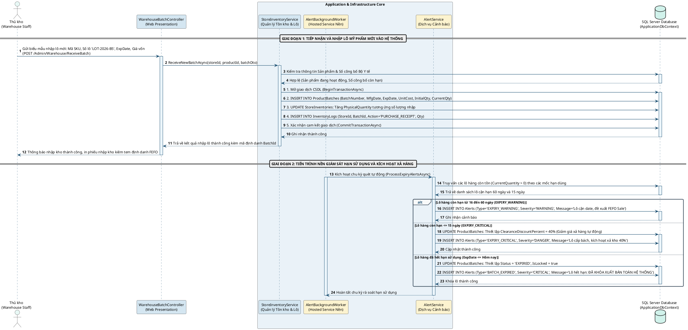
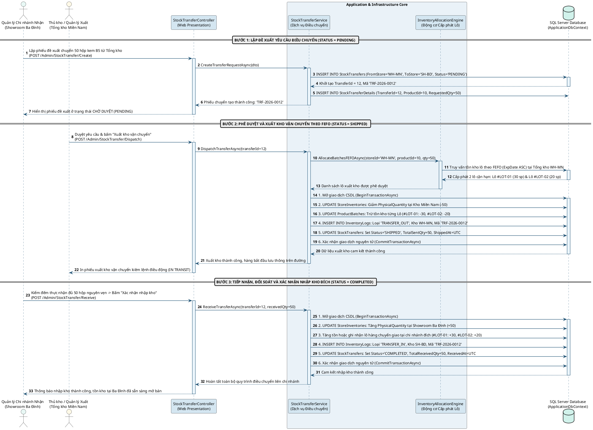
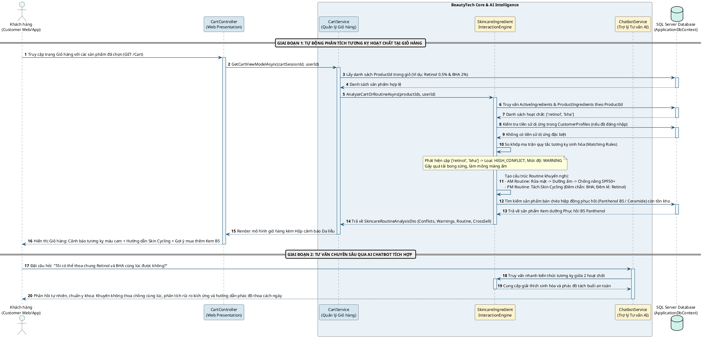
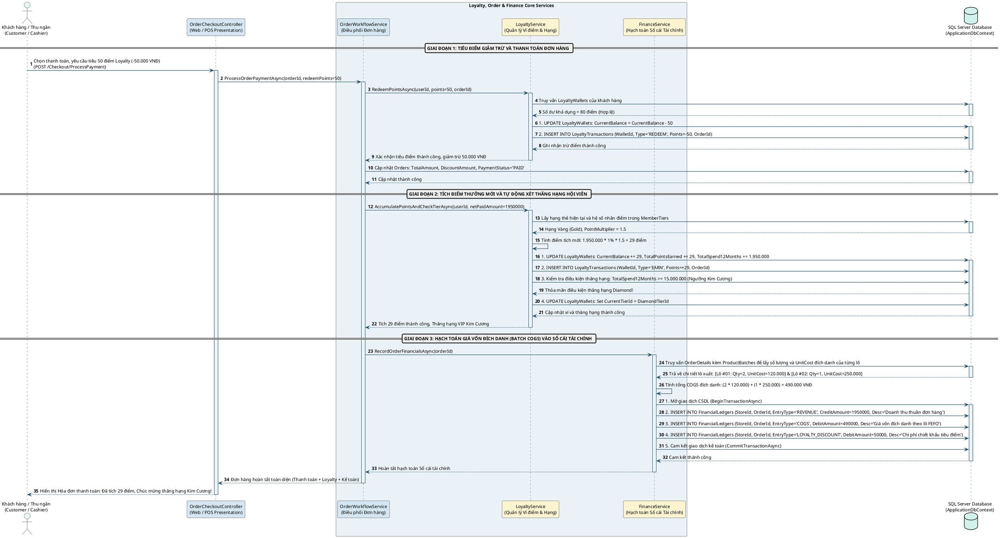

### 2.3.3. Đặc tả chi tiết Use Case, Biểu đồ Tuần tự và Thiết kế Backend cho các nghiệp vụ cốt lõi (Phần 2: Nghiệp vụ 5 đến Nghiệp vụ 8)

Tiếp nối bốn nghiệp vụ nền tảng đã trình bày, phần này đi sâu phân tích và mô hình hóa bốn nghiệp vụ chuyên sâu mang tính đặc thù cao của ngành bán lẻ mỹ phẩm chuỗi và thương mại điện tử hợp nhất CANMAKE BEAUTY. Các nghiệp vụ này bao gồm: Quản lý nhập lô mỹ phẩm gắn liền hạn sử dụng FEFO và định giá xả hàng tự động; Quy trình điều chuyển hàng hóa liên chi nhánh ba bước bảo toàn tổng tồn kho; Phòng thí nghiệm da liễu kiểm tra tương kỵ hóa học hoạt chất giỏ hàng kết hợp tư vấn AI; và cuối cùng là Hệ thống tích điểm thăng hạng hội viên song hành cùng cơ chế kế toán hạch toán giá vốn hàng bán đích danh theo từng lô sản phẩm.

---

#### 2.3.3.5. Nghiệp vụ 5: Nhập lô mỹ phẩm mới vào kho, Giám sát hạn sử dụng FEFO và Định giá xả hàng cận date tự động (UC-05 & SD-05)

Ngành bán lẻ mỹ phẩm chịu sự chi phối ngặt nghèo của Thông tư 06/2011/TT-BYT do Bộ Y tế ban hành. Mỗi sản phẩm lưu hành trên thị trường bắt buộc phải có Số tiếp nhận Phiếu công bố sản phẩm mỹ phẩm, đồng thời phải được quản lý chặt chẽ theo từng số lô sản xuất và hạn dùng. Mỹ phẩm cận date hoặc hết hạn sử dụng không chỉ gây thiệt hại về tài chính nếu phải tiêu hủy mà còn tiềm ẩn nguy cơ gây kích ứng da nghiêm trọng cho người tiêu dùng nếu để thất thoát ra quầy bán lẻ. Vì vậy, nghiệp vụ UC-05 kết hợp giữa quy trình nhập kho chặt chẽ tại tầng giao diện với tiến trình dịch vụ nền `AlertBackgroundWorker` nhằm liên tục rà soát tuổi thọ sản phẩm, cảnh báo sớm và tự động kích hoạt chiến lược giảm giá thanh lý theo cơ chế FEFO (First Expired, First Out).

**Bảng 2.7: Bảng đặc tả Use Case UC-05 – Nhập lô mỹ phẩm mới, Giám sát FEFO và Định giá xả hàng cận date**

| STT | Thuộc tính đặc tả | Nội dung chi tiết |
| :--- | :--- | :--- |
| 1 | **Tên Use Case** | Nhập lô mỹ phẩm mới vào kho, Giám sát hạn sử dụng FEFO và Định giá xả hàng tự động (UC-05). |
| 2 | **Tác nhân chính (Actors)** | Thủ kho Tổng kho / Showroom, Quản trị viên Vận hành Hệ thống, Hệ thống tiến trình nền tự động (`AlertBackgroundWorker`). |
| 3 | **Mục đích (Goal)** | Tiếp nhận hàng hóa mỹ phẩm từ nhà cung cấp, kiểm tra pháp lý số công bố mỹ phẩm, nhập số lô, ngày sản xuất, hạn sử dụng và giá vốn đơn vị vào hệ thống; đồng thời kích hoạt cơ chế tự động quét date, phân tầng cảnh báo và định mức chiết khấu xả hàng cận date bảo đảm nguyên tắc FEFO. |
| 4 | **Tiền điều kiện (Preconditions)** | 1. Thủ kho đã đăng nhập tài khoản hợp lệ có quyền `Inventory.Receive` và `ProductBatch.Create` trong phân quyền PBAC. 2. Danh mục sản phẩm cha đã tồn tại trong bảng `Products` và nhà cung cấp đã có thông tin trong bảng `Suppliers`. |
| 5 | **Hậu điều kiện (Postconditions)** | 1. Bản ghi lô sản phẩm mới được tạo lập trong bảng `ProductBatches` với đầy đủ số lô, ngày sản xuất, hạn sử dụng, số lượng ban đầu và giá vốn đơn vị. 2. Số lượng tồn kho vật lý tại chi nhánh tương ứng trong bảng `StoreInventories` tăng lên. 3. Bản ghi nhật ký kho được lưu vết chi tiết trong bảng `InventoryLogs` với loại giao dịch `PURCHASE_RECEIPT`. 4. Tiến trình nền giám sát hạn sử dụng nhận diện lô mới để đưa vào chu kỳ quét cảnh báo định kỳ. |
| 6 | **Luồng sự kiện chính (Basic Flow)** | 1. Thủ kho chọn chức năng Tiếp nhận hàng nhập kho trên Cổng Quản trị Kho vận. 2. Thủ kho tìm kiếm sản phẩm theo mã SKU hoặc quét mã vạch EAN-13, chọn Nhà cung cấp và nhập Số hóa đơn/chứng từ giao hàng. 3. Thủ kho đối chiếu hồ sơ pháp lý, kiểm tra Số phiếu công bố mỹ phẩm in trên bao bì thực tế so với dữ liệu trên hệ thống. 4. Thủ kho nhập Số lô sản xuất (BatchNumber), Ngày sản xuất (MfgDate), Hạn sử dụng (ExpDate), Số lượng nhập (Quantity) và Đơn giá vốn nhập kho (UnitCost). 5. Thủ kho bấm nút "Xác nhận nhập kho". 6. Hệ thống thực thi giao dịch cơ sở dữ liệu nguyên tử: Tạo mới bản ghi trong `ProductBatches`, cập nhật tăng trường `PhysicalQuantity` trong `StoreInventories` của kho nhận, và ghi nhật ký kiểm toán vào bảng `InventoryLogs`. 7. Hệ thống hiển thị thông báo nhập kho thành công kèm mã phiếu nhập, đồng thời tự động in Phiếu nhập kho kiêm nhãn vạch định danh vị trí kệ hàng. |
| 7 | **Luồng sự kiện rẽ nhánh (Alternative Flow)** | - *Lô hàng đã từng tồn tại trong hệ thống (A1):* Nếu số lô nhập trùng với một lô đã có trong cơ sở dữ liệu của sản phẩm đó, hệ thống yêu cầu thủ kho kiểm tra lại hạn sử dụng. Nếu cùng hạn dùng, hệ thống cộng dồn số lượng vào lô hiện hữu; nếu khác hạn dùng, hệ thống phát cảnh báo sai lệch dữ liệu nhà sản xuất và yêu cầu kiểm tra thực tế. - *Tiến trình nền quét cận date (A2):* Hàng ngày, tiến trình `AlertBackgroundWorker` quét toàn bộ bảng `ProductBatches`. Khi phát hiện lô hàng chạm ngưỡng 60 ngày đến hạn sử dụng, hệ thống chuyển cảnh báo sang mức `EXPIRY_WARNING` và hiển thị đề xuất chương trình FEFO Sale trên Dashboard; khi chạm ngưỡng 15 ngày, hệ thống gán nhãn `EXPIRY_CRITICAL` và tự động cập nhật trường `ClearanceDiscountPercent` lên mức chiết khấu thanh lý từ 30% đến 50%. |
| 8 | **Luồng ngoại lệ (Exception Flow)** | - *Hạn sử dụng không hợp lệ (E1):* Nếu hạn sử dụng nhỏ hơn hoặc bằng ngày hiện tại hoặc thời hạn sử dụng còn lại dưới 90 ngày tại thời điểm nhập kho, hệ thống từ chối ghi nhận và phát thông báo vi phạm chính sách nhập khẩu mỹ phẩm. - *Số phiếu công bố hết hiệu lực (E2):* Nếu số công bố mỹ phẩm của sản phẩm đã hết hạn 5 năm theo quy định Bộ Y tế, hệ thống cảnh báo đỏ và khóa chức năng nhập kho cho đến khi Quản trị viên cập nhật số công bố gia hạn mới. |
| 9 | **Quy tắc nghiệp vụ liên quan** | - BR-FEFO-01: Nguyên tắc xuất kho bán hàng tại Showroom và đóng gói đơn Online bắt buộc ưu tiên lô có hạn dùng gần nhất (ExpDate nhỏ nhất) còn nguyên vẹn chất lượng. - BR-EXP-02: Lô hàng khi quá hạn sử dụng (ExpDate <= Ngày hiện tại) lập tức bị tiến trình nền chuyển cờ trạng thái sang `EXPIRED`, tự động khóa cứng chức năng xuất bán trên toàn bộ quầy POS và cổng Web E-Commerce. |
| 10 | **Yêu cầu giao diện & Dữ liệu** | Biểu mẫu nhập lô hỗ trợ phím tắt, trường chọn ngày tháng trực quan, hiển thị trực tiếp số ngày sử dụng còn lại (Shelf-life days) tính theo thời gian thực để hỗ trợ thủ kho ra quyết định tiếp nhận. |

Dưới đây là mã mô hình hóa biểu đồ tuần tự biểu diễn toàn diện chu trình sống của một lô mỹ phẩm từ khi nhập kho, qua khâu giám sát cảnh báo hạn dùng của tiến trình nền, đến việc tự động khóa cứng khi chạm hạn sử dụng.

> **[HƯỚNG DẪN CHÈN SƠ ĐỒ 2.14 - BIỂU ĐỒ TUẦN TỰ SD-05 NHẬP LÔ VÀ GIÁM SÁT HẠN SỬ DỤNG FEFO]**
> - **Vị trí chèn:** Ngay sau đoạn phân tích quy trình nghiệp vụ UC-05.
> - **Nguồn hình ảnh:** Sinh viên render từ đoạn mã PlantUML phía trên thành file ảnh `Hinh_2_14_So_Do_Tuan_Tu_SD05.png` và lưu trữ tại thư mục `d:\Lập trình web\OmnichannelBeautySolution\doc\Hinh_2_14_So_Do_Tuan_Tu_SD05.png`.
> - **Tiêu đề hình:** *Sơ đồ 2.14: Biểu đồ tuần tự nghiệp vụ Nhập lô mỹ phẩm, Giám sát hạn dùng FEFO và Định giá xả hàng cận date tự động.*

**Phân tích kỹ thuật tầng xử lý Backend và cơ sở dữ liệu nghiệp vụ 5:**

Cơ chế quản trị tồn kho mỹ phẩm của hệ thống CANMAKE BEAUTY được thiết kế phân tầng rõ rệt giữa hai thực thể `ProductBatches` (quản lý thông tin nguồn gốc, hạn dùng và giá vốn) và `StoreInventories` (quản lý vị trí địa lý và biến động số lượng vật lý theo từng điểm bán). Trong phương thức `ReceiveNewBatchAsync`, hệ thống bao bọc toàn bộ chuỗi thao tác ghi dữ liệu vào một giao dịch nguyên tử `BeginTransactionAsync`. Khi một lô mới được tạo, trường `UnitCost` được chốt cứng đại diện cho giá vốn đích danh của lô hàng đó. Đây là thông số tối quan trọng để phục vụ việc tính toán giá vốn hàng bán chính xác ở phân hệ tài chính mà không bị sai lệch bởi phương pháp bình quân gia quyền.

Điểm sáng tạo cốt lõi trong phân hệ quản lý kho là tiến trình `AlertBackgroundWorker` kế thừa `BackgroundService` của .NET 8, chạy ngầm định kỳ bằng cơ chế `PeriodicTimer`. Dịch vụ này không can thiệp trực tiếp vào giao dịch của người dùng để tránh nghẽn cổ chai cơ sở dữ liệu mà hoạt động hoàn toàn bất đồng bộ. Mỗi ngày một lần vào lúc 02:00 sáng, tiến trình kích hoạt hàm `ProcessExpiryAlertsAsync` trong `AlertService`. Thuật toán thực hiện tính toán khoảng cách thời gian giữa ngày hết hạn của từng lô với ngày hiện tại bằng biểu thức `(pb.ExpDate.Date - today).TotalDays`. Nếu thời gian còn lại rơi vào khoảng từ 16 đến 60 ngày, hệ thống tạo bản ghi cảnh báo `EXPIRY_WARNING` nhằm khuyến nghị nhân viên lập kế hoạch trưng bày sản phẩm ra các vị trí bắt mắt tại Showroom hoặc chạy chiến dịch flash-sale trực tuyến. Khi thời gian còn lại dưới 15 ngày, mức độ nguy hiểm chuyển thành `EXPIRY_CRITICAL`, hệ thống tự động gán giá trị chiết khấu thanh lý vào trường `ClearanceDiscountPercent` trong bảng `ProductBatches`. Nhờ vậy, khi khách hàng truy cập website hoặc thu ngân tra cứu mã hàng tại POS, giá bán tự động được khấu trừ theo tỷ lệ khuyến mãi cận date này mà không cần quản trị viên phải can thiệp thủ công. Đặc biệt, nếu phát hiện lô có `ExpDate <= today`, cờ trạng thái của lô bị chuyển tức thì sang `EXPIRED`. Mọi câu lệnh truy vấn tồn kho khả dụng tại `StoreInventoryService` đều có điều kiện chặn cứng `pb.Status != "EXPIRED"`, loại bỏ hoàn toàn khả năng bán nhầm mỹ phẩm quá hạn ra thị trường.

---

#### 2.3.3.6. Nghiệp vụ 6: Điều chuyển hàng hóa liên chi nhánh ba bước bảo toàn tổng tồn kho (UC-06 & SD-06)

Trong chuỗi bán lẻ đa chi nhánh, nhu cầu điều phối hàng hóa giữa Tổng kho trung tâm và các Showroom bán lẻ, hoặc giữa hai Showroom lân cận nhau nhằm giải quyết bài toán lệch tồn kho cục bộ là diễn ra thường nhật. Nếu quy trình điều chuyển chỉ ghi nhận bằng một thao tác xuất kho đơn lẻ, hệ thống sẽ rơi vào trạng thái mất dấu dòng hàng khi xe tải đang trên đường di chuyển, tạo ra lỗ hổng lớn gây thất thoát hàng hóa mỹ phẩm giá trị cao. Do đó, nghiệp vụ UC-06 thiết lập cỗ máy trạng thái ba bước nghiêm ngặt: Lập đề xuất chuyển kho (`PENDING`), Xuất kho vận chuyển (`SHIPPED` / `IN_TRANSIT`), và Xác nhận tiếp nhận nhập kho đích (`COMPLETED`).

**Bảng 2.8: Bảng đặc tả Use Case UC-06 – Điều chuyển hàng hóa liên chi nhánh ba bước bảo toàn tồn kho**

| STT | Thuộc tính đặc tả | Nội dung chi tiết |
| :--- | :--- | :--- |
| 1 | **Tên Use Case** | Điều chuyển hàng hóa liên chi nhánh ba bước bảo toàn tổng tồn kho (UC-06). |
| 2 | **Tác nhân chính (Actors)** | Quản lý Chi nhánh Nhận hàng (Cửa hàng đích), Thủ kho Chi nhánh Xuất hàng (Kho nguồn / Tổng kho), Hệ thống điều chuyển tự động (`StockTransferService`). |
| 3 | **Mục đích (Goal)** | Thực hiện quy trình luân chuyển hàng hóa mỹ phẩm giữa hai điểm bán hoặc từ kho tổng về cửa hàng một cách an toàn, minh bạch, bảo đảm tổng lượng hàng trên toàn chuỗi luôn được bảo toàn và số liệu lô xuất tuân thủ nghiêm ngặt nguyên tắc FEFO. |
| 4 | **Tiền điều kiện (Preconditions)** | 1. Quản lý chi nhánh nhận và thủ kho xuất đều có tài khoản đã xác thực với vai trò tương ứng. 2. Kho xuất có đủ lượng tồn kho khả dụng cho các sản phẩm yêu cầu điều chuyển. |
| 5 | **Hậu điều kiện (Postconditions)** | 1. Trạng thái phiếu điều chuyển chuyển dịch tuần tự: `PENDING` -> `SHIPPED` -> `COMPLETED`. 2. Lượng tồn kho tại kho xuất giảm đi và lượng tồn kho tại kho nhận tăng lên tương ứng. 3. Bản ghi nhật ký kho `InventoryLogs` được ghi nhận đối ứng cho cả hai đầu kho: mã `TRANSFER_OUT` tại kho xuất và mã `TRANSFER_IN` tại kho nhận. 4. Lô hàng chuyển giao giữ nguyên số lô, hạn dùng và giá vốn gốc. |
| 6 | **Luồng sự kiện chính (Basic Flow)** | 1. Quản lý chi nhánh nhận nhận thấy mặt hàng kem chống nắng hoặc serum B5 sắp hết hàng tại showroom, truy cập phân hệ Quản lý Điều chuyển và lập phiếu yêu cầu chuyển hàng từ Kho tổng. 2. Hệ thống tạo phiếu chuyển với mã duy nhất (ví dụ: `TRF-2026-0012`) ở trạng thái `PENDING`. 3. Thủ kho tại Kho tổng tiếp nhận yêu cầu, kiểm tra số lượng và bấm "Xuất kho vận chuyển". 4. Động cơ phân bổ lô `InventoryAllocationEngine` tự động tìm kiếm các lô hàng của sản phẩm có hạn dùng gần nhất (FEFO) tại kho xuất để gắn vào chi tiết phiếu chuyển. 5. Hệ thống thực thi giao dịch trừ số lượng vật lý `PhysicalQuantity` tại kho xuất, trừ số lượng tồn của từng lô tương ứng trong `ProductBatches`, ghi log `TRANSFER_OUT` và đổi trạng thái phiếu sang `SHIPPED`. Hàng bắt đầu lưu thông trên đường. 6. Đơn vị vận chuyển giao hàng tới cửa hàng đích. Quản lý chi nhánh đích mở thùng hàng, quét mã kiểm đếm thực tế đối chiếu với danh sách lô trên phiếu chuyển. 7. Nếu số lượng thực nhận khớp hoàn toàn với số lượng gửi, Quản lý chi nhánh đích bấm nút "Xác nhận nhập kho". 8. Hệ thống kích hoạt giao dịch nhập kho: tăng `PhysicalQuantity` tại kho nhận, ghi nhận số lượng tồn lô mỹ phẩm tại điểm bán mới theo đúng hạn dùng gốc, ghi log `TRANSFER_IN` và chuyển trạng thái phiếu sang `COMPLETED`. Toàn bộ quy trình hoàn tất. |
| 7 | **Luồng sự kiện rẽ nhánh (Alternative Flow)** | - *Từ chối yêu cầu điều chuyển (A1):* Tại Bước 3, nếu Kho tổng nhận thấy tồn kho không đủ hoặc đang chuẩn bị chạy chiến dịch tại chỗ, thủ kho có thể bấm "Từ chối" kèm lý do. Phiếu chuyển chuyển sang trạng thái `REJECTED`, chi nhánh nhận được gửi thông báo phản hồi. - *Tiếp nhận có sai lệch hoặc hàng vỡ hỏng do vận chuyển (A2):* Tại Bước 6, nếu thủ kho phát hiện thiếu hụt hoặc sản phẩm bị vỡ hỏng trong quá trình chuyên chở, người nhận nhập số lượng thực nhận nhỏ hơn số lượng gửi và chọn lý do sai lệch. Hệ thống chỉ nhập kho số lượng nguyên vẹn, đồng thời tự động tạo một biên bản thất thoát tài chính chuyển sang phân hệ kế toán để làm việc với đơn vị vận chuyển đền bù. |
| 8 | **Luồng ngoại lệ (Exception Flow)** | - *Xung đột đồng thời tồn kho xuất (E1):* Trong khoảng thời gian từ lúc tạo đề xuất đến lúc xuất hàng, nếu lượng tồn tại kho xuất bị bán hết cho các đơn hàng POS khác, hệ thống sẽ phát hiện số lượng khả dụng không đủ khi bấm Dispatch và báo lỗi dừng giao dịch. - *Cố tình xác nhận hai lần (E2):* Nếu quản lý chi nhánh nhận bấm nút xác nhận nhiều lần, khóa lạc quan `RowVersion` và kiểm tra trạng thái phiếu sẽ chặn đứng các yêu cầu kế tiếp, tránh việc cộng tồn kho hai lần. |
| 9 | **Quy tắc nghiệp vụ liên quan** | - BR-TRF-01: Tuyệt đối không cho phép cộng tồn kho tại chi nhánh nhận khi chi nhánh xuất chưa bấm Dispatch (ngăn chặn tình trạng ghi nhận ảo tồn kho trước khi hàng thực xuất). - BR-TRF-02: Việc cấp phát lô mỹ phẩm điều chuyển bắt buộc phải lấy từ các lô có hạn dùng gần nhất còn hạn sử dụng tối thiểu 120 ngày theo nguyên tắc FEFO. |
| 10 | **Yêu cầu giao diện & Dữ liệu** | Giao diện phiếu điều chuyển cung cấp timeline trực quan hiển thị ba bước với dấu tích xanh sinh động, cho phép in phiếu xuất kho vận chuyển kiêm lệnh điều động nội bộ có mã vạch hai chiều QR Code để quét nhận nhanh bằng máy quét cầm tay. |

Dưới đây là mã PlantUML chi tiết thể hiện toàn vẹn luồng tương tác ba bước giữa hai chi nhánh, tầng điều khiển, động cơ phân bổ lô và cơ sở dữ liệu.

> **[HƯỚNG DẪN CHÈN SƠ ĐỒ 2.15 - BIỂU ĐỒ TUẦN TỰ SD-06 ĐIỀU CHUYỂN KHO LIÊN CHI NHÁNH BA BƯỚC]**
> - **Vị trí chèn:** Ngay sau bảng đặc tả Use Case UC-06 và phần phân tích quy trình điều chuyển liên chi nhánh.
> - **Nguồn hình ảnh:** Sinh viên đối chiếu trực tiếp file ảnh có sẵn trong hệ thống tại đường dẫn `d:\Lập trình web\OmnichannelBeautySolution\doc\Hinh_3_4_So_Do_Tuan_Tu_SD04.png`.
> - **Tiêu đề hình:** *Sơ đồ 2.15: Biểu đồ tuần tự nghiệp vụ Điều chuyển hàng hóa liên chi nhánh ba bước bảo toàn tổng tồn kho.*

**Phân tích kỹ thuật tầng xử lý Backend và cơ sở dữ liệu nghiệp vụ 6:**

Nghiệp vụ điều chuyển kho được thực thi bởi dịch vụ `StockTransferService.cs`. Điểm then chốt trong thiết kế kiến trúc của nghiệp vụ này là việc ngăn chặn tuyệt đối tình trạng hàng hóa bị "biến mất" hoặc "tự nhân đôi" trong quá trình lưu thông. Khi chuyển từ trạng thái `PENDING` sang `SHIPPED`, phương thức `DispatchTransferAsync` bắt buộc phải gọi `InventoryAllocationEngine` để chỉ định danh sách lô cụ thể. Thuật toán phân bổ lô thực thi truy vấn EF Core với tiêu chí sắp xếp ưu tiên `ExpDate ASC` nhằm bảo đảm lô có hạn dùng ngắn hơn tại kho tổng sẽ được luân chuyển đi trước. Giao dịch xuất kho được bọc trong giao dịch cơ sở dữ liệu với mức cô lập thích hợp. Tại kho xuất, trường `PhysicalQuantity` trong bảng `StoreInventories` bị trừ đi ngay lập tức, đồng thời số lượng tồn của từng lô trong `ProductBatches` cũng được giảm trừ tương ứng. Tuy nhiên, tại kho nhận, số lượng chưa hề tăng lên. Bản ghi `StockTransfers` mang trạng thái `SHIPPED` đóng vai trò là một "kho lưu động" ghi nhận toàn bộ giá trị hàng hóa đang nằm trên phương tiện vận tải. Nếu trích xuất báo cáo tổng tài sản hàng tồn kho toàn chuỗi tại thời điểm này, công thức kế toán quản trị sẽ là: Tổng tồn kho chuỗi = Tổng tồn tại các kho tĩnh + Tổng hàng đang điều chuyển trên đường (`In-Transit Stock`).

Khi hàng đến nơi, thủ kho chi nhánh nhận thực hiện hàm `ReceiveTransferAsync`. Giao dịch thứ hai được mở ra để cập nhật tăng `PhysicalQuantity` tại kho đích và ghi nhận lô hàng tại vị trí mới. Việc ghi vết nhật ký hai chiều thông qua hai bản ghi đối ứng trong bảng `InventoryLogs` gồm `TRANSFER_OUT` tại kho nguồn và `TRANSFER_IN` tại kho đích với cùng một mã tham chiếu `TransferId` bảo đảm tính minh bạch tuyệt đối khi phục vụ công tác kiểm toán nội bộ. Trong trường hợp xảy ra hao hụt, hệ thống chỉ ghi nhận `TRANSFER_IN` đúng với số lượng thực nhận, phần chênh lệch được tự động sinh một mã giao dịch `STOCK_LOSS_TRANSIT` liên kết sang phân hệ tài chính để kế toán hạch toán chi phí tổn thất do vận chuyển.

---

#### 2.3.3.7. Nghiệp vụ 7: Trắc nghiệm Chẩn đoán Da thông minh, Kiểm tra tương kỵ hoạt chất trong giỏ hàng và Tư vấn AI Chatbot (UC-07 & SD-07)

Khác với các ngành hàng tiêu dùng thông thường, mỹ phẩm là dòng sản phẩm chứa các hoạt chất sinh hóa có tính dược lý trực tiếp lên biểu bì da người sử dụng. Khách hàng thông thường khi tự xây dựng chu trình chăm sóc da (Skincare Routine) rất dễ gặp phải hiện tượng kết hợp sai lầm các thành phần kỵ nhau, ví dụ như sử dụng đồng thời Retinol cùng BHA ở nồng độ cao gây bỏng rát, lột tẩy quá đà (over-exfoliation); hoặc kết hợp Vitamin C dạng L-AA với Copper Peptides gây phản ứng oxy hóa khử làm mất hoạt tính của cả hai. Nghiệp vụ UC-07 giải quyết triệt để rào cản này bằng cách tích hợp Động cơ phân tích tương kỵ hoạt chất `SkincareIngredientInteractionEngine` trực tiếp vào quy trình mua sắm và giỏ hàng, kết hợp bài trắc nghiệm phân tích da (Skin Quiz) và trợ lý ảo AI Chatbot tư vấn 24/7.

**Bảng 2.9: Bảng đặc tả Use Case UC-07 – Trắc nghiệm Chẩn đoán Da và Kiểm tra tương kỵ hoạt chất trong giỏ hàng**

| STT | Thuộc tính đặc tả | Nội dung chi tiết |
| :--- | :--- | :--- |
| 1 | **Tên Use Case** | Trắc nghiệm Chẩn đoán Da thông minh, Kiểm tra tương kỵ hoạt chất giỏ hàng và Tư vấn AI (UC-07). |
| 2 | **Tác nhân chính (Actors)** | Khách hàng vãng lai / Thành viên đã đăng nhập, Động cơ Tương kỵ Hoạt chất (`SkincareIngredientInteractionEngine`), Dịch vụ Trợ lý AI (`ChatbotService`). |
| 3 | **Mục đích (Goal)** | Hỗ trợ khách hàng chẩn đoán tuýp da khoa học, tự động quét phát hiện các xung đột hóa học giữa các thành phần mỹ phẩm có trong giỏ hàng, đề xuất tách lịch trình sáng/tối khoa học và gợi ý các sản phẩm phục hồi hiệp đồng giúp bảo vệ hàng rào da tối ưu. |
| 4 | **Tiền điều kiện (Preconditions)** | Khách hàng truy cập vào hệ thống Website hoặc ứng dụng di động của CANMAKE BEAUTY và tiến hành thêm sản phẩm vào giỏ hàng hoặc thực hiện bài khảo sát da. |
| 5 | **Hậu điều kiện (Postconditions)** | 1. Kết quả chẩn đoán da được lưu vết trong bảng `CustomerProfiles` (nếu khách đã đăng nhập). 2. Bảng phân tích tương kỵ hoạt chất hiển thị trực quan ngay tại giao diện Giỏ hàng (Cart) với các nhãn cảnh báo mức độ `WARNING`, `DANGER` hoặc huy hiệu hiệp đồng `SUCCESS_SYNERGY`. 3. Lịch trình chăm sóc da phân tách Buổi Sáng (AM) và Buổi Tối (PM) hoặc Skin Cycling được tự động tạo lập kèm sản phẩm phục hồi gợi ý. |
| 6 | **Luồng sự kiện chính (Basic Flow)** | 1. Khách hàng thực hiện bài kiểm tra trắc nghiệm Da (Skin Quiz) trên web, trả lời các câu hỏi về lượng dầu tiết ra, độ nhạy cảm, tiền sử kích ứng và mục tiêu điều trị (Mụn, Nám, Chống lão hóa). 2. Hệ thống chấm điểm và xác định tuýp da (ví dụ: Da hỗn hợp thiên dầu, nhạy cảm mụn) kèm danh sách hoạt chất khuyến nghị và hoạt chất cần tránh. 3. Khách hàng lựa chọn một số sản phẩm điều trị chuyên sâu đưa vào giỏ hàng (ví dụ: Tinh chất Serum Retinol 0.5% và Dung dịch tẩy da chết BHA 2%). 4. Khi khách hàng bấm vào Giỏ hàng, hệ thống tự động kích hoạt Động cơ `SkincareIngredientInteractionEngine` truyền vào danh sách ProductId. 5. Động cơ phân tích truy vấn toàn bộ thành phần hoạt chất chính trong bảng `ProductIngredients` liên kết với bảng `ActiveIngredients`. 6. Động cơ đối chiếu ma trận quy tắc tương kỵ sinh hóa trong cơ sở tri thức hệ thống, phát hiện cặp hoạt chất xung đột Retinol và BHA. 7. Hệ thống hiển thị Hộp cảnh báo Da liễu (Skincare Safety Alert) màu cam trên đầu trang giỏ hàng với thông điệp: "Cảnh báo quá tải bong sừng: Dùng chung Retinol và BHA trong cùng một buổi tối dễ làm tổn thương hàng rào ẩm tự nhiên". 8. Động cơ tự động xuất lịch trình khuyến nghị: Phân tách sử dụng cách ngày (Skin Cycling) - Đêm chẵn dùng BHA, Đêm lẻ dùng Retinol. 9. Động cơ kích hoạt thuật toán gợi ý bán chéo hiệp đồng (Synergy Cross-sell): Đề xuất bổ sung kem dưỡng phục hồi chứa Vitamin B5 (Panthenol) và Ceramide để làm dịu da và củng cố biểu bì. 10. Khách hàng đồng ý, bấm nút "Thêm kem phục hồi B5 vào giỏ" và an tâm tiến hành thanh toán. |
| 7 | **Luồng sự kiện rẽ nhánh (Alternative Flow)** | - *Phát hiện xung đột vô hiệu hóa hoạt tính (A1):* Nếu khách hàng chọn cùng lúc Vitamin C nguyên chất (L-AA) và Peptides đồng (Copper Peptides), động cơ phát cảnh báo mức đỏ `DANGER` về phản ứng oxy hóa khử (Redox Conflict) làm mất hoạt tính của cả hai sản phẩm, đồng thời hướng dẫn tách buổi: Dùng Vitamin C buổi sáng và Copper Peptides buổi tối. - *Tương thích hiệp đồng vàng (A2):* Nếu khách hàng chọn Vitamin C kết hợp với Ferulic Acid hoặc Retinol kết hợp Niacinamide đúng tỷ lệ, hệ thống hiển thị huy hiệu xanh lá cây `SUCCESS_SYNERGY` khen ngợi sự kết hợp thông minh nhân đôi hiệu quả chống oxy hóa. - *Khách hàng trò chuyện với AI Chatbot (A3):* Khách hàng mở khung chat hỏi: "Tôi đang mang thai 3 tháng đầu thì có dùng được Serum Retinol này không?". Dịch vụ `ChatbotService` phân tích ý định, tra cứu danh mục hoạt chất chống chỉ định thai kỳ và phản hồi tức thì: "Mẹ bầu tuyệt đối không nên sử dụng Retinol và các dẫn xuất Vitamin A liều cao. CANMAKE BEAUTY gợi ý bạn thay thế bằng hoạt chất Bakuchiol chiết xuất từ thiên nhiên an toàn cho thai kỳ". |
| 8 | **Luồng ngoại lệ (Exception Flow)** | - *Sản phẩm chưa cập nhật danh mục thành phần (E1):* Nếu một sản phẩm mới chưa được chuyên viên cập nhật danh sách hoạt chất trong `ProductIngredients`, động cơ bỏ qua sản phẩm đó và ghi log kiểm toán nhắc nhở quản trị viên hoàn thiện dữ liệu hoạt chất. |
| 9 | **Quy tắc nghiệp vụ liên quan** | - BR-BEAUTY-01: Hệ thống cảnh báo khoa học và hướng dẫn điều chỉnh cách dùng chứ không chặn quyền đặt hàng của khách, bảo đảm trải nghiệm mua sắm thông suốt. - BR-BEAUTY-02: Mọi đề xuất hiệp đồng bán chéo (Synergy Cross-sell) chỉ được gợi ý các sản phẩm phục hồi hiện đang còn tồn kho khả dụng tại chuỗi. |
| 10 | **Yêu cầu giao diện & Dữ liệu** | Giao diện Giỏ hàng tích hợp widget "Phòng thí nghiệm Da liễu bỏ túi" với màu sắc trực quan (Đỏ: Nguy hiểm/Vô hiệu hóa; Cam: Quá tải kích ứng; Xanh lá: Hiệp đồng nhân đôi tác dụng). Hiển thị rõ danh sách các bước AM Routine và PM Routine. |

Dưới đây là mã PlantUML mô hình hóa biểu đồ tuần tự thể hiện sự phối hợp chặt chẽ giữa giao diện Giỏ hàng, Động cơ Tương kỵ Hoạt chất và Trợ lý AI.

> **[HƯỚNG DẪN CHÈN SƠ ĐỒ 2.16 - BIỂU ĐỒ TUẦN TỰ SD-07 ĐỘNG CƠ TƯƠNG KỴ HOẠT CHẤT VÀ TƯ VẤN AI]**
> - **Vị trí chèn:** Ngay sau bảng đặc tả Use Case UC-07 và phần phân tích thuật toán tương kỵ mỹ phẩm.
> - **Nguồn hình ảnh:** Sinh viên render từ đoạn mã PlantUML phía trên thành file ảnh `Hinh_2_16_So_Do_Tuan_Tu_SD07.png` và lưu trữ tại thư mục `d:\Lập trình web\OmnichannelBeautySolution\doc\Hinh_2_16_So_Do_Tuan_Tu_SD07.png`.
> - **Tiêu đề hình:** *Sơ đồ 2.16: Biểu đồ tuần tự nghiệp vụ Trắc nghiệm Da thông minh, Kiểm tra tương kỵ hoạt chất trong giỏ hàng và Trợ lý AI.*

**Phân tích kỹ thuật tầng xử lý Backend và cơ sở dữ liệu nghiệp vụ 7:**

Động cơ `SkincareIngredientInteractionEngine.cs` là một trong những thành tựu nổi bật nhất thể hiện tính chuyên biệt hóa sâu sắc của đề tài khóa luận trong lĩnh vực BeautyTech. Tại tầng cơ sở dữ liệu, mối quan hệ giữa sản phẩm và hoạt chất được chuẩn hóa theo chuẩn 3NF thông qua bảng trung gian `ProductIngredients` liên kết giữa bảng `Products` và `ActiveIngredients`. Mỗi liên kết lưu trữ rõ nồng độ phần trăm của hoạt chất và vai trò chính của nó trong công thức điều chế.

Khi phương thức `AnalyzeCartOrRoutineAsync` được gọi từ `CartService`, thuật toán thực hiện ba bước xử lý logic chuyên sâu:
1. *Kiểm tra tiền sử dị ứng cá nhân hóa:* Nếu khách hàng đã đăng nhập tài khoản, hệ thống đọc trường `KnownAllergies` trong bảng `CustomerProfiles`. Đây là một chuỗi định dạng JSON lưu trữ các nhóm chất mà khách hàng từng bị dị ứng trong quá khứ (ví dụ: Paraben, Hương liệu tổng hợp, Cồn khô). Động cơ sẽ rà soát từng thành phần của các sản phẩm trong giỏ, nếu phát hiện trùng khớp lập tức đẩy vào danh sách `AllergyWarnings` để cảnh báo khách hàng trước khi bấm thanh toán.
2. *Đối chiếu ma trận xung đột hóa học tĩnh (Static Conflict Matrix):* Động cơ khai báo tập quy tắc bất biến `Rules` gồm 12 cặp tương tác tiêu biểu đã được hội đồng bác sĩ da liễu thẩm định. Các cặp xung đột được phân loại rõ ràng:
   - Xung đột kích ứng quá tải (`HIGH_CONFLICT`): Điển hình là cặp Retinol kết hợp cùng BHA (Salicylic Acid) hoặc AHA (Glycolic Acid). Độ pH thấp của acid làm phóng thích Retinol ồ ạt gây bong tróc và suy yếu màng ẩm tự nhiên. Động cơ tự động sinh hướng dẫn phân chia lịch trình Skin Cycling (sử dụng luân phiên đêm chẵn - đêm lẻ).
   - Xung đột vô hiệu hóa sinh hóa (`CHEMICAL_DEACTIVATION` / `REDOX_CONFLICT`): Tiêu biểu là cặp Benzoyl Peroxide kết hợp Retinol (chất oxy hóa mạnh phá hủy phân tử chống lão hóa) hoặc Vitamin C nguyên chất kết hợp Copper Peptides (ion đồng xúc tác phản ứng oxy hóa làm biến màu và triệt tiêu hoạt tính). Hệ thống tự động phân tách chu trình sử dụng thành Buổi Sáng (AM Routine - ưu tiên chống oxy hóa ban ngày cùng kem chống nắng) và Buổi Tối (PM Routine - ưu tiên tái tạo tế bào trước khi ngủ).
   - Hiệp đồng vàng và củng cố biểu bì (`GOLD_SYNERGY` / `BARRIER_SYNERGY`): Điển hình là bộ ba Vitamin C + Ferulic Acid + Vitamin E giúp ổn định hoạt chất và nhân gấp nhiều lần khả năng chống gốc tự do tia cực tím, hoặc cặp đôi Retinol kết hợp Vitamin B5 (Panthenol) / Ceramide giúp bù đắp lipid sinh học và giảm đến 75% hiện tượng kích ứng ban đầu.
3. *Động cơ gợi ý bán chéo hiệp đồng (Synergy Cross-Sell Engine):* Khi phát hiện giỏ hàng chứa sản phẩm treatment mạnh có nguy cơ gây khô da, thay vì chỉ đưa ra lời cảnh báo tiêu cực, động cơ kích hoạt truy vấn cơ sở dữ liệu tìm kiếm các sản phẩm kem phục hồi chứa Panthenol hoặc Ceramide đang có sẵn hàng tại chuỗi để xuất vào danh sách `SynergyCrossSellSuggestions`. Cơ chế này vừa bảo vệ làn da của người dùng, vừa gia tăng giá trị trung bình trên một đơn hàng (AOV - Average Order Value) cho chuỗi bán lẻ CANMAKE BEAUTY một cách hoàn toàn tự nhiên và thuyết phục.

---

#### 2.3.3.8. Nghiệp vụ 8: Tích/Tiêu điểm thưởng thành viên (`LoyaltyWallets`), Tự động xét thăng hạng VIP (`MemberTiers`) và Hạch toán giá vốn đích danh theo lô (`Batch-Specific COGS`) vào `FinancialLedgers` (UC-08 & SD-08)

Để giữ chân khách hàng trong môi trường cạnh tranh khốc liệt của ngành bán lẻ mỹ phẩm, CANMAKE BEAUTY xây dựng cơ chế quản lý khách hàng thân thiết đa kênh hợp nhất. Mọi điểm thưởng tích lũy khi mua sắm tại cửa hàng vật lý đều có thể sử dụng trực tiếp để khấu trừ tiền khi mua sắm online trên website và ngược lại. Song song với luồng trải nghiệm khách hàng ở mặt trước, tại tầng quản trị nghiệp vụ phía sau, bài toán kế toán tài chính được giải quyết triệt để thông qua cơ chế hạch toán giá vốn hàng bán đích danh theo từng lô sản phẩm (`Batch-Specific COGS`). Mọi dòng tiền doanh thu, chiết khấu điểm thưởng và giá vốn đều được tự động ghi nhận vào Sổ cái tài chính (`FinancialLedgers`) phục vụ việc trích xuất báo cáo kết quả kinh doanh Lãi/Lỗ (P&L) theo thời gian thực cho từng showroom.

**Bảng 2.10: Bảng đặc tả Use Case UC-08 – Loyalty Wallet, Thăng hạng VIP và Hạch toán Giá vốn đích danh**

| STT | Thuộc tính đặc tả | Nội dung chi tiết |
| :--- | :--- | :--- |
| 1 | **Tên Use Case** | Tích/Tiêu điểm thưởng thành viên, Tự động thăng hạng VIP và Hạch toán Giá vốn đích danh vào Sổ cái tài chính (UC-08). |
| 2 | **Tác nhân chính (Actors)** | Khách hàng thành viên, Thu ngân tại quầy POS, Dịch vụ Khách hàng thân thiết (`LoyaltyService`), Dịch vụ Tài chính Kế toán (`FinanceService`). |
| 3 | **Mục đích (Goal)** | Quản lý ví điểm thưởng điện tử, hỗ trợ tiêu điểm trừ tiền trực tiếp trên hóa đơn, tự động tính tổng chi tiêu 365 ngày để thăng hạng hội viên; đồng thời xác định giá vốn hàng bán đích danh theo từng lô mỹ phẩm xuất bán và tự động ghi các bút toán kép vào Sổ cái tài chính. |
| 4 | **Tiền điều kiện (Preconditions)** | 1. Khách hàng đã có tài khoản định danh trong hệ thống liên kết với ví điểm `LoyaltyWallets`. 2. Đơn hàng mua sắm tại POS hoặc Website đã hoàn tất thanh toán thành công và lô mỹ phẩm xuất bán đã được chỉ định rõ ràng. |
| 5 | **Hậu điều kiện (Postconditions)** | 1. Số dư điểm trong `LoyaltyWallets` tăng lên (nếu tích điểm) hoặc giảm đi (nếu tiêu điểm). 2. Nhật ký giao dịch điểm được tạo mới trong `LoyaltyTransactions`. 3. Tổng chi tiêu 12 tháng `TotalSpend12Months` được cập nhật; nếu vượt ngưỡng chi tiêu quy định, hạng thẻ `CurrentTierId` được tự động nâng lên. 4. Các bút toán tài chính đối ứng (Doanh thu bán hàng, Giá vốn hàng bán đích danh, Chi phí chiết khấu điểm thưởng) được ghi nhận chuẩn xác vào bảng `FinancialLedgers` gắn liền với mã chi nhánh (`StoreId`). |
| 6 | **Luồng sự kiện chính (Basic Flow)** | 1. Khách hàng thực hiện thanh toán đơn hàng có giá trị 2.000.000 VNĐ tại quầy POS hoặc Cổng thanh toán trực tuyến. 2. *Trường hợp tiêu điểm:* Khách hàng có 50 điểm tích lũy, yêu cầu sử dụng toàn bộ để giảm trừ tiền. Hệ thống quy đổi theo tỷ lệ 1 điểm = 1.000 VNĐ, giảm trực tiếp 50.000 VNĐ trên tổng tiền thanh toán (thỏa mãn điều kiện chiết khấu không vượt quá 30% giá trị đơn hàng). 3. Khách hàng thanh toán số tiền còn lại 1.950.000 VNĐ. 4. Hệ thống hoàn tất đơn hàng, kích hoạt giao dịch nguyên tử trong `LoyaltyService`: Khấu trừ 50 điểm trong `LoyaltyWallets`, ghi nhận bản ghi giao dịch `REDEEM_POINTS` trong `LoyaltyTransactions`. 5. *Trường hợp tích điểm mới:* Dựa trên hạng thẻ hiện tại của khách hàng (ví dụ: Hạng Vàng có hệ số nhân điểm `PointMultiplier = 1.5`), hệ thống tính số điểm thưởng tích lũy mới: 1.950.000 * 1% * 1.5 = 29 điểm, cập nhật cộng dồn vào ví điểm của khách kèm bản ghi `EARN_POINTS`. 6. Hệ thống cộng dồn số tiền thanh toán vào trường `TotalSpend12Months`. Nếu tổng chi tiêu vượt ngưỡng quy định của Hạng Kim Cương trong bảng `MemberTiers`, hệ thống tự động nâng hạng thẻ của khách lên Kim Cương và bắn thông báo chúc mừng qua Notification Hub. 7. Đơn hàng chuyển sang phân hệ tài chính, `FinanceService` tính toán giá vốn hàng bán đích danh: Truy vấn đơn giá vốn `UnitCost` của từng lô trong `ProductBatches` gắn liền với `OrderDetails`, tính tổng giá vốn đích danh của đơn hàng. 8. `FinanceService` tự động sinh các bút toán kế toán kép vào bảng `FinancialLedgers`: Bút toán ghi nhận Doanh thu bán hàng (Có tài khoản Doanh thu), Bút toán ghi nhận Giá vốn hàng bán (Nợ tài khoản Giá vốn), và Bút toán ghi nhận Chi phí khuyến mại từ điểm thưởng (Nợ tài khoản Chiết khấu Loyalty). Toàn bộ quy trình hoàn tất trong cùng một phiên xử lý dữ liệu. |
| 7 | **Luồng sự kiện rẽ nhánh (Alternative Flow)** | - *Tiêu điểm vượt hạn mức tối đa (A1):* Nếu số điểm khách yêu cầu quy đổi vượt quá 30% tổng giá trị hóa đơn, hệ thống tự động giới hạn lại số điểm được phép trừ ở mức tối đa cho phép và thông báo rõ ràng cho thu ngân / khách hàng. - *Hủy đơn hoặc trả hàng hoàn tiền (A2):* Khi đơn hàng bị hủy hoặc phát sinh nghiệp vụ trả hàng, `LoyaltyService` thực thi giao dịch hoàn nguyên: thu hồi số điểm đã tích từ đơn hàng đó và hoàn trả lại số điểm khách hàng đã tiêu trừ vào ví, đồng thời `FinanceService` ghi nhận các bút toán điều chỉnh giảm doanh thu và hoàn nhập giá vốn kho. |
| 8 | **Luồng ngoại lệ (Exception Flow)** | - *Xung đột đồng thời khi tiêu điểm (E1):* Nếu khách hàng mở đồng thời hai thiết bị để bấm tiêu cùng một số dư điểm, cơ chế khóa lạc quan hoặc kiểm tra số dư tức thời tại `ApplicationDbContext` sẽ chỉ cho phép một giao dịch thành công, giao dịch thứ hai bị từ chối do số dư không đủ. |
| 9 | **Quy tắc nghiệp vụ liên quan** | - BR-LOY-01: Tỷ lệ quy đổi điểm thưởng thống nhất toàn chuỗi là 1 điểm = 1.000 VNĐ. Điểm thưởng có thời hạn sử dụng 365 ngày kể từ ngày tích lũy. - BR-FIN-02: Giá vốn hàng bán bắt buộc phải hạch toán đích danh theo từng mã lô xuất kho (`OrderDetail.Quantity * ProductBatch.UnitCost`), nghiêm cấm sử dụng phương pháp giá vốn ước lượng để bảo đảm tính chuẩn xác của báo cáo P&L chi nhánh. |
| 10 | **Yêu cầu giao diện & Dữ liệu** | Ứng dụng hiển thị thẻ thành viên điện tử với mã QR cá nhân hóa `BEAUTY-MEM-{UserId}` để thu ngân quét nhanh tại quầy; Dashboard tài chính hiển thị biểu đồ cơ cấu Doanh thu - Giá vốn - Lợi nhuận gộp theo từng ngày và từng chi nhánh. |

Dưới đây là mã PlantUML chi tiết biểu diễn luồng tuần tự nghiệp vụ xử lý ví điểm thưởng, thăng hạng hội viên và hạch toán giá vốn sổ cái tài chính.

> **[HƯỚNG DẪN CHÈN SƠ ĐỒ 2.17 - BIỂU ĐỒ TUẦN TỰ SD-08 LOYALTY WALLET, THĂNG HẠNG VÀ HẠCH TOÁN GIÁ VỐN ĐÍCH DANH]**
> - **Vị trí chèn:** Ngay sau bảng đặc tả Use Case UC-08 và phần phân tích cơ chế kế toán quản trị.
> - **Nguồn hình ảnh:** Sinh viên render từ đoạn mã PlantUML phía trên thành file ảnh `Hinh_2_17_So_Do_Tuan_Tu_SD08.png` và lưu trữ tại thư mục `d:\Lập trình web\OmnichannelBeautySolution\doc\Hinh_2_17_So_Do_Tuan_Tu_SD08.png`.
> - **Tiêu đề hình:** *Sơ đồ 2.17: Biểu đồ tuần tự nghiệp vụ Tích/Tiêu điểm Loyalty, Tự động thăng hạng VIP và Hạch toán giá vốn đích danh theo lô vào Sổ cái tài chính.*

**Phân tích kỹ thuật tầng xử lý Backend và cơ sở dữ liệu nghiệp vụ 8:**

Mô hình dữ liệu của phân hệ khách hàng thân thiết được cấu thành từ ba thực thể liên kết chặt chẽ: `MemberTiers` (định nghĩa các cấp bậc hội viên từ Silver, Gold, Platinum đến Diamond kèm các đặc quyền tỷ lệ nhân điểm), `LoyaltyWallets` (lưu trữ số dư điểm tức thời `CurrentBalance`, tổng tích lũy trọn đời `TotalPointsEarned` và tổng chi tiêu xét hạng 12 tháng `TotalSpend12Months`), và `LoyaltyTransactions` (ghi nhận chi tiết từng biến động điểm vào/ra). Trong phương thức `RedeemPointsAsync`, hệ thống áp dụng cơ chế xác thực kép: vừa kiểm tra số dư điểm hiện tại có lớn hơn hoặc bằng số điểm yêu cầu tiêu hay không, vừa kiểm tra giá trị quy đổi không vượt quá trần quy định 30% tổng giá trị hóa đơn. Thao tác trừ điểm và ghi bản ghi nhật ký kiểm toán được gói gọn trong giao dịch bảo đảm tính toàn vẹn số liệu tuyệt đối.

Song song đó, phương thức `AccumulatePointsAndCheckTierAsync` giải quyết bài toán chăm sóc khách hàng tự động mà không đòi hỏi sự can thiệp thủ công từ nhân viên quản trị. Sau khi tính toán điểm thưởng mới dựa trên hệ số `PointMultiplier` của hạng hiện tại, hệ thống thực hiện cộng dồn giá trị thanh toán thuần vào trường `TotalSpend12Months`. Ngay lập tức, thuật toán so khớp giá trị này với trường `MinSpend` của các bậc hạng cao hơn trong bảng `MemberTiers`. Nếu đạt ngưỡng, trường `CurrentTierId` trong ví khách hàng được nâng cấp tự động, đồng thời hệ thống kích hoạt gửi thông báo đẩy đến thiết bị di động của khách hàng chúc mừng cột mốc thăng hạng VIP kèm theo mã voucher ưu đãi sinh nhật đặc quyền.

Về phía hậu trường điều hành doanh nghiệp, điểm đột phá về mặt quản trị tài chính của hệ thống CANMAKE BEAUTY so với các giải pháp thông thường là việc xóa bỏ hoàn toàn phương pháp tính giá vốn bình quân gia quyền vốn chứa đựng nhiều sai số khi giá nhập khẩu mỹ phẩm biến động liên tục theo tỷ giá ngoại tệ. Thông qua `FinanceService.cs`, hệ thống triển khai phương pháp Giá vốn đích danh theo lô (`Batch-Specific COGS`). Do mỗi đơn hàng xuất kho đều đã được `InventoryAllocationEngine` chỉ định chính xác sản phẩm được trích xuất từ lô hàng nào trong bảng `ProductBatches`, hệ thống chỉ việc lấy tích số giữa số lượng xuất và đơn giá vốn nhập kho gốc `UnitCost` của lô đó:

**Giá vốn đích danh (Batch-Specific COGS)** = ∑ (Quantity_i × ProductBatch.UnitCost_i)

Sau khi xác định được giá vốn chuẩn xác đến từng đồng, phương thức `RecordLedgerEntryAsync` của `FinanceService` tự động khởi tạo các bản ghi vào bảng Sổ cái tài chính `FinancialLedgers` với các mã loại nghiệp vụ chuẩn mực: `REVENUE` (Ghi nhận Doanh thu bán lẻ), `COGS` (Ghi nhận Giá vốn hàng bán đích danh) và `LOYALTY_DISCOUNT` (Ghi nhận Chi phí chiết khấu từ việc tiêu điểm thưởng của khách). Mỗi bản ghi sổ cái đều được gắn chặt với mã chi nhánh (`StoreId`), mã đơn hàng (`OrderId`) và mã chứng từ duy nhất có cấu trúc `LED-yyyyMMdd-{GUID}`. Nhờ kiến trúc dữ liệu chuẩn hóa này, Ban Giám đốc và Kế toán trưởng có thể trích xuất Báo cáo Kết quả Hoạt động Kinh doanh Lãi/Lỗ (P&L) thời gian thực của từng Showroom trong chuỗi vào bất kỳ thời điểm nào trong ngày với độ tin cậy tuyệt đối, phục vụ việc đánh giá hiệu quả kinh doanh của từng điểm bán một cách khách quan và chính xác nhất.

