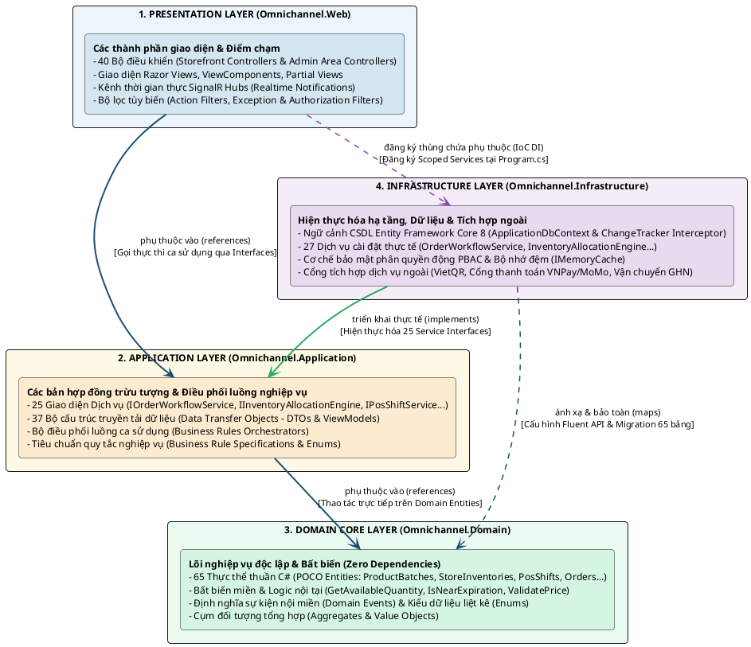
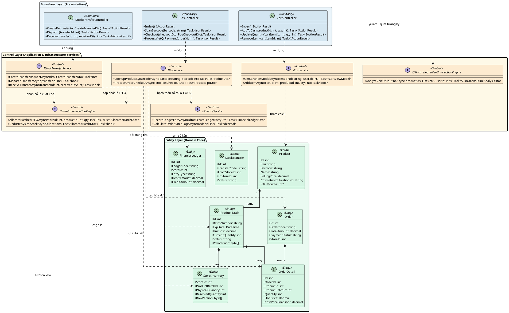
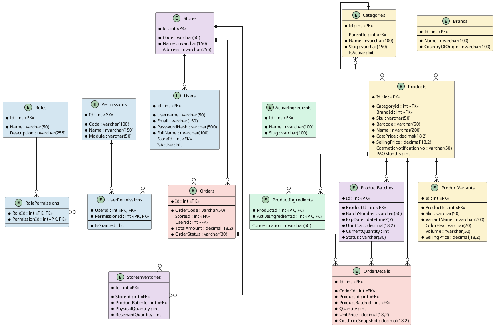

## 2.4. Thiết kế Kiến trúc Hệ thống và Cơ sở dữ liệu Chuẩn hóa 3NF

Một giải pháp phần mềm cấp doanh nghiệp phục vụ chuỗi bán lẻ đa chi nhánh và thương mại điện tử hợp nhất không chỉ đòi hỏi các chức năng nghiệp vụ phong phú ở mặt trước mà còn phụ thuộc cốt tử vào sự vững chắc của kiến trúc tổng thể và mô hình dữ liệu ở tầng nền tảng. Phần này trình bày toàn diện ba trụ cột kỹ thuật trọng yếu của hệ thống OMNI BEAUTY: Kiến trúc phân tầng Clean Architecture kết hợp biểu đồ lớp thực thi BCE; Mô hình ma trận phân quyền động PBAC giải quyết bài toán cô lập dữ liệu theo từng điểm bán; và Thiết kế cơ sở dữ liệu quan hệ chuẩn hóa 3NF quy mô 65 bảng dữ liệu thực tế trên Microsoft SQL Server.

---

### 2.4.1. Thiết kế Kiến trúc tổng thể Clean Architecture 4 tầng và Biểu đồ lớp thực thi (BCE Class Diagram)

Nhằm triệt tiêu sự phụ thuộc lẫn nhau giữa giao diện hiển thị, logic nghiệp vụ và công nghệ lưu trữ dữ liệu, giải pháp `OmnichannelBeautySolution` được thiết kế tuân thủ nghiêm ngặt nguyên lý Đảo ngược Phụ thuộc (Dependency Inversion Principle - DIP) của Robert C. Martin thông qua mô hình Clean Architecture (hay Onion Architecture). Toàn bộ hệ thống được phân rã thành bốn dự án độc lập tương ứng với bốn tầng kiến trúc:

1. **Tầng Lõi Nghiệp vụ (Omnichannel.Domain):** Là hạt nhân trung tâm của toàn bộ hệ thống, chứa đựng 65 thực thể nghiệp vụ thuần túy (POCO Entities), các quy tắc tính toán nội tại (Domain Rules), các cấu trúc dữ liệu tổng hợp (Aggregates) và các sự kiện miền (Domain Events). Tầng này hoàn toàn cô lập, không chứa bất kỳ phụ thuộc nào vào các thư viện ngoài, không phụ thuộc vào Entity Framework Core hay công nghệ cơ sở dữ liệu, bảo đảm tính bất biến và độ bền vững của quy tắc nghiệp vụ cốt lõi theo thời gian.
2. **Tầng Nghiệp vụ Ứng dụng (Omnichannel.Application):** Đóng vai trò là cầu nối trừu tượng giữa tầng hiển thị và tầng hạ tầng. Tầng này định nghĩa 25 giao diện hợp đồng dịch vụ (Service Interfaces như `IOrderWorkflowService`, `IInventoryAllocationEngine`, `ISkincareIngredientInteractionEngine`), các tiêu chuẩn quy tắc kinh doanh (Specifications) và 37 bộ đối tượng truyền tải dữ liệu (DTOs & ViewModels). Tầng này chỉ tham chiếu duy nhất tới tầng `Omnichannel.Domain` mà không hề biết đến công nghệ lưu trữ vật lý phía sau.
3. **Tầng Hạ tầng Kỹ thuật và Truy xuất Dữ liệu (Omnichannel.Infrastructure):** Chịu trách nhiệm hiện thực hóa toàn bộ các bản hợp đồng giao tiếp do tầng `Omnichannel.Application` đề ra. Tầng này chứa ngữ cảnh cơ sở dữ liệu `ApplicationDbContext`, cơ chế khởi tạo và nạp dữ liệu mẫu `DbInitializer`, 27 dịch vụ thực thi nghiệp vụ cụ thể, cơ chế chặn bắt lưu vết kiểm toán dữ liệu `ChangeTracker Interceptor`, động cơ bảo mật phân quyền động PBAC, và các cổng tích hợp dịch vụ bên ngoài như Cổng thanh toán trực tuyến VietQR, VNPay, MoMo và Cổng đối tác vận chuyển Giao Hàng Nhanh (GHN).
4. **Tầng Giao diện và Điểm chạm Khách hàng (Omnichannel.Web):** Là tầng biên ngoài cùng tiếp nhận các yêu cầu tương tác từ người dùng thông qua giao thức HTTP và WebSocket. Dự án này bao gồm 16 bộ điều khiển Storefront/API, 24 bộ điều khiển Quản trị (Admin Area Controllers), các khung nhìn giao diện Razor Views theo 4 Layout chuyên biệt, các kênh kết nối thời gian thực SignalR Hubs (`/systemHub`, `/notificationHub`), chuỗi bộ lọc bảo mật tùy biến và các tiến trình chạy nền định kỳ (`AlertBackgroundWorker`).

> **[HƯỚNG DẪN CHÈN SƠ ĐỒ 2.18 - KIẾN TRÚC TỔNG THỂ CLEAN ARCHITECTURE 4 TẦNG]**
> - **Vị trí chèn:** Ngay sau đoạn phân tích bốn tầng kiến trúc của giải pháp OMNI BEAUTY.
> - **Nguồn hình ảnh:** Sinh viên liên kết trực tiếp tới file ảnh đã có sẵn trong dự án tại đường dẫn `d:\Lập trình web\OmnichannelBeautySolution\doc\Kien_Truc_Clean_Architecture_4_Tang.png`.
> - **Tiêu đề hình:** *Sơ đồ 2.18: Kiến trúc tổng thể Clean Architecture 4 tầng và luồng phụ thuộc của hệ thống OMNI BEAUTY.*

Dưới đây là bảng phân rã chi tiết trách nhiệm kỹ thuật và vòng đời phụ thuộc (Dependency Injection Lifecycle) của từng tầng được cấu hình trong `Program.cs`.

##### Bảng 2.11: Bảng phân rã trách nhiệm kỹ thuật và vòng đời Dependency Injection của 4 tầng kiến trúc

| Tầng kiến trúc | Thành phần cấu thành chính | Trách nhiệm kỹ thuật cốt lõi | Vòng đời DI trong Container (IoC Lifecycle) |
| :--- | :--- | :--- | :--- |
| **Omnichannel.Domain** | 19 tập tin thực thể POCO (65 thực thể), Enums, Aggregates, Value Objects. | Định nghĩa toàn bộ cấu trúc dữ liệu nghiệp vụ, ràng buộc quan hệ thực thể và phương thức nghiệp vụ nội tại (như `GetAvailableQuantity()`, `IsExpired()`, `CalculateLineTotal()`). | Không đăng ký vào IoC Container (Là các lớp mô hình thuần dữ liệu). |
| **Omnichannel.Application** | 25 Giao diện Dịch vụ (Interfaces), 37 Data Transfer Objects (DTOs), ViewModels, Specifications. | Định hình bản hợp đồng giao tiếp giữa các phân hệ, tiêu chuẩn hóa dữ liệu đầu vào/đầu ra của ca sử dụng, ngăn chặn rò rỉ cấu trúc thực thể CSDL ra tầng ngoài. | Đăng ký trừu tượng gắn liền với lớp triển khai ở tầng Infrastructure. |
| **Omnichannel.Infrastructure** | `ApplicationDbContext`, 27 Lớp Dịch vụ triển khai (Services), `DbInitializer`, Security Providers, HttpClient Integrations. | Hiện thực hóa truy vấn CSDL qua EF Core 8 với cơ chế kết nối linh hoạt `EnableRetryOnFailure`, ghi nhật ký kiểm toán tự động, thực thi thuật toán phân bổ lô FEFO, kết nối API VietQR, VNPay, GHN. | - **Scoped:** `ApplicationDbContext`, 27 Lớp Dịch vụ nghiệp vụ. - **Singleton:** `PasswordHasherService`, `DynamicPermissionPolicyProvider`, `MemoryCache`. - **Transient / Typed HttpClient:** `PaymentService`, `GhnShippingService`. |
| **Omnichannel.Web** | 40 Bộ điều khiển (Controllers), Razor Views, ViewComponents, 2 SignalR Hubs, Middlewares, Background Service. | Tiếp nhận HTTP/WebSocket Request, thực thi đường ống Middleware 9 bước, xử lý định tuyến URL thông minh (Slug Routing), hiển thị giao diện đa màn hình CFD, quản trị phân quyền PBAC. | - **Scoped:** Controllers, ViewComponents, SignalR Hub Context. - **Singleton:** `AlertBackgroundWorker` (Hosted Service kế thừa `BackgroundService`). |

##### Chuỗi xử lý đường ống HTTP Request Pipeline thực tế trong Program.cs

Khi một yêu cầu từ trình duyệt của khách hàng hoặc thiết bị POS gửi đến máy chủ web, yêu cầu đó phải đi qua chuỗi đường ống dẫn (HTTP Request Pipeline) gồm 9 bước nghiêm ngặt được thiết lập tại `Program.cs` nhằm bảo đảm tối đa tính an toàn, bảo mật và hiệu năng tải trang:

1. **GlobalExceptionMiddleware:** Đứng ở vị trí đầu tiên của đường ống để bắt trọn mọi ngoại lệ chưa được xử lý phát sinh trong suốt chu trình xử lý của các tầng bên dưới. Nếu yêu cầu là AJAX hoặc RESTful API, middleware tự động tuần tự hóa và phản hồi mã lỗi JSON chuẩn RFC 7807; nếu là yêu cầu duyệt web thông thường, hệ thống thực hiện chuyển hướng thân thiện sang trang thông báo lỗi tương ứng với mã trạng thái HTTP (404, 500).
2. **UseResponseCompression:** Kích hoạt cơ chế nén luồng dữ liệu phản hồi động sử dụng chuẩn thuật toán Brotli (mức ưu tiên cao nhất) và Gzip cho toàn bộ tài nguyên văn bản HTML, JSON, CSS và JavaScript, giúp giảm tới 70% dung lượng truyền tải qua mạng.
3. **UseStaticFiles & Caching Header:** Phục vụ các tài nguyên tĩnh như hình ảnh sản phẩm mỹ phẩm, tập tin stylesheet, mã script và font chữ kèm cấu hình tiêu đề `Cache-Control: public, max-age=2592000` (lưu trữ bộ nhớ đệm trình duyệt trong 30 ngày).
4. **UseRouting:** Phân tích cú pháp Uniform Resource Identifier (URI) của yêu cầu đến để khớp với bảng định tuyến nội bộ, xác định rõ điểm đến thuộc khu vực Storefront thông thường hay Phân hệ Quản trị (Admin Area).
5. **SlugRedirectMiddleware:** Đây là thành phần định tuyến đa hình tùy biến chuyên biệt cho ngành bán lẻ. Middleware tra cứu bảng `SlugRedirects` trong cơ sở dữ liệu để kiểm tra lịch sử thay đổi URL của sản phẩm hoặc bài viết. Nếu người dùng truy cập một liên kết cũ, hệ thống tự động trả về phản hồi chuyển hướng vĩnh viễn (HTTP 301 Permanent Redirect) sang URL canonical mới nhất, bảo toàn điểm số tối ưu hóa công cụ tìm kiếm (SEO) và ngăn ngừa lỗi liên kết gãy.
6. **UseCors & Security Headers Middleware:** Thiết lập các chính sách chia sẻ tài nguyên nguồn gốc chéo (Cross-Origin Resource Sharing) bảo vệ các API dành cho thiết bị POS và ứng dụng di động; đồng thời chèn các tiêu đề bảo mật nâng cao vào phản hồi HTTP bao gồm `X-Frame-Options: SAMEORIGIN`, `X-Content-Type-Options: nosniff`, và chính sách bảo mật nội dung `Content-Security-Policy`.
7. **UseAuthentication (Cơ chế Xác thực Đa Đề án):** Giải mã và xác thực danh tính người dùng. Hệ thống hỗ trợ song song hai đề án xác thực độc lập: Đề án Cookie (`OmnichannelBeauty.AuthCookie`) dành cho phiên làm việc trên trình duyệt của khách hàng và nhân viên quản trị; và Đề án Token (`Bearer Scheme` sử dụng JWT) phục vụ xác thực phi trạng thái cho các trạm bán lẻ POS và ứng dụng quét mã vạch cầm tay.
8. **UseAuthorization (Động cơ Phân quyền PBAC & Cô lập Dữ liệu):** Kích hoạt lớp kiểm tra ủy quyền động `PermissionAuthorizationHandler`. Hệ thống trích xuất định danh người dùng và mã quyền nguyên tử được yêu cầu tại Action, đối chiếu với bộ nhớ đệm quyền hạn trong Redis/MemoryCache để ra quyết định cấp phép hoặc từ chối truy cập (HTTP 403 Forbidden). Đồng thời, tầng này thực thi bộ lọc cô lập dữ liệu theo mã chi nhánh (`StoreId Isolation`) bảo đảm an toàn thông tin nội bộ giữa các showroom.
9. **Endpoint Routing & SignalR Realtime Hub Mapping:** Đích đến cuối cùng của yêu cầu, thực hiện ánh xạ tới các Action Controller tương ứng hoặc duy trì kênh kết nối thời gian thực WebSocket thông qua hai Hub trọng yếu: `/notificationHub` (phục vụ thông báo đẩy toàn hệ thống) và `/systemHub` (phục vụ đồng bộ giỏ hàng hai màn hình CFD tại quầy thu ngân POS).

##### Mô hình hóa Biểu đồ Lớp Thực thi BCE (Boundary – Control – Entity Class Diagram)

Nhằm làm sáng tỏ cấu trúc tương tác hướng đối tượng giữa ba thành phần giao diện biên (Boundary), xử lý điều phối (Control) và dữ liệu thực thể (Entity), hệ thống áp dụng mẫu kiến trúc BCE của Ivar Jacobson để biểu diễn các phân hệ nghiệp vụ trọng tâm.

> **[HƯỚNG DẪN CHÈN SƠ ĐỒ 2.19 - BIỂU ĐỒ LỚP KIẾN TRÚC BCE CHO CÁC PHÂN HỆ CỐT LÕI]**
> - **Vị trí chèn:** Ngay sau bảng phân rã kiến trúc và phân tích mô hình BCE.
> - **Nguồn hình ảnh:** Sinh viên render từ đoạn mã PlantUML phía trên thành file ảnh `Hinh_2_19_BCE_Class_Diagram.png` và lưu trữ tại thư mục `d:\Lập trình web\OmnichannelBeautySolution\doc\Hinh_2_19_BCE_Class_Diagram.png`.
> - **Tiêu đề hình:** *Sơ đồ 2.19: Biểu đồ Lớp kiến trúc Boundary – Control – Entity (BCE) cho các phân hệ cốt lõi của hệ thống OMNI BEAUTY.*

**Phân tích trách nhiệm kiến trúc của các thành phần trong Biểu đồ Lớp BCE:**
- *Thành phần Giao diện Biên (Boundary Controllers):* Đóng vai trò là cổng đón tiếp và bảo vệ hệ thống trước các tác nhân bên ngoài. Lớp này tiếp nhận tham số từ HTTP Request, thực hiện chuyển đổi kiểu dữ liệu cơ bản, ủy quyền kiểm tra tính hợp lệ của tham số thông qua ViewModel/DTO và chuyển giao quyền xử lý nghiệp vụ cho các lớp Điều khiển (Control). Boundary tuyệt đối không trực tiếp mở kết nối cơ sở dữ liệu hay thực thi các câu lệnh truy vấn SQL.
- *Thành phần Xử lý Điều phối (Control Services):* Đảm nhiệm toàn bộ việc chỉ huy luồng nghiệp vụ phức tạp. Điển hình như `PosService` và `InventoryAllocationEngine` phối hợp nhịp nhàng để vừa cấp phát lô hàng theo đúng hạn dùng FEFO, vừa bọc các thao tác trừ kho và sinh đơn hàng vào giao dịch nguyên tử, sau đó kích hoạt `FinanceService` tự động hạch toán giá vốn đích danh và doanh thu vào sổ cái tài chính.
- *Thành phần Thực thể Dữ liệu (Domain Entities):* Đại diện cho trạng thái nghiệp vụ và dữ liệu bền vững của doanh nghiệp. Các thực thể lưu trữ cấu trúc bảng dữ liệu, khóa ngoại, các phương thức tính toán nội suy tự bảo vệ tính toàn vẹn trạng thái và khóa kiểm soát xung đột đồng thời (`RowVersion`).

---

### 2.4.2. Thiết kế Ma trận Phân quyền Động (Granular Dynamic PBAC Matrix) và Cô lập dữ liệu đa chi nhánh

Trong các hệ thống bán lẻ quy mô lớn, việc gán cứng vai trò trong mã nguồn dạng `[Authorize(Roles = "Admin")]` là nguyên nhân hàng đầu dẫn đến sự xơ cứng kiến trúc phần mềm. Khi chuỗi cửa hàng OMNI BEAUTY phát triển thêm các chức năng quản lý mới như Chuyên viên chăm sóc da, Trưởng ca bán lẻ hay Nhân viên kiểm kê kho cận date, phương pháp truyền thống buộc đội ngũ lập trình viên phải sửa đổi mã nguồn, biên dịch lại toàn bộ dự án và tạm dừng hệ thống để triển khai lại. Để khắc phục triệt để nhược điểm này, hệ thống áp dụng mô hình Kiểm soát Truy cập Dựa trên Quyền hạn Động (Permission-Based Access Control - PBAC) kết hợp cơ chế `DynamicPermissionPolicyProvider` của nền tảng ASP.NET Core 8.

Toàn bộ hệ thống được chia nhỏ thành **51 quyền hạn nguyên tử** (Atomic Permissions) thuộc **17 phân hệ chức năng**, phân bổ sẵn cho **6 vai trò người dùng cốt lõi** trong `DbInitializer.cs`:
1. `SuperAdmin`: Quản trị viên tối cao toàn chuỗi, nắm giữ toàn quyền 51/51 quyền hạn, có tầm nhìn quản trị xuyên suốt mọi chi nhánh và cấu hình hệ thống.
2. `StoreManager`: Quản lý chi nhánh cửa hàng, phụ trách toàn bộ hoạt động bán lẻ, vận hành kho tại chỗ, phê duyệt ca làm việc và đề xuất điều chuyển hàng hóa tại điểm bán được giao.
3. `Cashier`: Thu ngân điểm bán trực tiếp, tập trung vào màn hình POS, mở/đóng ca tiền mặt, quét mã vạch bán hàng và in hóa đơn thanh toán.
4. `WarehouseStaff`: Nhân viên thủ kho, chuyên trách việc tiếp nhận lô hàng mỹ phẩm mới, kiểm soát hạn sử dụng FEFO, đóng gói điều chuyển kho và thực hiện kiểm kê hàng hóa.
5. `ContentEditor`: Biên tập viên nội dung, chịu trách nhiệm quản lý tin tức làm đẹp, bài viết chuẩn SEO, cây menu điều hướng, banner khuyến mãi và kiểm duyệt đánh giá của khách hàng.
6. `Customer`: Khách hàng thành viên, có quyền quản lý hồ sơ cá nhân, lịch sử chăm sóc da, theo dõi đơn hàng, tích lũy điểm thưởng và đổi voucher ưu đãi.

Dưới đây là ma trận phân bổ chi tiết 51 quyền nguyên tử cho 6 vai trò người dùng được khởi tạo mặc định trong hệ thống OMNI BEAUTY.

##### Bảng 2.12: Ma trận phân rã 51 Quyền nguyên tử thuộc 17 Phân hệ cho 6 Vai trò hệ thống

| STT | Phân hệ nghiệp vụ (Module) | Mã quyền nguyên tử (Permission Code) | Tên quyền và Ý nghĩa nghiệp vụ chi tiết | Super Admin | Store Manager | Cashier | Warehouse Staff | Content Editor | Customer |
| :---: | :--- | :--- | :--- | :---: | :---: | :---: | :---: | :---: | :---: |
| **1** | **DASHBOARD** | `DASHBOARD_VIEW` | Xem bảng điều khiển tổng quan kết quả kinh doanh | [X] | [X] | [ ] | [ ] | [ ] | [ ] |
| **2** |  | `DASHBOARD_ANALYTICS` | Xem biểu đồ phân tích chuyên sâu và tỷ lệ chuyển đổi | [X] | [ ] | [ ] | [ ] | [ ] | [ ] |
| **3** | **PRODUCT** | `PRODUCT_VIEW` | Tra cứu danh sách sản phẩm và thông tin mỹ phẩm | [X] | [X] | [X] | [X] | [X] | [ ] |
| **4** |  | `PRODUCT_CREATE` | Tạo mới sản phẩm Master SKU và số công bố Bộ Y tế | [X] | [ ] | [ ] | [ ] | [ ] | [ ] |
| **5** |  | `PRODUCT_EDIT` | Chỉnh sửa thông tin thành phần, phân loại và giá bán lẻ | [X] | [ ] | [ ] | [ ] | [ ] | [ ] |
| **6** |  | `PRODUCT_DELETE` | Xóa hoặc vô hiệu hóa sản phẩm khỏi danh mục | [X] | [ ] | [ ] | [ ] | [ ] | [ ] |
| **7** |  | `PRODUCT_IMPORT` | Nhập danh mục sản phẩm hàng loạt từ tệp Excel | [X] | [ ] | [ ] | [X] | [ ] | [ ] |
| **8** | **INVENTORY** | `INVENTORY_VIEW` | Giám sát tồn kho thực tế theo từng lô và hạn dùng FEFO | [X] | [X] | [X] | [X] | [ ] | [ ] |
| **9** |  | `INVENTORY_IMPORT` | Tiếp nhận và nhập lô hàng mới từ nhà cung cấp | [X] | [ ] | [ ] | [X] | [ ] | [ ] |
| **10** |  | `INVENTORY_EXPORT` | Xuất hủy hàng hóa quá hạn sử dụng hoặc bao bì hư hại | [X] | [ ] | [ ] | [X] | [ ] | [ ] |
| **11** |  | `INVENTORY_ADJUST` | Điều chỉnh cân bằng tồn kho khi phát hiện lệch thực tế | [X] | [X] | [ ] | [X] | [ ] | [ ] |
| **12** |  | `INVENTORY_STOCKTAKE` | Thực hiện đợt kiểm kê định kỳ đối soát toàn bộ kệ hàng | [X] | [X] | [ ] | [X] | [ ] | [ ] |
| **13** | **POS** | `POS_ACCESS` | Mở và truy cập giao diện bán hàng chuyên biệt tại quầy | [X] | [X] | [X] | [ ] | [ ] | [ ] |
| **14** |  | `POS_CHECKOUT` | Tạo đơn và hoàn tất thanh toán hóa đơn cho khách | [X] | [X] | [X] | [ ] | [ ] | [ ] |
| **15** |  | `POS_REFUND` | Thực hiện trả hàng và hoàn tiền mặt/chuyển khoản | [X] | [X] | [ ] | [ ] | [ ] | [ ] |
| **16** |  | `POS_SHIFT_OPEN` | Mở ca làm việc và khai báo số dư tiền mặt đầu ca | [X] | [X] | [X] | [ ] | [ ] | [ ] |
| **17** |  | `POS_SHIFT_CLOSE` | Đóng ca, nộp số liệu đếm két và in biên bản Z-Report | [X] | [X] | [X] | [ ] | [ ] | [ ] |
| **18** | **ORDER** | `ORDER_VIEW` | Tra cứu danh sách và chi tiết đơn hàng đa kênh | [X] | [X] | [X] | [ ] | [ ] | [X] |
| **19** |  | `ORDER_CREATE` | Khởi tạo đơn đặt hàng mới trên web hoặc tại quầy | [X] | [X] | [X] | [ ] | [ ] | [X] |
| **20** |  | `ORDER_EDIT` | Cập nhật thông tin giao hàng hoặc trạng thái đơn | [X] | [X] | [ ] | [ ] | [ ] | [ ] |
| **21** |  | `ORDER_CANCEL` | Hủy đơn hàng và tự động giải phóng tồn kho đã giữ | [X] | [X] | [ ] | [ ] | [ ] | [X] |
| **22** | **CUSTOMER** | `CUSTOMER_VIEW` | Xem danh sách hồ sơ khách hàng thành viên | [X] | [X] | [X] | [ ] | [ ] | [ ] |
| **23** |  | `CUSTOMER_CREATE` | Thu thập thông tin và tạo hồ sơ khách hàng mới | [X] | [X] | [X] | [ ] | [ ] | [ ] |
| **24** |  | `CUSTOMER_EDIT` | Cập nhật số điện thoại, địa chỉ nhận hàng của khách | [X] | [X] | [ ] | [ ] | [ ] | [ ] |
| **25** |  | `CUSTOMER_PROFILE_VIEW`| Xem hồ sơ da liễu, tiền sử dị ứng và chu trình dưỡng da | [X] | [X] | [ ] | [ ] | [ ] | [X] |
| **26** | **CMS** | `CMS_POST_MANAGE` | Quản trị bài viết chia sẻ kiến thức làm đẹp chuẩn SEO | [X] | [ ] | [ ] | [ ] | [X] | [ ] |
| **27** |  | `CMS_BANNER_MANAGE` | Quản lý banner hình ảnh chiến dịch khuyến mãi | [X] | [ ] | [ ] | [ ] | [X] | [ ] |
| **28** |  | `CMS_MENU_MANAGE` | Quản trị cấu trúc cây menu điều hướng đa hình | [X] | [ ] | [ ] | [ ] | [X] | [ ] |
| **29** |  | `CMS_REVIEW_MODERATE` | Kiểm duyệt đánh giá nhận xét và hình ảnh swatch mỹ phẩm | [X] | [ ] | [ ] | [ ] | [X] | [ ] |
| **30** |  | `CMS_STATIC_PAGE_MANAGE`| Soạn thảo và chỉnh sửa nội dung các trang chính sách pháp lý | [X] | [ ] | [ ] | [ ] | [X] | [ ] |
| **31** | **REPORT** | `REPORT_SALES` | Kết xuất và xem báo cáo phân tích doanh thu bán hàng | [X] | [X] | [ ] | [ ] | [ ] | [ ] |
| **32** |  | `REPORT_INVENTORY` | Xem báo cáo xuất nhập tồn, vòng quay hàng cận date | [X] | [X] | [ ] | [X] | [ ] | [ ] |
| **33** |  | `REPORT_FINANCE` | Xem báo cáo tài chính tổng hợp toàn chuỗi | [X] | [ ] | [ ] | [ ] | [ ] | [ ] |
| **34** | **FINANCE** | `FINANCE_LEDGER_VIEW` | Truy xuất Sổ cái tài chính ghi nhận doanh thu và chi phí | [X] | [X] | [ ] | [ ] | [ ] | [ ] |
| **35** |  | `FINANCE_SUPPLIER_DEBT`| Quản lý công nợ phải trả cho nhà cung cấp mỹ phẩm | [X] | [ ] | [ ] | [ ] | [ ] | [ ] |
| **36** |  | `FINANCE_COD_RECONCILE`| Đối soát tiền hàng thu hộ COD từ đơn vị vận chuyển GHN | [X] | [ ] | [ ] | [ ] | [ ] | [ ] |
| **37** |  | `FINANCE_PNL_VIEW` | Xem báo cáo kết quả kinh doanh Lãi/Lỗ theo từng showroom | [X] | [X] | [ ] | [ ] | [ ] | [ ] |
| **38** | **PROMOTION** | `PROMOTION_MANAGE` | Cấu hình quy tắc khuyến mãi và mua kèm giá sốc | [X] | [ ] | [ ] | [ ] | [ ] | [ ] |
| **39** |  | `COUPON_MANAGE` | Tạo mã coupon giảm giá và thiết lập hạn mức sử dụng | [X] | [ ] | [ ] | [ ] | [ ] | [ ] |
| **40** |  | `VOUCHER_MANAGE` | Phát hành voucher ưu đãi cá nhân hóa cho hội viên | [X] | [X] | [ ] | [ ] | [ ] | [ ] |
| **41** | **LOYALTY** | `LOYALTY_VIEW` | Tra cứu số dư điểm ví thưởng và bậc hạng thành viên | [X] | [X] | [X] | [ ] | [ ] | [X] |
| **42** |  | `LOYALTY_ADJUST_POINTS`| Điều chỉnh cộng/trừ điểm thưởng thủ công có phê duyệt | [X] | [X] | [ ] | [ ] | [ ] | [ ] |
| **43** |  | `LOYALTY_TIER_MANAGE` | Cấu hình tiêu chuẩn tích lũy chi tiêu để thăng hạng VIP | [X] | [ ] | [ ] | [ ] | [ ] | [ ] |
| **44** | **STOCK_TRANSFER** | `TRANSFER_CREATE` | Lập phiếu đề xuất điều chuyển hàng hóa liên chi nhánh | [X] | [X] | [ ] | [X] | [ ] | [ ] |
| **45** |  | `TRANSFER_APPROVE` | Phê duyệt và ký lệnh xuất kho điều chuyển vận chuyển | [X] | [ ] | [ ] | [ ] | [ ] | [ ] |
| **46** |  | `TRANSFER_RECEIVE` | Kiểm đếm và xác nhận tiếp nhận hàng nhập kho đích | [X] | [X] | [ ] | [X] | [ ] | [ ] |
| **47** | **SETTINGS** | `SETTINGS_VIEW` | Xem các tham số cấu hình chung của toàn hệ thống | [X] | [ ] | [ ] | [ ] | [ ] | [ ] |
| **48** |  | `SETTINGS_MANAGE` | Chỉnh sửa thông tin doanh nghiệp, cổng thanh toán | [X] | [ ] | [ ] | [ ] | [ ] | [ ] |
| **49** | **SECURITY** | `USER_MANAGE` | Tạo tài khoản, khóa và phân quyền cho nhân viên | [X] | [ ] | [ ] | [ ] | [ ] | [ ] |
| **50** |  | `ROLE_MANAGE` | Tạo mới và chỉnh sửa danh mục vai trò chức danh | [X] | [ ] | [ ] | [ ] | [ ] | [ ] |
| **51** |  | `PERMISSION_MANAGE` | Cấu hình ma trận cấp quyền cho vai trò và tài khoản | [X] | [ ] | [ ] | [ ] | [ ] | [ ] |

##### Cơ chế Ghi đè Quyền cá nhân (User Permission Overrides) và Cô lập Dữ liệu chi nhánh (StoreId Isolation)

Bên cạnh việc kế thừa quyền hạn tự động từ Vai trò người dùng (thông qua bảng `RolePermissions`), hệ thống OMNI BEAUTY hiện thực hóa một cơ chế quản trị nhân sự mang tính tùy biến cực cao: **Ghi đè quyền hạn trực tiếp trên từng tài khoản cá nhân** thông qua bảng `UserPermissions`. Bảng này chứa trường cờ nhị phân `IsGranted` với logic giải quyết xung đột như sau:
- *Cấp quyền đặc cách (Grant Override - `IsGranted = 1`):* Cho phép một nhân sự cụ thể được thực thi một hành vi vượt cấp mà vai trò mặc định của họ không có. Ví dụ: Nhân viên thu ngân `cashier_01` tại Showroom Ba Đình có năng lực tốt được cấp đặc cách quyền `INVENTORY_STOCKTAKE` để tham gia tổ chức kiểm kê kho ban đêm cùng thủ kho mà không cần phải nâng toàn bộ nhóm thu ngân lên làm quản lý.
- *Thu hồi quyền tức thời (Revoke Override - `IsGranted = 0`):* Cho phép tước bỏ ngay lập tức một quyền hạn nhạy cảm của một cá nhân dù vai trò của họ vẫn chứa quyền đó. Ví dụ: Một Quản lý cửa hàng đang trong thời gian bàn giao công việc có thể bị tước quyền `ORDER_CANCEL` để ngăn chặn việc tự ý hủy đơn hàng mà không cần phải thay đổi cấu hình vai trò `StoreManager` của các chi nhánh khác.

Cùng với phân quyền hành vi, bài toán **Cô lập dữ liệu theo từng điểm bán (StoreId Data Isolation)** được giải quyết triệt để tại tầng kiến trúc hạ tầng bằng cách tích hợp trực tiếp vào trường `StoreId` của bảng `Users` và áp dụng kỹ thuật Bộ lọc Truy vấn Toàn cục (Global Query Filters) của Entity Framework Core 8:
- Đối với nhân sự chi nhánh (Quản lý cửa hàng, Thu ngân, Thủ kho): Trường `StoreId` luôn có giá trị cụ thể trỏ về điểm bán tương ứng (ví dụ: `StoreId = 1` cho Showroom Quận 1, `StoreId = 2` cho Showroom Ba Đình). Mọi câu lệnh truy vấn dữ liệu từ Controller đến Service đều tự động bị chặn và gắn điều kiện lọc ngầm: `WHERE StoreId == currentUser.StoreId`. Nhờ vậy, thu ngân hoặc quản lý chi nhánh này hoàn toàn không thể xem trộm doanh thu, báo cáo ca hay số liệu két tiền mặt của chi nhánh khác.
- Đối với cấp điều hành chuỗi (`SuperAdmin`): Trường `StoreId` có giá trị `NULL`. Hệ thống tự động vô hiệu hóa điều kiện lọc ngầm, cho phép Ban Giám đốc và Quản trị viên tối cao có cái nhìn toàn cảnh về tình hình kinh doanh, tồn kho và công nợ trên toàn bộ hệ thống chuỗi bán lẻ.

---

### 2.4.3. Thiết kế Cơ sở dữ liệu quan hệ chuẩn 3NF và Sơ đồ Thực thể – Liên kết (ERD) – Phần 1

Cơ sở dữ liệu của giải pháp OMNI BEAUTY mang tên `OmnichannelBeautyDb` được cài đặt trên hệ quản trị cơ sở dữ liệu quan hệ Microsoft SQL Server. Mô hình dữ liệu bao gồm **65 bảng thực thể chuẩn hóa 3NF** được phân rã khoa học thành **17 phân nhóm nghiệp vụ**, đáp ứng trọn vẹn toàn bộ các điểm chạm nghiệp vụ đa kênh từ thương mại điện tử, quản trị tồn kho FEFO, vận hành bán lẻ POS, chăm sóc da liễu thông minh đến kế toán sổ cái tài chính.

##### Bảng 2.13: Bảng tổng hợp quy mô 17 phân nhóm dữ liệu (65 bảng) của hệ thống OMNI BEAUTY

| STT | Phân nhóm dữ liệu nghiệp vụ | Số lượng bảng | Danh sách các bảng thực thể thành phần | Mục đích và vai trò vận hành |
| :---: | :--- | :---: | :--- | :--- |
| **1** | Định danh, Bảo mật & Phân quyền PBAC | 6 | `Roles`, `Permissions`, `Users`, `UserRoles`, `RolePermissions`, `UserPermissions` | Quản trị tài khoản, phiên đăng nhập và ma trận phân quyền động 51 quyền cho toàn chuỗi. |
| **2** | Nội dung CMS, Giao diện & Layout Đa hình | 13 | `Menus`, `MenuItems`, `Banners`, `PostCategories`, `Posts`, `StaticPages`, `ProductReviews`, `MediaAssets`, `ThemeConfigs`, `UiSections`, `PageLayouts`, `LayoutSections`, `SectionItems` | Quản trị toàn diện trải nghiệm hình ảnh, bài viết làm đẹp, đánh giá sản phẩm và các khối hiển thị trang chủ. |
| **3** | Danh mục gốc & Master Sản phẩm Mỹ phẩm | 4 | `Categories`, `Brands`, `Suppliers`, `Products` | Quản trị cây danh mục đa cấp, thương hiệu, nhà cung cấp và thông tin pháp lý số công bố Bộ Y tế. |
| **4** | Biến thể Mỹ phẩm & Bảng màu Swatch | 5 | `ProductVariants`, `ProductSwatches`, `ProductAttributes`, `ProductAttributeValues`, `ProductVariantAttributeValues` | Phân loại sản phẩm theo bảng màu thực tế (Hex/Texture), dung tích đóng gói (ml/g) và quản lý SKU con. |
| **5** | Khoa học Da liễu & Động cơ Hoạt chất | 6 | `ActiveIngredients`, `ProductIngredients`, `SkinTypes`, `ProductSkinTypes`, `SkinConcerns`, `ProductConcerns` | Từ điển hoạt chất khoa học, kiểm tra tương kỵ hóa học giỏ hàng và tư vấn theo tuýp da khách hàng. |
| **6** | Chi nhánh Showroom & Quản trị Tồn kho FEFO | 4 | `Stores`, `ProductBatches`, `StoreInventories`, `InventoryLogs` | Quản lý mạng lưới cửa hàng, giám sát lô sản xuất, ngày hết hạn và lưu vết mọi biến động xuất nhập tồn. |
| **7** | Bán hàng Đa kênh, Giỏ hàng & Hóa đơn | 5 | `Carts`, `CartItems`, `Orders`, `OrderDetails`, `Invoices` | Xử lý giỏ hàng trực tuyến, đặt hàng O2O, đơn hàng bán lẻ và chứng từ hóa đơn thanh toán. |
| **8** | Nhật ký Kiểm toán Hệ thống | 1 | `AuditLogs` | Lưu vết chi tiết mọi thao tác can thiệp dữ liệu nhạy cảm (OldValues / NewValues định dạng JSON). |
| **9** | Vận hành Bán lẻ POS & Ca Két tiền mặt | 2 | `PosShifts`, `PosDrawerTransactions` | Quản trị ca làm việc của thu ngân, kiểm toán két tiền mặt, đối soát lệch két và in báo cáo Z-Report. |
| **10** | Hồ sơ Khách hàng & CRM Sắc đẹp | 3 | `CustomerProfiles`, `SkinHistories`, `RepurchaseSchedules` | Lưu vết hồ sơ da liễu, lịch sử điều trị và thuật toán dự báo ngày dùng hết mỹ phẩm để nhắc mua lại. |
| **11** | Ví Điểm Thưởng & Thăng hạng Hội viên | 4 | `MemberTiers`, `LoyaltyWallets`, `PointTransactions`, `Vouchers` | Quản lý ví điểm thưởng đa kênh, hệ số nhân tích điểm và tự động nâng hạng thẻ VIP (Bạc, Vàng, Kim Cương). |
| **12** | Động cơ Khuyến mãi & Coupon Giảm giá | 4 | `Promotions`, `PromotionItems`, `Coupons`, `CouponUsages` | Thiết lập chiến dịch giảm giá, tặng quà kèm (GWP) và kiểm soát số lần áp dụng mã ưu đãi. |
| **13** | Điều chuyển Hàng hóa Liên chi nhánh | 2 | `StockTransfers`, `StockTransferDetails` | Quy trình điều phối luân chuyển hàng hóa 3 bước giữa tổng kho và các showroom bảo toàn tổng tồn kho. |
| **14** | Tham số Hệ thống & Lịch sử Điều hướng SEO | 2 | `Settings`, `SlugRedirects` | Cấu hình tham số vận hành chuỗi và lưu vết chuyển hướng canonical 301 bảo vệ thứ hạng công cụ tìm kiếm. |
| **15** | Kế toán Sổ cái Tài chính & Quản trị Lãi/Lỗ | 3 | `FinancialLedgers`, `SupplierDebts`, `CodReconciliations` | Sổ cái tài chính ghi nhận doanh thu, giá vốn đích danh theo lô (Batch COGS), công nợ và đối soát COD. |
| **16** | Trợ lý Ảo AI & Lịch sử Hội thoại Tư vấn | 2 | `ChatSessions`, `ChatMessages` | Lưu trữ phiên hội thoại tương tác giữa khách hàng và trợ lý trí tuệ nhân tạo RAG. |
| **17** | Cảnh báo Thông minh, Thông điệp & Thông báo | 6 | `Alerts`, `Notifications`, `InternalMessages`, `WishlistItems`, `StockAlerts`, `OutboxMessages` | Trung tâm thông báo đẩy thời gian thực, bảng tin nội bộ chuỗi và hộp thư bảo đảm giao dịch Outbox. |
| **TỔNG** | **Toàn bộ hệ thống cơ sở dữ liệu** | **65** | **65 bảng chuẩn hóa 3NF phân rã chi tiết** | **Bảo đảm vận hành toàn diện chuỗi bán lẻ mỹ phẩm OMNI BEAUTY** |

##### Chứng minh tính Chuẩn hóa Cơ sở dữ liệu đạt Chuẩn 3NF (Third Normal Form)

Để bảo đảm cơ sở dữ liệu hoạt động tối ưu, không phát sinh các dị thường khi thêm (Insertion Anomaly), xóa (Deletion Anomaly) hay sửa dữ liệu (Update Anomaly), toàn bộ thiết kế thực thể của OMNI BEAUTY được thẩm định nghiêm ngặt theo các tiêu chuẩn dạng chuẩn:

1. **Tuân thủ Dạng chuẩn 1 (First Normal Form - 1NF):**
   - *Yêu cầu:* Mỗi ô dữ liệu chỉ chứa giá trị nguyên tố (Atomic Value), không chứa danh sách lặp hoặc thuộc tính đa trị.
   - *Thực thi trong hệ thống:* Trong các thiết kế sơ khai, thông tin các hoạt chất hóa học có trong một loại mỹ phẩm thường bị lưu gộp chung thành một chuỗi văn bản trong bảng sản phẩm. OMNI BEAUTY đã triệt tiêu hoàn toàn vi phạm này bằng cách tách riêng bảng `ActiveIngredients` (chứa định danh hoạt chất) và bảng trung gian `ProductIngredients` (lưu trữ chính xác cặp `ProductId` và `ActiveIngredientId` cùng nồng độ phần trăm `Concentration`). Tương tự, bảng màu son không lưu gộp trong sản phẩm cha mà được tách thành từng bản ghi biến thể `ProductVariants` và `ProductSwatches` độc lập. 100% các cột trong 65 bảng dữ liệu đều mang giá trị đơn nhất và mọi bảng đều sở hữu một khóa chính chuẩn mực `INT IDENTITY(1,1)`.
2. **Tuân thủ Dạng chuẩn 2 (Second Normal Form - 2NF):**
   - *Yêu cầu:* Đã đạt 1NF và mọi thuộc tính không khóa phải phụ thuộc hàm đầy đủ (Fully Functionally Dependent) vào toàn bộ khóa chính, loại bỏ hoàn toàn sự phụ thuộc từng phần vào một phần của khóa chính phức hợp.
   - *Thực thi trong hệ thống:* Đối với bảng trung gian `StoreInventories` có cặp khóa ngoại liên kết tới chi nhánh và lô hàng, hệ thống không lưu trữ thuộc tính tên sản phẩm hay hạn sử dụng trong bảng này. Các thông tin về hạn sử dụng và số lô sản xuất phụ thuộc hoàn toàn vào khóa chính `Id` của bảng `ProductBatches`, trong khi vị trí địa lý và tên showroom phụ thuộc vào `StoreId` của bảng `Stores`. Bảng `StoreInventories` chỉ lưu trữ duy nhất các trường phụ thuộc vào sự kết hợp giữa kho và lô là `PhysicalQuantity` và `ReservedQuantity`. Nhờ vậy, khi một lô mỹ phẩm được phân bổ tới nhiều showroom khác nhau, thông tin ngày sản xuất và hạn dùng không bao giờ bị lặp lại dư thừa.
3. **Tuân thủ Dạng chuẩn 3 (Third Normal Form - 3NF):**
   - *Yêu cầu:* Đã đạt 2NF và không tồn tại bất kỳ sự phụ thuộc bắc cầu (Transitive Dependency) nào giữa các thuộc tính không khóa; nghĩa là không có thuộc tính không khóa nào phụ thuộc vào một thuộc tính không khóa khác.
   - *Thực thi trong hệ thống:* Một lỗi kinh điển thường gặp trong các hệ thống bán hàng là bảng `OrderDetails` lưu trữ tên thương hiệu hoặc tên nhà sản xuất của sản phẩm. Trong OMNI BEAUTY, `OrderDetails` chỉ chứa `ProductId` và `ProductBatchId`. Từ `ProductId`, hệ thống tham chiếu tới bảng `Products`, và từ `Products` tham chiếu tiếp tới `Brands` hoặc `Suppliers`. Không có thông tin thương hiệu nào nằm trong chi tiết đơn hàng. Đặc biệt, để bảo toàn giá trị lịch sử bán hàng khi giá niêm yết của sản phẩm thay đổi trong tương lai, bảng `OrderDetails` lưu hai trường chốt chặn lịch sử là `UnitPrice` (giá bán thực tế tại thời điểm thanh toán) và `CostPriceSnapshot` (giá vốn đích danh của lô xuất kho). Đây không phải là sự phụ thuộc bắc cầu mà là thuộc tính nội tại của chính bản ghi giao dịch tại thời điểm cam kết dữ liệu.

> **[HƯỚNG DẪN CHÈN SƠ ĐỒ 2.20 - SƠ ĐỒ THỰC THỂ LIÊN KẾT ERD TỔNG THỂ]**
> - **Vị trí chèn:** Ngay sau phần chứng minh các dạng chuẩn 1NF, 2NF và 3NF.
> - **Nguồn hình ảnh:** Sinh viên render từ đoạn mã PlantUML phía trên thành file ảnh `Hinh_2_20_So_Do_ERD_Tong_The.png` và lưu trữ tại thư mục `d:\Lập trình web\OmnichannelBeautySolution\doc\Hinh_2_20_So_Do_ERD_Tong_The.png`.
> - **Tiêu đề hình:** *Sơ đồ 2.20: Sơ đồ Thực thể – Liên kết (ERD) tổng thể của các phân hệ cốt lõi trong hệ thống OMNI BEAUTY.*

---

#### 2.4.3.1. Đặc tả chi tiết cấu trúc 22 Bảng dữ liệu cốt lõi (Phần 1: Nhóm 1 & Nhóm 2)

Nhằm phục vụ công tác cài đặt vật lý trên hệ quản trị cơ sở dữ liệu Microsoft SQL Server và ánh xạ chính xác vào Entity Framework Core 8, dưới đây là từ điển dữ liệu chi tiết của 9 bảng đầu tiên thuộc Nhóm Định danh - Bảo mật PBAC và Nhóm Danh mục - Khoa học Da liễu.

##### A. Nhóm 1: Phân hệ Định danh, Bảo mật & Phân quyền Động PBAC

Phân hệ này quản lý toàn bộ tài khoản nhân sự chuỗi, khách hàng, vai trò hệ thống, danh mục quyền hạn nguyên tử và cơ chế ghi đè quyền cá nhân.

###### Bảng 2.14: Đặc tả chi tiết bảng Users (Tài khoản người dùng và nhân sự chuỗi)

| Tên cột | Kiểu C# | Kiểu SQL Server | Nullable | Ràng buộc PK/FK/Index | Ý nghĩa nghiệp vụ & Giải thích vai trò |
| :--- | :--- | :--- | :---: | :--- | :--- |
| `Id` | `int` | `INT IDENTITY(1,1)` | Không | `PRIMARY KEY` | Khóa chính tự tăng định danh duy nhất mỗi tài khoản trong hệ thống. |
| `Username` | `string` | `VARCHAR(50)` | Không | `UNIQUE INDEX` | Tên đăng nhập của người dùng hoặc mã số nhân viên chuỗi. |
| `Email` | `string` | `VARCHAR(150)` | Không | `UNIQUE INDEX` | Địa chỉ thư điện tử dùng để nhận hóa đơn và khôi phục mật khẩu. |
| `PasswordHash` | `string` | `VARCHAR(500)` | Không | Không | Chuỗi băm mật khẩu bảo mật sử dụng thuật toán PBKDF2 với muối ngẫu nhiên (Salt). |
| `FullName` | `string` | `NVARCHAR(100)` | Không | Không | Họ và tên đầy đủ của nhân viên hoặc khách hàng. |
| `PhoneNumber` | `string?` | `VARCHAR(20)` | Có | `INDEX` | Số điện thoại liên hệ dùng để tra cứu nhanh thông tin tích điểm tại quầy POS. |
| `AvatarUrl` | `string?` | `VARCHAR(500)` | Có | Không | Đường dẫn hình ảnh đại diện của người dùng. |
| `AvatarMediaId` | `int?` | `INT` | Có | `FK -> MediaAssets(Id)` | Khóa ngoại liên kết tới thư viện tài sản đa phương tiện quản trung tâm. |
| `NormalizedUsername`| `string?`| `VARCHAR(50)` | Có | Không | Tên đăng nhập được viết hoa chuẩn hóa phục vụ so khớp tốc độ cao. |
| `SecurityStamp` | `string?` | `VARCHAR(100)` | Có | Không | Dấu mốc bảo mật ngẫu nhiên thay đổi mỗi khi đổi mật khẩu để vô hiệu hóa cookie cũ. |
| `UserType` | `int` | `INT` | Không | `DEFAULT = 1` | Phân loại người dùng: 1: Khách hàng thông thường; 2: Nhân viên nội bộ chuỗi. |
| `IsActive` | `bool` | `BIT` | Không | `DEFAULT = 1` | Trạng thái kích hoạt tài khoản: 1: Đang hoạt động; 0: Bị khóa truy cập. |
| `StoreId` | `int?` | `INT` | Có | `FK -> Stores(Id), INDEX`| Mã chi nhánh làm việc cố định của nhân viên phục vụ cô lập dữ liệu (StoreId Isolation). |
| `CreatedAt` | `DateTime`| `DATETIME2(7)` | Không | `DEFAULT = SYSUTCDATETIME()`| Thời điểm tạo tài khoản tính theo giờ chuẩn quốc tế UTC. |
| `UpdatedAt` | `DateTime?`|`DATETIME2(7)` | Có | Không | Thời điểm cập nhật thông tin hồ sơ tài khoản gần nhất. |

*Phân tích thiết kế bảng Users:* Cột `StoreId` là mấu chốt kỹ thuật để hiện thực hóa việc phân vùng dữ liệu giữa các chi nhánh. Khi nhân viên đăng nhập, `StoreId` được nạp trực tiếp vào Claim của người dùng. Mọi truy vấn phát sinh từ tài khoản đó đều bị Entity Framework Core chặn bắt và tự động bổ sung điều kiện lọc `WHERE StoreId = @CurrentStoreId`, bảo đảm nhân viên không thể xâm phạm dữ liệu của chi nhánh bạn.

---

###### Bảng 2.15: Đặc tả chi tiết bảng Roles (Danh mục vai trò hệ thống)

| Tên cột | Kiểu C# | Kiểu SQL Server | Nullable | Ràng buộc PK/FK/Index | Ý nghĩa nghiệp vụ & Giải thích vai trò |
| :--- | :--- | :--- | :---: | :--- | :--- |
| `Id` | `int` | `INT IDENTITY(1,1)` | Không | `PRIMARY KEY` | Khóa chính tự tăng định danh duy nhất mỗi vai trò trong hệ thống. |
| `Name` | `string` | `VARCHAR(50)` | Không | `UNIQUE INDEX` | Tên mã định danh của vai trò (`SuperAdmin`, `StoreManager`, `Cashier`...). |
| `Description` | `string?` | `NVARCHAR(255)` | Có | Không | Diễn giải chi tiết chức năng và phạm vi quyền hạn của vai trò. |
| `IsActive` | `bool` | `BIT` | Không | `DEFAULT = 1` | Trạng thái hoạt động của vai trò: 1: Đang áp dụng; 0: Tạm ngừng. |
| `CreatedAt` | `DateTime`| `DATETIME2(7)` | Không | `DEFAULT = SYSUTCDATETIME()`| Thời điểm khởi tạo vai trò trong hệ thống. |

*Phân tích thiết kế bảng Roles:* Bảng `Roles` định nghĩa 6 vai trò cốt lõi. Bảng này không chứa các cờ phân quyền cụ thể mà liên kết nhiều - nhiều với bảng `Permissions` thông qua bảng trung gian `RolePermissions`, cho phép quản trị viên linh hoạt điều chỉnh quyền của cả nhóm chức danh thông qua giao diện trực quan.

---

###### Bảng 2.16: Đặc tả chi tiết bảng Permissions (Danh mục quyền hạn nguyên tử)

| Tên cột | Kiểu C# | Kiểu SQL Server | Nullable | Ràng buộc PK/FK/Index | Ý nghĩa nghiệp vụ & Giải thích vai trò |
| :--- | :--- | :--- | :---: | :--- | :--- |
| `Id` | `int` | `INT IDENTITY(1,1)` | Không | `PRIMARY KEY` | Khóa chính tự tăng định danh duy nhất mỗi quyền hạn nguyên tử. |
| `Code` | `string` | `VARCHAR(100)` | Không | `UNIQUE INDEX` | Mã định danh quyền duy nhất viết hoa (`PRODUCT_VIEW`, `POS_CHECKOUT`...). |
| `Name` | `string` | `NVARCHAR(150)` | Không | Không | Tên hiển thị thân thiện của quyền trên giao diện ma trận quản trị. |
| `Module` | `string` | `VARCHAR(50)` | Không | `INDEX` | Tên phân hệ chức năng tương ứng (`PRODUCT`, `POS`, `INVENTORY`, `FINANCE`...). |
| `Description` | `string?` | `NVARCHAR(255)` | Có | Không | Diễn giải mục đích bảo mật và các thao tác được phép thực hiện khi có quyền. |

*Phân tích thiết kế bảng Permissions:* Bảng `Permissions` lưu trữ 51 quyền nguyên tử cố định được gieo mầm sẵn qua `DbInitializer`. Cột `Module` được đánh chỉ mục Index để tối ưu hóa tốc độ gom nhóm quyền khi hiển thị bảng ma trận phân quyền dạng cây thư mục trên trang quản trị bảo mật.

---

###### Bảng 2.17: Đặc tả chi tiết bảng RolePermissions & UserPermissions (Ánh xạ và Ghi đè quyền)

*1. Bảng RolePermissions (Phân quyền theo Vai trò):*

| Tên cột | Kiểu C# | Kiểu SQL Server | Nullable | Ràng buộc PK/FK/Index | Ý nghĩa nghiệp vụ & Giải thích vai trò |
| :--- | :--- | :--- | :---: | :--- | :--- |
| `RoleId` | `int` | `INT` | Không | `PRIMARY KEY (PK1), FK -> Roles(Id)` | Mã vai trò được gán quyền hạn. |
| `PermissionId` | `int` | `INT` | Không | `PRIMARY KEY (PK2), FK -> Permissions(Id)` | Mã quyền nguyên tử được trao cho vai trò. |

*2. Bảng UserPermissions (Ghi đè quyền hạn cá nhân):*

| Tên cột | Kiểu C# | Kiểu SQL Server | Nullable | Ràng buộc PK/FK/Index | Ý nghĩa nghiệp vụ & Giải thích vai trò |
| :--- | :--- | :--- | :---: | :--- | :--- |
| `UserId` | `int` | `INT` | Không | `PRIMARY KEY (PK1), FK -> Users(Id)` | Mã tài khoản người dùng được can thiệp quyền riêng biệt. |
| `PermissionId` | `int` | `INT` | Không | `PRIMARY KEY (PK2), FK -> Permissions(Id)` | Mã quyền nguyên tử được cấp thêm hoặc tước bỏ. |
| `IsGranted` | `bool` | `BIT` | Không | `DEFAULT = 1` | Trạng thái can thiệp: 1: Cấp đặc cách (Grant); 0: Thu hồi cưỡng chế (Deny). |

*Phân tích thiết kế bảng RolePermissions & UserPermissions:* Việc sử dụng cặp khóa chính phức hợp `(RoleId, PermissionId)` và `(UserId, PermissionId)` loại bỏ hoàn toàn khả năng gán trùng lặp quyền. Trường `IsGranted` trong `UserPermissions` đóng vai trò là cơ chế ghi đè cấp cao nhất trong luồng thẩm định quyền hạn 3 tầng: Mọi quyền dù Vai trò có sở hữu nhưng nếu có bản ghi `IsGranted = 0` tại `UserPermissions` thì yêu cầu truy cập lập tức bị từ chối.

---

##### B. Nhóm 2: Phân hệ Danh mục, Biến thể Mỹ phẩm & Khoa học Da liễu

Phân hệ này phản ánh bản sắc chuyên biệt của ngành bán lẻ mỹ phẩm, từ cấu trúc danh mục đa cấp, hồ sơ pháp lý số công bố y tế, thời hạn mở nắp PAO, biến thể màu sắc swatch đến từ điển hoạt chất và tương kỵ da liễu.

###### Bảng 2.18: Đặc tả chi tiết bảng Categories (Danh mục mỹ phẩm đa cấp)

| Tên cột | Kiểu C# | Kiểu SQL Server | Nullable | Ràng buộc PK/FK/Index | Ý nghĩa nghiệp vụ & Giải thích vai trò |
| :--- | :--- | :--- | :---: | :--- | :--- |
| `Id` | `int` | `INT IDENTITY(1,1)` | Không | `PRIMARY KEY` | Khóa chính tự tăng định danh duy nhất mỗi nhóm danh mục. |
| `ParentId` | `int?` | `INT` | Có | `FK -> Categories(Id), INDEX`| Khóa ngoại đệ quy trỏ về danh mục cha tạo cấu trúc cây thư mục vô hạn cấp. |
| `Name` | `string` | `NVARCHAR(100)` | Không | Không | Tên hiển thị của danh mục (ví dụ: Chăm sóc da mặt, Serum đặc trị, Kem chống nắng). |
| `Slug` | `string` | `VARCHAR(150)` | Không | `UNIQUE INDEX` | Đường dẫn thân thiện chuẩn SEO phục vụ định tuyến trang web. |
| `Description` | `string?` | `NVARCHAR(500)` | Có | Không | Đoạn văn mô tả tóm tắt danh mục phục vụ nội dung SEO Onpage. |
| `ImageUrl` | `string?` | `VARCHAR(500)` | Có | Không | Đường dẫn hình ảnh minh họa cho danh mục hiển thị trên thanh menu. |
| `MediaAssetId` | `int?` | `INT` | Có | `FK -> MediaAssets(Id)` | Khóa ngoại liên kết tới bảng quản lý tệp tin truyền thông trung tâm. |
| `Icon` | `string?` | `VARCHAR(100)` | Có | Không | Mã định danh biểu tượng giao diện (ví dụ: FontAwesome `fa-sparkles`). |
| `SortOrder` | `int` | `INT` | Không | `DEFAULT = 0` | Thứ tự ưu tiên sắp xếp hiển thị trên thanh điều hướng. |
| `IsActive` | `bool` | `BIT` | Không | `DEFAULT = 1` | Cờ kích hoạt trạng thái hiển thị danh mục trên Storefront. |

*Phân tích thiết kế bảng Categories:* Khóa ngoại tự tham chiếu `ParentId` cho phép OMNI BEAUTY tổ chức cây danh mục linh hoạt từ Ngành hàng lớn (Chăm sóc da, Trang điểm) xuống Danh mục con cấp 1 (Làm sạch, Dưỡng ẩm) và Danh mục chi tiết cấp 2 (Tẩy trang dạng dầu, Sữa rửa mặt tạo bọt) mà không cần phải tạo thêm các bảng phân cấp cồng kềnh.

---

###### Bảng 2.19: Đặc tả chi tiết bảng Brands (Thương hiệu dược mỹ phẩm)

| Tên cột | Kiểu C# | Kiểu SQL Server | Nullable | Ràng buộc PK/FK/Index | Ý nghĩa nghiệp vụ & Giải thích vai trò |
| :--- | :--- | :--- | :---: | :--- | :--- |
| `Id` | `int` | `INT IDENTITY(1,1)` | Không | `PRIMARY KEY` | Khóa chính tự tăng định danh thương hiệu mỹ phẩm. |
| `Name` | `string` | `NVARCHAR(100)` | Không | Không | Tên thương hiệu chính thức (ví dụ: La Roche-Posay, Paula's Choice, Obagi, Anessa). |
| `Slug` | `string` | `VARCHAR(150)` | Không | `UNIQUE INDEX` | Chuỗi định danh URL thân thiện cho trang thương hiệu chuẩn SEO. |
| `CountryOfOrigin`| `string` | `NVARCHAR(100)` | Không | Không | Quốc gia xuất xứ của thương hiệu (Pháp, Mỹ, Nhật Bản, Hàn Quốc). |
| `LogoUrl` | `string?` | `VARCHAR(500)` | Có | Không | Đường dẫn tập tin logo thương hiệu hiển thị trên giao diện. |
| `LogoMediaId` | `int?` | `INT` | Có | `FK -> MediaAssets(Id)` | Khóa ngoại liên kết tệp logo trong kho media. |
| `Description` | `string?` | `NVARCHAR(1000)`| Có | Không | Giới thiệu lịch sử, triết lý nghiên cứu và câu chuyện thương hiệu. |
| `IsFeatured` | `bool` | `BIT` | Không | `DEFAULT = 1` | Đánh dấu thương hiệu nổi bật hiển thị trên trang chủ. |
| `SortOrder` | `int` | `INT` | Không | `DEFAULT = 0` | Thứ tự sắp xếp hiển thị logo đối tác trên trang chủ. |
| `IsActive` | `bool` | `BIT` | Không | `DEFAULT = 1` | Trạng thái hợp tác kinh doanh của thương hiệu tại chuỗi. |
| `CreatedAt` | `DateTime`| `DATETIME2(7)` | Không | `DEFAULT = SYSUTCDATETIME()`| Thời điểm tạo bản ghi thương hiệu trong hệ thống. |

*Phân tích thiết kế bảng Brands:* Trường `CountryOfOrigin` có vai trò quan trọng trong việc hỗ trợ bộ lọc thông minh (Smart Filter). Khách hàng mỹ phẩm tại Việt Nam thường có xu hướng tìm kiếm theo xuất xứ (ví dụ: Dược mỹ phẩm Pháp, Mỹ phẩm làm sạch Hàn Quốc), việc chuẩn hóa cột này giúp tăng tốc độ truy vấn đa chiều ở tầng giao diện Storefront.

---

###### Bảng 2.20: Đặc tả chi tiết bảng Products (Sản phẩm gốc Master SKU)

| Tên cột | Kiểu C# | Kiểu SQL Server | Nullable | Ràng buộc PK/FK/Index | Ý nghĩa nghiệp vụ & Giải thích vai trò |
| :--- | :--- | :--- | :---: | :--- | :--- |
| `Id` | `int` | `INT IDENTITY(1,1)` | Không | `PRIMARY KEY` | Khóa chính tự tăng định danh sản phẩm Master. |
| `CategoryId` | `int` | `INT` | Không | `FK -> Categories(Id), INDEX`| Khóa ngoại xác định danh mục ngành hàng trực thuộc. |
| `BrandId` | `int?` | `INT` | Có | `FK -> Brands(Id), INDEX` | Khóa ngoại xác định thương hiệu sản xuất. |
| `SupplierId` | `int?` | `INT` | Có | `FK -> Suppliers(Id)` | Khóa ngoại xác định nhà cung cấp phân phối chính thức. |
| `Sku` | `string` | `VARCHAR(50)` | Không | `UNIQUE INDEX` | Mã định danh lưu kho chuẩn hóa duy nhất của sản phẩm Master. |
| `Barcode` | `string` | `VARCHAR(50)` | Không | `INDEX` | Mã vạch chuẩn quốc tế EAN-13 quét tại máy quét quầy POS. |
| `Name` | `string` | `NVARCHAR(200)` | Không | Không | Tên thương mại đầy đủ của sản phẩm mỹ phẩm. |
| `Slug` | `string` | `VARCHAR(250)` | Không | `UNIQUE INDEX` | Đường dẫn trang chi tiết sản phẩm tối ưu hóa SEO. |
| `ShortDescription`| `string?`| `NVARCHAR(500)`| Có | Không | Đoạn tóm tắt công dụng nổi bật hiển thị trên thẻ xem trước. |
| `Description` | `string?` | `NVARCHAR(MAX)` | Có | Không | Toàn văn bài viết chi tiết hướng dẫn sử dụng và chứng nhận lâm sàng. |
| `CostPrice` | `decimal`| `DECIMAL(18,2)` | Không | `DEFAULT = 0` | Giá vốn nhập kho tham chiếu ban đầu của sản phẩm. |
| `SellingPrice` | `decimal`| `DECIMAL(18,2)` | Không | `INDEX` | Giá bán lẻ niêm yết chính thức áp dụng toàn chuỗi. |
| `DiscountPrice`| `decimal?`|`DECIMAL(18,2)` | Có | Không | Giá bán khuyến mãi đặc biệt (nếu có chương trình ưu đãi). |
| `ThumbnailUrl` | `string?` | `VARCHAR(500)` | Có | Không | Ảnh đại diện thu nhỏ sản phẩm. |
| `ThumbnailMediaId`|`int?` | `INT` | Có | `FK -> MediaAssets(Id)` | Khóa ngoại ảnh đại diện trong thư viện media. |
| `ImagesJson` | `string?` | `NVARCHAR(MAX)` | Có | Không | Chuỗi JSON chứa danh sách mảng đường dẫn các góc ảnh chụp sản phẩm. |
| `Unit` | `string` | `NVARCHAR(50)` | Không | `DEFAULT = N'Chai'` | Đơn vị tính bán lẻ (Chai, Lọ, Tuýp, Hộp, Thỏi). |
| `IsActive` | `bool` | `BIT` | Không | `DEFAULT = 1` | Trạng thái kinh doanh sản phẩm: 1: Mở bán; 0: Ngừng kinh doanh. |
| `IsFeatured` | `bool` | `BIT` | Không | `DEFAULT = 0` | Đánh dấu sản phẩm bán chạy để đưa lên khu vực nổi bật. |
| `HasVariants` | `bool` | `BIT` | Không | `DEFAULT = 0` | Cờ nhận biết sản phẩm có biến thể màu sắc/dung tích hay không. |
| `ProductType` | `string` | `VARCHAR(20)` | Không | `DEFAULT = 'STANDARD'` | Loại sản phẩm: `STANDARD` (Hàng bán), `TESTER` (Hàng thử quầy), `SAMPLE` (Gói mẫu), `GWP` (Quà tặng kèm). |
| `CosmeticNotificationNo`|`string?`|`VARCHAR(50)`| Có | `INDEX` | Số tiếp nhận Phiếu công bố sản phẩm mỹ phẩm do Cục Quản lý Dược cấp theo Thông tư 06/2011/TT-BYT. |
| `CosmeticNotificationExpiry`|`DateTime?`|`DATE`| Có | Không | Ngày hết hạn 5 năm của số công bố mỹ phẩm. |
| `PAOMonths` | `int?` | `INT` | Có | Không | Thời hạn sử dụng an toàn sau khi mở nắp (Period After Opening: 3, 6, 12, 24 tháng). |
| `StorageCondition`|`string`| `VARCHAR(50)` | Không | `DEFAULT = 'Ambient_15_25C'`| Điều kiện bảo quản tiêu chuẩn (`Ambient_15_25C`, `Cool_8_15C`, `Refrigerated_2_8C`). |
| `ManufacturerName`|`string?`|`NVARCHAR(200)`| Có | Không | Tên đầy đủ của nhà máy chế tạo sản phẩm. |
| `CountryOfOrigin`|`string?`|`NVARCHAR(100)`| Có | Không | Nước sản xuất in trên bao bì gốc. |
| `ImporterName` | `string?` | `NVARCHAR(200)`| Có | Không | Doanh nghiệp chịu trách nhiệm đưa sản phẩm ra thị trường Việt Nam. |
| `RoutineStep` | `string?` | `VARCHAR(50)` | Có | Không | Bước trong chu trình chăm sóc da (`1_Cleanser`, `2_Toner`, `3_Serum`, `4_Moisturizer`, `5_Sunscreen`). |
| `IsAlcoholFree` | `bool` | `BIT` | Không | `DEFAULT = 0` | Cờ chứng nhận không chứa cồn khô gây kích ứng da. |
| `IsFragranceFree`|`bool` | `BIT` | Không | `DEFAULT = 0` | Cờ chứng nhận không chứa hương liệu nhân tạo. |
| `IsPregnancySafe`|`bool` | `BIT` | Không | `DEFAULT = 0` | Cờ chứng nhận công thức an toàn cho phụ nữ mang thai. |
| `FullIngredients`|`string?`|`NVARCHAR(MAX)`| Có | Không | Toàn bộ danh mục bảng thành phần quốc tế INCI in trên bao bì. |
| `CreatedAt` | `DateTime`| `DATETIME2(7)` | Không | `DEFAULT = SYSUTCDATETIME()`| Thời điểm tạo sản phẩm trên hệ thống. |
| `UpdatedAt` | `DateTime?`|`DATETIME2(7)` | Có | Không | Thời điểm điều chỉnh thông tin sản phẩm gần nhất. |

*Phân tích thiết kế bảng Products:* Bảng `Products` được thiết kế chuyên biệt hóa tuyệt đối cho ngành mỹ phẩm. Các trường như `CosmeticNotificationNo`, `CosmeticNotificationExpiry`, `PAOMonths`, `RoutineStep`, `IsPregnancySafe` giúp giải quyết triệt để yêu cầu tuân thủ pháp lý dược mỹ phẩm và phục vụ đắc lực cho các thuật toán tư vấn BeautyTech tự động ở tầng giao diện Storefront.

---

###### Bảng 2.21: Đặc tả chi tiết bảng ProductVariants & ProductSwatches (Biến thể SKU & Bảng màu)

*1. Bảng ProductVariants (Biến thể theo Dung tích / Màu sắc):*

| Tên cột | Kiểu C# | Kiểu SQL Server | Nullable | Ràng buộc PK/FK/Index | Ý nghĩa nghiệp vụ & Giải thích vai trò |
| :--- | :--- | :--- | :---: | :--- | :--- |
| `Id` | `int` | `INT IDENTITY(1,1)` | Không | `PRIMARY KEY` | Khóa chính tự tăng định danh biến thể sản phẩm. |
| `ProductId` | `int` | `INT` | Không | `FK -> Products(Id), INDEX`| Khóa ngoại trỏ về sản phẩm gốc Master SKU. |
| `Sku` | `string` | `VARCHAR(50)` | Không | `UNIQUE INDEX` | Mã SKU riêng biệt của biến thể (ví dụ: `LRP-B5-40ML`, `LRP-B5-100ML`). |
| `Barcode` | `string` | `VARCHAR(50)` | Không | `INDEX` | Mã vạch chuẩn riêng biệt của biến thể phục vụ quét tại quầy POS. |
| `VariantName` | `string` | `NVARCHAR(200)` | Không | Không | Tên hiển thị đầy đủ của biến thể (ví dụ: "Dung tích 40ml", "Màu #505 Chili"). |
| `ColorName` | `string?` | `NVARCHAR(50)` | Có | Không | Tên sắc thái màu sắc của son hoặc kem nền. |
| `ColorHex` | `string?` | `VARCHAR(20)` | Có | Không | Mã màu hiển thị dạng Hexadecimal (ví dụ: `#A8332A`). |
| `SwatchColorHex`| `string?` | `VARCHAR(20)` | Có | Không | Mã màu Swatch chính xác phục vụ hiển thị nút chọn màu sắc trực quan. |
| `SwatchImageUrl`| `string?` | `VARCHAR(500)` | Có | Không | Ảnh chụp cận cảnh vệt chất son hoặc kết cấu kem swatch trên nền trắng. |
| `Volume` | `string?` | `NVARCHAR(50)` | Có | Không | Quy cách đóng gói dung tích hoặc khối lượng (ví dụ: `30ml`, `50ml`, `3.5g`). |
| `Formulation` | `string?` | `NVARCHAR(50)` | Có | Không | Dạng kết cấu của sản phẩm (`Gel`, `Cream`, `Lotion`, `Matte Liquid`). |
| `CostPrice` | `decimal`| `DECIMAL(18,2)` | Không | Không | Giá vốn tham chiếu của biến thể. |
| `SellingPrice` | `decimal`| `DECIMAL(18,2)` | Không | Không | Giá bán lẻ chính thức của biến thể. |
| `DiscountPrice`| `decimal?`|`DECIMAL(18,2)` | Có | Không | Giá khuyến mãi riêng của biến thể (nếu có). |
| `PriceAdjustment`|`decimal`|`DECIMAL(18,2)` | Không | `DEFAULT = 0` | Số tiền chênh lệch cộng thêm so với giá gốc sản phẩm Master. |
| `WeightGrams` | `decimal?`|`DECIMAL(10,2)` | Có | Không | Trọng lượng đóng gói chuẩn hóa tính bằng gram phục vụ tính cước GHN. |
| `StockQuantity` | `int` | `INT` | Không | `DEFAULT = 0` | Tổng tồn kho khả dụng tức thời của riêng biến thể. |
| `IsActive` | `bool` | `BIT` | Không | `DEFAULT = 1` | Trạng thái mở bán của biến thể SKU. |
| `SortOrder` | `int` | `INT` | Không | `DEFAULT = 0` | Thứ tự sắp xếp các nút lựa chọn biến thể trên giao diện. |
| `CreatedAt` | `DateTime`| `DATETIME2(7)` | Không | `DEFAULT = SYSUTCDATETIME()`| Thời điểm khởi tạo bản ghi biến thể. |

*2. Bảng ProductSwatches (Thư viện hình ảnh Swatch chất son và nền da thực tế):*

| Tên cột | Kiểu C# | Kiểu SQL Server | Nullable | Ràng buộc PK/FK/Index | Ý nghĩa nghiệp vụ & Giải thích vai trò |
| :--- | :--- | :--- | :---: | :--- | :--- |
| `Id` | `int` | `INT IDENTITY(1,1)` | Không | `PRIMARY KEY` | Khóa chính tự tăng định danh hình ảnh Swatch. |
| `ProductVariantId`|`int` | `INT` | Không | `FK -> ProductVariants(Id), INDEX`| Khóa ngoại trỏ về biến thể son hoặc kem nền tương ứng. |
| `SwatchImageUrl`| `string` | `VARCHAR(500)` | Không | Không | Đường dẫn ảnh chụp vệt chất mỹ phẩm cận cảnh độ phân giải cao. |
| `SwatchOnSkinImageUrl`|`string?`|`VARCHAR(500)`| Có | Không | Đường dẫn ảnh chụp thực tế khi thoa sản phẩm lên các tông màu da khác nhau (Tone sáng, Tone tự nhiên, Tone ngăm). |
| `SortOrder` | `int` | `INT` | Không | `DEFAULT = 0` | Thứ tự hiển thị hình ảnh trong bộ sưu tập Swatch. |

*Phân tích thiết kế bảng ProductVariants & ProductSwatches:* Việc tách riêng `ProductVariants` và `ProductSwatches` giải quyết bài toán trải nghiệm người dùng tối cao trong ngành mỹ phẩm: Khách hàng mua sắm trực tuyến không thể thử sản phẩm trực tiếp, do đó việc cung cấp mã màu chuẩn `SwatchColorHex` cùng hình ảnh `SwatchOnSkinImageUrl` chụp trên các nền da thực tế giúp giảm tới 80% tỷ lệ trả hàng do sai lệch màu sắc son môi hay kem nền.

---

###### Bảng 2.22: Đặc tả chi tiết bảng ActiveIngredients & ProductIngredients (Khoa học Hoạt chất Da liễu)

*1. Bảng ActiveIngredients (Từ điển hoạt chất khoa học):*

| Tên cột | Kiểu C# | Kiểu SQL Server | Nullable | Ràng buộc PK/FK/Index | Ý nghĩa nghiệp vụ & Giải thích vai trò |
| :--- | :--- | :--- | :---: | :--- | :--- |
| `Id` | `int` | `INT IDENTITY(1,1)` | Không | `PRIMARY KEY` | Khóa chính tự tăng định danh hoạt chất hóa học. |
| `Name` | `string` | `NVARCHAR(100)` | Không | Không | Tên khoa học của hoạt chất (ví dụ: Niacinamide, Retinol, Salicylic Acid (BHA), Glycolic Acid (AHA), Hyaluronic Acid, Panthenol (B5), Ceramide NP). |
| `Slug` | `string` | `VARCHAR(100)` | Không | `UNIQUE INDEX` | Mã định danh dạng chuỗi viết thường dùng trong động cơ so khớp (`retinol`, `bha`, `vitamin-c`). |
| `Description` | `string?` | `NVARCHAR(500)` | Có | Không | Giải thích cơ chế sinh học, công dụng trị liệu và lưu ý an toàn của hoạt chất. |
| `IsActive` | `bool` | `BIT` | Không | `DEFAULT = 1` | Trạng thái áp dụng hoạt chất trong động cơ kiểm tra. |

*2. Bảng ProductIngredients (Bảng trung gian liên kết Sản phẩm và Hoạt chất):*

| Tên cột | Kiểu C# | Kiểu SQL Server | Nullable | Ràng buộc PK/FK/Index | Ý nghĩa nghiệp vụ & Giải thích vai trò |
| :--- | :--- | :--- | :---: | :--- | :--- |
| `ProductId` | `int` | `INT` | Không | `PRIMARY KEY (PK1), FK -> Products(Id)` | Khóa ngoại xác định sản phẩm mỹ phẩm chứa hoạt chất. |
| `ActiveIngredientId`|`int`| `INT` | Không | `PRIMARY KEY (PK2), FK -> ActiveIngredients(Id)`| Khóa ngoại xác định hoạt chất khoa học có trong sản phẩm. |
| `Concentration`| `string?` | `NVARCHAR(50)` | Có | Không | Nồng độ phần trăm hoạt chất được công bố chính thức (ví dụ: `0.3%`, `2%`, `10%`, `5000ppm`). |

*Phân tích thiết kế bảng ActiveIngredients & ProductIngredients:* Cặp bảng này là nền tảng tri thức phục vụ trực tiếp cho Động cơ Phân tích Tương kỵ Hoạt chất `SkincareIngredientInteractionEngine.cs`. Nhờ tách biệt quan hệ Nhiều - Nhiều và chuẩn hóa mã định danh `Slug`, hệ thống có thể thực thi câu lệnh truy vấn quét toàn bộ các cặp hoạt chất có trong giỏ hàng trong thời gian dưới 5 mili-giây, đối chiếu với ma trận xung đột sinh hóa để phát cảnh báo tương kỵ hoặc đề xuất chu trình dưỡng da AM/PM Routine khoa học và an toàn tuyệt đối cho người tiêu dùng.
